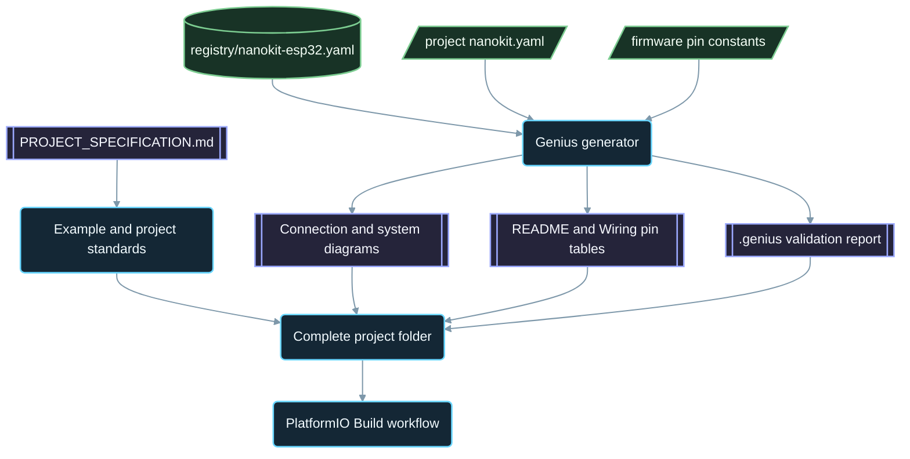

<div align="center">

# NanoKit-ESP32

**The official PlatformIO ecosystem for the NanoKit Integrated ESP32 Dev Board**

<p>
<strong>English</strong> ·
<a href="docs/i18n/README.zh-CN.md">简体中文</a> ·
<a href="docs/i18n/README.zh-TW.md">繁體中文</a> ·
<a href="docs/i18n/README.ja.md">日本語</a> ·
<a href="docs/i18n/README.ko.md">한국어</a> ·
<a href="docs/i18n/README.tr.md">Türkçe</a> ·
<a href="docs/i18n/README.ru.md">Русский</a> ·
<a href="docs/i18n/README.vi.md">Tiếng Việt</a> ·
<a href="docs/i18n/README.th.md">ไทย</a> ·
<a href="docs/i18n/README.de.md">Deutsch</a> ·
<a href="docs/i18n/README.es.md">Español</a> ·
<a href="docs/i18n/README.fr.md">Français</a> ·
<a href="docs/i18n/README.uk.md">Українська</a> ·
<a href="docs/i18n/README.pl.md">Polski</a> ·
<a href="docs/i18n/README.pt-BR.md">Português (Brasil)</a> ·
<a href="docs/i18n/README.ar.md">العربية</a> ·
<a href="docs/i18n/README.fa.md">فارسی</a> ·
<a href="docs/i18n/README.id.md">Bahasa Indonesia</a> ·
<a href="docs/i18n/README.it.md">Italiano</a> ·
<a href="docs/i18n/README.el.md">Ελληνικά</a> ·
<a href="docs/i18n/README.ml.md">മലയാളം</a> ·
<a href="docs/i18n/README.ur-Latn.md">Roman Urdu</a> ·
<a href="docs/i18n/README.ro.md">Română</a>
</p>

<p>
<a href="https://github.com/ProAmineOfficial/NanoKit-ESP32/stargazers"></a>
<a href="https://github.com/ProAmineOfficial/NanoKit-ESP32/commits/main"></a>
<a href="LICENSE"></a>
<a href="https://github.com/ProAmineOfficial/NanoKit-ESP32/actions/workflows/platformio-build.yml"></a>
<a href="https://github.com/ProAmineOfficial/NanoKit-ESP32/actions/workflows/repository-index.yml"></a>
</p>

<p>
<a href="https://proamine.tech"></a>
<a href="https://gitarchitecturediagram.com/ProAmineOfficial/NanoKit-ESP32"></a>

</p>

**Developed by Amine Saoud ibn al-Bashir.**

</div>

##  NanoKit Integrated ESP32 Pinout Datasheet


NanoKit Integrated ESP32 Dev Board is an embedded development platform for IoT, AI, robotics, education, and professional prototyping. This repository is organized for PlatformIO examples, complete applications, open-source projects, graduation projects, simulation resources, documentation, articles, tutorials, and reusable templates.

The NanoKit board is part of the wider UMT hardware vision, but this repository's firmware uses standard PlatformIO Arduino C++ and ESP32 GPIO numbers so every project compiles and runs directly in PlatformIO.

##  Repository Mission

This is not a demo repository and not a template repository. It is the official long-term NanoKit-ESP32 ecosystem repository for educational and professional embedded systems development: every project teaches the code, the wiring, the algorithm, the NanoKit pin mapping, and the troubleshooting path.

See [PROJECT_SPECIFICATION.md](PROJECT_SPECIFICATION.md) for the master repository rules, growth model, example standards, documentation requirements, and Definition of Done.

##  Quick Start

1. Install [VS Code](https://code.visualstudio.com/) with the [PlatformIO IDE](https://platformio.org/install/ide?install=vscode) extension, or the PlatformIO Core CLI.
2. Clone the repository and open an example. [`digital_input_output`](examples_on_platformio/digital_input_output/) is the first one to try: a button, an LED, and the onboard LED.
3. Connect NanoKit over USB, then build, upload, and open the Serial Monitor:

```bash
git clone https://github.com/ProAmineOfficial/NanoKit-ESP32.git
cd NanoKit-ESP32/examples_on_platformio/digital_input_output
pio run --target upload
pio device monitor -b 115200
```

Every project README lists the parts, the NanoKit pin table, the wiring order, and the expected Serial Monitor output.

##  Repository Layout

| Path | Purpose |
|---|---|
| [`examples_on_platformio/`](examples_on_platformio/README.md) | Focused PlatformIO examples without a user interface: one board feature, sensor, or module per example. |
| [`applications_on_platformio/`](applications_on_platformio/README.md) | Complete applications with a user interface, such as web apps served by NanoKit with buttons, sliders, and dashboards. |
| [`open_source_projects/`](open_source_projects/README.md) | Larger original NanoKit projects such as NanoKit Drone 4X, plus community, contributor, showcase, and hackathon areas. |
| [`graduation_projects/`](graduation_projects/README.md) | Bachelor, master, engineering, institute, capstone, and thesis project workspaces. |
| `tutorials/` | Beginner to advanced tutorials, project guides, and video link indexes. |
| `articles/` | Technical articles on embedded systems, IoT, AI, robotics, PlatformIO, NanoKit, and UMT. |
| `docs/` | Getting started, installation, hardware, software, API, troubleshooting, roadmap, architecture, and translations. |
| `registry/` | The NanoKit board as data: every header pin, GPIO, VR address, and electrical rule. |
| `tools/` | Repository automation: the Genius generator and the index generator. |
| `simulator/` | Web simulator, simulation engine, examples, and simulator assets. |
| `templates/` | Reusable templates for examples, applications, thesis work, and documentation. |
| `assets/` | Shared images, icons, logos, banners, and videos. |

##  Hardware Manifests and Generated Documentation

Every example, application, open-source project, and graduation project describes its hardware once, in a `nanokit.yaml` manifest. `python tools/genius/generate.py` validates it against the board registry [`registry/nanokit-esp32.yaml`](registry/nanokit-esp32.yaml) and against the pin constants in the firmware, then regenerates:

- `images/connection-diagram.md` and `images/system-diagram.md` with `Pin <NanoKit pin> / GPIO<n>` labels and Confirmed / Proposed / Blocked styling,
- the NanoKit pin table in each project README and the connection table in each `docs/Wiring.md`,
- `.genius/VALIDATION_REPORT.md` with the rules checked, the findings, and the code evidence.

A pin on the internal flash, an output on an input-only pin, a 5 V signal without level shifting, or a manifest that disagrees with the code stops the commit and the pull request. The reference project is [`examples_on_platformio/ultrasonic_distance/`](examples_on_platformio/ultrasonic_distance/). Schema and rules: [`tools/genius/README.md`](tools/genius/README.md). Design record: [`docs/software/genius-generator-spec.md`](docs/software/genius-generator-spec.md).

##  Generated Indexes

- [Repository Index](REPOSITORY_INDEX.md) summarizes the main repository areas and counts real projects (folders with a manifest).
- [Repository Tree](REPOSITORY_TREE.md) shows the generated file tree.
- [Project Backlog](docs/roadmap/project-backlog.md) lists every planned example, application, tutorial, and article in five waves; its Status column and the [roadmap summary](docs/roadmap/README.md) are refreshed automatically.
- Every PlatformIO project is compiled by the [PlatformIO Build workflow](.github/workflows/platformio-build.yml) on each push and pull request.

Run `python tools/genius/generate.py` and then `python tools/update_repository_index.py` after adding or changing a project. Enable the local hook once with `git config core.hooksPath .githooks`; the GitHub workflow runs the same two tools on every push to `main` and validates pull requests.

##  Interactive Repository Tree

The tree below is generated from the current repository contents. Select its title to expand or collapse it. The local pre-commit hook and the GitHub workflow refresh it automatically when projects or files are added, moved, or removed.

<details>
<summary> <strong>Open current NanoKit-ESP32 tree</strong></summary>

<!-- GENERATED_REPOSITORY_TREE:START -->
```text
NanoKit-ESP32/
|-- .githooks/
|   `-- pre-commit
|-- .github/
|   `-- workflows/
|       |-- deploy-documentation.yml
|       |-- platformio-build.yml
|       `-- repository-index.yml
|-- applications_on_platformio/
|   |-- face_rotation_tracking_camera/
|   |   |-- .genius/
|   |   |   |-- project.json
|   |   |   |-- README.md
|   |   |   `-- VALIDATION_REPORT.md
|   |   |-- assets/
|   |   |   `-- README.md
|   |   |-- docs/
|   |   |   `-- README.md
|   |   |-- esp32/
|   |   |   |-- docs/
|   |   |   |   |-- Implementation_Guide.md
|   |   |   |   `-- Wiring.md
|   |   |   |-- include/
|   |   |   |   `-- README.md
|   |   |   |-- lib/
|   |   |   |   `-- README.md
|   |   |   |-- src/
|   |   |   |   `-- main.cpp
|   |   |   |-- test/
|   |   |   |   `-- README.md
|   |   |   `-- platformio.ini
|   |   |-- images/
|   |   |   |-- connection-diagram.md
|   |   |   `-- system-diagram.md
|   |   |-- vision/
|   |   |   `-- README.md
|   |   |-- nanokit.yaml
|   |   `-- README.md
|   |-- industrial_monitoring/
|   |   `-- README.md
|   |-- smart_home_controller/
|   |   `-- README.md
|   |-- weather_station/
|   |   `-- README.md
|   |-- PROJECT_STANDARD.md
|   `-- README.md
|-- articles/
|   |-- ai/
|   |   `-- README.md
|   |-- embedded_systems/
|   |   `-- README.md
|   |-- iot/
|   |   `-- README.md
|   |-- nanokit/
|   |   `-- README.md
|   |-- platformio/
|   |   `-- README.md
|   |-- robotics/
|   |   `-- README.md
|   |-- umt_platform/
|   |   `-- README.md
|   `-- README.md
|-- assets/
|   |-- banners/
|   |   `-- .gitkeep
|   |-- icons/
|   |   |-- fluent/
|   |   |   |-- backhand-index-pointing-right.png
|   |   |   |-- bar-chart.png
|   |   |   |-- books.png
|   |   |   |-- brain.png
|   |   |   |-- building-construction.png
|   |   |   |-- bullseye.png
|   |   |   |-- check-mark-button.png
|   |   |   |-- deciduous-tree.png
|   |   |   |-- downwards-button.png
|   |   |   |-- e-mail.png
|   |   |   |-- electric-plug.png
|   |   |   |-- file-folder.png
|   |   |   |-- gear.png
|   |   |   |-- globe-showing-europe-africa.png
|   |   |   |-- globe-with-meridians.png
|   |   |   |-- graduation-cap.png
|   |   |   |-- hammer-and-wrench.png
|   |   |   |-- handshake.png
|   |   |   |-- helicopter.png
|   |   |   |-- laptop.png
|   |   |   |-- LICENSE
|   |   |   |-- light-bulb.png
|   |   |   |-- link.png
|   |   |   |-- locked-with-key.png
|   |   |   |-- memo.png
|   |   |   |-- movie-camera.png
|   |   |   |-- page-facing-up.png
|   |   |   |-- puzzle-piece.png
|   |   |   |-- robot.png
|   |   |   |-- rocket.png
|   |   |   |-- satellite-antenna.png
|   |   |   |-- scroll.png
|   |   |   |-- spiral-calendar.png
|   |   |   |-- star.png
|   |   |   |-- technologist.png
|   |   |   |-- telephone-receiver.png
|   |   |   `-- warning.png
|   |   `-- .gitkeep
|   |-- images/
|   |   |-- .gitkeep
|   |   `-- nanokit-integrated-esp32-pinout-v2020-smd-tht.jpg
|   |-- logos/
|   |   `-- .gitkeep
|   |-- videos/
|   |   `-- .gitkeep
|   `-- README.md
|-- docs/
|   |-- api/
|   |   `-- README.md
|   |-- architecture/
|   |   `-- README.md
|   |-- audits/
|   |   `-- 2026-10-25-repository-audit.md
|   |-- getting_started/
|   |   `-- README.md
|   |-- hardware/
|   |   |-- nanokit-integrated-esp32-pinout.md
|   |   `-- README.md
|   |-- i18n/
|   |   |-- README.ar.md
|   |   |-- README.de.md
|   |   |-- README.el.md
|   |   |-- README.es.md
|   |   |-- README.fa.md
|   |   |-- README.fr.md
|   |   |-- README.id.md
|   |   |-- README.it.md
|   |   |-- README.ja.md
|   |   |-- README.ko.md
|   |   |-- README.md
|   |   |-- README.ml.md
|   |   |-- README.pl.md
|   |   |-- README.pt-BR.md
|   |   |-- README.ro.md
|   |   |-- README.ru.md
|   |   |-- README.th.md
|   |   |-- README.tr.md
|   |   |-- README.uk.md
|   |   |-- README.ur-Latn.md
|   |   |-- README.vi.md
|   |   |-- README.zh-CN.md
|   |   `-- README.zh-TW.md
|   |-- installation/
|   |   `-- README.md
|   |-- roadmap/
|   |   |-- project-backlog.md
|   |   `-- README.md
|   |-- software/
|   |   |-- genius-generator-spec.md
|   |   |-- platformio-example-standard.md
|   |   `-- README.md
|   |-- troubleshooting/
|   |   `-- README.md
|   |-- docs-workstation.css
|   |-- docs-workstation.js
|   |-- index.html
|   `-- README.md
|-- examples_on_platformio/
|   |-- analog_input_potentiometer/
|   |   |-- .genius/
|   |   |   |-- project.json
|   |   |   |-- README.md
|   |   |   `-- VALIDATION_REPORT.md
|   |   |-- .vscode/
|   |   |   `-- extensions.json
|   |   |-- assets/
|   |   |   `-- README.md
|   |   |-- docs/
|   |   |   |-- Implementation_Guide.md
|   |   |   `-- Wiring.md
|   |   |-- images/
|   |   |   |-- connection-diagram.md
|   |   |   `-- system-diagram.md
|   |   |-- include/
|   |   |   `-- README.md
|   |   |-- lib/
|   |   |   `-- README.md
|   |   |-- src/
|   |   |   `-- main.cpp
|   |   |-- test/
|   |   |   `-- README.md
|   |   |-- .gitignore
|   |   |-- nanokit.yaml
|   |   |-- platformio.ini
|   |   `-- README.md
|   |-- camera_tracking/
|   |   |-- .genius/
|   |   |   |-- project.json
|   |   |   |-- README.md
|   |   |   `-- VALIDATION_REPORT.md
|   |   |-- assets/
|   |   |   `-- README.md
|   |   |-- docs/
|   |   |   |-- Implementation_Guide.md
|   |   |   `-- Wiring.md
|   |   |-- images/
|   |   |   |-- connection-diagram.md
|   |   |   `-- system-diagram.md
|   |   |-- include/
|   |   |   `-- README.md
|   |   |-- lib/
|   |   |   `-- README.md
|   |   |-- src/
|   |   |   `-- main.cpp
|   |   |-- test/
|   |   |   `-- README.md
|   |   |-- nanokit.yaml
|   |   |-- platformio.ini
|   |   `-- README.md
|   |-- deep_sleep_wakeup/
|   |   |-- .genius/
|   |   |   |-- project.json
|   |   |   |-- README.md
|   |   |   `-- VALIDATION_REPORT.md
|   |   |-- .vscode/
|   |   |   `-- extensions.json
|   |   |-- assets/
|   |   |   `-- README.md
|   |   |-- docs/
|   |   |   |-- Implementation_Guide.md
|   |   |   `-- Wiring.md
|   |   |-- images/
|   |   |   |-- connection-diagram.md
|   |   |   `-- system-diagram.md
|   |   |-- include/
|   |   |   `-- README.md
|   |   |-- lib/
|   |   |   `-- README.md
|   |   |-- src/
|   |   |   `-- main.cpp
|   |   |-- test/
|   |   |   `-- README.md
|   |   |-- .gitignore
|   |   |-- nanokit.yaml
|   |   |-- platformio.ini
|   |   `-- README.md
|   |-- digital_input_output/
|   |   |-- .genius/
|   |   |   |-- project.json
|   |   |   |-- README.md
|   |   |   `-- VALIDATION_REPORT.md
|   |   |-- .vscode/
|   |   |   `-- extensions.json
|   |   |-- assets/
|   |   |   `-- README.md
|   |   |-- docs/
|   |   |   |-- Implementation_Guide.md
|   |   |   `-- Wiring.md
|   |   |-- images/
|   |   |   |-- connection-diagram.md
|   |   |   `-- system-diagram.md
|   |   |-- include/
|   |   |   `-- README.md
|   |   |-- lib/
|   |   |   `-- README.md
|   |   |-- src/
|   |   |   `-- main.cpp
|   |   |-- test/
|   |   |   `-- README.md
|   |   |-- .gitignore
|   |   |-- nanokit.yaml
|   |   |-- platformio.ini
|   |   `-- README.md
|   |-- dual_core_tasks/
|   |   |-- .genius/
|   |   |   |-- project.json
|   |   |   |-- README.md
|   |   |   `-- VALIDATION_REPORT.md
|   |   |-- .vscode/
|   |   |   `-- extensions.json
|   |   |-- assets/
|   |   |   `-- README.md
|   |   |-- docs/
|   |   |   |-- Implementation_Guide.md
|   |   |   `-- Wiring.md
|   |   |-- images/
|   |   |   |-- connection-diagram.md
|   |   |   `-- system-diagram.md
|   |   |-- include/
|   |   |   `-- README.md
|   |   |-- lib/
|   |   |   `-- README.md
|   |   |-- src/
|   |   |   `-- main.cpp
|   |   |-- test/
|   |   |   `-- README.md
|   |   |-- .gitignore
|   |   |-- nanokit.yaml
|   |   |-- platformio.ini
|   |   `-- README.md
|   |-- hall_sensor/
|   |   |-- .genius/
|   |   |   |-- project.json
|   |   |   |-- README.md
|   |   |   `-- VALIDATION_REPORT.md
|   |   |-- .vscode/
|   |   |   `-- extensions.json
|   |   |-- assets/
|   |   |   `-- README.md
|   |   |-- docs/
|   |   |   |-- Implementation_Guide.md
|   |   |   `-- Wiring.md
|   |   |-- images/
|   |   |   |-- connection-diagram.md
|   |   |   `-- system-diagram.md
|   |   |-- include/
|   |   |   `-- README.md
|   |   |-- lib/
|   |   |   `-- README.md
|   |   |-- src/
|   |   |   `-- main.cpp
|   |   |-- test/
|   |   |   `-- README.md
|   |   |-- .gitignore
|   |   |-- nanokit.yaml
|   |   |-- platformio.ini
|   |   `-- README.md
|   |-- i2c_scanner/
|   |   |-- .genius/
|   |   |   |-- project.json
|   |   |   |-- README.md
|   |   |   `-- VALIDATION_REPORT.md
|   |   |-- .vscode/
|   |   |   `-- extensions.json
|   |   |-- assets/
|   |   |   `-- README.md
|   |   |-- docs/
|   |   |   |-- Implementation_Guide.md
|   |   |   `-- Wiring.md
|   |   |-- images/
|   |   |   |-- connection-diagram.md
|   |   |   `-- system-diagram.md
|   |   |-- include/
|   |   |   `-- README.md
|   |   |-- lib/
|   |   |   `-- README.md
|   |   |-- src/
|   |   |   `-- main.cpp
|   |   |-- test/
|   |   |   `-- README.md
|   |   |-- .gitignore
|   |   |-- nanokit.yaml
|   |   |-- platformio.ini
|   |   `-- README.md
|   |-- interrupts_and_timers/
|   |   |-- .genius/
|   |   |   |-- project.json
|   |   |   |-- README.md
|   |   |   `-- VALIDATION_REPORT.md
|   |   |-- .vscode/
|   |   |   `-- extensions.json
|   |   |-- assets/
|   |   |   `-- README.md
|   |   |-- docs/
|   |   |   |-- Implementation_Guide.md
|   |   |   `-- Wiring.md
|   |   |-- images/
|   |   |   |-- connection-diagram.md
|   |   |   `-- system-diagram.md
|   |   |-- include/
|   |   |   `-- README.md
|   |   |-- lib/
|   |   |   `-- README.md
|   |   |-- src/
|   |   |   `-- main.cpp
|   |   |-- test/
|   |   |   `-- README.md
|   |   |-- .gitignore
|   |   |-- nanokit.yaml
|   |   |-- platformio.ini
|   |   `-- README.md
|   |-- preferences_flash_storage/
|   |   |-- .genius/
|   |   |   |-- project.json
|   |   |   |-- README.md
|   |   |   `-- VALIDATION_REPORT.md
|   |   |-- .vscode/
|   |   |   `-- extensions.json
|   |   |-- assets/
|   |   |   `-- README.md
|   |   |-- docs/
|   |   |   |-- Implementation_Guide.md
|   |   |   `-- Wiring.md
|   |   |-- images/
|   |   |   |-- connection-diagram.md
|   |   |   `-- system-diagram.md
|   |   |-- include/
|   |   |   `-- README.md
|   |   |-- lib/
|   |   |   `-- README.md
|   |   |-- src/
|   |   |   `-- main.cpp
|   |   |-- test/
|   |   |   `-- README.md
|   |   |-- .gitignore
|   |   |-- nanokit.yaml
|   |   |-- platformio.ini
|   |   `-- README.md
|   |-- pwm_led_fade/
|   |   |-- .genius/
|   |   |   |-- project.json
|   |   |   |-- README.md
|   |   |   `-- VALIDATION_REPORT.md
|   |   |-- .vscode/
|   |   |   `-- extensions.json
|   |   |-- assets/
|   |   |   `-- README.md
|   |   |-- docs/
|   |   |   |-- Implementation_Guide.md
|   |   |   `-- Wiring.md
|   |   |-- images/
|   |   |   |-- connection-diagram.md
|   |   |   `-- system-diagram.md
|   |   |-- include/
|   |   |   `-- README.md
|   |   |-- lib/
|   |   |   `-- README.md
|   |   |-- src/
|   |   |   `-- main.cpp
|   |   |-- test/
|   |   |   `-- README.md
|   |   |-- .gitignore
|   |   |-- nanokit.yaml
|   |   |-- platformio.ini
|   |   `-- README.md
|   |-- stepper_motor_control/
|   |   |-- .genius/
|   |   |   |-- project.json
|   |   |   |-- README.md
|   |   |   `-- VALIDATION_REPORT.md
|   |   |-- assets/
|   |   |   `-- README.md
|   |   |-- docs/
|   |   |   |-- Implementation_Guide.md
|   |   |   `-- Wiring.md
|   |   |-- images/
|   |   |   |-- connection-diagram.md
|   |   |   `-- system-diagram.md
|   |   |-- include/
|   |   |   `-- README.md
|   |   |-- lib/
|   |   |   `-- README.md
|   |   |-- src/
|   |   |   `-- main.cpp
|   |   |-- test/
|   |   |   `-- README.md
|   |   |-- nanokit.yaml
|   |   |-- platformio.ini
|   |   `-- README.md
|   |-- touch_sensor/
|   |   |-- .genius/
|   |   |   |-- project.json
|   |   |   |-- README.md
|   |   |   `-- VALIDATION_REPORT.md
|   |   |-- .vscode/
|   |   |   `-- extensions.json
|   |   |-- assets/
|   |   |   `-- README.md
|   |   |-- docs/
|   |   |   |-- Implementation_Guide.md
|   |   |   `-- Wiring.md
|   |   |-- images/
|   |   |   |-- connection-diagram.md
|   |   |   `-- system-diagram.md
|   |   |-- include/
|   |   |   `-- README.md
|   |   |-- lib/
|   |   |   `-- README.md
|   |   |-- src/
|   |   |   `-- main.cpp
|   |   |-- test/
|   |   |   `-- README.md
|   |   |-- .gitignore
|   |   |-- nanokit.yaml
|   |   |-- platformio.ini
|   |   `-- README.md
|   |-- ultrasonic_distance/
|   |   |-- .genius/
|   |   |   |-- project.json
|   |   |   |-- README.md
|   |   |   `-- VALIDATION_REPORT.md
|   |   |-- .vscode/
|   |   |   `-- extensions.json
|   |   |-- assets/
|   |   |   `-- README.md
|   |   |-- docs/
|   |   |   |-- Implementation_Guide.md
|   |   |   `-- Wiring.md
|   |   |-- images/
|   |   |   |-- connection-diagram.md
|   |   |   `-- system-diagram.md
|   |   |-- include/
|   |   |   `-- README.md
|   |   |-- lib/
|   |   |   `-- README.md
|   |   |-- src/
|   |   |   `-- main.cpp
|   |   |-- test/
|   |   |   `-- README.md
|   |   |-- .gitignore
|   |   |-- nanokit.yaml
|   |   |-- platformio.ini
|   |   `-- README.md
|   |-- PROJECT_STANDARD.md
|   `-- README.md
|-- graduation_projects/
|   |-- bachelor_projects/
|   |   `-- README.md
|   |-- capstone_projects/
|   |   `-- README.md
|   |-- engineering_projects/
|   |   `-- README.md
|   |-- institute_projects/
|   |   `-- README.md
|   |-- master_projects/
|   |   `-- README.md
|   |-- templates/
|   |   `-- README.md
|   |-- university_thesis/
|   |   `-- README.md
|   |-- PROJECT_STANDARD.md
|   `-- README.md
|-- open_source_projects/
|   |-- community_projects/
|   |   `-- README.md
|   |-- contributor_projects/
|   |   `-- README.md
|   |-- hackathon_projects/
|   |   `-- README.md
|   |-- nanokit_drone_4x_quadcopter/
|   |   |-- .genius/
|   |   |   |-- project.json
|   |   |   |-- README.md
|   |   |   `-- VALIDATION_REPORT.md
|   |   |-- assets/
|   |   |   `-- README.md
|   |   |-- camera_node/
|   |   |   |-- include/
|   |   |   |   |-- audio_service.h
|   |   |   |   |-- camera_node_config.h
|   |   |   |   |-- camera_service.h
|   |   |   |   `-- recording_service.h
|   |   |   |-- src/
|   |   |   |   |-- audio_service.cpp
|   |   |   |   |-- camera_service.cpp
|   |   |   |   |-- main.cpp
|   |   |   |   `-- recording_service.cpp
|   |   |   |-- platformio.ini
|   |   |   `-- README.md
|   |   |-- docs/
|   |   |   |-- Architecture.md
|   |   |   |-- Bill_of_Materials.md
|   |   |   |-- Bluetooth_Protocol.md
|   |   |   |-- Calibration.md
|   |   |   |-- Camera_Audio_Node.md
|   |   |   |-- Camera_Integration.md
|   |   |   |-- Open_Source_References.md
|   |   |   |-- PID_Tuning.md
|   |   |   |-- Safety.md
|   |   |   |-- Sensor_Integration.md
|   |   |   |-- Testing.md
|   |   |   |-- WiFi_WebSocket_Protocol.md
|   |   |   `-- Wiring.md
|   |   |-- firmware/
|   |   |   |-- .vscode/
|   |   |   |   `-- extensions.json
|   |   |   |-- include/
|   |   |   |   |-- config/
|   |   |   |   |   |-- board_config.h
|   |   |   |   |   `-- feature_flags.h
|   |   |   |   |-- control/
|   |   |   |   |   |-- flight_controller.h
|   |   |   |   |   |-- motor_mixer.h
|   |   |   |   |   `-- pid_controller.h
|   |   |   |   |-- core/
|   |   |   |   |   |-- flight_types.h
|   |   |   |   |   `-- safety_manager.h
|   |   |   |   |-- navigation/
|   |   |   |   |   `-- navigation_manager.h
|   |   |   |   |-- network/
|   |   |   |   |   `-- flight_link.h
|   |   |   |   |-- sensors/
|   |   |   |   |   `-- sensor_hub.h
|   |   |   |   |-- storage/
|   |   |   |   |   `-- config_store.h
|   |   |   |   `-- README.md
|   |   |   |-- lib/
|   |   |   |   `-- README.md
|   |   |   |-- src/
|   |   |   |   |-- control/
|   |   |   |   |   |-- flight_controller.cpp
|   |   |   |   |   `-- motor_mixer.cpp
|   |   |   |   |-- core/
|   |   |   |   |   |-- flight_types.cpp
|   |   |   |   |   `-- safety_manager.cpp
|   |   |   |   |-- navigation/
|   |   |   |   |   `-- navigation_manager.cpp
|   |   |   |   |-- network/
|   |   |   |   |   `-- flight_link.cpp
|   |   |   |   |-- sensors/
|   |   |   |   |   `-- sensor_hub.cpp
|   |   |   |   |-- storage/
|   |   |   |   |   `-- config_store.cpp
|   |   |   |   `-- main.cpp
|   |   |   |-- test/
|   |   |   |   `-- README.md
|   |   |   |-- web_control/
|   |   |   |   |-- assets/
|   |   |   |   |   `-- nanokit-drone-4x-reference.png
|   |   |   |   |-- app.js
|   |   |   |   |-- index.html
|   |   |   |   |-- manifest.json
|   |   |   |   |-- README.md
|   |   |   |   `-- styles.css
|   |   |   |-- .gitignore
|   |   |   `-- platformio.ini
|   |   |-- images/
|   |   |   |-- camera-wiring.md
|   |   |   |-- connection-diagram.md
|   |   |   |-- control-loop.md
|   |   |   |-- motor-layout.md
|   |   |   `-- system-diagram.md
|   |   |-- nanokit.yaml
|   |   |-- project.yml
|   |   `-- README.md
|   |-- showcase_projects/
|   |   `-- README.md
|   |-- templates/
|   |   `-- README.md
|   |-- PROJECT_STANDARD.md
|   `-- README.md
|-- registry/
|   |-- nanokit-esp32.yaml
|   `-- README.md
|-- simulator/
|   |-- assets/
|   |   `-- .gitkeep
|   |-- engine/
|   |   `-- README.md
|   |-- examples/
|   |   `-- README.md
|   |-- web/
|   |   `-- README.md
|   `-- README.md
|-- templates/
|   |-- application_template/
|   |   `-- README.md
|   |-- documentation_template/
|   |   `-- README.md
|   |-- example_template/
|   |   `-- README.md
|   |-- thesis_template/
|   |   `-- README.md
|   `-- README.md
|-- tools/
|   |-- genius/
|   |   |-- tests/
|   |   |   `-- test_generate.py
|   |   |-- generate.py
|   |   `-- README.md
|   |-- README.md
|   |-- sync_with_github.ps1
|   `-- update_repository_index.py
|-- tutorials/
|   |-- advanced/
|   |   `-- README.md
|   |-- beginner/
|   |   `-- README.md
|   |-- intermediate/
|   |   `-- README.md
|   |-- projects/
|   |   `-- README.md
|   |-- video_links/
|   |   `-- README.md
|   `-- README.md
|-- .gitattributes
|-- .gitignore
|-- CHANGELOG.md
|-- CONTRIBUTING.md
|-- DEVELOPMENT_CREDIT.md
|-- LICENSE
|-- NOTICE
|-- PROJECT_SPECIFICATION.md
|-- README.md
|-- REPOSITORY_INDEX.md
`-- REPOSITORY_TREE.md
```
<!-- GENERATED_REPOSITORY_TREE:END -->

</details>

##  How the Repository Is Built



##  Featured Open-Source Project

[NanoKit Drone 4X (Quadcopter)](open_source_projects/nanokit_drone_4x_quadcopter/README.md) is the repository's safety-first Quad-X flight-control reference. A NanoKit flight controller runs a 250 Hz control loop with Quad-X motor mixing and safety gates, a browser Flight Deck connects over Wi-Fi and WebSocket, and a second NanoKit runs an isolated camera and audio payload with no motor authority. The project is in bench development: propellers stay removed and motor output stays at the safe minimum until the ESC protocol is verified.

##  Quality Contract

Official content in this repository should be production-ready, educational, complete, and maintainable.

- Do not leave directories empty as final work.
- Do not add placeholder content when real educational material can be provided.
- Build on existing work instead of overwriting it unnecessarily.
- Every example teaches the code, wiring, algorithm, pin mapping, and troubleshooting path.
- Every hardware example documents NanoKit pin numbers and ESP32 GPIO numbers, written in full as "Pin 36 / GPIO5".

Use [docs/software/platformio-example-standard.md](docs/software/platformio-example-standard.md) when creating or reviewing examples.

##  PlatformIO Baseline

PlatformIO projects use the ESP32 Arduino framework as the first public baseline:

```ini
[env:nanokit_esp32]
; espressif32 8.0.0 = Arduino-ESP32 core 3.3.12, pinned so a platform update cannot break the build
platform = espressif32 @ 8.0.0
board = esp32dev
framework = arduino
monitor_speed = 115200
upload_speed = 921600
```

Dedicated NanoKit board definitions can replace the generic `esp32dev` board profile as the hardware package evolves.

##  Firmware Rule

Official examples in this repository must use:

- PlatformIO
- Arduino framework for ESP32
- C++
- Markdown documentation
- Normal ESP32 GPIO numbers in source code

Do not use UMT SDK code or Virtual Register API code in PlatformIO examples.

##  Hardware Pinout

Use [docs/hardware/nanokit-integrated-esp32-pinout.md](docs/hardware/nanokit-integrated-esp32-pinout.md) as the source of truth for NanoKit pin numbers, ESP32 GPIO mappings, electrical notes, and warnings.

Every hardware example documents:

```text
NanoKit Pin -> GPIO -> Component Pin -> Description
```

Important restrictions:

- GPIO34, GPIO35, GPIO36, and GPIO39 are input-only.
- GPIO6, GPIO7, GPIO8, GPIO9, GPIO10, and GPIO11 are internal SPI flash pins and must not be used.
- GPIO0 is the BOOT pin.
- GPIO1 and GPIO3 are shared with USB Serial.
- EN is Reset / Enable and is not a GPIO.

##  Roadmap

The [Project Backlog](docs/roadmap/project-backlog.md) plans the library in five waves: board fundamentals, sensors and modules, web applications, protocols and cloud, and external modules. The [roadmap summary](docs/roadmap/README.md) shows how many projects of each wave are done.

##  Contributing

Contributions are welcome. Read [CONTRIBUTING.md](CONTRIBUTING.md) first: it explains the project standards, the `nanokit.yaml` manifest, the pre-commit hook, and the license of contributions.

##  Translations

This README is available in 23 languages through the language bar at the top. The translations live in [`docs/i18n/`](docs/i18n/); when a translation and this English README differ, the English README is authoritative.

##  Support

-  Website: [https://proamine.tech](https://proamine.tech)
-  Git Architecture Diagram: [https://gitarchitecturediagram.com](https://gitarchitecturediagram.com/ProAmineOfficial/NanoKit-ESP32)
-  Email: `technology@proamine.tech`
-  TikTok: [@pro_amine](https://www.tiktok.com/@pro_amine)
-  YouTube: [@pro_amine](https://www.youtube.com/@pro_amine)

##  License

NanoKit-ESP32 is licensed under the [GNU Affero General Public License v3.0 only](LICENSE) (`AGPL-3.0-only`), with additional terms under section 7 listed in [NOTICE](NOTICE):

- **Attribution:** every copy or modified version keeps the line "Developed by Amine Saoud ibn al-Bashir." and states that it is based on NanoKit-ESP32 by Amine Saoud ibn al-Bashir (Pro_Amine LLC).
- **Modified versions** are marked as different from the original and are not presented as the official NanoKit-ESP32 repository.
- **Names:** no rights are granted to the names NanoKit, Pro_Amine, or UMT, or to their logos; a redistributed version uses its own name.
- **Network use:** if you run a modified version as a network service, the AGPL requires you to offer its source code to its users.

You are free to study, use, and modify this code for learning, teaching, research, and your own projects under these terms. Versions published before the switch to the AGPL were distributed under the Apache License 2.0. The Fluent Emoji icons in `assets/icons/fluent/` are © Microsoft Corporation under the MIT License.

<div align="center">

**Developed by Amine Saoud ibn al-Bashir · © 2026 Pro_Amine LLC**

</div>
