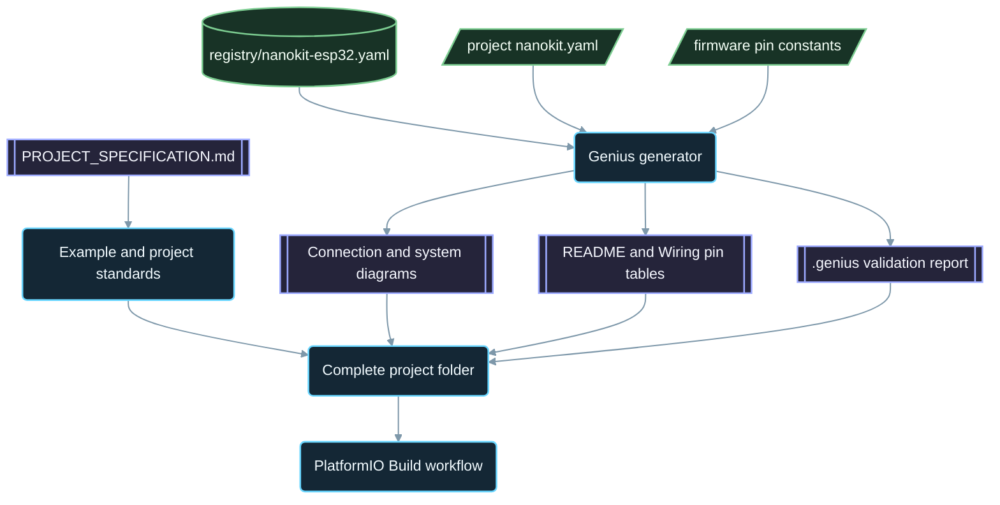

<div align="center">

# NanoKit-ESP32

**منظومة PlatformIO الرسمية للوحة التطوير NanoKit Integrated ESP32**

<p>
<a href="../../README.md">English</a> ·
<a href="README.zh-CN.md">简体中文</a> ·
<a href="README.zh-TW.md">繁體中文</a> ·
<a href="README.ja.md">日本語</a> ·
<a href="README.ko.md">한국어</a> ·
<a href="README.tr.md">Türkçe</a> ·
<a href="README.ru.md">Русский</a> ·
<a href="README.vi.md">Tiếng Việt</a> ·
<a href="README.th.md">ไทย</a> ·
<a href="README.de.md">Deutsch</a> ·
<a href="README.es.md">Español</a> ·
<a href="README.fr.md">Français</a> ·
<a href="README.uk.md">Українська</a> ·
<a href="README.pl.md">Polski</a> ·
<a href="README.pt-BR.md">Português (Brasil)</a> ·
<strong>العربية</strong> ·
<a href="README.fa.md">فارسی</a> ·
<a href="README.id.md">Bahasa Indonesia</a> ·
<a href="README.it.md">Italiano</a> ·
<a href="README.el.md">Ελληνικά</a> ·
<a href="README.ml.md">മലയാളം</a> ·
<a href="README.ur-Latn.md">Roman Urdu</a> ·
<a href="README.ro.md">Română</a>
</p>

<p>
<a href="https://github.com/ProAmineOfficial/NanoKit-ESP32/stargazers"></a>
<a href="https://github.com/ProAmineOfficial/NanoKit-ESP32/commits/main"></a>
<a href="../../LICENSE"></a>
<a href="https://github.com/ProAmineOfficial/NanoKit-ESP32/actions/workflows/platformio-build.yml"></a>
<a href="https://github.com/ProAmineOfficial/NanoKit-ESP32/actions/workflows/repository-index.yml"></a>
</p>

<p>
<a href="https://proamine.tech"></a>
<a href="https://gitarchitecturediagram.com/ProAmineOfficial/NanoKit-ESP32"></a>

</p>

**Developed by Amine Saoud ibn al-Bashir.**

</div>

<div dir="rtl">

> **ملاحظة حول الترجمة:** هذه الصفحة ترجمة [لملف README باللغة الإنجليزية](../../README.md). وعند وجود أي اختلاف بين النسختين، يكون ملف README الإنجليزي هو المرجع المعتمد.

##  ورقة بيانات مخطط أطراف لوحة NanoKit Integrated ESP32


لوحة التطوير NanoKit Integrated ESP32 منصّة لتطوير الأنظمة المدمجة موجّهة لإنترنت الأشياء (IoT) والذكاء الاصطناعي والروبوتات والتعليم والنمذجة الأولية الاحترافية. وقد نُظِّم هذا المستودع ليضمّ أمثلة PlatformIO، وتطبيقات متكاملة، ومشاريع مفتوحة المصدر، ومشاريع تخرّج، وموارد للمحاكاة، ووثائق، ومقالات، ودروسًا تعليمية، وقوالب قابلة لإعادة الاستخدام.

تُعدّ لوحة NanoKit جزءًا من رؤية UMT الأوسع في مجال العتاد، غير أنّ البرنامج الثابت (firmware) في هذا المستودع يعتمد لغة C++ القياسية ضمن إطار Arduino في PlatformIO، وأرقام GPIO المعتادة في ESP32، بحيث يُبنى كل مشروع ويعمل مباشرةً في PlatformIO.

##  رسالة المستودع

ليس هذا مستودعًا للعروض التوضيحية ولا مستودعًا للقوالب، بل هو المستودع الرسمي طويل الأمد لمنظومة NanoKit-ESP32، المخصّص لتطوير الأنظمة المدمجة في المجالين التعليمي والاحترافي: فكل مشروع يشرح الشيفرة، والتوصيلات، والخوارزمية، وتوزيع أطراف NanoKit، ومسار تشخيص الأعطال وإصلاحها.

راجع [PROJECT_SPECIFICATION.md](../../PROJECT_SPECIFICATION.md) للاطلاع على القواعد الرئيسية للمستودع، ونموذج نموّه، ومعايير الأمثلة، ومتطلبات التوثيق، و«تعريف الإنجاز» (Definition of Done).

##  البدء السريع

1. ثبّت [VS Code](https://code.visualstudio.com/) مع إضافة [PlatformIO IDE](https://platformio.org/install/ide?install=vscode)، أو ثبّت أداة سطر الأوامر PlatformIO Core CLI.
2. استنسخ المستودع وافتح أحد الأمثلة. والمثال [`digital_input_output`](../../examples_on_platformio/digital_input_output/) هو أول ما ينبغي تجربته: زرّ ومصباح LED، إضافةً إلى مصباح LED المدمج في اللوحة.
3. وصِّل لوحة NanoKit عبر USB، ثم ابنِ المشروع وارفعه إلى اللوحة وافتح Serial Monitor:

```bash
git clone https://github.com/ProAmineOfficial/NanoKit-ESP32.git
cd NanoKit-ESP32/examples_on_platformio/digital_input_output
pio run --target upload
pio device monitor -b 115200
```

يسرد ملف README الخاص بكل مشروع القطعَ المطلوبة، وجدولَ أطراف NanoKit، وترتيبَ التوصيل، والمخرجاتِ المتوقعة في Serial Monitor.

##  بنية المستودع

| المسار | الغرض |
|---|---|
| [`examples_on_platformio/`](../../examples_on_platformio/README.md) | أمثلة PlatformIO مركّزة دون واجهة مستخدم: ميزة واحدة من ميزات اللوحة، أو مستشعر واحد، أو وحدة (module) واحدة في كل مثال. |
| [`applications_on_platformio/`](../../applications_on_platformio/README.md) | تطبيقات متكاملة بواجهة مستخدم، مثل تطبيقات الويب التي تستضيفها لوحة NanoKit نفسها وتتضمن أزرارًا ومنزلقات ولوحات معلومات. |
| [`open_source_projects/`](../../open_source_projects/README.md) | مشاريع NanoKit أصلية أكبر حجمًا مثل NanoKit Drone 4X، إضافةً إلى أقسام للمجتمع والمساهمين وعرض المشاريع والهاكاثونات. |
| [`graduation_projects/`](../../graduation_projects/README.md) | مساحات عمل لمشاريع الإجازة (البكالوريوس) والماستر (الماجستير) والهندسة والمعاهد والمشاريع الختامية والأطروحات. |
| `tutorials/` | دروس تعليمية من مستوى المبتدئين إلى المستوى المتقدم، وأدلّة للمشاريع، وفهارس لروابط الفيديو. |
| `articles/` | مقالات تقنية حول الأنظمة المدمجة وإنترنت الأشياء والذكاء الاصطناعي والروبوتات وPlatformIO وNanoKit وUMT. |
| `docs/` | البدء، والتثبيت، والعتاد، والبرمجيات، وواجهة API، وتشخيص الأعطال، وخارطة الطريق، والبنية المعمارية، والترجمات. |
| `registry/` | لوحة NanoKit في صورة بيانات: كل طرف من أطراف الموصّلات، وكل منفذ GPIO، وكل عنوان VR، وكل قاعدة كهربائية. |
| `tools/` | أتمتة المستودع: مولِّد Genius ومولِّد الفهرس. |
| `simulator/` | محاكٍ يعمل على الويب، ومحرّك محاكاة، وأمثلة، وموارد المحاكي. |
| `templates/` | قوالب قابلة لإعادة الاستخدام للأمثلة والتطبيقات وأعمال الأطروحات والتوثيق. |
| `assets/` | صور وأيقونات وشعارات ولافتات ومقاطع فيديو مشتركة. |

##  ملفات بيان العتاد والتوثيق المولَّد آليًا

يصف كل مثال وتطبيق ومشروع مفتوح المصدر ومشروع تخرّج عتادَه مرةً واحدة فقط، في ملف بيان (manifest) باسم `nanokit.yaml`. ويتحقق الأمر `python tools/genius/generate.py` من صحته بمقارنته بسجلّ اللوحة [`registry/nanokit-esp32.yaml`](../../registry/nanokit-esp32.yaml) وبثوابت الأطراف المعرَّفة في البرنامج الثابت، ثم يعيد توليد ما يلي:

- الملفين `images/connection-diagram.md` و`images/system-diagram.md` مع تسميات من الشكل `Pin <NanoKit pin> / GPIO<n>` وتنسيقٍ يميّز الحالات Confirmed / Proposed / Blocked (مؤكَّد / مقترَح / محظور)،
- جدول أطراف NanoKit في ملف README لكل مشروع، وجدول التوصيلات في كل ملف `docs/Wiring.md`،
- الملف `.genius/VALIDATION_REPORT.md` متضمّنًا القواعد التي جرى فحصها، والنتائج، والأدلة المستخرجة من الشيفرة.

يُوقَف الإيداع (commit) وطلب الدمج (pull request) في أيٍّ من الحالات الآتية: طرفٌ موصول بذاكرة الفلاش الداخلية، أو خرجٌ على طرفٍ مخصّص للإدخال فقط، أو إشارة بجهد 5 V دون محوِّل لمستوى الجهد، أو ملف بيان لا يتطابق مع الشيفرة. والمشروع المرجعي هو [`examples_on_platformio/ultrasonic_distance/`](../../examples_on_platformio/ultrasonic_distance/). المخطط (Schema) والقواعد: [`tools/genius/README.md`](../../tools/genius/README.md). سجلّ التصميم: [`docs/software/genius-generator-spec.md`](../../docs/software/genius-generator-spec.md).

##  الفهارس المولَّدة آليًا

- يلخّص [فهرس المستودع](../../REPOSITORY_INDEX.md) الأقسامَ الرئيسية للمستودع، ويُحصي المشاريع الفعلية (أي المجلدات التي تحتوي على ملف بيان).
- تعرض [شجرة المستودع](../../REPOSITORY_TREE.md) شجرة الملفات المولَّدة آليًا.
- يسرد [سجلّ المشاريع المخطَّطة](../../docs/roadmap/project-backlog.md) كل مثال وتطبيق ودرس ومقال مُدرَج في الخطة، موزَّعةً على خمس موجات؛ ويُحدَّث عمود الحالة (Status) فيه و[ملخص خارطة الطريق](../../docs/roadmap/README.md) تلقائيًا.
- يُبنى كل مشروع PlatformIO بواسطة [سير عمل PlatformIO Build](../../.github/workflows/platformio-build.yml) عند كل دفع (push) وكل طلب دمج.

شغّل `python tools/genius/generate.py` ثم `python tools/update_repository_index.py` بعد إضافة مشروع أو تعديله. فعّل الخطّاف (hook) المحلي مرةً واحدة بالأمر `git config core.hooksPath .githooks`؛ ويشغّل سير عمل GitHub الأداتين نفسيهما عند كل دفع إلى الفرع `main`، كما يتحقق من طلبات الدمج.

##  شجرة المستودع التفاعلية

تُولَّد الشجرة أدناه آليًا من المحتوى الحالي للمستودع. انقر على عنوانها لتوسيعها أو طيّها. ويتولى خطّاف pre-commit المحلي وسير عمل GitHub تحديثها تلقائيًا عند إضافة مشاريع أو ملفات أو نقلها أو حذفها.

توجد الشجرة الكاملة المولَّدة آليًا في [REPOSITORY_TREE.md](../../REPOSITORY_TREE.md)؛ ويعرضها ملف README الإنجليزي في شكل قائمة قابلة للتوسيع.

##  كيف يُبنى المستودع



##  مشروع مفتوح المصدر مميَّز

يُعدّ [NanoKit Drone 4X (طائرة رباعية المراوح)](../../open_source_projects/nanokit_drone_4x_quadcopter/README.md) المرجعَ الخاص بالتحكم في الطيران بتشكيل Quad-X في هذا المستودع، وهو مبنيّ على مبدأ «السلامة أولًا». إذ تشغّل وحدة تحكم في الطيران قائمة على NanoKit حلقةَ تحكم بتردد 250 Hz مع خلط محركات Quad-X وبوابات أمان، وتتصل واجهة Flight Deck في المتصفح عبر Wi-Fi وWebSocket، بينما تشغّل لوحة NanoKit ثانية حمولةً معزولة للكاميرا والصوت لا تملك أي صلاحية على المحركات. والمشروع حاليًا في مرحلة التطوير على منصّة الاختبار: تبقى المراوح منزوعة، ويبقى خرج المحركات عند الحد الأدنى الآمن إلى أن يتم التحقق من بروتوكول ESC.

##  ميثاق الجودة

ينبغي أن يكون المحتوى الرسمي في هذا المستودع جاهزًا للاستخدام الفعلي، وتعليميًا، ومكتملًا، وقابلًا للصيانة.

- لا تترك المجلدات فارغة بوصفها عملًا نهائيًا.
- لا تُضِف محتوى مؤقتًا (placeholder) متى أمكن تقديم مادة تعليمية حقيقية.
- ابنِ على العمل الموجود بدلًا من استبداله دون داعٍ.
- كل مثال يشرح الشيفرة، والتوصيلات، والخوارزمية، وتوزيع الأطراف، ومسار تشخيص الأعطال.
- كل مثال يتعلق بالعتاد يوثّق أرقام أطراف NanoKit وأرقام GPIO في ESP32، مكتوبةً كاملةً بالصيغة "Pin 36 / GPIO5".

استخدم [docs/software/platformio-example-standard.md](../../docs/software/platformio-example-standard.md) عند إنشاء الأمثلة أو مراجعتها.

##  الإعداد الأساسي في PlatformIO

تعتمد مشاريع PlatformIO إطار Arduino الخاص بـ ESP32 بوصفه أول إعداد أساسي عام:

```ini
[env:nanokit_esp32]
; espressif32 8.0.0 = Arduino-ESP32 core 3.3.12, pinned so a platform update cannot break the build
platform = espressif32 @ 8.0.0
board = esp32dev
framework = arduino
monitor_speed = 115200
upload_speed = 921600
```

يمكن أن تحلّ تعريفات لوحة مخصّصة لـ NanoKit محلّ ملف تعريف اللوحة العام `esp32dev` مع تطوّر حزمة العتاد.

##  قاعدة البرنامج الثابت

يجب أن تعتمد الأمثلة الرسمية في هذا المستودع على ما يلي:

- PlatformIO
- إطار Arduino الخاص بـ ESP32
- لغة C++
- توثيق بصيغة Markdown
- أرقام GPIO المعتادة لـ ESP32 في الشيفرة المصدرية

لا تستخدم شيفرة UMT SDK ولا شيفرة Virtual Register API في أمثلة PlatformIO.

##  مخطط أطراف العتاد

اعتمد [docs/hardware/nanokit-integrated-esp32-pinout.md](../../docs/hardware/nanokit-integrated-esp32-pinout.md) مرجعًا موثوقًا لأرقام أطراف NanoKit، وتقابلات GPIO في ESP32، والملاحظات الكهربائية، والتحذيرات.

يوثّق كل مثال يتعلق بالعتاد ما يلي:

```text
NanoKit Pin -> GPIO -> Component Pin -> Description
```

قيود مهمة:

- الأطراف GPIO34 وGPIO35 وGPIO36 وGPIO39 مخصّصة للإدخال فقط.
- الأطراف GPIO6 وGPIO7 وGPIO8 وGPIO9 وGPIO10 وGPIO11 خاصة بذاكرة الفلاش الداخلية المتصلة عبر SPI، ويجب عدم استخدامها.
- الطرف GPIO0 هو طرف BOOT.
- الطرفان GPIO1 وGPIO3 مشتركان مع منفذ USB التسلسلي (USB Serial).
- الطرف EN هو طرف إعادة الضبط / التمكين (Reset / Enable)، وليس طرف GPIO.

##  خارطة الطريق

يخطّط [سجلّ المشاريع المخطَّطة](../../docs/roadmap/project-backlog.md) لمكتبة المشاريع على خمس موجات: أساسيات اللوحة، والمستشعرات والوحدات، وتطبيقات الويب، والبروتوكولات والحوسبة السحابية، والوحدات الخارجية. ويبيّن [ملخص خارطة الطريق](../../docs/roadmap/README.md) عدد المشاريع المنجزة في كل موجة.

##  المساهمة

نرحّب بمساهماتكم. اقرأ [CONTRIBUTING.md](../../CONTRIBUTING.md) أولًا: فهو يشرح معايير المشاريع، وملف البيان `nanokit.yaml`، وخطّاف pre-commit، وترخيص المساهمات.

##  الترجمات

يتوفر ملف README هذا بـ 23 لغة عبر شريط اللغات في أعلى الصفحة. وتوجد الترجمات في [`docs/i18n/`](../../docs/i18n/)؛ وعند وجود اختلاف بين أي ترجمة وملف README الإنجليزي، يكون ملف README الإنجليزي هو المرجع المعتمد.

##  الدعم

-  الموقع الإلكتروني: [https://proamine.tech](https://proamine.tech)
-  Git Architecture Diagram: [https://gitarchitecturediagram.com](https://gitarchitecturediagram.com/ProAmineOfficial/NanoKit-ESP32)
-  البريد الإلكتروني: `technology@proamine.tech`
-  TikTok: [@pro_amine](https://www.tiktok.com/@pro_amine)
-  YouTube: [@pro_amine](https://www.youtube.com/@pro_amine)

##  الترخيص

يخضع NanoKit-ESP32 لترخيص [GNU Affero General Public License v3.0 only](../../LICENSE) (`AGPL-3.0-only`، أي رخصة جنو العمومية العامة أفيرو، الإصدار 3.0 فقط)، مع شروط إضافية بموجب القسم 7 مذكورة في [NOTICE](../../NOTICE):

- **الإسناد:** تحتفظ كل نسخة، أصلية كانت أو معدَّلة، بالسطر "Developed by Amine Saoud ibn al-Bashir." وتذكر أنها مبنية على NanoKit-ESP32 من تطوير Amine Saoud ibn al-Bashir (Pro_Amine LLC).
- **النسخ المعدَّلة** يُشار فيها بوضوح إلى أنها مختلفة عن الأصل، ولا تُقدَّم على أنها المستودع الرسمي لـ NanoKit-ESP32.
- **الأسماء:** لا تُمنح أي حقوق على الأسماء NanoKit أو Pro_Amine أو UMT ولا على شعاراتها؛ وتحمل أي نسخة يُعاد توزيعها اسمًا خاصًا بها.
- **الاستخدام عبر الشبكة:** إذا شغّلت نسخة معدَّلة بوصفها خدمة شبكية، فإن رخصة AGPL تُلزمك بإتاحة شيفرتها المصدرية لمستخدميها.

لك حرية دراسة هذه الشيفرة واستخدامها وتعديلها لأغراض التعلّم والتدريس والبحث ولمشاريعك الخاصة وفق هذه الشروط. أما الإصدارات المنشورة قبل التحوّل إلى AGPL فقد وُزِّعت بموجب Apache License 2.0. وأيقونات Fluent Emoji الموجودة في `assets/icons/fluent/` حقوقها محفوظة © لشركة Microsoft Corporation، وهي مرخّصة بموجب MIT License.

<div align="center">

**Developed by Amine Saoud ibn al-Bashir · © 2026 Pro_Amine LLC**

</div>

</div>
