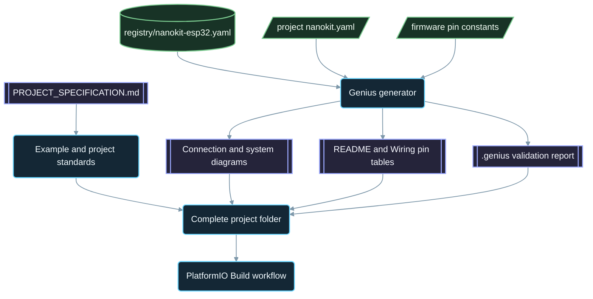

<div align="center">

# NanoKit-ESP32

**Das offizielle PlatformIO-Ökosystem für das NanoKit Integrated ESP32 Entwicklungsboard**

<p>
<a href="../../README.md">English</a> ·
<a href="README.zh-CN.md">简体中文</a> ·
<a href="README.zh-TW.md">繁體中文</a> ·
<a href="README.ja.md">日本語</a> ·
<a href="README.ko.md">한국어</a> ·
<a href="README.tr.md">Türkçe</a> ·
<a href="README.ru.md">Русский</a> ·
<a href="README.vi.md">Tiếng Việt</a> ·
<a href="README.th.md">ไทย</a> ·
<strong>Deutsch</strong> ·
<a href="README.es.md">Español</a> ·
<a href="README.fr.md">Français</a> ·
<a href="README.uk.md">Українська</a> ·
<a href="README.pl.md">Polski</a> ·
<a href="README.pt-BR.md">Português (Brasil)</a> ·
<a href="README.ar.md">العربية</a> ·
<a href="README.fa.md">فارسی</a> ·
<a href="README.id.md">Bahasa Indonesia</a> ·
<a href="README.it.md">Italiano</a> ·
<a href="README.el.md">Ελληνικά</a> ·
<a href="README.ml.md">മലയാളം</a> ·
<a href="README.ur-Latn.md">Roman Urdu</a> ·
<a href="README.ro.md">Română</a>
</p>

<p>
<a href="https://github.com/ProAmineOfficial/NanoKit-ESP32/stargazers"></a>
<a href="https://github.com/ProAmineOfficial/NanoKit-ESP32/commits/main"></a>
<a href="../../LICENSE"></a>
<a href="https://github.com/ProAmineOfficial/NanoKit-ESP32/actions/workflows/platformio-build.yml"></a>
<a href="https://github.com/ProAmineOfficial/NanoKit-ESP32/actions/workflows/repository-index.yml"></a>
</p>

<p>
<a href="https://proamine.tech"></a>
<a href="https://gitarchitecturediagram.com/ProAmineOfficial/NanoKit-ESP32"></a>

</p>

**Developed by Amine Saoud ibn al-Bashir.**

</div>

> **Übersetzungshinweis:** Diese Seite ist eine Übersetzung der [englischen README](../../README.md). Bei Abweichungen ist die englische README maßgeblich.

##  Datenblatt zur Pinbelegung des NanoKit Integrated ESP32


Das NanoKit Integrated ESP32 Entwicklungsboard ist eine Embedded-Entwicklungsplattform für IoT, KI, Robotik, Ausbildung und professionelles Prototyping. Dieses Repository ist gegliedert in PlatformIO-Beispiele, vollständige Anwendungen, Open-Source-Projekte, Abschlussprojekte, Simulationsressourcen, Dokumentation, Fachartikel, Tutorials und wiederverwendbare Vorlagen.

Das NanoKit-Board ist Teil der umfassenderen UMT-Hardwarevision, doch die Firmware dieses Repositorys verwendet standardmäßiges PlatformIO-Arduino-C++ und ESP32-GPIO-Nummern, sodass jedes Projekt direkt in PlatformIO kompiliert und ausgeführt werden kann.

##  Mission des Repositorys

Dies ist weder ein Demo- noch ein Vorlagen-Repository. Es ist das offizielle, langfristig angelegte Ökosystem-Repository von NanoKit-ESP32 für die Entwicklung eingebetteter Systeme in Ausbildung und Beruf: Jedes Projekt vermittelt den Code, die Verdrahtung, den Algorithmus, die NanoKit-Pinzuordnung und den Weg zur Fehlersuche.

Siehe [PROJECT_SPECIFICATION.md](../../PROJECT_SPECIFICATION.md) für die übergeordneten Repository-Regeln, das Wachstumsmodell, die Standards für Beispiele, die Dokumentationsanforderungen und die Definition of Done.

##  Schnellstart

1. Installieren Sie [VS Code](https://code.visualstudio.com/) mit der Erweiterung [PlatformIO IDE](https://platformio.org/install/ide?install=vscode) oder die PlatformIO Core CLI.
2. Klonen Sie das Repository und öffnen Sie ein Beispiel. [`digital_input_output`](../../examples_on_platformio/digital_input_output/) eignet sich als erstes: ein Taster, eine LED und die Onboard-LED.
3. Schließen Sie NanoKit per USB an, kompilieren Sie dann, laden Sie die Firmware hoch und öffnen Sie den Serial Monitor:

```bash
git clone https://github.com/ProAmineOfficial/NanoKit-ESP32.git
cd NanoKit-ESP32/examples_on_platformio/digital_input_output
pio run --target upload
pio device monitor -b 115200
```

Jede Projekt-README führt die Bauteile, die NanoKit-Pintabelle, die Verdrahtungsreihenfolge und die erwartete Ausgabe im Serial Monitor auf.

##  Aufbau des Repositorys

| Pfad | Zweck |
|---|---|
| [`examples_on_platformio/`](../../examples_on_platformio/README.md) | Gezielte PlatformIO-Beispiele ohne Benutzeroberfläche: eine Board-Funktion, ein Sensor oder ein Modul pro Beispiel. |
| [`applications_on_platformio/`](../../applications_on_platformio/README.md) | Vollständige Anwendungen mit Benutzeroberfläche, etwa von NanoKit bereitgestellte Web-Apps mit Schaltflächen, Schiebereglern und Dashboards. |
| [`open_source_projects/`](../../open_source_projects/README.md) | Größere eigene NanoKit-Projekte wie NanoKit Drone 4X sowie Bereiche für Community, Mitwirkende, Showcases und Hackathons. |
| [`graduation_projects/`](../../graduation_projects/README.md) | Arbeitsbereiche für Bachelor-, Master-, Ingenieur-, Instituts-, Capstone- und Abschlussarbeitsprojekte. |
| `tutorials/` | Tutorials vom Einstieg bis zum Fortgeschrittenen, Projektleitfäden und Verzeichnisse mit Videolinks. |
| `articles/` | Fachartikel zu eingebetteten Systemen, IoT, KI, Robotik, PlatformIO, NanoKit und UMT. |
| `docs/` | Einstieg, Installation, Hardware, Software, API, Fehlerbehebung, Roadmap, Architektur und Übersetzungen. |
| `registry/` | Das NanoKit-Board als Daten: jeder Header-Pin, jeder GPIO, jede VR-Adresse und jede elektrische Regel. |
| `tools/` | Repository-Automatisierung: der Genius-Generator und der Index-Generator. |
| `simulator/` | Web-Simulator, Simulations-Engine, Beispiele und Simulator-Assets. |
| `templates/` | Wiederverwendbare Vorlagen für Beispiele, Anwendungen, Abschlussarbeiten und Dokumentation. |
| `assets/` | Gemeinsam genutzte Bilder, Icons, Logos, Banner und Videos. |

##  Hardware-Manifeste und generierte Dokumentation

Jedes Beispiel, jede Anwendung, jedes Open-Source-Projekt und jedes Abschlussprojekt beschreibt seine Hardware genau einmal, in einem `nanokit.yaml`-Manifest. `python tools/genius/generate.py` prüft es gegen die Board-Registry [`registry/nanokit-esp32.yaml`](../../registry/nanokit-esp32.yaml) und gegen die Pin-Konstanten in der Firmware und generiert anschließend neu:

- `images/connection-diagram.md` und `images/system-diagram.md` mit Beschriftungen der Form `Pin <NanoKit pin> / GPIO<n>` und den Stilen Confirmed / Proposed / Blocked,
- die NanoKit-Pintabelle in jeder Projekt-README und die Anschlusstabelle in jeder `docs/Wiring.md`,
- `.genius/VALIDATION_REPORT.md` mit den geprüften Regeln, den Befunden und den Belegen aus dem Code.

Ein Pin am internen Flash, ein Ausgang auf einem reinen Eingangspin, ein 5-V-Signal ohne Pegelwandlung oder ein Manifest, das nicht zum Code passt, stoppt den Commit und den Pull Request. Das Referenzprojekt ist [`examples_on_platformio/ultrasonic_distance/`](../../examples_on_platformio/ultrasonic_distance/). Schema und Regeln: [`tools/genius/README.md`](../../tools/genius/README.md). Designdokument: [`docs/software/genius-generator-spec.md`](../../docs/software/genius-generator-spec.md).

##  Generierte Indizes

- [Repository-Index](../../REPOSITORY_INDEX.md) fasst die Hauptbereiche des Repositorys zusammen und zählt echte Projekte (Ordner mit einem Manifest).
- [Repository-Baum](../../REPOSITORY_TREE.md) zeigt den generierten Dateibaum.
- [Projekt-Backlog](../../docs/roadmap/project-backlog.md) listet jedes geplante Beispiel, jede Anwendung, jedes Tutorial und jeden Artikel in fünf Wellen auf; die Spalte „Status“ und die [Roadmap-Übersicht](../../docs/roadmap/README.md) werden automatisch aktualisiert.
- Jedes PlatformIO-Projekt wird bei jedem Push und jedem Pull Request vom [PlatformIO-Build-Workflow](../../.github/workflows/platformio-build.yml) kompiliert.

Führen Sie nach dem Hinzufügen oder Ändern eines Projekts `python tools/genius/generate.py` und anschließend `python tools/update_repository_index.py` aus. Aktivieren Sie den lokalen Hook einmalig mit `git config core.hooksPath .githooks`; der GitHub-Workflow führt dieselben beiden Tools bei jedem Push auf `main` aus und validiert Pull Requests.

##  Interaktiver Repository-Baum

Der folgende Baum wird aus dem aktuellen Inhalt des Repositorys generiert. Wählen Sie seinen Titel aus, um ihn auf- oder zuzuklappen. Der lokale Pre-Commit-Hook und der GitHub-Workflow aktualisieren ihn automatisch, wenn Projekte oder Dateien hinzugefügt, verschoben oder entfernt werden.

Der vollständige generierte Baum steht in [REPOSITORY_TREE.md](../../REPOSITORY_TREE.md); die englische README zeigt ihn als aufklappbare Liste.

##  So ist das Repository aufgebaut



##  Vorgestelltes Open-Source-Projekt

[NanoKit Drone 4X (Quadrocopter)](../../open_source_projects/nanokit_drone_4x_quadcopter/README.md) ist die sicherheitsorientierte Quad-X-Flugsteuerungsreferenz des Repositorys. Ein NanoKit-Flugcontroller führt eine 250-Hz-Regelschleife mit Quad-X-Motormischung und Sicherheitssperren aus, ein browserbasiertes Flight Deck verbindet sich über Wi-Fi und WebSocket, und ein zweiter NanoKit betreibt eine isolierte Kamera- und Audio-Nutzlast ohne jeglichen Zugriff auf die Motoren. Das Projekt befindet sich in der Prüfstandsentwicklung: Die Propeller bleiben demontiert und die Motorausgabe bleibt auf dem sicheren Minimum, bis das ESC-Protokoll verifiziert ist.

##  Qualitätsvertrag

Offizielle Inhalte in diesem Repository sollen produktionsreif, lehrreich, vollständig und wartbar sein.

- Hinterlassen Sie keine leeren Verzeichnisse als Endergebnis.
- Fügen Sie keine Platzhalterinhalte hinzu, wenn echtes Lehrmaterial bereitgestellt werden kann.
- Bauen Sie auf bestehender Arbeit auf, statt sie unnötig zu überschreiben.
- Jedes Beispiel vermittelt Code, Verdrahtung, Algorithmus, Pinzuordnung und den Weg zur Fehlersuche.
- Jedes Hardware-Beispiel dokumentiert NanoKit-Pinnummern und ESP32-GPIO-Nummern, vollständig ausgeschrieben als „Pin 36 / GPIO5“.

Verwenden Sie [docs/software/platformio-example-standard.md](../../docs/software/platformio-example-standard.md), wenn Sie Beispiele erstellen oder prüfen.

##  PlatformIO-Basiskonfiguration

PlatformIO-Projekte verwenden das ESP32-Arduino-Framework als erste öffentliche Basis:

```ini
[env:nanokit_esp32]
; espressif32 8.0.0 = Arduino-ESP32 core 3.3.12, pinned so a platform update cannot break the build
platform = espressif32 @ 8.0.0
board = esp32dev
framework = arduino
monitor_speed = 115200
upload_speed = 921600
```

Eigene NanoKit-Boarddefinitionen können das generische Boardprofil `esp32dev` ersetzen, sobald sich das Hardwarepaket weiterentwickelt.

##  Firmware-Regel

Offizielle Beispiele in diesem Repository müssen Folgendes verwenden:

- PlatformIO
- Arduino-Framework für ESP32
- C++
- Markdown-Dokumentation
- Normale ESP32-GPIO-Nummern im Quellcode

Verwenden Sie in PlatformIO-Beispielen keinen Code aus dem UMT SDK und keinen Code der Virtual Register API.

##  Hardware-Pinbelegung

Verwenden Sie [docs/hardware/nanokit-integrated-esp32-pinout.md](../../docs/hardware/nanokit-integrated-esp32-pinout.md) als maßgebliche Quelle für NanoKit-Pinnummern, ESP32-GPIO-Zuordnungen, elektrische Hinweise und Warnungen.

Jedes Hardware-Beispiel dokumentiert:

```text
NanoKit Pin -> GPIO -> Component Pin -> Description
```

Wichtige Einschränkungen:

- GPIO34, GPIO35, GPIO36 und GPIO39 sind reine Eingänge.
- GPIO6, GPIO7, GPIO8, GPIO9, GPIO10 und GPIO11 sind Pins des internen SPI-Flash und dürfen nicht verwendet werden.
- GPIO0 ist der BOOT-Pin.
- GPIO1 und GPIO3 werden mit der seriellen USB-Schnittstelle geteilt.
- EN ist Reset / Enable und kein GPIO.

##  Roadmap

Das [Projekt-Backlog](../../docs/roadmap/project-backlog.md) plant die Bibliothek in fünf Wellen: Board-Grundlagen, Sensoren und Module, Webanwendungen, Protokolle und Cloud sowie externe Module. Die [Roadmap-Übersicht](../../docs/roadmap/README.md) zeigt, wie viele Projekte jeder Welle abgeschlossen sind.

##  Mitwirken

Beiträge sind willkommen. Lesen Sie zuerst [CONTRIBUTING.md](../../CONTRIBUTING.md): Dort werden die Projektstandards, das `nanokit.yaml`-Manifest, der Pre-Commit-Hook und die Lizenzierung von Beiträgen erklärt.

##  Übersetzungen

Diese README ist über die Sprachleiste oben in 23 Sprachen verfügbar. Die Übersetzungen befinden sich in [`docs/i18n/`](../../docs/i18n/); wenn eine Übersetzung und die englische README voneinander abweichen, ist die englische README maßgeblich.

##  Support

-  Website: [https://proamine.tech](https://proamine.tech)
-  Git Architecture Diagram: [https://gitarchitecturediagram.com](https://gitarchitecturediagram.com/ProAmineOfficial/NanoKit-ESP32)
-  E-Mail: `technology@proamine.tech`
-  TikTok: [@pro_amine](https://www.tiktok.com/@pro_amine)
-  YouTube: [@pro_amine](https://www.youtube.com/@pro_amine)

##  Lizenz

NanoKit-ESP32 steht unter der [GNU Affero General Public License v3.0 only](../../LICENSE) (`AGPL-3.0-only`), mit zusätzlichen Bestimmungen nach Abschnitt 7, die in [NOTICE](../../NOTICE) aufgeführt sind:

- **Namensnennung:** Jede Kopie und jede veränderte Version behält die Zeile „Developed by Amine Saoud ibn al-Bashir.“ bei und gibt an, dass sie auf NanoKit-ESP32 von Amine Saoud ibn al-Bashir (Pro_Amine LLC) basiert.
- **Veränderte Versionen** werden als vom Original abweichend gekennzeichnet und nicht als offizielles NanoKit-ESP32-Repository ausgegeben.
- **Namen:** Es werden keine Rechte an den Namen NanoKit, Pro_Amine oder UMT oder an deren Logos eingeräumt; eine weiterverbreitete Version verwendet einen eigenen Namen.
- **Netzwerknutzung:** Wenn Sie eine veränderte Version als Netzwerkdienst betreiben, verpflichtet die AGPL Sie, deren Nutzern den Quellcode anzubieten.

Es steht Ihnen frei, diesen Code unter diesen Bedingungen zum Lernen, Lehren, Forschen und für eigene Projekte zu studieren, zu nutzen und zu verändern. Versionen, die vor dem Wechsel zur AGPL veröffentlicht wurden, wurden unter der Apache License 2.0 verbreitet. Die Fluent-Emoji-Icons in `assets/icons/fluent/` sind © Microsoft Corporation und stehen unter der MIT License.

<div align="center">

**Developed by Amine Saoud ibn al-Bashir · © 2026 Pro_Amine LLC**

</div>
