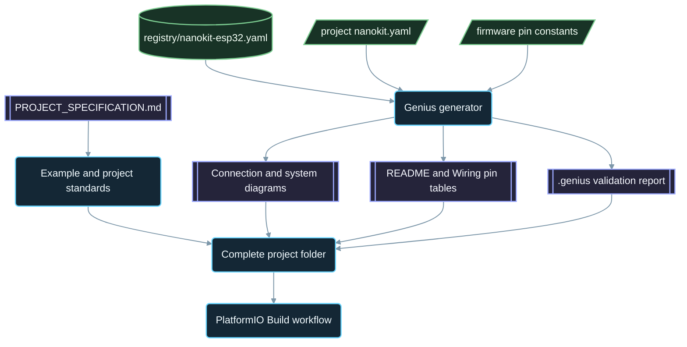

<div align="center">

# NanoKit-ESP32

**Το επίσημο οικοσύστημα PlatformIO για την αναπτυξιακή πλακέτα NanoKit Integrated ESP32**

<p>
<a href="../../README.md">English</a> ·
<a href="README.zh-CN.md">简体中文</a> ·
<a href="README.zh-TW.md">繁體中文</a> ·
<a href="README.ja.md">日本語</a> ·
<a href="README.ko.md">한국어</a> ·
<a href="README.tr.md">Türkçe</a> ·
<a href="README.ru.md">Русский</a> ·
<a href="README.vi.md">Tiếng Việt</a> ·
<a href="README.th.md">ไทย</a> ·
<a href="README.de.md">Deutsch</a> ·
<a href="README.es.md">Español</a> ·
<a href="README.fr.md">Français</a> ·
<a href="README.uk.md">Українська</a> ·
<a href="README.pl.md">Polski</a> ·
<a href="README.pt-BR.md">Português (Brasil)</a> ·
<a href="README.ar.md">العربية</a> ·
<a href="README.fa.md">فارسی</a> ·
<a href="README.id.md">Bahasa Indonesia</a> ·
<a href="README.it.md">Italiano</a> ·
<strong>Ελληνικά</strong> ·
<a href="README.ml.md">മലയാളം</a> ·
<a href="README.ur-Latn.md">Roman Urdu</a> ·
<a href="README.ro.md">Română</a>
</p>

<p>
<a href="https://github.com/ProAmineOfficial/NanoKit-ESP32/stargazers"></a>
<a href="https://github.com/ProAmineOfficial/NanoKit-ESP32/commits/main"></a>
<a href="../../LICENSE"></a>
<a href="https://github.com/ProAmineOfficial/NanoKit-ESP32/actions/workflows/platformio-build.yml"></a>
<a href="https://github.com/ProAmineOfficial/NanoKit-ESP32/actions/workflows/repository-index.yml"></a>
</p>

<p>
<a href="https://proamine.tech"></a>
<a href="https://gitarchitecturediagram.com/ProAmineOfficial/NanoKit-ESP32"></a>

</p>

**Developed by Amine Saoud ibn al-Bashir.**

</div>

> **Σημείωση μετάφρασης:** αυτή η σελίδα είναι μετάφραση του [αγγλικού README](../../README.md). Σε περίπτωση διαφοράς, υπερισχύει το αγγλικό README.

##  Φύλλο δεδομένων με τη διάταξη ακροδεκτών του NanoKit Integrated ESP32


Η αναπτυξιακή πλακέτα NanoKit Integrated ESP32 είναι μια πλατφόρμα ανάπτυξης ενσωματωμένων συστημάτων για IoT, τεχνητή νοημοσύνη, ρομποτική, εκπαίδευση και επαγγελματική κατασκευή πρωτοτύπων. Το αποθετήριο είναι οργανωμένο για παραδείγματα PlatformIO, ολοκληρωμένες εφαρμογές, έργα ανοιχτού κώδικα, πτυχιακές εργασίες, πόρους προσομοίωσης, τεκμηρίωση, άρθρα, οδηγούς εκμάθησης και επαναχρησιμοποιήσιμα πρότυπα.

Η πλακέτα NanoKit αποτελεί μέρος του ευρύτερου οράματος υλικού UMT, όμως το υλικολογισμικό αυτού του αποθετηρίου χρησιμοποιεί τυπική Arduino C++ για PlatformIO και τους αριθμούς GPIO του ESP32, ώστε κάθε έργο να μεταγλωττίζεται και να εκτελείται απευθείας στο PlatformIO.

##  Αποστολή του αποθετηρίου

Δεν πρόκειται για αποθετήριο επίδειξης ούτε για αποθετήριο προτύπων. Είναι το επίσημο, μακροπρόθεσμο αποθετήριο του οικοσυστήματος NanoKit-ESP32 για εκπαιδευτική και επαγγελματική ανάπτυξη ενσωματωμένων συστημάτων: κάθε έργο διδάσκει τον κώδικα, τη συνδεσμολογία, τον αλγόριθμο, την αντιστοίχιση ακροδεκτών του NanoKit και τη διαδικασία αντιμετώπισης προβλημάτων.

Δείτε το [PROJECT_SPECIFICATION.md](../../PROJECT_SPECIFICATION.md) για τους κύριους κανόνες του αποθετηρίου, το μοντέλο επέκτασης, τα πρότυπα των παραδειγμάτων, τις απαιτήσεις τεκμηρίωσης και τον ορισμό ολοκλήρωσης (Definition of Done).

##  Γρήγορη εκκίνηση

1. Εγκαταστήστε το [VS Code](https://code.visualstudio.com/) με την επέκταση [PlatformIO IDE](https://platformio.org/install/ide?install=vscode) ή το PlatformIO Core CLI.
2. Κλωνοποιήστε το αποθετήριο και ανοίξτε ένα παράδειγμα. Το [`digital_input_output`](../../examples_on_platformio/digital_input_output/) είναι το πρώτο που αξίζει να δοκιμάσετε: ένα κουμπί, ένα LED και το ενσωματωμένο LED της πλακέτας.
3. Συνδέστε το NanoKit μέσω USB, έπειτα μεταγλωττίστε, φορτώστε το υλικολογισμικό και ανοίξτε το Serial Monitor:

```bash
git clone https://github.com/ProAmineOfficial/NanoKit-ESP32.git
cd NanoKit-ESP32/examples_on_platformio/digital_input_output
pio run --target upload
pio device monitor -b 115200
```

Το README κάθε έργου παραθέτει τα εξαρτήματα, τον πίνακα ακροδεκτών του NanoKit, τη σειρά συνδεσμολογίας και την αναμενόμενη έξοδο στο Serial Monitor.

##  Δομή του αποθετηρίου

| Διαδρομή | Σκοπός |
|---|---|
| [`examples_on_platformio/`](../../examples_on_platformio/README.md) | Στοχευμένα παραδείγματα PlatformIO χωρίς διεπαφή χρήστη: μία λειτουργία της πλακέτας, ένας αισθητήρας ή μία μονάδα ανά παράδειγμα. |
| [`applications_on_platformio/`](../../applications_on_platformio/README.md) | Ολοκληρωμένες εφαρμογές με διεπαφή χρήστη, όπως διαδικτυακές εφαρμογές που εξυπηρετεί το ίδιο το NanoKit, με κουμπιά, ολισθητές και πίνακες ελέγχου. |
| [`open_source_projects/`](../../open_source_projects/README.md) | Μεγαλύτερα πρωτότυπα έργα NanoKit, όπως το NanoKit Drone 4X, καθώς και ενότητες για την κοινότητα, τους συνεισφέροντες, την προβολή έργων και τα hackathon. |
| [`graduation_projects/`](../../graduation_projects/README.md) | Χώροι εργασίας για πτυχιακές, μεταπτυχιακές, διπλωματικές μηχανικών, εργασίες ινστιτούτων, εργασίες capstone και διατριβές. |
| `tutorials/` | Οδηγοί εκμάθησης από αρχάριο έως προχωρημένο επίπεδο, οδηγοί έργων και ευρετήρια συνδέσμων βίντεο. |
| `articles/` | Τεχνικά άρθρα για ενσωματωμένα συστήματα, IoT, τεχνητή νοημοσύνη, ρομποτική, PlatformIO, NanoKit και UMT. |
| `docs/` | Πρώτα βήματα, εγκατάσταση, υλικό, λογισμικό, API, αντιμετώπιση προβλημάτων, οδικός χάρτης, αρχιτεκτονική και μεταφράσεις. |
| `registry/` | Η πλακέτα NanoKit ως δεδομένα: κάθε ακροδέκτης των κεφαλών ακίδων, GPIO, διεύθυνση VR και ηλεκτρικός κανόνας. |
| `tools/` | Αυτοματοποίηση του αποθετηρίου: η γεννήτρια Genius και η γεννήτρια ευρετηρίου. |
| `simulator/` | Διαδικτυακός προσομοιωτής, μηχανή προσομοίωσης, παραδείγματα και πόροι του προσομοιωτή. |
| `templates/` | Επαναχρησιμοποιήσιμα πρότυπα για παραδείγματα, εφαρμογές, διπλωματικές εργασίες και τεκμηρίωση. |
| `assets/` | Κοινόχρηστες εικόνες, εικονίδια, λογότυπα, banner και βίντεο. |

##  Μανιφέστα υλικού και παραγόμενη τεκμηρίωση

Κάθε παράδειγμα, εφαρμογή, έργο ανοιχτού κώδικα και πτυχιακή εργασία περιγράφει το υλικό του μία φορά, σε ένα μανιφέστο `nanokit.yaml`. Η εντολή `python tools/genius/generate.py` το επικυρώνει έναντι του μητρώου της πλακέτας [`registry/nanokit-esp32.yaml`](../../registry/nanokit-esp32.yaml) και των σταθερών ακροδεκτών στο υλικολογισμικό και στη συνέχεια αναδημιουργεί:

- τα `images/connection-diagram.md` και `images/system-diagram.md` με ετικέτες `Pin <NanoKit pin> / GPIO<n>` και μορφοποίηση Confirmed / Proposed / Blocked,
- τον πίνακα ακροδεκτών του NanoKit στο README κάθε έργου και τον πίνακα συνδέσεων σε κάθε `docs/Wiring.md`,
- το `.genius/VALIDATION_REPORT.md` με τους κανόνες που ελέγχθηκαν, τα ευρήματα και τα τεκμήρια από τον κώδικα.

Ένας ακροδέκτης που δεσμεύεται από την εσωτερική μνήμη flash, μια έξοδος σε ακροδέκτη μόνο εισόδου, ένα σήμα 5 V χωρίς μετατροπή στάθμης ή ένα μανιφέστο που δεν συμφωνεί με τον κώδικα σταματούν το commit και το pull request. Το έργο αναφοράς είναι το [`examples_on_platformio/ultrasonic_distance/`](../../examples_on_platformio/ultrasonic_distance/). Σχήμα και κανόνες: [`tools/genius/README.md`](../../tools/genius/README.md). Τεκμηρίωση σχεδιασμού: [`docs/software/genius-generator-spec.md`](../../docs/software/genius-generator-spec.md).

##  Παραγόμενα ευρετήρια

- Το [Ευρετήριο αποθετηρίου](../../REPOSITORY_INDEX.md) συνοψίζει τις κύριες περιοχές του αποθετηρίου και καταμετρά τα πραγματικά έργα (φακέλους με μανιφέστο).
- Το [Δέντρο αποθετηρίου](../../REPOSITORY_TREE.md) δείχνει το παραγόμενο δέντρο αρχείων.
- Η [Λίστα προγραμματισμένων έργων](../../docs/roadmap/project-backlog.md) απαριθμεί κάθε προγραμματισμένο παράδειγμα, εφαρμογή, οδηγό εκμάθησης και άρθρο σε πέντε κύματα· η στήλη Status και η [σύνοψη του οδικού χάρτη](../../docs/roadmap/README.md) ανανεώνονται αυτόματα.
- Κάθε έργο PlatformIO μεταγλωττίζεται από τη [ροή εργασιών PlatformIO Build](../../.github/workflows/platformio-build.yml) σε κάθε push και pull request.

Μετά την προσθήκη ή την αλλαγή ενός έργου, εκτελέστε το `python tools/genius/generate.py` και έπειτα το `python tools/update_repository_index.py`. Ενεργοποιήστε μία φορά το τοπικό hook με `git config core.hooksPath .githooks`· η ροή εργασιών του GitHub εκτελεί τα ίδια δύο εργαλεία σε κάθε push στο `main` και επικυρώνει τα pull request.

##  Διαδραστικό δέντρο αποθετηρίου

Το παρακάτω δέντρο παράγεται από τα τρέχοντα περιεχόμενα του αποθετηρίου. Επιλέξτε τον τίτλο του για να το αναπτύξετε ή να το συμπτύξετε. Το τοπικό pre-commit hook και η ροή εργασιών του GitHub το ανανεώνουν αυτόματα όταν προστίθενται, μετακινούνται ή αφαιρούνται έργα ή αρχεία.

Το πλήρες παραγόμενο δέντρο βρίσκεται στο [REPOSITORY_TREE.md](../../REPOSITORY_TREE.md)· το αγγλικό README το εμφανίζει ως αναπτυσσόμενη λίστα.

##  Πώς είναι δομημένο το αποθετήριο



##  Προτεινόμενο έργο ανοιχτού κώδικα

Το [NanoKit Drone 4X (τετρακόπτερο)](../../open_source_projects/nanokit_drone_4x_quadcopter/README.md) είναι το έργο αναφοράς του αποθετηρίου για έλεγχο πτήσης Quad-X με προτεραιότητα στην ασφάλεια. Ένας ελεγκτής πτήσης NanoKit εκτελεί βρόχο ελέγχου 250 Hz με μίξη κινητήρων Quad-X και φραγμούς ασφαλείας, ένα Flight Deck στο πρόγραμμα περιήγησης συνδέεται μέσω Wi-Fi και WebSocket, και ένα δεύτερο NanoKit εκτελεί ένα απομονωμένο ωφέλιμο φορτίο κάμερας και ήχου χωρίς καμία εξουσία στους κινητήρες. Το έργο βρίσκεται σε φάση ανάπτυξης στον πάγκο: οι έλικες παραμένουν αφαιρεμένες και η έξοδος των κινητήρων μένει στο ασφαλές ελάχιστο μέχρι να επαληθευτεί το πρωτόκολλο ESC.

##  Συμβόλαιο ποιότητας

Το επίσημο περιεχόμενο αυτού του αποθετηρίου πρέπει να είναι έτοιμο για παραγωγή, εκπαιδευτικό, πλήρες και εύκολο στη συντήρηση.

- Μην αφήνετε κενούς καταλόγους ως τελικό αποτέλεσμα.
- Μην προσθέτετε προσωρινό περιεχόμενο-υποκατάστατο όταν μπορεί να δοθεί πραγματικό εκπαιδευτικό υλικό.
- Χτίστε πάνω στην υπάρχουσα δουλειά αντί να την αντικαθιστάτε χωρίς λόγο.
- Κάθε παράδειγμα διδάσκει τον κώδικα, τη συνδεσμολογία, τον αλγόριθμο, την αντιστοίχιση ακροδεκτών και τη διαδικασία αντιμετώπισης προβλημάτων.
- Κάθε παράδειγμα υλικού τεκμηριώνει τους αριθμούς ακροδεκτών του NanoKit και τους αριθμούς GPIO του ESP32, γραμμένους πλήρως ως «Pin 36 / GPIO5».

Χρησιμοποιήστε το [docs/software/platformio-example-standard.md](../../docs/software/platformio-example-standard.md) όταν δημιουργείτε ή ελέγχετε παραδείγματα.

##  Βασική διαμόρφωση PlatformIO

Τα έργα PlatformIO χρησιμοποιούν το πλαίσιο Arduino για ESP32 ως την πρώτη δημόσια βασική διαμόρφωση:

```ini
[env:nanokit_esp32]
platform = espressif32
board = esp32dev
framework = arduino
monitor_speed = 115200
upload_speed = 921600
```

Καθώς εξελίσσεται το πακέτο υλικού, ειδικοί ορισμοί πλακέτας NanoKit μπορούν να αντικαταστήσουν το γενικό προφίλ πλακέτας `esp32dev`.

##  Κανόνας υλικολογισμικού

Τα επίσημα παραδείγματα αυτού του αποθετηρίου πρέπει να χρησιμοποιούν:

- PlatformIO
- Πλαίσιο Arduino για ESP32
- C++
- Τεκμηρίωση σε Markdown
- Κανονικούς αριθμούς GPIO του ESP32 στον πηγαίο κώδικα

Μη χρησιμοποιείτε κώδικα UMT SDK ή κώδικα Virtual Register API στα παραδείγματα PlatformIO.

##  Διάταξη ακροδεκτών υλικού

Χρησιμοποιήστε το [docs/hardware/nanokit-integrated-esp32-pinout.md](../../docs/hardware/nanokit-integrated-esp32-pinout.md) ως την έγκυρη πηγή για τους αριθμούς ακροδεκτών του NanoKit, τις αντιστοιχίσεις GPIO του ESP32, τις ηλεκτρικές σημειώσεις και τις προειδοποιήσεις.

Κάθε παράδειγμα υλικού τεκμηριώνει:

```text
NanoKit Pin -> GPIO -> Component Pin -> Description
```

Σημαντικοί περιορισμοί:

- Τα GPIO34, GPIO35, GPIO36 και GPIO39 είναι μόνο εισόδου.
- Τα GPIO6, GPIO7, GPIO8, GPIO9, GPIO10 και GPIO11 είναι ακροδέκτες της εσωτερικής μνήμης flash SPI και δεν πρέπει να χρησιμοποιούνται.
- Το GPIO0 είναι ο ακροδέκτης BOOT.
- Τα GPIO1 και GPIO3 είναι κοινά με το USB Serial.
- Το EN είναι Reset / Enable και δεν είναι GPIO.

##  Οδικός χάρτης

Η [Λίστα προγραμματισμένων έργων](../../docs/roadmap/project-backlog.md) σχεδιάζει τη βιβλιοθήκη σε πέντε κύματα: βασικές λειτουργίες της πλακέτας, αισθητήρες και μονάδες, διαδικτυακές εφαρμογές, πρωτόκολλα και νέφος, και εξωτερικές μονάδες. Η [σύνοψη του οδικού χάρτη](../../docs/roadmap/README.md) δείχνει πόσα έργα κάθε κύματος έχουν ολοκληρωθεί.

##  Συνεισφορά

Οι συνεισφορές είναι ευπρόσδεκτες. Διαβάστε πρώτα το [CONTRIBUTING.md](../../CONTRIBUTING.md): εξηγεί τα πρότυπα των έργων, το μανιφέστο `nanokit.yaml`, το pre-commit hook και την άδεια χρήσης των συνεισφορών.

##  Μεταφράσεις

Αυτό το README είναι διαθέσιμο σε 23 γλώσσες μέσω της γραμμής γλωσσών στην κορυφή της σελίδας. Οι μεταφράσεις βρίσκονται στο [`docs/i18n/`](../../docs/i18n/)· όταν μια μετάφραση διαφέρει από το αγγλικό README, υπερισχύει το αγγλικό README.

##  Υποστήριξη

-  Ιστότοπος: [https://proamine.tech](https://proamine.tech)
-  Git Architecture Diagram: [https://gitarchitecturediagram.com](https://gitarchitecturediagram.com/ProAmineOfficial/NanoKit-ESP32)
-  Ηλεκτρονικό ταχυδρομείο: `technology@proamine.tech`
-  TikTok: [@pro_amine](https://www.tiktok.com/@pro_amine)
-  YouTube: [@pro_amine](https://www.youtube.com/@pro_amine)

##  Άδεια χρήσης

Το NanoKit-ESP32 διατίθεται με την άδεια [GNU Affero General Public License v3.0 only](../../LICENSE) (`AGPL-3.0-only`), με πρόσθετους όρους βάσει της ενότητας 7 που αναφέρονται στο [NOTICE](../../NOTICE):

- **Αναφορά δημιουργού:** κάθε αντίγραφο ή τροποποιημένη έκδοση διατηρεί τη γραμμή «Developed by Amine Saoud ibn al-Bashir.» και δηλώνει ότι βασίζεται στο NanoKit-ESP32 του Amine Saoud ibn al-Bashir (Pro_Amine LLC).
- **Οι τροποποιημένες εκδόσεις** επισημαίνονται ως διαφορετικές από το πρωτότυπο και δεν παρουσιάζονται ως το επίσημο αποθετήριο NanoKit-ESP32.
- **Ονόματα:** δεν παραχωρείται κανένα δικαίωμα στα ονόματα NanoKit, Pro_Amine ή UMT ούτε στα λογότυπά τους· μια αναδιανεμόμενη έκδοση χρησιμοποιεί το δικό της όνομα.
- **Χρήση μέσω δικτύου:** αν εκτελείτε μια τροποποιημένη έκδοση ως υπηρεσία δικτύου, η AGPL σας υποχρεώνει να προσφέρετε τον πηγαίο κώδικά της στους χρήστες της.

Σύμφωνα με αυτούς τους όρους, είστε ελεύθεροι να μελετάτε, να χρησιμοποιείτε και να τροποποιείτε αυτόν τον κώδικα για μάθηση, διδασκαλία, έρευνα και τα δικά σας έργα. Οι εκδόσεις που δημοσιεύτηκαν πριν από τη μετάβαση στην AGPL διανέμονταν με την άδεια Apache License 2.0. Τα εικονίδια Fluent Emoji στο `assets/icons/fluent/` είναι © Microsoft Corporation και διατίθενται με την άδεια MIT License.

<div align="center">

**Developed by Amine Saoud ibn al-Bashir · © 2026 Pro_Amine LLC**

</div>
