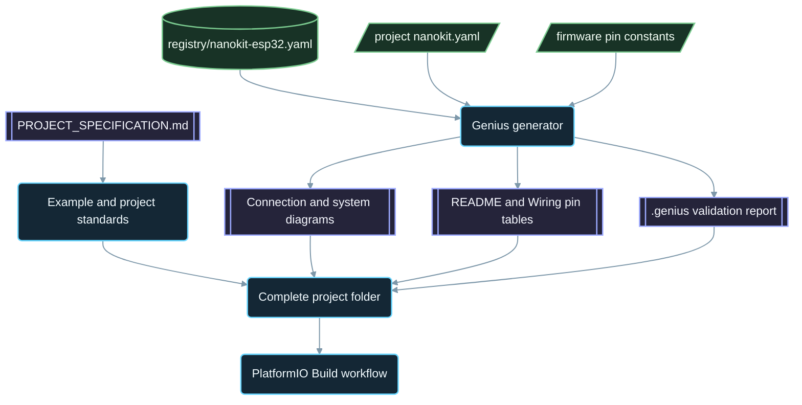

<div align="center">

# NanoKit-ESP32

**El ecosistema oficial de PlatformIO para la placa de desarrollo NanoKit Integrated ESP32**

<p>
<a href="../../README.md">English</a> ·
<a href="README.zh-CN.md">简体中文</a> ·
<a href="README.zh-TW.md">繁體中文</a> ·
<a href="README.ja.md">日本語</a> ·
<a href="README.ko.md">한국어</a> ·
<a href="README.tr.md">Türkçe</a> ·
<a href="README.ru.md">Русский</a> ·
<a href="README.vi.md">Tiếng Việt</a> ·
<a href="README.th.md">ไทย</a> ·
<a href="README.de.md">Deutsch</a> ·
<strong>Español</strong> ·
<a href="README.fr.md">Français</a> ·
<a href="README.uk.md">Українська</a> ·
<a href="README.pl.md">Polski</a> ·
<a href="README.pt-BR.md">Português (Brasil)</a> ·
<a href="README.ar.md">العربية</a> ·
<a href="README.fa.md">فارسی</a> ·
<a href="README.id.md">Bahasa Indonesia</a> ·
<a href="README.it.md">Italiano</a> ·
<a href="README.el.md">Ελληνικά</a> ·
<a href="README.ml.md">മലയാളം</a> ·
<a href="README.ur-Latn.md">Roman Urdu</a> ·
<a href="README.ro.md">Română</a>
</p>

<p>
<a href="https://github.com/ProAmineOfficial/NanoKit-ESP32/stargazers"></a>
<a href="https://github.com/ProAmineOfficial/NanoKit-ESP32/commits/main"></a>
<a href="../../LICENSE"></a>
<a href="https://github.com/ProAmineOfficial/NanoKit-ESP32/actions/workflows/platformio-build.yml"></a>
<a href="https://github.com/ProAmineOfficial/NanoKit-ESP32/actions/workflows/repository-index.yml"></a>
</p>

<p>
<a href="https://proamine.tech"></a>
<a href="https://gitarchitecturediagram.com/ProAmineOfficial/NanoKit-ESP32"></a>

</p>

**Developed by Amine Saoud ibn al-Bashir.**

</div>

> **Nota sobre la traducción:** esta página es una traducción del [README en inglés](../../README.md). Si ambos difieren, prevalece el README en inglés.

##  Hoja de datos de la distribución de pines de la NanoKit Integrated ESP32


La placa de desarrollo NanoKit Integrated ESP32 es una plataforma de desarrollo embebido para IoT, IA, robótica, educación y prototipado profesional. Este repositorio está organizado en ejemplos de PlatformIO, aplicaciones completas, proyectos de código abierto, proyectos de fin de carrera, recursos de simulación, documentación, artículos, tutoriales y plantillas reutilizables.

La placa NanoKit forma parte de la visión de hardware más amplia de UMT, pero el firmware de este repositorio usa C++ estándar de PlatformIO con Arduino y los números de GPIO del ESP32, de modo que cada proyecto se compila y se ejecuta directamente en PlatformIO.

##  Misión del repositorio

Este no es un repositorio de demostración ni un repositorio de plantillas. Es el repositorio oficial y a largo plazo del ecosistema NanoKit-ESP32 para el desarrollo de sistemas embebidos con fines educativos y profesionales: cada proyecto enseña el código, el cableado, el algoritmo, la asignación de pines de NanoKit y el camino para resolver problemas.

Consulta [PROJECT_SPECIFICATION.md](../../PROJECT_SPECIFICATION.md) para conocer las reglas maestras del repositorio, el modelo de crecimiento, los estándares de los ejemplos, los requisitos de documentación y la Definition of Done.

##  Inicio rápido

1. Instala [VS Code](https://code.visualstudio.com/) con la extensión [PlatformIO IDE](https://platformio.org/install/ide?install=vscode), o bien la CLI de PlatformIO Core.
2. Clona el repositorio y abre un ejemplo. [`digital_input_output`](../../examples_on_platformio/digital_input_output/) es el primero que conviene probar: un pulsador, un LED y el LED integrado en la placa.
3. Conecta la placa NanoKit por USB y, a continuación, compila, carga el firmware y abre el Serial Monitor:

```bash
git clone https://github.com/ProAmineOfficial/NanoKit-ESP32.git
cd NanoKit-ESP32/examples_on_platformio/digital_input_output
pio run --target upload
pio device monitor -b 115200
```

El README de cada proyecto enumera los componentes, la tabla de pines de NanoKit, el orden de cableado y la salida esperada en el Serial Monitor.

##  Estructura del repositorio

| Ruta | Propósito |
|---|---|
| [`examples_on_platformio/`](../../examples_on_platformio/README.md) | Ejemplos de PlatformIO centrados en un solo tema y sin interfaz de usuario: una función de la placa, un sensor o un módulo por ejemplo. |
| [`applications_on_platformio/`](../../applications_on_platformio/README.md) | Aplicaciones completas con interfaz de usuario, como aplicaciones web servidas por la NanoKit con botones, controles deslizantes y paneles. |
| [`open_source_projects/`](../../open_source_projects/README.md) | Proyectos originales de NanoKit de mayor envergadura, como NanoKit Drone 4X, además de espacios para la comunidad, los colaboradores, los proyectos destacados y los hackatones. |
| [`graduation_projects/`](../../graduation_projects/README.md) | Espacios de trabajo para proyectos de grado, máster, ingeniería, instituto, proyectos integradores (capstone) y tesis. |
| `tutorials/` | Tutoriales de nivel principiante a avanzado, guías de proyectos e índices de enlaces a videos. |
| `articles/` | Artículos técnicos sobre sistemas embebidos, IoT, IA, robótica, PlatformIO, NanoKit y UMT. |
| `docs/` | Primeros pasos, instalación, hardware, software, API, solución de problemas, hoja de ruta, arquitectura y traducciones. |
| `registry/` | La placa NanoKit como datos: cada pin de los conectores, cada GPIO, cada dirección VR y cada regla eléctrica. |
| `tools/` | Automatización del repositorio: el generador Genius y el generador de índices. |
| `simulator/` | Simulador web, motor de simulación, ejemplos y recursos del simulador. |
| `templates/` | Plantillas reutilizables para ejemplos, aplicaciones, trabajos de tesis y documentación. |
| `assets/` | Imágenes, iconos, logotipos, banners y videos compartidos. |

##  Manifiestos de hardware y documentación generada

Cada ejemplo, aplicación, proyecto de código abierto y proyecto de fin de carrera describe su hardware una sola vez, en un manifiesto `nanokit.yaml`. `python tools/genius/generate.py` lo valida contra el registro de la placa [`registry/nanokit-esp32.yaml`](../../registry/nanokit-esp32.yaml) y contra las constantes de pines del firmware, y después regenera:

- `images/connection-diagram.md` e `images/system-diagram.md` con etiquetas `Pin <NanoKit pin> / GPIO<n>` y estilos Confirmed / Proposed / Blocked,
- la tabla de pines de NanoKit en el README de cada proyecto y la tabla de conexiones en cada `docs/Wiring.md`,
- `.genius/VALIDATION_REPORT.md` con las reglas comprobadas, los hallazgos y la evidencia en el código.

Un pin en la flash interna, una salida en un pin que solo admite entrada, una señal de 5 V sin adaptación de nivel o un manifiesto que no coincide con el código detienen el commit y el pull request. El proyecto de referencia es [`examples_on_platformio/ultrasonic_distance/`](../../examples_on_platformio/ultrasonic_distance/). Esquema y reglas: [`tools/genius/README.md`](../../tools/genius/README.md). Registro de diseño: [`docs/software/genius-generator-spec.md`](../../docs/software/genius-generator-spec.md).

##  Índices generados

- El [índice del repositorio](../../REPOSITORY_INDEX.md) resume las áreas principales del repositorio y cuenta los proyectos reales (carpetas con un manifiesto).
- El [árbol del repositorio](../../REPOSITORY_TREE.md) muestra el árbol de archivos generado.
- El [backlog de proyectos](../../docs/roadmap/project-backlog.md) enumera cada ejemplo, aplicación, tutorial y artículo planificado en cinco oleadas; su columna Status y el [resumen de la hoja de ruta](../../docs/roadmap/README.md) se actualizan automáticamente.
- Cada proyecto de PlatformIO se compila con el [workflow PlatformIO Build](../../.github/workflows/platformio-build.yml) en cada push y en cada pull request.

Ejecuta `python tools/genius/generate.py` y después `python tools/update_repository_index.py` tras añadir o modificar un proyecto. Activa el hook local una sola vez con `git config core.hooksPath .githooks`; el workflow de GitHub ejecuta esas mismas dos herramientas en cada push a `main` y valida los pull requests.

##  Árbol interactivo del repositorio

El árbol siguiente se genera a partir del contenido actual del repositorio. Selecciona su título para expandirlo o contraerlo. El hook de pre-commit local y el workflow de GitHub lo actualizan automáticamente cuando se añaden, mueven o eliminan proyectos o archivos.

El árbol generado completo está en [REPOSITORY_TREE.md](../../REPOSITORY_TREE.md); el README en inglés lo muestra como una lista desplegable.

##  Cómo se construye el repositorio



##  Proyecto de código abierto destacado

[NanoKit Drone 4X (cuadricóptero)](../../open_source_projects/nanokit_drone_4x_quadcopter/README.md) es la referencia de control de vuelo Quad-X del repositorio, diseñada con la seguridad como prioridad. Un controlador de vuelo NanoKit ejecuta un lazo de control a 250 Hz con mezcla de motores Quad-X y salvaguardas de seguridad, un Flight Deck en el navegador se conecta por Wi-Fi y WebSocket, y una segunda NanoKit gestiona una carga útil aislada de cámara y audio sin ningún control sobre los motores. El proyecto está en fase de desarrollo en banco de pruebas: las hélices permanecen desmontadas y la salida de los motores se mantiene en el mínimo seguro hasta que se verifique el protocolo del ESC.

##  Contrato de calidad

El contenido oficial de este repositorio debe estar listo para producción y ser didáctico, completo y mantenible.

- No dejes directorios vacíos como trabajo final.
- No añadas contenido de relleno cuando se pueda aportar material educativo real.
- Construye sobre el trabajo existente en lugar de sobrescribirlo sin necesidad.
- Cada ejemplo enseña el código, el cableado, el algoritmo, la asignación de pines y el camino para resolver problemas.
- Cada ejemplo de hardware documenta los números de pin de NanoKit y los números de GPIO del ESP32, escritos completos como «Pin 36 / GPIO5».

Usa [docs/software/platformio-example-standard.md](../../docs/software/platformio-example-standard.md) al crear o revisar ejemplos.

##  Configuración base de PlatformIO

Los proyectos de PlatformIO usan el framework Arduino para ESP32 como primera base pública:

```ini
[env:nanokit_esp32]
; espressif32 8.0.0 = Arduino-ESP32 core 3.3.12, pinned so a platform update cannot break the build
platform = espressif32 @ 8.0.0
board = esp32dev
framework = arduino
monitor_speed = 115200
upload_speed = 921600
```

Las definiciones de placa específicas de NanoKit podrán sustituir el perfil genérico de placa `esp32dev` a medida que evolucione el paquete de hardware.

##  Regla del firmware

Los ejemplos oficiales de este repositorio deben usar:

- PlatformIO
- Framework Arduino para ESP32
- C++
- Documentación en Markdown
- Números de GPIO normales del ESP32 en el código fuente

No uses código del SDK de UMT ni código de la Virtual Register API en los ejemplos de PlatformIO.

##  Distribución de pines del hardware

Usa [docs/hardware/nanokit-integrated-esp32-pinout.md](../../docs/hardware/nanokit-integrated-esp32-pinout.md) como fuente de verdad para los números de pin de NanoKit, las asignaciones de GPIO del ESP32, las notas eléctricas y las advertencias.

Cada ejemplo de hardware documenta:

```text
NanoKit Pin -> GPIO -> Component Pin -> Description
```

Restricciones importantes:

- GPIO34, GPIO35, GPIO36 y GPIO39 son solo de entrada.
- GPIO6, GPIO7, GPIO8, GPIO9, GPIO10 y GPIO11 son pines de la flash SPI interna y no deben usarse.
- GPIO0 es el pin BOOT.
- GPIO1 y GPIO3 se comparten con el puerto serie USB.
- EN es Reset / Enable y no es un GPIO.

##  Hoja de ruta

El [backlog de proyectos](../../docs/roadmap/project-backlog.md) planifica la biblioteca en cinco oleadas: fundamentos de la placa, sensores y módulos, aplicaciones web, protocolos y nube, y módulos externos. El [resumen de la hoja de ruta](../../docs/roadmap/README.md) muestra cuántos proyectos de cada oleada están terminados.

##  Contribuir

Las contribuciones son bienvenidas. Lee primero [CONTRIBUTING.md](../../CONTRIBUTING.md): explica los estándares del proyecto, el manifiesto `nanokit.yaml`, el hook de pre-commit y la licencia de las contribuciones.

##  Traducciones

Este README está disponible en 23 idiomas a través de la barra de idiomas de la parte superior. Las traducciones se encuentran en [`docs/i18n/`](../../docs/i18n/); cuando una traducción y el README en inglés difieren, prevalece el README en inglés.

##  Soporte

-  Sitio web: [https://proamine.tech](https://proamine.tech)
-  Git Architecture Diagram: [https://gitarchitecturediagram.com](https://gitarchitecturediagram.com/ProAmineOfficial/NanoKit-ESP32)
-  Correo electrónico: `technology@proamine.tech`
-  TikTok: [@pro_amine](https://www.tiktok.com/@pro_amine)
-  YouTube: [@pro_amine](https://www.youtube.com/@pro_amine)

##  Licencia

NanoKit-ESP32 se distribuye bajo la [GNU Affero General Public License v3.0 only](../../LICENSE) (`AGPL-3.0-only`), con términos adicionales conforme a la sección 7 recogidos en [NOTICE](../../NOTICE):

- **Atribución:** toda copia o versión modificada conserva la línea «Developed by Amine Saoud ibn al-Bashir.» e indica que está basada en NanoKit-ESP32 de Amine Saoud ibn al-Bashir (Pro_Amine LLC).
- **Las versiones modificadas** se marcan como distintas del original y no se presentan como el repositorio oficial de NanoKit-ESP32.
- **Nombres:** no se concede ningún derecho sobre los nombres NanoKit, Pro_Amine o UMT ni sobre sus logotipos; una versión redistribuida usa su propio nombre.
- **Uso en red:** si ejecutas una versión modificada como servicio en red, la AGPL te obliga a ofrecer su código fuente a sus usuarios.

Puedes estudiar, usar y modificar libremente este código para aprender, enseñar, investigar y para tus propios proyectos conforme a estos términos. Las versiones publicadas antes del cambio a la AGPL se distribuyeron bajo la Apache License 2.0. Los iconos Fluent Emoji de `assets/icons/fluent/` son © Microsoft Corporation y se distribuyen bajo la MIT License.

<div align="center">

**Developed by Amine Saoud ibn al-Bashir · © 2026 Pro_Amine LLC**

</div>
