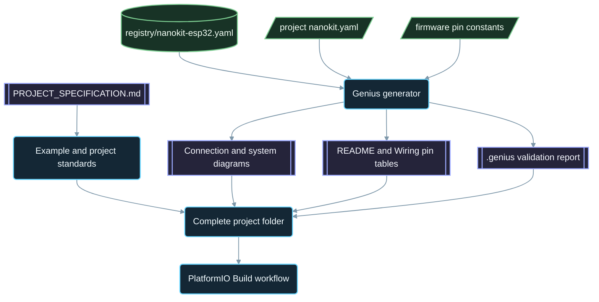

<div align="center">

# NanoKit-ESP32

**اکوسیستم رسمی PlatformIO برای برد توسعهٔ NanoKit Integrated ESP32**

<p>
<a href="../../README.md">English</a> ·
<a href="README.zh-CN.md">简体中文</a> ·
<a href="README.zh-TW.md">繁體中文</a> ·
<a href="README.ja.md">日本語</a> ·
<a href="README.ko.md">한국어</a> ·
<a href="README.tr.md">Türkçe</a> ·
<a href="README.ru.md">Русский</a> ·
<a href="README.vi.md">Tiếng Việt</a> ·
<a href="README.th.md">ไทย</a> ·
<a href="README.de.md">Deutsch</a> ·
<a href="README.es.md">Español</a> ·
<a href="README.fr.md">Français</a> ·
<a href="README.uk.md">Українська</a> ·
<a href="README.pl.md">Polski</a> ·
<a href="README.pt-BR.md">Português (Brasil)</a> ·
<a href="README.ar.md">العربية</a> ·
<strong>فارسی</strong> ·
<a href="README.id.md">Bahasa Indonesia</a> ·
<a href="README.it.md">Italiano</a> ·
<a href="README.el.md">Ελληνικά</a> ·
<a href="README.ml.md">മലയാളം</a> ·
<a href="README.ur-Latn.md">Roman Urdu</a> ·
<a href="README.ro.md">Română</a>
</p>

<p>
<a href="https://github.com/ProAmineOfficial/NanoKit-ESP32/stargazers"></a>
<a href="https://github.com/ProAmineOfficial/NanoKit-ESP32/commits/main"></a>
<a href="../../LICENSE"></a>
<a href="https://github.com/ProAmineOfficial/NanoKit-ESP32/actions/workflows/platformio-build.yml"></a>
<a href="https://github.com/ProAmineOfficial/NanoKit-ESP32/actions/workflows/repository-index.yml"></a>
</p>

<p>
<a href="https://proamine.tech"></a>
<a href="https://gitarchitecturediagram.com/ProAmineOfficial/NanoKit-ESP32"></a>

</p>

**Developed by Amine Saoud ibn al-Bashir.**

</div>

<div dir="rtl">

> **یادداشت ترجمه:** این صفحه ترجمه‌ای از [README انگلیسی](../../README.md) است. در صورت وجود تفاوت میان این دو، README انگلیسی مرجع معتبر است.

##  دیتاشیت نقشهٔ پایه‌های NanoKit Integrated ESP32


برد توسعهٔ NanoKit Integrated ESP32 یک پلتفرم توسعهٔ سیستم‌های نهفته برای اینترنت اشیا (IoT)، هوش مصنوعی، رباتیک، آموزش و نمونه‌سازی حرفه‌ای است. این مخزن برای نمونه‌های PlatformIO، اپلیکیشن‌های کامل، پروژه‌های متن‌باز، پروژه‌های پایان‌تحصیلی، منابع شبیه‌سازی، مستندات، مقاله‌ها، آموزش‌ها و قالب‌های قابل استفادهٔ مجدد سازمان‌دهی شده است.

برد NanoKit بخشی از چشم‌انداز گسترده‌تر سخت‌افزاری UMT است، اما فریم‌ور این مخزن از C++ استاندارد Arduino در PlatformIO و شماره‌های معمول GPIO در ESP32 استفاده می‌کند تا هر پروژه مستقیماً در PlatformIO کامپایل و اجرا شود.

##  مأموریت مخزن

این مخزن نه یک مخزن نمایشی (دمو) است و نه یک مخزن قالب. این مخزنِ رسمی و بلندمدت اکوسیستم NanoKit-ESP32 برای توسعهٔ آموزشی و حرفه‌ای سیستم‌های نهفته است: هر پروژه کد، سیم‌کشی، الگوریتم، نگاشت پایه‌های NanoKit و مسیر عیب‌یابی را آموزش می‌دهد.

برای قوانین اصلی مخزن، مدل رشد، استانداردهای نمونه‌ها، الزامات مستندسازی و «تعریف انجام‌شده» (Definition of Done) به [PROJECT_SPECIFICATION.md](../../PROJECT_SPECIFICATION.md) مراجعه کنید.

##  شروع سریع

1. [VS Code](https://code.visualstudio.com/) را همراه با افزونهٔ [PlatformIO IDE](https://platformio.org/install/ide?install=vscode) نصب کنید، یا ابزار خط فرمان PlatformIO Core CLI را نصب کنید.
2. مخزن را کلون کنید و یک نمونه را باز کنید. [`digital_input_output`](../../examples_on_platformio/digital_input_output/) نخستین نمونه برای امتحان است: یک دکمه، یک LED و LED روی برد.
3. برد NanoKit را از طریق USB وصل کنید، سپس پروژه را بیلد و آپلود کنید و Serial Monitor را باز کنید:

```bash
git clone https://github.com/ProAmineOfficial/NanoKit-ESP32.git
cd NanoKit-ESP32/examples_on_platformio/digital_input_output
pio run --target upload
pio device monitor -b 115200
```

فایل README هر پروژه قطعات، جدول پایه‌های NanoKit، ترتیب سیم‌کشی و خروجی مورد انتظار Serial Monitor را فهرست می‌کند.

##  ساختار مخزن

| مسیر | کاربرد |
|---|---|
| [`examples_on_platformio/`](../../examples_on_platformio/README.md) | نمونه‌های متمرکز PlatformIO بدون رابط کاربری: در هر نمونه یک قابلیت برد، یک حسگر یا یک ماژول. |
| [`applications_on_platformio/`](../../applications_on_platformio/README.md) | اپلیکیشن‌های کامل با رابط کاربری، مانند وب‌اپ‌هایی با دکمه، اسلایدر و داشبورد که خود NanoKit آن‌ها را میزبانی می‌کند. |
| [`open_source_projects/`](../../open_source_projects/README.md) | پروژه‌های اصیل و بزرگ‌تر NanoKit مانند NanoKit Drone 4X، به‌علاوهٔ بخش‌هایی برای جامعه، مشارکت‌کنندگان، نمایش پروژه‌ها و هکاتون‌ها. |
| [`graduation_projects/`](../../graduation_projects/README.md) | فضاهای کاری برای پروژه‌های کارشناسی، کارشناسی ارشد، مهندسی، آموزشکده‌ها، پروژه‌های پایانی (capstone) و پایان‌نامه‌ها. |
| `tutorials/` | آموزش‌های مقدماتی تا پیشرفته، راهنماهای پروژه و فهرست پیوندهای ویدئویی. |
| `articles/` | مقاله‌های فنی دربارهٔ سیستم‌های نهفته، اینترنت اشیا، هوش مصنوعی، رباتیک، PlatformIO، NanoKit و UMT. |
| `docs/` | شروع کار، نصب، سخت‌افزار، نرم‌افزار، API، عیب‌یابی، نقشهٔ راه، معماری و ترجمه‌ها. |
| `registry/` | برد NanoKit به‌صورت داده: همهٔ پایه‌های هدر، همهٔ GPIOها، آدرس‌های VR و قواعد الکتریکی. |
| `tools/` | خودکارسازی مخزن: مولد Genius و مولد فهرست. |
| `simulator/` | شبیه‌ساز تحت وب، موتور شبیه‌سازی، نمونه‌ها و منابع شبیه‌ساز. |
| `templates/` | قالب‌های قابل استفادهٔ مجدد برای نمونه‌ها، اپلیکیشن‌ها، پایان‌نامه‌ها و مستندات. |
| `assets/` | تصاویر، آیکون‌ها، لوگوها، بنرها و ویدئوهای مشترک. |

##  مانیفست‌های سخت‌افزاری و مستندات تولیدشده

هر نمونه، اپلیکیشن، پروژهٔ متن‌باز و پروژهٔ پایان‌تحصیلی سخت‌افزار خود را فقط یک بار، در یک مانیفست `nanokit.yaml` توصیف می‌کند. فرمان `python tools/genius/generate.py` آن را با رجیستری برد [`registry/nanokit-esp32.yaml`](../../registry/nanokit-esp32.yaml) و با ثابت‌های پایه در فریم‌ور اعتبارسنجی می‌کند و سپس موارد زیر را دوباره تولید می‌کند:

- فایل‌های `images/connection-diagram.md` و `images/system-diagram.md` با برچسب‌های `Pin <NanoKit pin> / GPIO<n>` و سبک‌بندی وضعیت‌های Confirmed / Proposed / Blocked (تأییدشده / پیشنهادی / مسدود)،
- جدول پایه‌های NanoKit در README هر پروژه و جدول اتصالات در هر فایل `docs/Wiring.md`،
- فایل `.genius/VALIDATION_REPORT.md` شامل قواعد بررسی‌شده، یافته‌ها و شواهد برگرفته از کد.

پایه‌ای که روی حافظهٔ فلش داخلی است، خروجی روی پایه‌ای که فقط ورودی است، سیگنال ۵ ولتی بدون مبدل سطح ولتاژ، یا مانیفستی که با کد همخوانی ندارد، جلوی کامیت و درخواست ادغام (pull request) را می‌گیرد. پروژهٔ مرجع [`examples_on_platformio/ultrasonic_distance/`](../../examples_on_platformio/ultrasonic_distance/) است. طرح‌واره (Schema) و قواعد: [`tools/genius/README.md`](../../tools/genius/README.md). سند طراحی: [`docs/software/genius-generator-spec.md`](../../docs/software/genius-generator-spec.md).

##  فهرست‌های تولیدشده

- [فهرست مخزن](../../REPOSITORY_INDEX.md) بخش‌های اصلی مخزن را خلاصه می‌کند و پروژه‌های واقعی (پوشه‌های دارای مانیفست) را می‌شمارد.
- [درخت مخزن](../../REPOSITORY_TREE.md) درخت فایل‌های تولیدشده را نشان می‌دهد.
- [فهرست کارهای پروژه](../../docs/roadmap/project-backlog.md) همهٔ نمونه‌ها، اپلیکیشن‌ها، آموزش‌ها و مقاله‌های برنامه‌ریزی‌شده را در پنج موج فهرست می‌کند؛ ستون وضعیت (Status) آن و [خلاصهٔ نقشهٔ راه](../../docs/roadmap/README.md) به‌طور خودکار به‌روزرسانی می‌شوند.
- هر پروژهٔ PlatformIO در هر push و هر درخواست ادغام توسط [گردش‌کار PlatformIO Build](../../.github/workflows/platformio-build.yml) کامپایل می‌شود.

پس از افزودن یا تغییر یک پروژه، `python tools/genius/generate.py` و سپس `python tools/update_repository_index.py` را اجرا کنید. هوک محلی را یک بار با `git config core.hooksPath .githooks` فعال کنید؛ گردش‌کار GitHub همین دو ابزار را در هر push به شاخهٔ `main` اجرا می‌کند و درخواست‌های ادغام را اعتبارسنجی می‌کند.

##  درخت تعاملی مخزن

درخت زیر از محتوای فعلی مخزن تولید می‌شود. برای باز یا بسته کردن آن، روی عنوانش کلیک کنید. هوک pre-commit محلی و گردش‌کار GitHub هنگام افزودن، جابه‌جایی یا حذف پروژه‌ها یا فایل‌ها، آن را به‌طور خودکار به‌روزرسانی می‌کنند.

درخت کامل تولیدشده در [REPOSITORY_TREE.md](../../REPOSITORY_TREE.md) قرار دارد؛ README انگلیسی آن را به‌صورت فهرستی بازشدنی نمایش می‌دهد.

##  مخزن چگونه ساخته می‌شود



##  پروژهٔ متن‌باز برگزیده

[NanoKit Drone 4X (کوادکوپتر)](../../open_source_projects/nanokit_drone_4x_quadcopter/README.md) مرجع کنترل پرواز Quad-X در این مخزن است که با رویکرد «ایمنی در اولویت» طراحی شده است. یک کنترل‌کنندهٔ پرواز NanoKit حلقهٔ کنترلی ۲۵۰ هرتزی را با میکس موتورهای Quad-X و دروازه‌های ایمنی اجرا می‌کند، یک Flight Deck تحت مرورگر از طریق Wi-Fi و WebSocket متصل می‌شود، و یک NanoKit دوم محمولهٔ ایزولهٔ دوربین و صدا را بدون هیچ اختیاری بر موتورها اجرا می‌کند. این پروژه در مرحلهٔ توسعه روی میز آزمایش است: تا زمانی که پروتکل ESC تأیید نشده، ملخ‌ها جدا می‌مانند و خروجی موتورها در حداقل ایمن نگه داشته می‌شود.

##  قرارداد کیفیت

محتوای رسمی این مخزن باید آمادهٔ استفاده در محیط واقعی، آموزشی، کامل و قابل نگهداری باشد.

- پوشه‌ها را به‌عنوان کار نهایی خالی رها نکنید.
- وقتی می‌توان محتوای آموزشی واقعی ارائه کرد، محتوای جای‌نگهدار (placeholder) اضافه نکنید.
- به‌جای بازنویسی غیرضروری کارهای موجود، بر پایهٔ آن‌ها بسازید.
- هر نمونه کد، سیم‌کشی، الگوریتم، نگاشت پایه‌ها و مسیر عیب‌یابی را آموزش می‌دهد.
- هر نمونهٔ سخت‌افزاری شماره‌های پایهٔ NanoKit و شماره‌های GPIO در ESP32 را به‌طور کامل و به شکل "Pin 36 / GPIO5" مستند می‌کند.

هنگام ایجاد یا بازبینی نمونه‌ها از [docs/software/platformio-example-standard.md](../../docs/software/platformio-example-standard.md) استفاده کنید.

##  پیکربندی پایهٔ PlatformIO

پروژه‌های PlatformIO از فریم‌ورک Arduino برای ESP32 به‌عنوان نخستین مبنای عمومی استفاده می‌کنند:

```ini
[env:nanokit_esp32]
; espressif32 8.0.0 = Arduino-ESP32 core 3.3.12, pinned so a platform update cannot break the build
platform = espressif32 @ 8.0.0
board = esp32dev
framework = arduino
monitor_speed = 115200
upload_speed = 921600
```

با تکامل بستهٔ سخت‌افزاری، تعریف‌های اختصاصی برد NanoKit می‌توانند جایگزین پروفایل عمومی برد `esp32dev` شوند.

##  قاعدهٔ فریم‌ور

نمونه‌های رسمی این مخزن باید از موارد زیر استفاده کنند:

- PlatformIO
- فریم‌ورک Arduino برای ESP32
- زبان C++
- مستندسازی با Markdown
- شماره‌های معمول GPIO در ESP32 در کد منبع

در نمونه‌های PlatformIO از کد UMT SDK یا کد Virtual Register API استفاده نکنید.

##  نقشهٔ پایه‌های سخت‌افزار

فایل [docs/hardware/nanokit-integrated-esp32-pinout.md](../../docs/hardware/nanokit-integrated-esp32-pinout.md) را به‌عنوان مرجع معتبر برای شماره‌های پایهٔ NanoKit، نگاشت GPIOهای ESP32، نکات الکتریکی و هشدارها به کار ببرید.

هر نمونهٔ سخت‌افزاری موارد زیر را مستند می‌کند:

```text
NanoKit Pin -> GPIO -> Component Pin -> Description
```

محدودیت‌های مهم:

- پایه‌های GPIO34، GPIO35، GPIO36 و GPIO39 فقط ورودی هستند.
- پایه‌های GPIO6، GPIO7، GPIO8، GPIO9، GPIO10 و GPIO11 به حافظهٔ فلش SPI داخلی اختصاص دارند و نباید استفاده شوند.
- GPIO0 پایهٔ BOOT است.
- GPIO1 و GPIO3 با USB Serial مشترک هستند.
- EN پایهٔ Reset / Enable (ریست / فعال‌سازی) است و GPIO نیست.

##  نقشهٔ راه

[فهرست کارهای پروژه](../../docs/roadmap/project-backlog.md) کتابخانه را در پنج موج برنامه‌ریزی می‌کند: مبانی برد، حسگرها و ماژول‌ها، اپلیکیشن‌های وب، پروتکل‌ها و رایانش ابری، و ماژول‌های خارجی. [خلاصهٔ نقشهٔ راه](../../docs/roadmap/README.md) نشان می‌دهد چند پروژه از هر موج انجام شده است.

##  مشارکت

از مشارکت شما استقبال می‌کنیم. ابتدا [CONTRIBUTING.md](../../CONTRIBUTING.md) را بخوانید: این فایل استانداردهای پروژه، مانیفست `nanokit.yaml`، هوک pre-commit و مجوز مشارکت‌ها را توضیح می‌دهد.

##  ترجمه‌ها

این README از طریق نوار زبان در بالای صفحه به ۲۳ زبان در دسترس است. ترجمه‌ها در [`docs/i18n/`](../../docs/i18n/) قرار دارند؛ هرگاه ترجمه‌ای با README انگلیسی تفاوت داشته باشد، README انگلیسی مرجع معتبر است.

##  پشتیبانی

-  وب‌سایت: [https://proamine.tech](https://proamine.tech)
-  Git Architecture Diagram: [https://gitarchitecturediagram.com](https://gitarchitecturediagram.com/ProAmineOfficial/NanoKit-ESP32)
-  ایمیل: `technology@proamine.tech`
-  TikTok: [@pro_amine](https://www.tiktok.com/@pro_amine)
-  YouTube: [@pro_amine](https://www.youtube.com/@pro_amine)

##  مجوز

NanoKit-ESP32 تحت مجوز [GNU Affero General Public License v3.0 only](../../LICENSE) (`AGPL-3.0-only`، یعنی مجوز عمومی همگانی گنو افرو، فقط نسخهٔ ۳٫۰) منتشر شده است، همراه با شرایط تکمیلی ذیل بند ۷ که در [NOTICE](../../NOTICE) آمده است:

- **انتساب:** هر نسخه یا نسخهٔ تغییریافته، سطر "Developed by Amine Saoud ibn al-Bashir." را حفظ می‌کند و بیان می‌کند که بر پایهٔ NanoKit-ESP32 اثر Amine Saoud ibn al-Bashir (Pro_Amine LLC) ساخته شده است.
- **نسخه‌های تغییریافته** به‌عنوان نسخه‌ای متفاوت از نسخهٔ اصلی علامت‌گذاری می‌شوند و به‌عنوان مخزن رسمی NanoKit-ESP32 معرفی نمی‌شوند.
- **نام‌ها:** هیچ حقی نسبت به نام‌های NanoKit، Pro_Amine یا UMT یا لوگوهای آن‌ها اعطا نمی‌شود؛ هر نسخهٔ بازتوزیع‌شده از نام خودش استفاده می‌کند.
- **استفادهٔ شبکه‌ای:** اگر نسخهٔ تغییریافته‌ای را به‌عنوان سرویس شبکه اجرا کنید، AGPL شما را ملزم می‌کند که کد منبع آن را در اختیار کاربرانش قرار دهید.

شما آزادید این کد را برای یادگیری، آموزش، پژوهش و پروژه‌های شخصی خود، تحت این شرایط مطالعه کنید، به کار ببرید و تغییر دهید. نسخه‌هایی که پیش از تغییر مجوز به AGPL منتشر شده‌اند، تحت Apache License 2.0 توزیع شده‌اند. حق نشر آیکون‌های Fluent Emoji در `assets/icons/fluent/` متعلق به © Microsoft Corporation است و این آیکون‌ها تحت MIT License منتشر شده‌اند.

<div align="center">

**Developed by Amine Saoud ibn al-Bashir · © 2026 Pro_Amine LLC**

</div>

</div>
