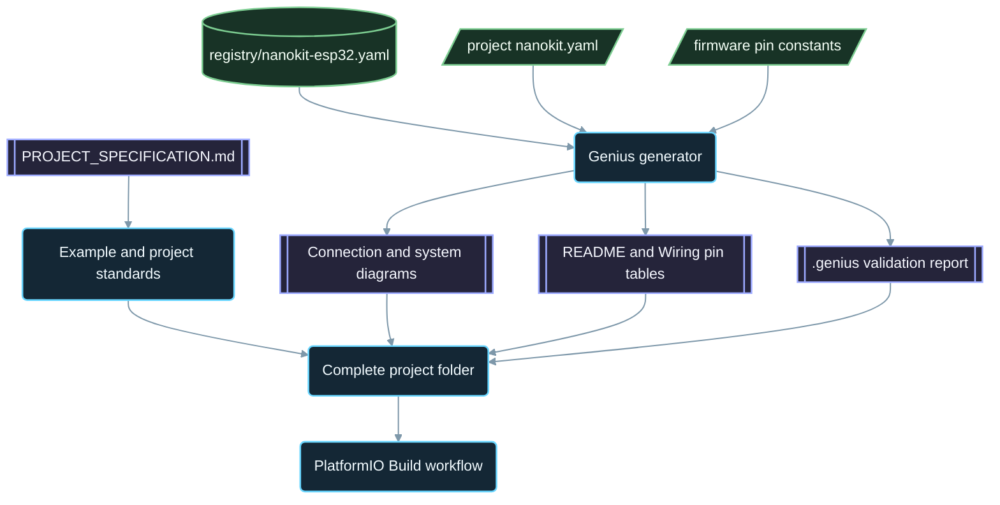

<div align="center">

# NanoKit-ESP32

**L'écosystème PlatformIO officiel de la carte de développement NanoKit Integrated ESP32**

<p>
<a href="../../README.md">English</a> ·
<a href="README.zh-CN.md">简体中文</a> ·
<a href="README.zh-TW.md">繁體中文</a> ·
<a href="README.ja.md">日本語</a> ·
<a href="README.ko.md">한국어</a> ·
<a href="README.tr.md">Türkçe</a> ·
<a href="README.ru.md">Русский</a> ·
<a href="README.vi.md">Tiếng Việt</a> ·
<a href="README.th.md">ไทย</a> ·
<a href="README.de.md">Deutsch</a> ·
<a href="README.es.md">Español</a> ·
<strong>Français</strong> ·
<a href="README.uk.md">Українська</a> ·
<a href="README.pl.md">Polski</a> ·
<a href="README.pt-BR.md">Português (Brasil)</a> ·
<a href="README.ar.md">العربية</a> ·
<a href="README.fa.md">فارسی</a> ·
<a href="README.id.md">Bahasa Indonesia</a> ·
<a href="README.it.md">Italiano</a> ·
<a href="README.el.md">Ελληνικά</a> ·
<a href="README.ml.md">മലയാളം</a> ·
<a href="README.ur-Latn.md">Roman Urdu</a> ·
<a href="README.ro.md">Română</a>
</p>

<p>
<a href="https://github.com/ProAmineOfficial/NanoKit-ESP32/stargazers"></a>
<a href="https://github.com/ProAmineOfficial/NanoKit-ESP32/commits/main"></a>
<a href="../../LICENSE"></a>
<a href="https://github.com/ProAmineOfficial/NanoKit-ESP32/actions/workflows/platformio-build.yml"></a>
<a href="https://github.com/ProAmineOfficial/NanoKit-ESP32/actions/workflows/repository-index.yml"></a>
</p>

<p>
<a href="https://proamine.tech"></a>
<a href="https://gitarchitecturediagram.com/ProAmineOfficial/NanoKit-ESP32"></a>

</p>

**Developed by Amine Saoud ibn al-Bashir.**

</div>

> **Note de traduction :** cette page est une traduction du [README en anglais](../../README.md). En cas de divergence, c'est le README en anglais qui fait foi.

##  Fiche technique du brochage de la NanoKit Integrated ESP32


La carte de développement NanoKit Integrated ESP32 est une plateforme de développement embarqué pour l'IoT, l'IA, la robotique, l'enseignement et le prototypage professionnel. Ce dépôt est organisé en exemples PlatformIO, applications complètes, projets open source, projets de fin d'études, ressources de simulation, documentation, articles, tutoriels et modèles réutilisables.

La carte NanoKit s'inscrit dans la vision matérielle plus large d'UMT, mais le firmware de ce dépôt utilise du C++ Arduino standard sous PlatformIO et les numéros GPIO de l'ESP32, de sorte que chaque projet se compile et s'exécute directement dans PlatformIO.

##  Mission du dépôt

Il ne s'agit ni d'un dépôt de démonstration ni d'un dépôt modèle. C'est le dépôt officiel et pérenne de l'écosystème NanoKit-ESP32, consacré au développement de systèmes embarqués à des fins pédagogiques et professionnelles : chaque projet enseigne le code, le câblage, l'algorithme, la correspondance des broches NanoKit et la démarche de dépannage.

Consultez [PROJECT_SPECIFICATION.md](../../PROJECT_SPECIFICATION.md) pour les règles fondamentales du dépôt, le modèle de croissance, les standards des exemples, les exigences de documentation et la Definition of Done.

##  Démarrage rapide

1. Installez [VS Code](https://code.visualstudio.com/) avec l'extension [PlatformIO IDE](https://platformio.org/install/ide?install=vscode), ou bien la CLI PlatformIO Core.
2. Clonez le dépôt et ouvrez un exemple. [`digital_input_output`](../../examples_on_platformio/digital_input_output/) est le premier à essayer : un bouton, une LED et la LED intégrée à la carte.
3. Branchez la NanoKit en USB, puis compilez, téléversez et ouvrez le Serial Monitor :

```bash
git clone https://github.com/ProAmineOfficial/NanoKit-ESP32.git
cd NanoKit-ESP32/examples_on_platformio/digital_input_output
pio run --target upload
pio device monitor -b 115200
```

Le README de chaque projet indique les composants, la table des broches NanoKit, l'ordre de câblage et la sortie attendue dans le Serial Monitor.

##  Organisation du dépôt

| Chemin | Rôle |
|---|---|
| [`examples_on_platformio/`](../../examples_on_platformio/README.md) | Exemples PlatformIO ciblés, sans interface utilisateur : une fonctionnalité de la carte, un capteur ou un module par exemple. |
| [`applications_on_platformio/`](../../applications_on_platformio/README.md) | Applications complètes avec interface utilisateur, comme des applications web servies par la NanoKit avec boutons, curseurs et tableaux de bord. |
| [`open_source_projects/`](../../open_source_projects/README.md) | Projets NanoKit originaux de plus grande envergure, comme NanoKit Drone 4X, ainsi que des espaces dédiés à la communauté, aux contributeurs, aux vitrines de projets et aux hackathons. |
| [`graduation_projects/`](../../graduation_projects/README.md) | Espaces de travail pour les projets de licence, de master, d'école d'ingénieurs, d'institut, de synthèse (capstone) et de mémoire. |
| `tutorials/` | Tutoriels du niveau débutant au niveau avancé, guides de projet et index de liens vidéo. |
| `articles/` | Articles techniques sur les systèmes embarqués, l'IoT, l'IA, la robotique, PlatformIO, NanoKit et UMT. |
| `docs/` | Prise en main, installation, matériel, logiciel, API, dépannage, feuille de route, architecture et traductions. |
| `registry/` | La carte NanoKit sous forme de données : chaque broche des connecteurs, chaque GPIO, chaque adresse VR et chaque règle électrique. |
| `tools/` | Automatisation du dépôt : le générateur Genius et le générateur d'index. |
| `simulator/` | Simulateur web, moteur de simulation, exemples et ressources du simulateur. |
| `templates/` | Modèles réutilisables pour les exemples, les applications, les mémoires et la documentation. |
| `assets/` | Images, icônes, logos, bannières et vidéos partagés. |

##  Manifestes matériels et documentation générée

Chaque exemple, application, projet open source et projet de fin d'études décrit son matériel une seule fois, dans un manifeste `nanokit.yaml`. `python tools/genius/generate.py` le valide par rapport au registre de la carte [`registry/nanokit-esp32.yaml`](../../registry/nanokit-esp32.yaml) et aux constantes de broches du firmware, puis régénère :

- `images/connection-diagram.md` et `images/system-diagram.md` avec des libellés `Pin <NanoKit pin> / GPIO<n>` et les styles Confirmed / Proposed / Blocked,
- la table des broches NanoKit dans le README de chaque projet et la table de connexions dans chaque `docs/Wiring.md`,
- `.genius/VALIDATION_REPORT.md` avec les règles vérifiées, les constats et les preuves tirées du code.

Une broche sur la flash interne, une sortie sur une broche en entrée seule, un signal 5 V sans adaptation de niveau ou un manifeste en désaccord avec le code bloque le commit et la pull request. Le projet de référence est [`examples_on_platformio/ultrasonic_distance/`](../../examples_on_platformio/ultrasonic_distance/). Schéma et règles : [`tools/genius/README.md`](../../tools/genius/README.md). Dossier de conception : [`docs/software/genius-generator-spec.md`](../../docs/software/genius-generator-spec.md).

##  Index générés

- L'[index du dépôt](../../REPOSITORY_INDEX.md) résume les principales zones du dépôt et compte les projets réels (dossiers dotés d'un manifeste).
- L'[arborescence du dépôt](../../REPOSITORY_TREE.md) affiche l'arborescence de fichiers générée.
- Le [backlog des projets](../../docs/roadmap/project-backlog.md) répertorie chaque exemple, application, tutoriel et article prévu en cinq vagues ; sa colonne Status et le [résumé de la feuille de route](../../docs/roadmap/README.md) sont actualisés automatiquement.
- Chaque projet PlatformIO est compilé par le [workflow PlatformIO Build](../../.github/workflows/platformio-build.yml) à chaque push et à chaque pull request.

Exécutez `python tools/genius/generate.py` puis `python tools/update_repository_index.py` après avoir ajouté ou modifié un projet. Activez une fois pour toutes le hook local avec `git config core.hooksPath .githooks` ; le workflow GitHub exécute ces deux mêmes outils à chaque push sur `main` et valide les pull requests.

##  Arborescence interactive du dépôt

L'arborescence ci-dessous est générée à partir du contenu actuel du dépôt. Sélectionnez son titre pour la déplier ou la replier. Le hook pre-commit local et le workflow GitHub l'actualisent automatiquement lorsque des projets ou des fichiers sont ajoutés, déplacés ou supprimés.

L'arborescence complète générée se trouve dans [REPOSITORY_TREE.md](../../REPOSITORY_TREE.md) ; le README en anglais l'affiche sous forme de liste dépliable.

##  Comment le dépôt est construit



##  Projet open source à la une

[NanoKit Drone 4X (quadricoptère)](../../open_source_projects/nanokit_drone_4x_quadcopter/README.md) est la référence de contrôle de vol Quad-X du dépôt, conçue en donnant la priorité à la sécurité. Un contrôleur de vol NanoKit exécute une boucle de régulation à 250 Hz avec mixage moteur Quad-X et verrous de sécurité, un Flight Deck dans le navigateur se connecte via Wi-Fi et WebSocket, et une seconde NanoKit gère une charge utile caméra et audio isolée, sans aucune autorité sur les moteurs. Le projet est en phase de développement sur banc : les hélices restent démontées et la sortie moteur reste au minimum sûr jusqu'à ce que le protocole ESC soit vérifié.

##  Contrat de qualité

Le contenu officiel de ce dépôt doit être prêt pour la production, pédagogique, complet et maintenable.

- Ne laissez pas de répertoires vides comme travail final.
- N'ajoutez pas de contenu provisoire lorsqu'un véritable matériel pédagogique peut être fourni.
- Appuyez-vous sur le travail existant au lieu de l'écraser inutilement.
- Chaque exemple enseigne le code, le câblage, l'algorithme, la correspondance des broches et la démarche de dépannage.
- Chaque exemple matériel documente les numéros de broche NanoKit et les numéros GPIO de l'ESP32, écrits en entier sous la forme « Pin 36 / GPIO5 ».

Utilisez [docs/software/platformio-example-standard.md](../../docs/software/platformio-example-standard.md) pour créer ou relire des exemples.

##  Configuration de base PlatformIO

Les projets PlatformIO utilisent le framework Arduino pour ESP32 comme première base publique :

```ini
[env:nanokit_esp32]
; espressif32 8.0.0 = Arduino-ESP32 core 3.3.12, pinned so a platform update cannot break the build
platform = espressif32 @ 8.0.0
board = esp32dev
framework = arduino
monitor_speed = 115200
upload_speed = 921600
```

Des définitions de carte dédiées à NanoKit pourront remplacer le profil de carte générique `esp32dev` à mesure que le paquet matériel évoluera.

##  Règle du firmware

Les exemples officiels de ce dépôt doivent utiliser :

- PlatformIO
- Le framework Arduino pour ESP32
- C++
- Une documentation en Markdown
- Les numéros GPIO ESP32 habituels dans le code source

N'utilisez pas de code du SDK UMT ni de code de la Virtual Register API dans les exemples PlatformIO.

##  Brochage matériel

Utilisez [docs/hardware/nanokit-integrated-esp32-pinout.md](../../docs/hardware/nanokit-integrated-esp32-pinout.md) comme source de référence pour les numéros de broche NanoKit, les correspondances GPIO de l'ESP32, les notes électriques et les avertissements.

Chaque exemple matériel documente :

```text
NanoKit Pin -> GPIO -> Component Pin -> Description
```

Restrictions importantes :

- GPIO34, GPIO35, GPIO36 et GPIO39 fonctionnent en entrée uniquement.
- GPIO6, GPIO7, GPIO8, GPIO9, GPIO10 et GPIO11 sont reliés à la flash SPI interne et ne doivent pas être utilisés.
- GPIO0 est la broche BOOT.
- GPIO1 et GPIO3 sont partagés avec la liaison série USB.
- EN correspond à Reset / Enable et n'est pas un GPIO.

##  Feuille de route

Le [backlog des projets](../../docs/roadmap/project-backlog.md) planifie la bibliothèque en cinq vagues : fondamentaux de la carte, capteurs et modules, applications web, protocoles et cloud, et modules externes. Le [résumé de la feuille de route](../../docs/roadmap/README.md) indique combien de projets de chaque vague sont terminés.

##  Contribuer

Les contributions sont les bienvenues. Lisez d'abord [CONTRIBUTING.md](../../CONTRIBUTING.md) : il présente les standards du projet, le manifeste `nanokit.yaml`, le hook pre-commit et la licence des contributions.

##  Traductions

Ce README est disponible en 23 langues grâce à la barre de langues en haut de la page. Les traductions se trouvent dans [`docs/i18n/`](../../docs/i18n/) ; lorsqu'une traduction diffère du README en anglais, c'est le README en anglais qui fait foi.

##  Assistance

-  Site web : [https://proamine.tech](https://proamine.tech)
-  Git Architecture Diagram : [https://gitarchitecturediagram.com](https://gitarchitecturediagram.com/ProAmineOfficial/NanoKit-ESP32)
-  E-mail : `technology@proamine.tech`
-  TikTok : [@pro_amine](https://www.tiktok.com/@pro_amine)
-  YouTube : [@pro_amine](https://www.youtube.com/@pro_amine)

##  Licence

NanoKit-ESP32 est distribué sous la [GNU Affero General Public License v3.0 only](../../LICENSE) (`AGPL-3.0-only`), avec des conditions supplémentaires au titre de la section 7, énumérées dans [NOTICE](../../NOTICE) :

- **Attribution :** chaque copie ou version modifiée conserve la ligne « Developed by Amine Saoud ibn al-Bashir. » et indique qu'elle est basée sur NanoKit-ESP32 d'Amine Saoud ibn al-Bashir (Pro_Amine LLC).
- **Les versions modifiées** sont signalées comme différentes de l'original et ne sont pas présentées comme le dépôt officiel NanoKit-ESP32.
- **Noms :** aucun droit n'est accordé sur les noms NanoKit, Pro_Amine ou UMT, ni sur leurs logos ; une version redistribuée utilise son propre nom.
- **Utilisation en réseau :** si vous exploitez une version modifiée en tant que service réseau, l'AGPL vous oblige à en proposer le code source à ses utilisateurs.

Vous êtes libre d'étudier, d'utiliser et de modifier ce code pour apprendre, enseigner, faire de la recherche et mener vos propres projets selon ces conditions. Les versions publiées avant le passage à l'AGPL étaient distribuées sous l'Apache License 2.0. Les icônes Fluent Emoji de `assets/icons/fluent/` sont © Microsoft Corporation et distribuées sous la MIT License.

<div align="center">

**Developed by Amine Saoud ibn al-Bashir · © 2026 Pro_Amine LLC**

</div>
