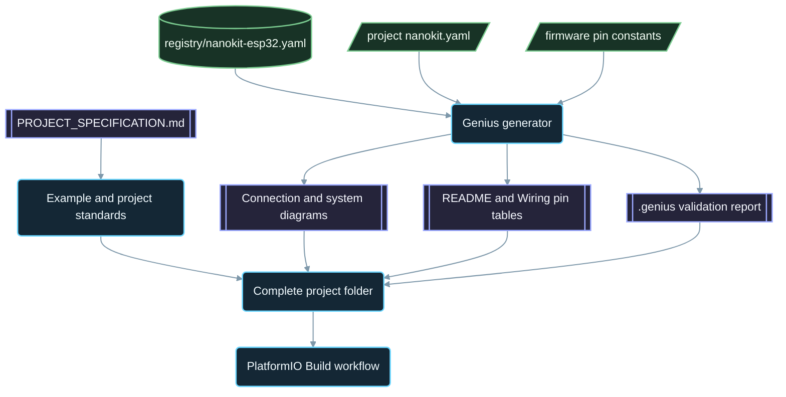

<div align="center">

# NanoKit-ESP32

**Ekosistem PlatformIO resmi untuk papan pengembangan NanoKit Integrated ESP32**

<p>
<a href="../../README.md">English</a> ·
<a href="README.zh-CN.md">简体中文</a> ·
<a href="README.zh-TW.md">繁體中文</a> ·
<a href="README.ja.md">日本語</a> ·
<a href="README.ko.md">한국어</a> ·
<a href="README.tr.md">Türkçe</a> ·
<a href="README.ru.md">Русский</a> ·
<a href="README.vi.md">Tiếng Việt</a> ·
<a href="README.th.md">ไทย</a> ·
<a href="README.de.md">Deutsch</a> ·
<a href="README.es.md">Español</a> ·
<a href="README.fr.md">Français</a> ·
<a href="README.uk.md">Українська</a> ·
<a href="README.pl.md">Polski</a> ·
<a href="README.pt-BR.md">Português (Brasil)</a> ·
<a href="README.ar.md">العربية</a> ·
<a href="README.fa.md">فارسی</a> ·
<strong>Bahasa Indonesia</strong> ·
<a href="README.it.md">Italiano</a> ·
<a href="README.el.md">Ελληνικά</a> ·
<a href="README.ml.md">മലയാളം</a> ·
<a href="README.ur-Latn.md">Roman Urdu</a> ·
<a href="README.ro.md">Română</a>
</p>

<p>
<a href="https://github.com/ProAmineOfficial/NanoKit-ESP32/stargazers"></a>
<a href="https://github.com/ProAmineOfficial/NanoKit-ESP32/commits/main"></a>
<a href="../../LICENSE"></a>
<a href="https://github.com/ProAmineOfficial/NanoKit-ESP32/actions/workflows/platformio-build.yml"></a>
<a href="https://github.com/ProAmineOfficial/NanoKit-ESP32/actions/workflows/repository-index.yml"></a>
</p>

<p>
<a href="https://proamine.tech"></a>
<a href="https://gitarchitecturediagram.com/ProAmineOfficial/NanoKit-ESP32"></a>

</p>

**Developed by Amine Saoud ibn al-Bashir.**

</div>

> **Catatan terjemahan:** halaman ini merupakan terjemahan dari [README berbahasa Inggris](../../README.md). Jika keduanya berbeda, README berbahasa Inggris yang berlaku.

##  Lembar Data Pinout NanoKit Integrated ESP32


Papan pengembangan NanoKit Integrated ESP32 adalah platform pengembangan sistem tertanam untuk IoT, AI, robotika, pendidikan, dan pembuatan prototipe profesional. Repositori ini disusun untuk contoh PlatformIO, aplikasi lengkap, proyek open source, proyek tugas akhir, sumber daya simulasi, dokumentasi, artikel, tutorial, dan templat yang dapat digunakan ulang.

Papan NanoKit merupakan bagian dari visi perangkat keras UMT yang lebih luas, tetapi firmware di repositori ini menggunakan C++ Arduino standar di PlatformIO dan nomor GPIO ESP32, sehingga setiap proyek dapat dikompilasi dan dijalankan langsung di PlatformIO.

##  Misi Repositori

Ini bukan repositori demo dan bukan pula repositori templat. Ini adalah repositori resmi jangka panjang untuk ekosistem NanoKit-ESP32 dalam pengembangan sistem tertanam di bidang pendidikan maupun profesional: setiap proyek mengajarkan kode, pengkabelan, algoritma, pemetaan pin NanoKit, dan langkah-langkah pemecahan masalah.

Lihat [PROJECT_SPECIFICATION.md](../../PROJECT_SPECIFICATION.md) untuk aturan utama repositori, model pertumbuhan, standar contoh, persyaratan dokumentasi, dan Definition of Done.

##  Mulai Cepat

1. Instal [VS Code](https://code.visualstudio.com/) beserta ekstensi [PlatformIO IDE](https://platformio.org/install/ide?install=vscode), atau PlatformIO Core CLI.
2. Kloning repositori, lalu buka sebuah contoh. [`digital_input_output`](../../examples_on_platformio/digital_input_output/) adalah contoh pertama yang sebaiknya dicoba: sebuah tombol, sebuah LED, dan LED bawaan papan.
3. Hubungkan NanoKit melalui USB, lalu lakukan build, unggah firmware, dan buka Serial Monitor:

```bash
git clone https://github.com/ProAmineOfficial/NanoKit-ESP32.git
cd NanoKit-ESP32/examples_on_platformio/digital_input_output
pio run --target upload
pio device monitor -b 115200
```

README setiap proyek mencantumkan komponen, tabel pin NanoKit, urutan pengkabelan, dan keluaran Serial Monitor yang diharapkan.

##  Struktur Repositori

| Jalur | Fungsi |
|---|---|
| [`examples_on_platformio/`](../../examples_on_platformio/README.md) | Contoh PlatformIO yang terfokus tanpa antarmuka pengguna: satu fitur papan, sensor, atau modul per contoh. |
| [`applications_on_platformio/`](../../applications_on_platformio/README.md) | Aplikasi lengkap dengan antarmuka pengguna, misalnya aplikasi web yang disajikan oleh NanoKit dengan tombol, slider, dan dasbor. |
| [`open_source_projects/`](../../open_source_projects/README.md) | Proyek NanoKit orisinal berskala lebih besar seperti NanoKit Drone 4X, serta area untuk komunitas, kontributor, etalase proyek, dan hackathon. |
| [`graduation_projects/`](../../graduation_projects/README.md) | Ruang kerja untuk proyek sarjana, magister, teknik, institut, capstone, dan tesis. |
| `tutorials/` | Tutorial dari tingkat pemula hingga mahir, panduan proyek, dan indeks tautan video. |
| `articles/` | Artikel teknis tentang sistem tertanam, IoT, AI, robotika, PlatformIO, NanoKit, dan UMT. |
| `docs/` | Panduan memulai, instalasi, perangkat keras, perangkat lunak, API, pemecahan masalah, peta jalan, arsitektur, dan terjemahan. |
| `registry/` | Papan NanoKit dalam bentuk data: setiap pin header, GPIO, alamat VR, dan aturan kelistrikan. |
| `tools/` | Otomatisasi repositori: generator Genius dan generator indeks. |
| `simulator/` | Simulator web, mesin simulasi, contoh, dan aset simulator. |
| `templates/` | Templat yang dapat digunakan ulang untuk contoh, aplikasi, tesis, dan dokumentasi. |
| `assets/` | Gambar, ikon, logo, banner, dan video yang digunakan bersama. |

##  Manifes Perangkat Keras dan Dokumentasi yang Dihasilkan

Setiap contoh, aplikasi, proyek open source, dan proyek tugas akhir menjelaskan perangkat kerasnya satu kali saja, dalam manifes `nanokit.yaml`. `python tools/genius/generate.py` memvalidasinya terhadap registri papan [`registry/nanokit-esp32.yaml`](../../registry/nanokit-esp32.yaml) dan terhadap konstanta pin di firmware, lalu membuat ulang:

- `images/connection-diagram.md` dan `images/system-diagram.md` dengan label `Pin <NanoKit pin> / GPIO<n>` serta gaya Confirmed / Proposed / Blocked,
- tabel pin NanoKit di README setiap proyek dan tabel koneksi di setiap `docs/Wiring.md`,
- `.genius/VALIDATION_REPORT.md` yang berisi aturan yang diperiksa, temuan, dan bukti dari kode.

Pin yang terhubung ke flash internal, output pada pin khusus input, sinyal 5 V tanpa penyesuaian level tegangan, atau manifes yang tidak sesuai dengan kode akan menghentikan commit dan pull request. Proyek acuannya adalah [`examples_on_platformio/ultrasonic_distance/`](../../examples_on_platformio/ultrasonic_distance/). Skema dan aturan: [`tools/genius/README.md`](../../tools/genius/README.md). Catatan desain: [`docs/software/genius-generator-spec.md`](../../docs/software/genius-generator-spec.md).

##  Indeks yang Dihasilkan

- [Indeks Repositori](../../REPOSITORY_INDEX.md) merangkum area utama repositori dan menghitung proyek nyata (folder yang memiliki manifes).
- [Pohon Repositori](../../REPOSITORY_TREE.md) menampilkan pohon berkas yang dihasilkan.
- [Backlog Proyek](../../docs/roadmap/project-backlog.md) mencantumkan setiap contoh, aplikasi, tutorial, dan artikel yang direncanakan dalam lima gelombang; kolom Status-nya dan [ringkasan peta jalan](../../docs/roadmap/README.md) diperbarui secara otomatis.
- Setiap proyek PlatformIO dikompilasi oleh [workflow PlatformIO Build](../../.github/workflows/platformio-build.yml) pada setiap push dan pull request.

Jalankan `python tools/genius/generate.py`, lalu `python tools/update_repository_index.py` setelah menambahkan atau mengubah proyek. Aktifkan hook lokal sekali saja dengan `git config core.hooksPath .githooks`; workflow GitHub menjalankan kedua alat yang sama pada setiap push ke `main` dan memvalidasi pull request.

##  Pohon Repositori Interaktif

Pohon di bawah ini dihasilkan dari isi repositori saat ini. Pilih judulnya untuk membuka atau menutupnya. Hook pre-commit lokal dan workflow GitHub memperbaruinya secara otomatis ketika proyek atau berkas ditambahkan, dipindahkan, atau dihapus.

Pohon lengkap yang dihasilkan tersedia di [REPOSITORY_TREE.md](../../REPOSITORY_TREE.md); README berbahasa Inggris menampilkannya sebagai daftar yang dapat dibuka dan ditutup.

##  Cara Repositori Ini Dibangun



##  Proyek Open Source Unggulan

[NanoKit Drone 4X (Quadcopter)](../../open_source_projects/nanokit_drone_4x_quadcopter/README.md) adalah referensi kendali terbang Quad-X di repositori ini yang mengutamakan keselamatan. Sebuah pengendali terbang NanoKit menjalankan loop kendali 250 Hz dengan pencampuran motor Quad-X dan gerbang keselamatan, Flight Deck berbasis browser terhubung melalui Wi-Fi dan WebSocket, dan NanoKit kedua menjalankan muatan kamera dan audio yang terisolasi tanpa wewenang apa pun atas motor. Proyek ini masih dalam tahap pengembangan di meja uji: baling-baling tetap dilepas dan keluaran motor tetap pada batas minimum yang aman hingga protokol ESC terverifikasi.

##  Kontrak Kualitas

Konten resmi di repositori ini harus siap produksi, edukatif, lengkap, dan mudah dipelihara.

- Jangan meninggalkan direktori kosong sebagai hasil akhir.
- Jangan menambahkan konten pengisi jika materi edukatif yang nyata dapat disediakan.
- Bangun di atas karya yang sudah ada alih-alih menimpanya tanpa perlu.
- Setiap contoh mengajarkan kode, pengkabelan, algoritma, pemetaan pin, dan langkah-langkah pemecahan masalah.
- Setiap contoh perangkat keras mendokumentasikan nomor pin NanoKit dan nomor GPIO ESP32, ditulis lengkap sebagai "Pin 36 / GPIO5".

Gunakan [docs/software/platformio-example-standard.md](../../docs/software/platformio-example-standard.md) saat membuat atau meninjau contoh.

##  Konfigurasi Dasar PlatformIO

Proyek PlatformIO menggunakan framework Arduino untuk ESP32 sebagai acuan dasar publik pertama:

```ini
[env:nanokit_esp32]
platform = espressif32
board = esp32dev
framework = arduino
monitor_speed = 115200
upload_speed = 921600
```

Definisi papan khusus NanoKit dapat menggantikan profil papan generik `esp32dev` seiring berkembangnya paket perangkat keras.

##  Aturan Firmware

Contoh resmi di repositori ini wajib menggunakan:

- PlatformIO
- Framework Arduino untuk ESP32
- C++
- Dokumentasi Markdown
- Nomor GPIO ESP32 biasa di kode sumber

Jangan gunakan kode UMT SDK atau kode Virtual Register API dalam contoh PlatformIO.

##  Pinout Perangkat Keras

Gunakan [docs/hardware/nanokit-integrated-esp32-pinout.md](../../docs/hardware/nanokit-integrated-esp32-pinout.md) sebagai sumber acuan utama untuk nomor pin NanoKit, pemetaan GPIO ESP32, catatan kelistrikan, dan peringatan.

Setiap contoh perangkat keras mendokumentasikan:

```text
NanoKit Pin -> GPIO -> Component Pin -> Description
```

Batasan penting:

- GPIO34, GPIO35, GPIO36, dan GPIO39 hanya dapat digunakan sebagai input.
- GPIO6, GPIO7, GPIO8, GPIO9, GPIO10, dan GPIO11 adalah pin flash SPI internal dan tidak boleh digunakan.
- GPIO0 adalah pin BOOT.
- GPIO1 dan GPIO3 digunakan bersama oleh Serial USB.
- EN adalah Reset / Enable dan bukan GPIO.

##  Peta Jalan

[Backlog Proyek](../../docs/roadmap/project-backlog.md) merencanakan koleksi proyek ini dalam lima gelombang: dasar-dasar papan, sensor dan modul, aplikasi web, protokol dan cloud, serta modul eksternal. [Ringkasan peta jalan](../../docs/roadmap/README.md) menunjukkan berapa banyak proyek dari setiap gelombang yang sudah selesai.

##  Berkontribusi

Kontribusi sangat diterima. Baca [CONTRIBUTING.md](../../CONTRIBUTING.md) terlebih dahulu: dokumen itu menjelaskan standar proyek, manifes `nanokit.yaml`, hook pre-commit, dan lisensi kontribusi.

##  Terjemahan

README ini tersedia dalam 23 bahasa melalui bilah bahasa di bagian atas. Terjemahannya berada di [`docs/i18n/`](../../docs/i18n/); jika sebuah terjemahan berbeda dengan README berbahasa Inggris, README berbahasa Inggris yang berlaku.

##  Dukungan

-  Situs web: [https://proamine.tech](https://proamine.tech)
-  Git Architecture Diagram: [https://gitarchitecturediagram.com](https://gitarchitecturediagram.com/ProAmineOfficial/NanoKit-ESP32)
-  Email: `technology@proamine.tech`
-  TikTok: [@pro_amine](https://www.tiktok.com/@pro_amine)
-  YouTube: [@pro_amine](https://www.youtube.com/@pro_amine)

##  Lisensi

NanoKit-ESP32 dilisensikan di bawah [GNU Affero General Public License v3.0 only](../../LICENSE) (`AGPL-3.0-only`), dengan ketentuan tambahan berdasarkan bagian 7 yang tercantum dalam [NOTICE](../../NOTICE):

- **Atribusi:** setiap salinan atau versi modifikasi mempertahankan baris "Developed by Amine Saoud ibn al-Bashir." dan menyatakan bahwa versi tersebut didasarkan pada NanoKit-ESP32 karya Amine Saoud ibn al-Bashir (Pro_Amine LLC).
- **Versi modifikasi** ditandai sebagai berbeda dari versi asli dan tidak ditampilkan sebagai repositori resmi NanoKit-ESP32.
- **Nama:** tidak ada hak yang diberikan atas nama NanoKit, Pro_Amine, atau UMT, maupun atas logonya; versi yang didistribusikan ulang menggunakan namanya sendiri.
- **Penggunaan jaringan:** jika Anda menjalankan versi modifikasi sebagai layanan jaringan, AGPL mewajibkan Anda menyediakan kode sumbernya bagi para penggunanya.

Anda bebas mempelajari, menggunakan, dan memodifikasi kode ini untuk belajar, mengajar, riset, dan proyek Anda sendiri sesuai ketentuan tersebut. Versi yang diterbitkan sebelum peralihan ke AGPL didistribusikan di bawah Apache License 2.0. Ikon Fluent Emoji di `assets/icons/fluent/` adalah © Microsoft Corporation dan dilisensikan di bawah MIT License.

<div align="center">

**Developed by Amine Saoud ibn al-Bashir · © 2026 Pro_Amine LLC**

</div>
