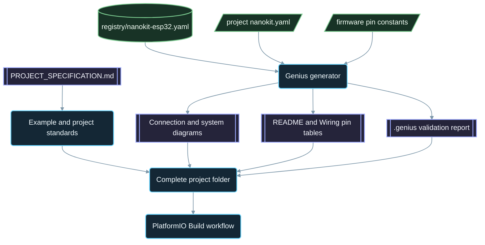

<div align="center">

# NanoKit-ESP32

**L'ecosistema PlatformIO ufficiale per la scheda di sviluppo NanoKit Integrated ESP32**

<p>
<a href="../../README.md">English</a> ·
<a href="README.zh-CN.md">简体中文</a> ·
<a href="README.zh-TW.md">繁體中文</a> ·
<a href="README.ja.md">日本語</a> ·
<a href="README.ko.md">한국어</a> ·
<a href="README.tr.md">Türkçe</a> ·
<a href="README.ru.md">Русский</a> ·
<a href="README.vi.md">Tiếng Việt</a> ·
<a href="README.th.md">ไทย</a> ·
<a href="README.de.md">Deutsch</a> ·
<a href="README.es.md">Español</a> ·
<a href="README.fr.md">Français</a> ·
<a href="README.uk.md">Українська</a> ·
<a href="README.pl.md">Polski</a> ·
<a href="README.pt-BR.md">Português (Brasil)</a> ·
<a href="README.ar.md">العربية</a> ·
<a href="README.fa.md">فارسی</a> ·
<a href="README.id.md">Bahasa Indonesia</a> ·
<strong>Italiano</strong> ·
<a href="README.el.md">Ελληνικά</a> ·
<a href="README.ml.md">മലയാളം</a> ·
<a href="README.ur-Latn.md">Roman Urdu</a> ·
<a href="README.ro.md">Română</a>
</p>

<p>
<a href="https://github.com/ProAmineOfficial/NanoKit-ESP32/stargazers"></a>
<a href="https://github.com/ProAmineOfficial/NanoKit-ESP32/commits/main"></a>
<a href="../../LICENSE"></a>
<a href="https://github.com/ProAmineOfficial/NanoKit-ESP32/actions/workflows/platformio-build.yml"></a>
<a href="https://github.com/ProAmineOfficial/NanoKit-ESP32/actions/workflows/repository-index.yml"></a>
</p>

<p>
<a href="https://proamine.tech"></a>
<a href="https://gitarchitecturediagram.com/ProAmineOfficial/NanoKit-ESP32"></a>

</p>

**Developed by Amine Saoud ibn al-Bashir.**

</div>

> **Nota sulla traduzione:** questa pagina è una traduzione del [README in inglese](../../README.md). In caso di differenze, fa fede il README in inglese.

##  Datasheet della piedinatura della NanoKit Integrated ESP32


La scheda di sviluppo NanoKit Integrated ESP32 è una piattaforma di sviluppo embedded per IoT, IA, robotica, didattica e prototipazione professionale. Questo repository è organizzato in esempi PlatformIO, applicazioni complete, progetti open source, progetti di laurea, risorse di simulazione, documentazione, articoli, tutorial e modelli riutilizzabili.

La scheda NanoKit fa parte della più ampia visione hardware di UMT, ma il firmware di questo repository usa il C++ Arduino standard di PlatformIO e i numeri GPIO dell'ESP32, così ogni progetto si compila e si esegue direttamente in PlatformIO.

##  Missione del repository

Questo non è un repository dimostrativo né un repository modello. È il repository ufficiale e di lungo periodo dell'ecosistema NanoKit-ESP32 per lo sviluppo di sistemi embedded in ambito didattico e professionale: ogni progetto insegna il codice, il cablaggio, l'algoritmo, la mappatura dei pin NanoKit e il percorso di risoluzione dei problemi.

Consulta [PROJECT_SPECIFICATION.md](../../PROJECT_SPECIFICATION.md) per le regole principali del repository, il modello di crescita, gli standard degli esempi, i requisiti di documentazione e la Definition of Done.

##  Avvio rapido

1. Installa [VS Code](https://code.visualstudio.com/) con l'estensione [PlatformIO IDE](https://platformio.org/install/ide?install=vscode), oppure la CLI di PlatformIO Core.
2. Clona il repository e apri un esempio. [`digital_input_output`](../../examples_on_platformio/digital_input_output/) è il primo da provare: un pulsante, un LED e il LED integrato sulla scheda.
3. Collega la NanoKit via USB, quindi compila, carica il firmware e apri il Serial Monitor:

```bash
git clone https://github.com/ProAmineOfficial/NanoKit-ESP32.git
cd NanoKit-ESP32/examples_on_platformio/digital_input_output
pio run --target upload
pio device monitor -b 115200
```

Il README di ogni progetto elenca i componenti, la tabella dei pin NanoKit, l'ordine di cablaggio e l'output atteso nel Serial Monitor.

##  Struttura del repository

| Percorso | Scopo |
|---|---|
| [`examples_on_platformio/`](../../examples_on_platformio/README.md) | Esempi PlatformIO mirati, senza interfaccia utente: una funzionalità della scheda, un sensore o un modulo per esempio. |
| [`applications_on_platformio/`](../../applications_on_platformio/README.md) | Applicazioni complete con interfaccia utente, come web app servite dalla NanoKit con pulsanti, cursori e dashboard. |
| [`open_source_projects/`](../../open_source_projects/README.md) | Progetti NanoKit originali di maggiori dimensioni, come NanoKit Drone 4X, oltre ad aree dedicate a community, contributori, vetrine di progetti e hackathon. |
| [`graduation_projects/`](../../graduation_projects/README.md) | Spazi di lavoro per progetti di laurea triennale e magistrale, di ingegneria, di istituto, capstone e di tesi. |
| `tutorials/` | Tutorial dal livello base a quello avanzato, guide ai progetti e indici di link a video. |
| `articles/` | Articoli tecnici su sistemi embedded, IoT, IA, robotica, PlatformIO, NanoKit e UMT. |
| `docs/` | Primi passi, installazione, hardware, software, API, risoluzione dei problemi, roadmap, architettura e traduzioni. |
| `registry/` | La scheda NanoKit sotto forma di dati: ogni pin dei connettori, ogni GPIO, ogni indirizzo VR e ogni regola elettrica. |
| `tools/` | Automazione del repository: il generatore Genius e il generatore dell'indice. |
| `simulator/` | Simulatore web, motore di simulazione, esempi e risorse del simulatore. |
| `templates/` | Modelli riutilizzabili per esempi, applicazioni, tesi e documentazione. |
| `assets/` | Immagini, icone, loghi, banner e video condivisi. |

##  Manifest hardware e documentazione generata

Ogni esempio, applicazione, progetto open source e progetto di laurea descrive il proprio hardware una sola volta, in un manifest `nanokit.yaml`. `python tools/genius/generate.py` lo convalida rispetto al registro della scheda [`registry/nanokit-esp32.yaml`](../../registry/nanokit-esp32.yaml) e alle costanti dei pin nel firmware, quindi rigenera:

- `images/connection-diagram.md` e `images/system-diagram.md` con etichette `Pin <NanoKit pin> / GPIO<n>` e stili Confirmed / Proposed / Blocked,
- la tabella dei pin NanoKit nel README di ogni progetto e la tabella dei collegamenti in ogni `docs/Wiring.md`,
- `.genius/VALIDATION_REPORT.md` con le regole verificate, i risultati e le evidenze nel codice.

Un pin sulla flash interna, un'uscita su un pin di solo ingresso, un segnale a 5 V senza traslazione di livello o un manifest in disaccordo con il codice bloccano il commit e la pull request. Il progetto di riferimento è [`examples_on_platformio/ultrasonic_distance/`](../../examples_on_platformio/ultrasonic_distance/). Schema e regole: [`tools/genius/README.md`](../../tools/genius/README.md). Documento di progettazione: [`docs/software/genius-generator-spec.md`](../../docs/software/genius-generator-spec.md).

##  Indici generati

- L'[indice del repository](../../REPOSITORY_INDEX.md) riassume le aree principali del repository e conta i progetti reali (cartelle con un manifest).
- L'[albero del repository](../../REPOSITORY_TREE.md) mostra l'albero dei file generato.
- Il [backlog dei progetti](../../docs/roadmap/project-backlog.md) elenca ogni esempio, applicazione, tutorial e articolo pianificato in cinque ondate; la sua colonna Status e il [riepilogo della roadmap](../../docs/roadmap/README.md) vengono aggiornati automaticamente.
- Ogni progetto PlatformIO viene compilato dal [workflow PlatformIO Build](../../.github/workflows/platformio-build.yml) a ogni push e a ogni pull request.

Dopo aver aggiunto o modificato un progetto, esegui `python tools/genius/generate.py` e poi `python tools/update_repository_index.py`. Attiva una sola volta l'hook locale con `git config core.hooksPath .githooks`; il workflow di GitHub esegue gli stessi due strumenti a ogni push su `main` e convalida le pull request.

##  Albero interattivo del repository

L'albero seguente è generato a partire dal contenuto attuale del repository. Seleziona il titolo per espanderlo o comprimerlo. L'hook pre-commit locale e il workflow di GitHub lo aggiornano automaticamente quando progetti o file vengono aggiunti, spostati o rimossi.

L'albero completo generato si trova in [REPOSITORY_TREE.md](../../REPOSITORY_TREE.md); il README in inglese lo mostra come elenco espandibile.

##  Come è costruito il repository



##  Progetto open source in evidenza

[NanoKit Drone 4X (quadricottero)](../../open_source_projects/nanokit_drone_4x_quadcopter/README.md) è il riferimento di controllo di volo Quad-X del repository, progettato mettendo la sicurezza al primo posto. Un controllore di volo NanoKit esegue un anello di controllo a 250 Hz con mixaggio dei motori Quad-X e blocchi di sicurezza, un Flight Deck nel browser si collega tramite Wi-Fi e WebSocket, e una seconda NanoKit gestisce un payload isolato di videocamera e audio senza alcuna autorità sui motori. Il progetto è in fase di sviluppo al banco: le eliche restano smontate e l'uscita dei motori resta al minimo sicuro finché il protocollo ESC non sarà verificato.

##  Contratto di qualità

I contenuti ufficiali di questo repository devono essere pronti per la produzione, didattici, completi e manutenibili.

- Non lasciare directory vuote come lavoro finale.
- Non aggiungere contenuti segnaposto quando è possibile fornire materiale didattico reale.
- Costruisci sul lavoro esistente invece di sovrascriverlo inutilmente.
- Ogni esempio insegna il codice, il cablaggio, l'algoritmo, la mappatura dei pin e il percorso di risoluzione dei problemi.
- Ogni esempio hardware documenta i numeri dei pin NanoKit e i numeri GPIO dell'ESP32, scritti per esteso come «Pin 36 / GPIO5».

Usa [docs/software/platformio-example-standard.md](../../docs/software/platformio-example-standard.md) quando crei o revisioni degli esempi.

##  Configurazione di base di PlatformIO

I progetti PlatformIO usano il framework Arduino per ESP32 come prima base pubblica:

```ini
[env:nanokit_esp32]
; espressif32 8.0.0 = Arduino-ESP32 core 3.3.12, pinned so a platform update cannot break the build
platform = espressif32 @ 8.0.0
board = esp32dev
framework = arduino
monitor_speed = 115200
upload_speed = 921600
```

Definizioni di scheda dedicate a NanoKit potranno sostituire il profilo di scheda generico `esp32dev` man mano che il pacchetto hardware evolverà.

##  Regola del firmware

Gli esempi ufficiali di questo repository devono usare:

- PlatformIO
- Framework Arduino per ESP32
- C++
- Documentazione in Markdown
- Numeri GPIO standard dell'ESP32 nel codice sorgente

Non usare codice dell'SDK UMT né codice della Virtual Register API negli esempi PlatformIO.

##  Piedinatura hardware

Usa [docs/hardware/nanokit-integrated-esp32-pinout.md](../../docs/hardware/nanokit-integrated-esp32-pinout.md) come fonte di riferimento per i numeri dei pin NanoKit, le corrispondenze GPIO dell'ESP32, le note elettriche e le avvertenze.

Ogni esempio hardware documenta:

```text
NanoKit Pin -> GPIO -> Component Pin -> Description
```

Limitazioni importanti:

- GPIO34, GPIO35, GPIO36 e GPIO39 sono di solo ingresso.
- GPIO6, GPIO7, GPIO8, GPIO9, GPIO10 e GPIO11 sono pin della flash SPI interna e non devono essere usati.
- GPIO0 è il pin BOOT.
- GPIO1 e GPIO3 sono condivisi con la seriale USB.
- EN è Reset / Enable e non è un GPIO.

##  Roadmap

Il [backlog dei progetti](../../docs/roadmap/project-backlog.md) pianifica la raccolta in cinque ondate: fondamenti della scheda, sensori e moduli, applicazioni web, protocolli e cloud, moduli esterni. Il [riepilogo della roadmap](../../docs/roadmap/README.md) mostra quanti progetti di ogni ondata sono completati.

##  Contribuire

I contributi sono benvenuti. Leggi prima [CONTRIBUTING.md](../../CONTRIBUTING.md): spiega gli standard dei progetti, il manifest `nanokit.yaml`, l'hook pre-commit e la licenza dei contributi.

##  Traduzioni

Questo README è disponibile in 23 lingue tramite la barra delle lingue in alto. Le traduzioni si trovano in [`docs/i18n/`](../../docs/i18n/); quando una traduzione e il README in inglese differiscono, fa fede il README in inglese.

##  Supporto

-  Sito web: [https://proamine.tech](https://proamine.tech)
-  Git Architecture Diagram: [https://gitarchitecturediagram.com](https://gitarchitecturediagram.com/ProAmineOfficial/NanoKit-ESP32)
-  Email: `technology@proamine.tech`
-  TikTok: [@pro_amine](https://www.tiktok.com/@pro_amine)
-  YouTube: [@pro_amine](https://www.youtube.com/@pro_amine)

##  Licenza

NanoKit-ESP32 è distribuito con licenza [GNU Affero General Public License v3.0 only](../../LICENSE) (`AGPL-3.0-only`), con termini aggiuntivi ai sensi della sezione 7 elencati in [NOTICE](../../NOTICE):

- **Attribuzione:** ogni copia o versione modificata mantiene la riga «Developed by Amine Saoud ibn al-Bashir.» e dichiara di essere basata su NanoKit-ESP32 di Amine Saoud ibn al-Bashir (Pro_Amine LLC).
- **Le versioni modificate** sono contrassegnate come diverse dall'originale e non vengono presentate come il repository ufficiale NanoKit-ESP32.
- **Nomi:** non viene concesso alcun diritto sui nomi NanoKit, Pro_Amine o UMT né sui relativi loghi; una versione ridistribuita usa un proprio nome.
- **Uso in rete:** se esegui una versione modificata come servizio di rete, la AGPL ti obbliga a offrirne il codice sorgente ai suoi utenti.

Sei libero di studiare, usare e modificare questo codice per imparare, insegnare, fare ricerca e realizzare i tuoi progetti nel rispetto di questi termini. Le versioni pubblicate prima del passaggio alla AGPL erano distribuite con la Apache License 2.0. Le icone Fluent Emoji in `assets/icons/fluent/` sono © Microsoft Corporation e distribuite con la MIT License.

<div align="center">

**Developed by Amine Saoud ibn al-Bashir · © 2026 Pro_Amine LLC**

</div>
