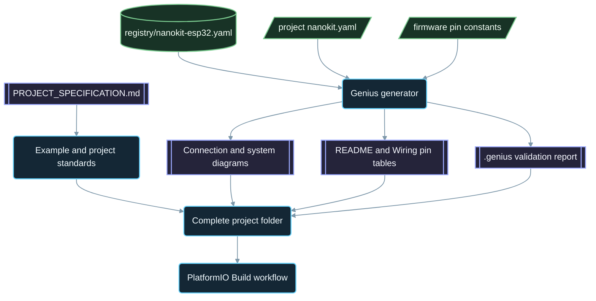

<div align="center">

# NanoKit-ESP32

**NanoKit Integrated ESP32 開発ボードのための公式 PlatformIO エコシステム**

<p>
<a href="../../README.md">English</a> ·
<a href="README.zh-CN.md">简体中文</a> ·
<a href="README.zh-TW.md">繁體中文</a> ·
<strong>日本語</strong> ·
<a href="README.ko.md">한국어</a> ·
<a href="README.tr.md">Türkçe</a> ·
<a href="README.ru.md">Русский</a> ·
<a href="README.vi.md">Tiếng Việt</a> ·
<a href="README.th.md">ไทย</a> ·
<a href="README.de.md">Deutsch</a> ·
<a href="README.es.md">Español</a> ·
<a href="README.fr.md">Français</a> ·
<a href="README.uk.md">Українська</a> ·
<a href="README.pl.md">Polski</a> ·
<a href="README.pt-BR.md">Português (Brasil)</a> ·
<a href="README.ar.md">العربية</a> ·
<a href="README.fa.md">فارسی</a> ·
<a href="README.id.md">Bahasa Indonesia</a> ·
<a href="README.it.md">Italiano</a> ·
<a href="README.el.md">Ελληνικά</a> ·
<a href="README.ml.md">മലയാളം</a> ·
<a href="README.ur-Latn.md">Roman Urdu</a> ·
<a href="README.ro.md">Română</a>
</p>

<p>
<a href="https://github.com/ProAmineOfficial/NanoKit-ESP32/stargazers"></a>
<a href="https://github.com/ProAmineOfficial/NanoKit-ESP32/commits/main"></a>
<a href="../../LICENSE"></a>
<a href="https://github.com/ProAmineOfficial/NanoKit-ESP32/actions/workflows/platformio-build.yml"></a>
<a href="https://github.com/ProAmineOfficial/NanoKit-ESP32/actions/workflows/repository-index.yml"></a>
</p>

<p>
<a href="https://proamine.tech"></a>
<a href="https://gitarchitecturediagram.com/ProAmineOfficial/NanoKit-ESP32"></a>

</p>

**Developed by Amine Saoud ibn al-Bashir.**

</div>

> **翻訳に関する注記：** このページは[英語版 README](../../README.md) の翻訳です。両者の内容が異なる場合は、英語版 README が正となります。

##  NanoKit Integrated ESP32 ピン配置データシート


NanoKit Integrated ESP32 開発ボードは、IoT、AI、ロボティクス、教育、そしてプロフェッショナルなプロトタイピングのための組み込み開発プラットフォームです。このリポジトリには、PlatformIO のサンプル、完成したアプリケーション、オープンソースプロジェクト、卒業研究プロジェクト、シミュレーション用リソース、ドキュメント、技術記事、チュートリアル、再利用可能なテンプレートが体系的にまとめられています。

NanoKit ボードはより大きな UMT ハードウェア構想の一部ですが、このリポジトリのファームウェアは標準的な PlatformIO Arduino C++ と ESP32 の GPIO 番号を使用しているため、すべてのプロジェクトを PlatformIO でそのままビルドして実行できます。

##  リポジトリの使命

これはデモ用のリポジトリでも、テンプレート用のリポジトリでもありません。教育およびプロフェッショナル向けの組み込みシステム開発のための、NanoKit-ESP32 公式の長期的なエコシステムリポジトリです。どのプロジェクトでも、コード、配線、アルゴリズム、NanoKit のピンマッピング、そしてトラブルシューティングの手順を学べます。

リポジトリ全体のルール、成長モデル、サンプルの基準、ドキュメント要件、完了の定義（Definition of Done）については、[PROJECT_SPECIFICATION.md](../../PROJECT_SPECIFICATION.md) を参照してください。

##  クイックスタート

1. [VS Code](https://code.visualstudio.com/) と [PlatformIO IDE](https://platformio.org/install/ide?install=vscode) 拡張機能、または PlatformIO Core CLI をインストールします。
2. リポジトリをクローンし、サンプルを開きます。最初に試すなら [`digital_input_output`](../../examples_on_platformio/digital_input_output/) がおすすめです。ボタン 1 個、LED 1 個、そしてボード上の LED を使います。
3. NanoKit を USB で接続し、ビルドと書き込み（アップロード）を行ってから、Serial Monitor を開きます。

```bash
git clone https://github.com/ProAmineOfficial/NanoKit-ESP32.git
cd NanoKit-ESP32/examples_on_platformio/digital_input_output
pio run --target upload
pio device monitor -b 115200
```

各プロジェクトの README には、部品リスト、NanoKit のピン表、配線の順序、そして期待される Serial Monitor の出力が記載されています。

##  リポジトリの構成

| パス | 用途 |
|---|---|
| [`examples_on_platformio/`](../../examples_on_platformio/README.md) | ユーザーインターフェースを持たない、テーマを絞った PlatformIO サンプル。1 つのサンプルでボードの機能、センサー、モジュールのいずれか 1 つを扱います。 |
| [`applications_on_platformio/`](../../applications_on_platformio/README.md) | ユーザーインターフェースを備えた完成アプリケーション。たとえば、NanoKit が配信する、ボタン、スライダー、ダッシュボードを備えた Web アプリなど。 |
| [`open_source_projects/`](../../open_source_projects/README.md) | NanoKit Drone 4X などの大規模なオリジナル NanoKit プロジェクトに加え、コミュニティ、コントリビューター、ショーケース、ハッカソンの各エリア。 |
| [`graduation_projects/`](../../graduation_projects/README.md) | 学士、修士、工学系、専門学校、キャップストーン、学位論文の各プロジェクト用ワークスペース。 |
| `tutorials/` | 初級から上級までのチュートリアル、プロジェクトガイド、動画リンクの索引。 |
| `articles/` | 組み込みシステム、IoT、AI、ロボティクス、PlatformIO、NanoKit、UMT に関する技術記事。 |
| `docs/` | 入門ガイド、インストール、ハードウェア、ソフトウェア、API、トラブルシューティング、ロードマップ、アーキテクチャ、翻訳。 |
| `registry/` | データとして記述した NanoKit ボード。すべてのヘッダーピン、GPIO、VR アドレス、電気的ルールを含みます。 |
| `tools/` | リポジトリの自動化ツール。Genius ジェネレーターとインデックスジェネレーターです。 |
| `simulator/` | Web シミュレーター、シミュレーションエンジン、サンプル、シミュレーター用アセット。 |
| `templates/` | サンプル、アプリケーション、学位論文、ドキュメント用の再利用可能なテンプレート。 |
| `assets/` | 共有の画像、アイコン、ロゴ、バナー、動画。 |

##  ハードウェアマニフェストと自動生成ドキュメント

すべてのサンプル、アプリケーション、オープンソースプロジェクト、卒業研究プロジェクトは、自身のハードウェア構成を `nanokit.yaml` マニフェストに一度だけ記述します。`python tools/genius/generate.py` は、ボードレジストリ [`registry/nanokit-esp32.yaml`](../../registry/nanokit-esp32.yaml) およびファームウェア内のピン定数と照合してマニフェストを検証し、次のものを再生成します。

- `Pin <NanoKit pin> / GPIO<n>` ラベルと Confirmed / Proposed / Blocked（確定／提案／ブロック）のスタイルを持つ `images/connection-diagram.md` と `images/system-diagram.md`
- 各プロジェクト README の NanoKit ピン表と、各 `docs/Wiring.md` の接続表
- チェックしたルール、検出事項、コード上の根拠を記載した `.genius/VALIDATION_REPORT.md`

内部フラッシュに使われているピン、入力専用ピンへの出力割り当て、レベル変換なしの 5 V 信号、あるいはコードと食い違うマニフェストがあると、コミットとプルリクエストは停止されます。リファレンスプロジェクトは [`examples_on_platformio/ultrasonic_distance/`](../../examples_on_platformio/ultrasonic_distance/) です。スキーマとルール：[`tools/genius/README.md`](../../tools/genius/README.md)。設計記録：[`docs/software/genius-generator-spec.md`](../../docs/software/genius-generator-spec.md)。

##  自動生成されるインデックス

- [リポジトリインデックス](../../REPOSITORY_INDEX.md)は、リポジトリの主要なエリアをまとめ、実際のプロジェクト（マニフェストを持つフォルダー）の数を集計します。
- [リポジトリツリー](../../REPOSITORY_TREE.md)は、自動生成されたファイルツリーを表示します。
- [プロジェクトバックログ](../../docs/roadmap/project-backlog.md)には、計画中のすべてのサンプル、アプリケーション、チュートリアル、記事が 5 つのウェーブに分けて掲載されています。その Status 列と[ロードマップの概要](../../docs/roadmap/README.md)は自動的に更新されます。
- すべての PlatformIO プロジェクトは、push とプルリクエストのたびに [PlatformIO Build ワークフロー](../../.github/workflows/platformio-build.yml)でビルドされます。

プロジェクトを追加または変更したら、`python tools/genius/generate.py` を実行し、続いて `python tools/update_repository_index.py` を実行してください。ローカルフックは `git config core.hooksPath .githooks` で一度有効にするだけで済みます。GitHub ワークフローは `main` への push のたびに同じ 2 つのツールを実行し、プルリクエストを検証します。

##  インタラクティブなリポジトリツリー

下のツリーは、リポジトリの現在の内容から自動生成されています。タイトルを選択すると、展開または折りたたみができます。プロジェクトやファイルが追加、移動、削除されると、ローカルの pre-commit フックと GitHub ワークフローがツリーを自動的に更新します。

自動生成されたツリーの全体は [REPOSITORY_TREE.md](../../REPOSITORY_TREE.md) にあります。英語版 README では、展開可能なリストとして表示されます。

##  リポジトリの構築方法



##  注目のオープンソースプロジェクト

[NanoKit Drone 4X（クアッドコプター）](../../open_source_projects/nanokit_drone_4x_quadcopter/README.md)は、安全を最優先にした、このリポジトリの Quad-X フライトコントロールのリファレンスです。フライトコントローラーとなる NanoKit が Quad-X モーターミキシングと安全ゲートを備えた 250 Hz の制御ループを実行し、ブラウザー上の Flight Deck が Wi-Fi と WebSocket で接続します。さらに 2 台目の NanoKit が、モーターへの操作権限を一切持たない、独立したカメラ・オーディオのペイロードを動かします。本プロジェクトは現在ベンチ開発の段階にあり、ESC プロトコルの検証が完了するまで、プロペラは取り外したまま、モーター出力は安全な最小値のままに保たれます。

##  品質に関する約束

このリポジトリの公式コンテンツは、実運用に耐え、教育的で、完全かつ保守しやすいものであるべきです。

- 空のディレクトリを最終成果物として残さないこと。
- 実際の教材を用意できる場合は、プレースホルダーのコンテンツを追加しないこと。
- 既存の成果を不必要に上書きせず、その上に積み上げること。
- すべてのサンプルで、コード、配線、アルゴリズム、ピンマッピング、トラブルシューティングの手順を解説すること。
- すべてのハードウェアサンプルで、NanoKit のピン番号と ESP32 の GPIO 番号を "Pin 36 / GPIO5" のように省略せずに記載すること。

サンプルを作成またはレビューする際は、[docs/software/platformio-example-standard.md](../../docs/software/platformio-example-standard.md) に従ってください。

##  PlatformIO のベースライン

PlatformIO プロジェクトでは、最初の公開ベースラインとして ESP32 Arduino フレームワークを使用します。

```ini
[env:nanokit_esp32]
platform = espressif32
board = esp32dev
framework = arduino
monitor_speed = 115200
upload_speed = 921600
```

ハードウェアパッケージの進化に伴い、汎用の `esp32dev` ボードプロファイルは、NanoKit 専用のボード定義に置き換えられる可能性があります。

##  ファームウェアのルール

このリポジトリの公式サンプルでは、次のものを使用する必要があります。

- PlatformIO
- ESP32 向け Arduino フレームワーク
- C++
- Markdown によるドキュメント
- ソースコードでは通常の ESP32 GPIO 番号

PlatformIO サンプルでは、UMT SDK のコードや Virtual Register API のコードを使用しないでください。

##  ハードウェアのピン配置

NanoKit のピン番号、ESP32 の GPIO マッピング、電気的な注意事項、警告については、[docs/hardware/nanokit-integrated-esp32-pinout.md](../../docs/hardware/nanokit-integrated-esp32-pinout.md) を唯一の正式な情報源としてください。

すべてのハードウェアサンプルには、次の内容を記載します。

```text
NanoKit Pin -> GPIO -> Component Pin -> Description
```

重要な制約：

- GPIO34、GPIO35、GPIO36、GPIO39 は入力専用です。
- GPIO6、GPIO7、GPIO8、GPIO9、GPIO10、GPIO11 は内部 SPI フラッシュ用のピンであり、使用してはいけません。
- GPIO0 は BOOT ピンです。
- GPIO1 と GPIO3 は USB シリアルと共用されています。
- EN はリセット／イネーブル（Reset / Enable）ピンであり、GPIO ではありません。

##  ロードマップ

[プロジェクトバックログ](../../docs/roadmap/project-backlog.md)では、ライブラリを 5 つのウェーブで計画しています。ボードの基礎、センサーとモジュール、Web アプリケーション、プロトコルとクラウド、外部モジュールです。[ロードマップの概要](../../docs/roadmap/README.md)には、各ウェーブで完了したプロジェクトの数が表示されます。

##  コントリビューション

コントリビューションを歓迎します。まず [CONTRIBUTING.md](../../CONTRIBUTING.md) をお読みください。プロジェクトの基準、`nanokit.yaml` マニフェスト、pre-commit フック、そしてコントリビューションのライセンスについて説明しています。

##  翻訳

この README は、ページ上部の言語バーから 23 の言語で閲覧できます。翻訳は [`docs/i18n/`](../../docs/i18n/) にあります。翻訳と英語版 README の内容が異なる場合は、英語版 README が正となります。

##  サポート

-  ウェブサイト：[https://proamine.tech](https://proamine.tech)
-  Git Architecture Diagram：[https://gitarchitecturediagram.com](https://gitarchitecturediagram.com/ProAmineOfficial/NanoKit-ESP32)
-  メール：`technology@proamine.tech`
-  TikTok：[@pro_amine](https://www.tiktok.com/@pro_amine)
-  YouTube：[@pro_amine](https://www.youtube.com/@pro_amine)

##  ライセンス

NanoKit-ESP32 は [GNU Affero General Public License v3.0 only](../../LICENSE)（`AGPL-3.0-only`）のもとでライセンスされており、第 7 条に基づく追加条項が [NOTICE](../../NOTICE) に記載されています。

- **帰属表示：** すべての複製物および改変版は、"Developed by Amine Saoud ibn al-Bashir." という一文を保持し、Amine Saoud ibn al-Bashir（Pro_Amine LLC）による NanoKit-ESP32 に基づいていることを明記します。
- **改変版**は、オリジナルとは異なるものであることを明示し、公式の NanoKit-ESP32 リポジトリとして提示してはなりません。
- **名称：** NanoKit、Pro_Amine、UMT の各名称およびそれらのロゴに関する権利は一切付与されません。再配布する版は独自の名称を使用します。
- **ネットワーク利用：** 改変版をネットワークサービスとして運用する場合、AGPL により、その利用者にソースコードを提供する必要があります。

これらの条件のもとで、学習、教育、研究、ご自身のプロジェクトのために、このコードを自由に調査、使用、改変できます。AGPL への移行前に公開されたバージョンは、Apache License 2.0 のもとで配布されていました。`assets/icons/fluent/` にある Fluent Emoji アイコンは © Microsoft Corporation に帰属し、MIT License のもとで提供されています。

<div align="center">

**Developed by Amine Saoud ibn al-Bashir · © 2026 Pro_Amine LLC**

</div>
