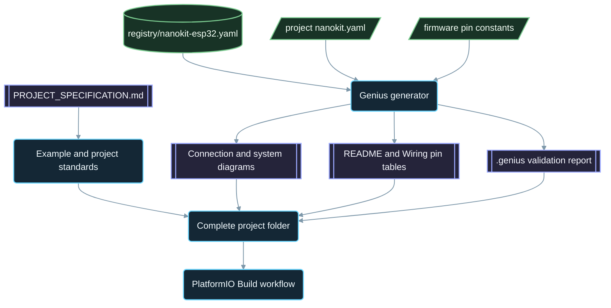

<div align="center">

# NanoKit-ESP32

**NanoKit Integrated ESP32 개발 보드를 위한 공식 PlatformIO 생태계**

<p>
<a href="../../README.md">English</a> ·
<a href="README.zh-CN.md">简体中文</a> ·
<a href="README.zh-TW.md">繁體中文</a> ·
<a href="README.ja.md">日本語</a> ·
<strong>한국어</strong> ·
<a href="README.tr.md">Türkçe</a> ·
<a href="README.ru.md">Русский</a> ·
<a href="README.vi.md">Tiếng Việt</a> ·
<a href="README.th.md">ไทย</a> ·
<a href="README.de.md">Deutsch</a> ·
<a href="README.es.md">Español</a> ·
<a href="README.fr.md">Français</a> ·
<a href="README.uk.md">Українська</a> ·
<a href="README.pl.md">Polski</a> ·
<a href="README.pt-BR.md">Português (Brasil)</a> ·
<a href="README.ar.md">العربية</a> ·
<a href="README.fa.md">فارسی</a> ·
<a href="README.id.md">Bahasa Indonesia</a> ·
<a href="README.it.md">Italiano</a> ·
<a href="README.el.md">Ελληνικά</a> ·
<a href="README.ml.md">മലയാളം</a> ·
<a href="README.ur-Latn.md">Roman Urdu</a> ·
<a href="README.ro.md">Română</a>
</p>

<p>
<a href="https://github.com/ProAmineOfficial/NanoKit-ESP32/stargazers"></a>
<a href="https://github.com/ProAmineOfficial/NanoKit-ESP32/commits/main"></a>
<a href="../../LICENSE"></a>
<a href="https://github.com/ProAmineOfficial/NanoKit-ESP32/actions/workflows/platformio-build.yml"></a>
<a href="https://github.com/ProAmineOfficial/NanoKit-ESP32/actions/workflows/repository-index.yml"></a>
</p>

<p>
<a href="https://proamine.tech"></a>
<a href="https://gitarchitecturediagram.com/ProAmineOfficial/NanoKit-ESP32"></a>

</p>

**Developed by Amine Saoud ibn al-Bashir.**

</div>

> **번역 안내:** 이 페이지는 [영어 README](../../README.md)의 번역본입니다. 두 문서의 내용이 다를 경우 영어 README가 우선합니다.

##  NanoKit Integrated ESP32 핀아웃 데이터시트


NanoKit Integrated ESP32 개발 보드는 IoT, AI, 로보틱스, 교육, 전문 프로토타이핑을 위한 임베디드 개발 플랫폼입니다. 이 저장소는 PlatformIO 예제, 완성된 애플리케이션, 오픈소스 프로젝트, 졸업 프로젝트, 시뮬레이션 자료, 문서, 기술 아티클, 튜토리얼, 재사용 가능한 템플릿을 담도록 구성되어 있습니다.

NanoKit 보드는 더 넓은 UMT 하드웨어 비전의 일부이지만, 이 저장소의 펌웨어는 표준 PlatformIO Arduino C++와 ESP32 GPIO 번호를 사용하므로 모든 프로젝트를 PlatformIO에서 바로 컴파일하고 실행할 수 있습니다.

##  저장소의 목표

이 저장소는 데모용 저장소도, 템플릿 저장소도 아닙니다. 교육 및 전문 임베디드 시스템 개발을 위한 NanoKit-ESP32의 공식 장기 생태계 저장소입니다. 모든 프로젝트는 코드, 배선, 알고리즘, NanoKit 핀 매핑, 문제 해결 과정을 함께 설명합니다.

저장소 전체 규칙, 성장 모델, 예제 표준, 문서화 요구 사항, 완료 정의(Definition of Done)는 [PROJECT_SPECIFICATION.md](../../PROJECT_SPECIFICATION.md)를 참고하세요.

##  빠른 시작

1. [VS Code](https://code.visualstudio.com/)와 [PlatformIO IDE](https://platformio.org/install/ide?install=vscode) 확장 프로그램, 또는 PlatformIO Core CLI를 설치합니다.
2. 저장소를 클론하고 예제를 엽니다. 처음에는 [`digital_input_output`](../../examples_on_platformio/digital_input_output/) 예제를 추천합니다. 버튼 하나, LED 하나, 그리고 보드 내장 LED를 사용합니다.
3. USB로 NanoKit을 연결한 다음, 빌드와 업로드를 하고 Serial Monitor를 엽니다.

```bash
git clone https://github.com/ProAmineOfficial/NanoKit-ESP32.git
cd NanoKit-ESP32/examples_on_platformio/digital_input_output
pio run --target upload
pio device monitor -b 115200
```

각 프로젝트의 README에는 부품 목록, NanoKit 핀 표, 배선 순서, 예상되는 Serial Monitor 출력이 정리되어 있습니다.

##  저장소 구성

| 경로 | 용도 |
|---|---|
| [`examples_on_platformio/`](../../examples_on_platformio/README.md) | 사용자 인터페이스가 없는, 한 가지 주제에 집중한 PlatformIO 예제입니다. 예제마다 보드 기능, 센서, 모듈 중 하나를 다룹니다. |
| [`applications_on_platformio/`](../../applications_on_platformio/README.md) | 사용자 인터페이스를 갖춘 완성형 애플리케이션입니다. 예를 들어 NanoKit이 제공하는, 버튼·슬라이더·대시보드가 있는 웹 앱이 있습니다. |
| [`open_source_projects/`](../../open_source_projects/README.md) | NanoKit Drone 4X 같은 대규모 NanoKit 오리지널 프로젝트와 커뮤니티, 기여자, 쇼케이스, 해커톤 영역입니다. |
| [`graduation_projects/`](../../graduation_projects/README.md) | 학사, 석사, 공학, 전문대학, 캡스톤, 학위 논문 프로젝트를 위한 작업 공간입니다. |
| `tutorials/` | 입문부터 고급까지의 튜토리얼, 프로젝트 가이드, 동영상 링크 색인입니다. |
| `articles/` | 임베디드 시스템, IoT, AI, 로보틱스, PlatformIO, NanoKit, UMT에 관한 기술 아티클입니다. |
| `docs/` | 시작하기, 설치, 하드웨어, 소프트웨어, API, 문제 해결, 로드맵, 아키텍처, 번역 문서입니다. |
| `registry/` | 데이터로 표현한 NanoKit 보드입니다. 모든 헤더 핀, GPIO, VR 주소, 전기적 규칙을 담고 있습니다. |
| `tools/` | 저장소 자동화 도구입니다. Genius 생성기와 인덱스 생성기가 있습니다. |
| `simulator/` | 웹 시뮬레이터, 시뮬레이션 엔진, 예제, 시뮬레이터 에셋입니다. |
| `templates/` | 예제, 애플리케이션, 학위 논문, 문서용 재사용 템플릿입니다. |
| `assets/` | 공용 이미지, 아이콘, 로고, 배너, 동영상입니다. |

##  하드웨어 매니페스트와 자동 생성 문서

모든 예제, 애플리케이션, 오픈소스 프로젝트, 졸업 프로젝트는 하드웨어 구성을 `nanokit.yaml` 매니페스트 한 곳에만 기술합니다. `python tools/genius/generate.py`는 보드 레지스트리 [`registry/nanokit-esp32.yaml`](../../registry/nanokit-esp32.yaml) 및 펌웨어의 핀 상수와 대조하여 매니페스트를 검증한 뒤, 다음 항목을 다시 생성합니다.

- `Pin <NanoKit pin> / GPIO<n>` 라벨과 Confirmed / Proposed / Blocked(확정 / 제안 / 차단) 스타일이 적용된 `images/connection-diagram.md` 및 `images/system-diagram.md`
- 각 프로젝트 README의 NanoKit 핀 표와 각 `docs/Wiring.md`의 연결 표
- 검사한 규칙, 발견 사항, 코드 근거를 담은 `.genius/VALIDATION_REPORT.md`

내부 플래시에 할당된 핀, 입력 전용 핀에 지정된 출력, 레벨 시프팅 없는 5 V 신호, 코드와 일치하지 않는 매니페스트 중 하나라도 있으면 커밋과 풀 리퀘스트가 중단됩니다. 기준 프로젝트는 [`examples_on_platformio/ultrasonic_distance/`](../../examples_on_platformio/ultrasonic_distance/)입니다. 스키마와 규칙: [`tools/genius/README.md`](../../tools/genius/README.md). 설계 기록: [`docs/software/genius-generator-spec.md`](../../docs/software/genius-generator-spec.md).

##  자동 생성 인덱스

- [저장소 인덱스](../../REPOSITORY_INDEX.md)는 저장소의 주요 영역을 요약하고 실제 프로젝트(매니페스트가 있는 폴더) 수를 집계합니다.
- [저장소 트리](../../REPOSITORY_TREE.md)는 자동 생성된 파일 트리를 보여 줍니다.
- [프로젝트 백로그](../../docs/roadmap/project-backlog.md)에는 계획된 모든 예제, 애플리케이션, 튜토리얼, 아티클이 다섯 단계(웨이브)로 나뉘어 정리되어 있으며, 백로그의 Status 열과 [로드맵 요약](../../docs/roadmap/README.md)은 자동으로 갱신됩니다.
- 모든 PlatformIO 프로젝트는 푸시와 풀 리퀘스트가 있을 때마다 [PlatformIO Build 워크플로](../../.github/workflows/platformio-build.yml)에서 컴파일됩니다.

프로젝트를 추가하거나 변경한 후에는 `python tools/genius/generate.py`를 실행한 다음 `python tools/update_repository_index.py`를 실행하세요. 로컬 훅은 `git config core.hooksPath .githooks`로 한 번만 활성화하면 됩니다. GitHub 워크플로는 `main`에 푸시될 때마다 같은 두 도구를 실행하고 풀 리퀘스트를 검증합니다.

##  인터랙티브 저장소 트리

아래 트리는 현재 저장소 내용을 바탕으로 자동 생성됩니다. 제목을 선택하면 펼치거나 접을 수 있습니다. 프로젝트나 파일이 추가, 이동, 삭제되면 로컬 pre-commit 훅과 GitHub 워크플로가 트리를 자동으로 갱신합니다.

자동 생성된 전체 트리는 [REPOSITORY_TREE.md](../../REPOSITORY_TREE.md)에 있으며, 영어 README에서는 펼칠 수 있는 목록으로 보여 줍니다.

##  저장소 구축 방식



##  주요 오픈소스 프로젝트

[NanoKit Drone 4X(쿼드콥터)](../../open_source_projects/nanokit_drone_4x_quadcopter/README.md)는 안전을 최우선으로 하는 이 저장소의 Quad-X 비행 제어 레퍼런스입니다. 비행 컨트롤러 역할의 NanoKit이 Quad-X 모터 믹싱과 안전 게이트를 갖춘 250 Hz 제어 루프를 실행하고, 브라우저 기반 Flight Deck이 Wi-Fi와 WebSocket으로 연결되며, 두 번째 NanoKit이 모터 제어 권한이 전혀 없는 독립된 카메라·오디오 페이로드를 구동합니다. 이 프로젝트는 현재 벤치 개발 단계에 있으며, ESC 프로토콜이 검증될 때까지 프로펠러는 분리된 상태로 두고 모터 출력은 안전 최솟값으로 유지합니다.

##  품질 약속

이 저장소의 공식 콘텐츠는 실제 운용이 가능하고, 교육적이며, 완결성 있고, 유지 보수하기 쉬워야 합니다.

- 빈 디렉터리를 최종 결과물로 남기지 않습니다.
- 실제 교육 자료를 제공할 수 있다면 자리 표시용 콘텐츠를 추가하지 않습니다.
- 기존 작업을 불필요하게 덮어쓰지 말고 그 위에 쌓아 갑니다.
- 모든 예제는 코드, 배선, 알고리즘, 핀 매핑, 문제 해결 과정을 설명합니다.
- 모든 하드웨어 예제는 NanoKit 핀 번호와 ESP32 GPIO 번호를 "Pin 36 / GPIO5"처럼 생략 없이 기재합니다.

예제를 만들거나 검토할 때는 [docs/software/platformio-example-standard.md](../../docs/software/platformio-example-standard.md)를 따르세요.

##  PlatformIO 기본 구성

PlatformIO 프로젝트는 첫 번째 공개 기준으로 ESP32 Arduino 프레임워크를 사용합니다.

```ini
[env:nanokit_esp32]
; espressif32 8.0.0 = Arduino-ESP32 core 3.3.12, pinned so a platform update cannot break the build
platform = espressif32 @ 8.0.0
board = esp32dev
framework = arduino
monitor_speed = 115200
upload_speed = 921600
```

하드웨어 패키지가 발전함에 따라 범용 `esp32dev` 보드 프로필은 NanoKit 전용 보드 정의로 대체될 수 있습니다.

##  펌웨어 규칙

이 저장소의 공식 예제는 다음을 사용해야 합니다.

- PlatformIO
- ESP32용 Arduino 프레임워크
- C++
- Markdown 문서
- 소스 코드에서는 일반 ESP32 GPIO 번호

PlatformIO 예제에서는 UMT SDK 코드나 Virtual Register API 코드를 사용하지 마세요.

##  하드웨어 핀아웃

NanoKit 핀 번호, ESP32 GPIO 매핑, 전기적 참고 사항, 경고에 대해서는 [docs/hardware/nanokit-integrated-esp32-pinout.md](../../docs/hardware/nanokit-integrated-esp32-pinout.md)를 단일 기준 문서로 삼으세요.

모든 하드웨어 예제에는 다음 내용이 기재됩니다.

```text
NanoKit Pin -> GPIO -> Component Pin -> Description
```

중요한 제약 사항:

- GPIO34, GPIO35, GPIO36, GPIO39는 입력 전용입니다.
- GPIO6, GPIO7, GPIO8, GPIO9, GPIO10, GPIO11은 내부 SPI 플래시 핀이므로 사용하면 안 됩니다.
- GPIO0은 BOOT 핀입니다.
- GPIO1과 GPIO3은 USB 시리얼과 공유됩니다.
- EN은 리셋 / 인에이블(Reset / Enable) 핀이며 GPIO가 아닙니다.

##  로드맵

[프로젝트 백로그](../../docs/roadmap/project-backlog.md)는 라이브러리를 다섯 단계로 계획합니다. 보드 기초, 센서와 모듈, 웹 애플리케이션, 프로토콜과 클라우드, 외부 모듈입니다. [로드맵 요약](../../docs/roadmap/README.md)에서 단계별로 완료된 프로젝트 수를 확인할 수 있습니다.

##  기여하기

기여를 환영합니다. 먼저 [CONTRIBUTING.md](../../CONTRIBUTING.md)를 읽어 주세요. 프로젝트 표준, `nanokit.yaml` 매니페스트, pre-commit 훅, 기여물의 라이선스에 대해 설명합니다.

##  번역

이 README는 상단의 언어 바를 통해 23개 언어로 제공됩니다. 번역본은 [`docs/i18n/`](../../docs/i18n/)에 있으며, 번역본과 영어 README의 내용이 다를 경우 영어 README가 우선합니다.

##  지원

-  웹사이트: [https://proamine.tech](https://proamine.tech)
-  Git Architecture Diagram: [https://gitarchitecturediagram.com](https://gitarchitecturediagram.com/ProAmineOfficial/NanoKit-ESP32)
-  이메일: `technology@proamine.tech`
-  TikTok: [@pro_amine](https://www.tiktok.com/@pro_amine)
-  YouTube: [@pro_amine](https://www.youtube.com/@pro_amine)

##  라이선스

NanoKit-ESP32는 [GNU Affero General Public License v3.0 only](../../LICENSE)(`AGPL-3.0-only`)에 따라 라이선스되며, 제7조에 따른 추가 조항은 [NOTICE](../../NOTICE)에 명시되어 있습니다.

- **저작자 표시:** 모든 사본 또는 수정 버전은 "Developed by Amine Saoud ibn al-Bashir." 문구를 유지해야 하며, Amine Saoud ibn al-Bashir(Pro_Amine LLC)의 NanoKit-ESP32를 기반으로 한다는 사실을 명시해야 합니다.
- **수정 버전**은 원본과 다르다는 점을 표시해야 하며, 공식 NanoKit-ESP32 저장소인 것처럼 제시해서는 안 됩니다.
- **명칭:** NanoKit, Pro_Amine, UMT라는 명칭이나 그 로고에 대한 권리는 일절 부여되지 않습니다. 재배포 버전은 자체 명칭을 사용해야 합니다.
- **네트워크 사용:** 수정 버전을 네트워크 서비스로 운영하는 경우, AGPL에 따라 해당 서비스 사용자에게 소스 코드를 제공해야 합니다.

이 조건에 따라 학습, 교육, 연구 및 개인 프로젝트를 위해 이 코드를 자유롭게 연구하고, 사용하고, 수정할 수 있습니다. AGPL로 전환하기 전에 공개된 버전은 Apache License 2.0으로 배포되었습니다. `assets/icons/fluent/`의 Fluent Emoji 아이콘은 © Microsoft Corporation 소유이며 MIT License로 제공됩니다.

<div align="center">

**Developed by Amine Saoud ibn al-Bashir · © 2026 Pro_Amine LLC**

</div>
