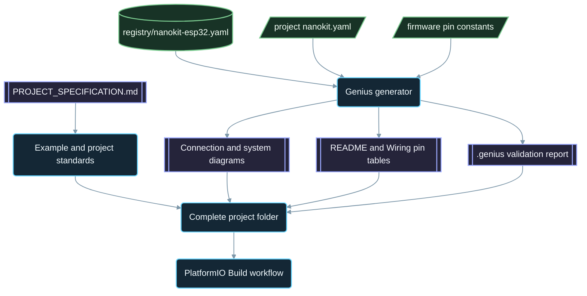

<div align="center">

# NanoKit-ESP32

**NanoKit Integrated ESP32 ഡെവലപ്‌മെന്റ് ബോർഡിനായുള്ള ഔദ്യോഗിക PlatformIO ഇക്കോസിസ്റ്റം**

<p>
<a href="../../README.md">English</a> ·
<a href="README.zh-CN.md">简体中文</a> ·
<a href="README.zh-TW.md">繁體中文</a> ·
<a href="README.ja.md">日本語</a> ·
<a href="README.ko.md">한국어</a> ·
<a href="README.tr.md">Türkçe</a> ·
<a href="README.ru.md">Русский</a> ·
<a href="README.vi.md">Tiếng Việt</a> ·
<a href="README.th.md">ไทย</a> ·
<a href="README.de.md">Deutsch</a> ·
<a href="README.es.md">Español</a> ·
<a href="README.fr.md">Français</a> ·
<a href="README.uk.md">Українська</a> ·
<a href="README.pl.md">Polski</a> ·
<a href="README.pt-BR.md">Português (Brasil)</a> ·
<a href="README.ar.md">العربية</a> ·
<a href="README.fa.md">فارسی</a> ·
<a href="README.id.md">Bahasa Indonesia</a> ·
<a href="README.it.md">Italiano</a> ·
<a href="README.el.md">Ελληνικά</a> ·
<strong>മലയാളം</strong> ·
<a href="README.ur-Latn.md">Roman Urdu</a> ·
<a href="README.ro.md">Română</a>
</p>

<p>
<a href="https://github.com/ProAmineOfficial/NanoKit-ESP32/stargazers"></a>
<a href="https://github.com/ProAmineOfficial/NanoKit-ESP32/commits/main"></a>
<a href="../../LICENSE"></a>
<a href="https://github.com/ProAmineOfficial/NanoKit-ESP32/actions/workflows/platformio-build.yml"></a>
<a href="https://github.com/ProAmineOfficial/NanoKit-ESP32/actions/workflows/repository-index.yml"></a>
</p>

<p>
<a href="https://proamine.tech"></a>
<a href="https://gitarchitecturediagram.com/ProAmineOfficial/NanoKit-ESP32"></a>

</p>

**Developed by Amine Saoud ibn al-Bashir.**

</div>

> **വിവർത്തന കുറിപ്പ്:** ഈ പേജ് [ഇംഗ്ലീഷ് README-യുടെ](../../README.md) വിവർത്തനമാണ്. ഇവ രണ്ടും തമ്മിൽ വ്യത്യാസമുണ്ടെങ്കിൽ ഇംഗ്ലീഷ് README ആണ് ആധികാരികം.

##  NanoKit Integrated ESP32 പിൻഔട്ട് ഡാറ്റാഷീറ്റ്


NanoKit Integrated ESP32 ഡെവലപ്‌മെന്റ് ബോർഡ് IoT, AI, റോബോട്ടിക്സ്, വിദ്യാഭ്യാസം, പ്രൊഫഷണൽ പ്രോട്ടോടൈപ്പിംഗ് എന്നിവയ്ക്കായുള്ള ഒരു എംബെഡഡ് ഡെവലപ്‌മെന്റ് പ്ലാറ്റ്‌ഫോമാണ്. PlatformIO ഉദാഹരണങ്ങൾ, സമ്പൂർണ്ണ ആപ്ലിക്കേഷനുകൾ, ഓപ്പൺ സോഴ്‌സ് പ്രോജക്റ്റുകൾ, ബിരുദ പ്രോജക്റ്റുകൾ, സിമുലേഷൻ വിഭവങ്ങൾ, ഡോക്യുമെന്റേഷൻ, ലേഖനങ്ങൾ, ട്യൂട്ടോറിയലുകൾ, പുനരുപയോഗിക്കാവുന്ന ടെംപ്ലേറ്റുകൾ എന്നിവയ്ക്കായാണ് ഈ റിപ്പോസിറ്ററി ക്രമീകരിച്ചിരിക്കുന്നത്.

NanoKit ബോർഡ് വിശാലമായ UMT ഹാർഡ്‌വെയർ കാഴ്ചപ്പാടിന്റെ ഭാഗമാണ്. എന്നാൽ എല്ലാ പ്രോജക്റ്റുകളും PlatformIO-യിൽ നേരിട്ട് കംപൈൽ ചെയ്ത് പ്രവർത്തിപ്പിക്കാൻ കഴിയുന്നതിനായി, ഈ റിപ്പോസിറ്ററിയിലെ ഫേംവെയർ സാധാരണ PlatformIO Arduino C++ ഉം ESP32 GPIO നമ്പറുകളുമാണ് ഉപയോഗിക്കുന്നത്.

##  റിപ്പോസിറ്ററിയുടെ ദൗത്യം

ഇതൊരു ഡെമോ റിപ്പോസിറ്ററിയോ ടെംപ്ലേറ്റ് റിപ്പോസിറ്ററിയോ അല്ല. വിദ്യാഭ്യാസപരവും പ്രൊഫഷണലുമായ എംബെഡഡ് സിസ്റ്റം വികസനത്തിനായുള്ള, ദീർഘകാലാടിസ്ഥാനത്തിലുള്ള ഔദ്യോഗിക NanoKit-ESP32 ഇക്കോസിസ്റ്റം റിപ്പോസിറ്ററിയാണിത്: ഓരോ പ്രോജക്റ്റും കോഡ്, വയറിംഗ്, അൽഗോരിതം, NanoKit പിൻ മാപ്പിംഗ്, ട്രബിൾഷൂട്ടിംഗ് രീതി എന്നിവ പഠിപ്പിക്കുന്നു.

റിപ്പോസിറ്ററിയുടെ പ്രധാന നിയമങ്ങൾ, വളർച്ചാ മാതൃക, ഉദാഹരണങ്ങൾക്കുള്ള മാനദണ്ഡങ്ങൾ, ഡോക്യുമെന്റേഷൻ ആവശ്യകതകൾ, പൂർത്തീകരണ നിർവചനം (Definition of Done) എന്നിവയ്ക്കായി [PROJECT_SPECIFICATION.md](../../PROJECT_SPECIFICATION.md) കാണുക.

##  വേഗത്തിൽ തുടങ്ങാം

1. [PlatformIO IDE](https://platformio.org/install/ide?install=vscode) എക്സ്റ്റൻഷനോടുകൂടി [VS Code](https://code.visualstudio.com/) ഇൻസ്റ്റാൾ ചെയ്യുക, അല്ലെങ്കിൽ PlatformIO Core CLI ഇൻസ്റ്റാൾ ചെയ്യുക.
2. റിപ്പോസിറ്ററി ക്ലോൺ ചെയ്ത് ഒരു ഉദാഹരണം തുറക്കുക. ആദ്യം പരീക്ഷിക്കേണ്ടത് [`digital_input_output`](../../examples_on_platformio/digital_input_output/) ആണ്: ഒരു ബട്ടൺ, ഒരു LED, ബോർഡിൽത്തന്നെയുള്ള ഓൺബോർഡ് LED.
3. NanoKit USB വഴി കണക്റ്റ് ചെയ്യുക, തുടർന്ന് ബിൽഡ് ചെയ്യുക, അപ്‌ലോഡ് ചെയ്യുക, Serial Monitor തുറക്കുക:

```bash
git clone https://github.com/ProAmineOfficial/NanoKit-ESP32.git
cd NanoKit-ESP32/examples_on_platformio/digital_input_output
pio run --target upload
pio device monitor -b 115200
```

ഓരോ പ്രോജക്റ്റിന്റെയും README-യിൽ ആവശ്യമായ ഘടകങ്ങൾ, NanoKit പിൻ ടേബിൾ, വയറിംഗ് ക്രമം, പ്രതീക്ഷിക്കുന്ന Serial Monitor ഔട്ട്‌പുട്ട് എന്നിവ നൽകിയിരിക്കുന്നു.

##  റിപ്പോസിറ്ററി ഘടന

| പാത്ത് | ഉദ്ദേശ്യം |
|---|---|
| [`examples_on_platformio/`](../../examples_on_platformio/README.md) | യൂസർ ഇന്റർഫേസ് ഇല്ലാത്ത, ഒരു വിഷയത്തിൽ കേന്ദ്രീകരിച്ച PlatformIO ഉദാഹരണങ്ങൾ: ഓരോ ഉദാഹരണത്തിലും ഒരു ബോർഡ് ഫീച്ചർ, സെൻസർ അല്ലെങ്കിൽ മൊഡ്യൂൾ. |
| [`applications_on_platformio/`](../../applications_on_platformio/README.md) | യൂസർ ഇന്റർഫേസുള്ള സമ്പൂർണ്ണ ആപ്ലിക്കേഷനുകൾ; ഉദാഹരണത്തിന് ബട്ടണുകൾ, സ്ലൈഡറുകൾ, ഡാഷ്‌ബോർഡുകൾ എന്നിവയോടുകൂടി NanoKit തന്നെ സെർവ് ചെയ്യുന്ന വെബ് ആപ്പുകൾ. |
| [`open_source_projects/`](../../open_source_projects/README.md) | NanoKit Drone 4X പോലുള്ള വലിയ മൗലിക NanoKit പ്രോജക്റ്റുകൾ, ഒപ്പം കമ്മ്യൂണിറ്റി, കോൺട്രിബ്യൂട്ടർ, ഷോകേസ്, ഹാക്കത്തോൺ വിഭാഗങ്ങൾ. |
| [`graduation_projects/`](../../graduation_projects/README.md) | ബാച്ചിലർ, മാസ്റ്റർ, എഞ്ചിനീയറിംഗ്, ഇൻസ്റ്റിറ്റ്യൂട്ട്, ക്യാപ്‌സ്റ്റോൺ, തീസിസ് പ്രോജക്റ്റുകൾക്കുള്ള വർക്ക്‌സ്‌പേസുകൾ. |
| `tutorials/` | തുടക്കക്കാർക്കുള്ളതു മുതൽ അഡ്വാൻസ്ഡ് തലം വരെയുള്ള ട്യൂട്ടോറിയലുകൾ, പ്രോജക്റ്റ് ഗൈഡുകൾ, വീഡിയോ ലിങ്ക് സൂചികകൾ. |
| `articles/` | എംബെഡഡ് സിസ്റ്റങ്ങൾ, IoT, AI, റോബോട്ടിക്സ്, PlatformIO, NanoKit, UMT എന്നിവയെക്കുറിച്ചുള്ള സാങ്കേതിക ലേഖനങ്ങൾ. |
| `docs/` | തുടക്കം, ഇൻസ്റ്റലേഷൻ, ഹാർഡ്‌വെയർ, സോഫ്റ്റ്‌വെയർ, API, ട്രബിൾഷൂട്ടിംഗ്, റോഡ്‌മാപ്പ്, ആർക്കിടെക്ചർ, വിവർത്തനങ്ങൾ. |
| `registry/` | ഡാറ്റാ രൂപത്തിൽ NanoKit ബോർഡ്: ഓരോ ഹെഡർ പിന്നും GPIO-യും VR വിലാസവും ഇലക്ട്രിക്കൽ നിയമവും. |
| `tools/` | റിപ്പോസിറ്ററി ഓട്ടോമേഷൻ: Genius ജനറേറ്ററും ഇൻഡക്സ് ജനറേറ്ററും. |
| `simulator/` | വെബ് സിമുലേറ്റർ, സിമുലേഷൻ എഞ്ചിൻ, ഉദാഹരണങ്ങൾ, സിമുലേറ്റർ അസറ്റുകൾ. |
| `templates/` | ഉദാഹരണങ്ങൾ, ആപ്ലിക്കേഷനുകൾ, തീസിസ് പ്രവർത്തനങ്ങൾ, ഡോക്യുമെന്റേഷൻ എന്നിവയ്ക്കായുള്ള പുനരുപയോഗിക്കാവുന്ന ടെംപ്ലേറ്റുകൾ. |
| `assets/` | പങ്കിട്ട് ഉപയോഗിക്കുന്ന ചിത്രങ്ങൾ, ഐക്കണുകൾ, ലോഗോകൾ, ബാനറുകൾ, വീഡിയോകൾ. |

##  ഹാർഡ്‌വെയർ മാനിഫെസ്റ്റുകളും ജനറേറ്റ് ചെയ്ത ഡോക്യുമെന്റേഷനും

ഓരോ ഉദാഹരണവും ആപ്ലിക്കേഷനും ഓപ്പൺ സോഴ്‌സ് പ്രോജക്റ്റും ബിരുദ പ്രോജക്റ്റും അതിന്റെ ഹാർഡ്‌വെയർ ഒരു `nanokit.yaml` മാനിഫെസ്റ്റിൽ ഒരിക്കൽ മാത്രം വിവരിക്കുന്നു. `python tools/genius/generate.py` അതിനെ ബോർഡ് രജിസ്ട്രിയായ [`registry/nanokit-esp32.yaml`](../../registry/nanokit-esp32.yaml)-നോടും ഫേംവെയറിലെ പിൻ കോൺസ്റ്റന്റുകളോടും ഒത്തുനോക്കി സാധൂകരിക്കുകയും, തുടർന്ന് താഴെപ്പറയുന്നവ വീണ്ടും ജനറേറ്റ് ചെയ്യുകയും ചെയ്യുന്നു:

- `Pin <NanoKit pin> / GPIO<n>` ലേബലുകളും Confirmed / Proposed / Blocked (സ്ഥിരീകരിച്ചത് / നിർദ്ദേശിച്ചത് / തടഞ്ഞത്) സ്റ്റൈലിംഗും ഉള്ള `images/connection-diagram.md`, `images/system-diagram.md` എന്നിവ,
- ഓരോ പ്രോജക്റ്റ് README-യിലെയും NanoKit പിൻ ടേബിളും ഓരോ `docs/Wiring.md`-യിലെയും കണക്ഷൻ ടേബിളും,
- പരിശോധിച്ച നിയമങ്ങൾ, കണ്ടെത്തലുകൾ, കോഡിൽ നിന്നുള്ള തെളിവുകൾ എന്നിവ ഉൾക്കൊള്ളുന്ന `.genius/VALIDATION_REPORT.md`.

ഇന്റേണൽ ഫ്ലാഷിലുള്ള ഒരു പിൻ, ഇൻപുട്ട് മാത്രം സ്വീകരിക്കുന്ന പിന്നിലെ ഒരു ഔട്ട്‌പുട്ട്, ലെവൽ ഷിഫ്റ്റിംഗ് ഇല്ലാത്ത 5 V സിഗ്നൽ, അല്ലെങ്കിൽ കോഡുമായി പൊരുത്തപ്പെടാത്ത മാനിഫെസ്റ്റ് എന്നിവയിൽ ഏതെങ്കിലും ഉണ്ടെങ്കിൽ കമ്മിറ്റും പുൾ റിക്വസ്റ്റും തടയപ്പെടും. റഫറൻസ് പ്രോജക്റ്റ് [`examples_on_platformio/ultrasonic_distance/`](../../examples_on_platformio/ultrasonic_distance/) ആണ്. സ്കീമയും നിയമങ്ങളും: [`tools/genius/README.md`](../../tools/genius/README.md). ഡിസൈൻ രേഖ: [`docs/software/genius-generator-spec.md`](../../docs/software/genius-generator-spec.md).

##  ജനറേറ്റ് ചെയ്ത സൂചികകൾ

- [റിപ്പോസിറ്ററി സൂചിക](../../REPOSITORY_INDEX.md) റിപ്പോസിറ്ററിയിലെ പ്രധാന മേഖലകളെ സംഗ്രഹിക്കുകയും യഥാർത്ഥ പ്രോജക്റ്റുകളുടെ (മാനിഫെസ്റ്റുള്ള ഫോൾഡറുകൾ) എണ്ണം കണക്കാക്കുകയും ചെയ്യുന്നു.
- [റിപ്പോസിറ്ററി ട്രീ](../../REPOSITORY_TREE.md) ജനറേറ്റ് ചെയ്ത ഫയൽ ട്രീ കാണിക്കുന്നു.
- ആസൂത്രണം ചെയ്ത എല്ലാ ഉദാഹരണങ്ങളും ആപ്ലിക്കേഷനുകളും ട്യൂട്ടോറിയലുകളും ലേഖനങ്ങളും [പ്രോജക്റ്റ് ബാക്ക്‌ലോഗ്](../../docs/roadmap/project-backlog.md) അഞ്ച് ഘട്ടങ്ങളിലായി പട്ടികപ്പെടുത്തുന്നു; അതിലെ Status കോളവും [റോഡ്‌മാപ്പ് സംഗ്രഹവും](../../docs/roadmap/README.md) സ്വയമേവ പുതുക്കപ്പെടുന്നു.
- ഓരോ push-ലും pull request-ലും [PlatformIO Build വർക്ക്‌ഫ്ലോ](../../.github/workflows/platformio-build.yml) എല്ലാ PlatformIO പ്രോജക്റ്റുകളും കംപൈൽ ചെയ്യുന്നു.

ഒരു പ്രോജക്റ്റ് ചേർക്കുകയോ മാറ്റുകയോ ചെയ്ത ശേഷം `python tools/genius/generate.py`, തുടർന്ന് `python tools/update_repository_index.py` എന്നിവ റൺ ചെയ്യുക. `git config core.hooksPath .githooks` ഉപയോഗിച്ച് ലോക്കൽ ഹുക്ക് ഒരിക്കൽ പ്രവർത്തനക്ഷമമാക്കുക; GitHub വർക്ക്‌ഫ്ലോ `main`-ലേക്കുള്ള ഓരോ push-ലും ഇതേ രണ്ട് ടൂളുകൾ റൺ ചെയ്യുകയും pull request-കൾ സാധൂകരിക്കുകയും ചെയ്യുന്നു.

##  ഇന്ററാക്ടീവ് റിപ്പോസിറ്ററി ട്രീ

താഴെയുള്ള ട്രീ റിപ്പോസിറ്ററിയിലെ നിലവിലെ ഉള്ളടക്കത്തിൽ നിന്ന് ജനറേറ്റ് ചെയ്തതാണ്. അത് വികസിപ്പിക്കാനോ ചുരുക്കാനോ അതിന്റെ തലക്കെട്ടിൽ ക്ലിക്ക് ചെയ്യുക. പ്രോജക്റ്റുകളോ ഫയലുകളോ ചേർക്കുകയോ സ്ഥാനം മാറ്റുകയോ നീക്കം ചെയ്യുകയോ ചെയ്യുമ്പോൾ ലോക്കൽ pre-commit ഹുക്കും GitHub വർക്ക്‌ഫ്ലോയും അത് സ്വയമേവ പുതുക്കുന്നു.

ജനറേറ്റ് ചെയ്ത പൂർണ്ണ ട്രീ [REPOSITORY_TREE.md](../../REPOSITORY_TREE.md)-ൽ ലഭ്യമാണ്; ഇംഗ്ലീഷ് README അത് വികസിപ്പിക്കാവുന്ന ഒരു പട്ടികയായി കാണിക്കുന്നു.

##  റിപ്പോസിറ്ററി എങ്ങനെ നിർമ്മിച്ചിരിക്കുന്നു



##  ശ്രദ്ധേയമായ ഓപ്പൺ സോഴ്‌സ് പ്രോജക്റ്റ്

[NanoKit Drone 4X (ക്വാഡ്‌കോപ്റ്റർ)](../../open_source_projects/nanokit_drone_4x_quadcopter/README.md) സുരക്ഷയ്ക്ക് പ്രഥമ പരിഗണന നൽകുന്ന, ഈ റിപ്പോസിറ്ററിയിലെ Quad-X ഫ്ലൈറ്റ് കൺട്രോൾ റഫറൻസാണ്. ഒരു NanoKit ഫ്ലൈറ്റ് കൺട്രോളർ Quad-X മോട്ടോർ മിക്സിംഗും സുരക്ഷാ ഗേറ്റുകളുമുള്ള 250 Hz കൺട്രോൾ ലൂപ്പ് പ്രവർത്തിപ്പിക്കുന്നു, ബ്രൗസറിൽ പ്രവർത്തിക്കുന്ന Flight Deck ഇന്റർഫേസ് Wi-Fi, WebSocket എന്നിവ വഴി കണക്റ്റ് ചെയ്യുന്നു, രണ്ടാമതൊരു NanoKit മോട്ടോറുകളിൽ യാതൊരു നിയന്ത്രണാധികാരവുമില്ലാത്ത, വേർതിരിച്ച ക്യാമറ-ഓഡിയോ പേലോഡ് പ്രവർത്തിപ്പിക്കുന്നു. പ്രോജക്റ്റ് ഇപ്പോൾ ബെഞ്ച് ഡെവലപ്‌മെന്റ് ഘട്ടത്തിലാണ്: ESC പ്രോട്ടോക്കോൾ സ്ഥിരീകരിക്കുന്നതുവരെ പ്രൊപ്പല്ലറുകൾ ഘടിപ്പിക്കാതെയും മോട്ടോർ ഔട്ട്‌പുട്ട് സുരക്ഷിതമായ ഏറ്റവും കുറഞ്ഞ നിലയിലും തുടരും.

##  ഗുണനിലവാര ഉടമ്പടി

ഈ റിപ്പോസിറ്ററിയിലെ ഔദ്യോഗിക ഉള്ളടക്കം പ്രൊഡക്ഷൻ ഉപയോഗത്തിന് തയ്യാറായതും വിദ്യാഭ്യാസപരവും സമ്പൂർണ്ണവും പരിപാലിക്കാൻ എളുപ്പമുള്ളതും ആയിരിക്കണം.

- ഡയറക്ടറികൾ ശൂന്യമായി വിട്ട് അത് അന്തിമ ജോലിയായി കണക്കാക്കരുത്.
- യഥാർത്ഥ പഠന സാമഗ്രികൾ നൽകാൻ കഴിയുമ്പോൾ പ്ലേസ്‌ഹോൾഡർ ഉള്ളടക്കം ചേർക്കരുത്.
- നിലവിലുള്ള ജോലി അനാവശ്യമായി മാറ്റിയെഴുതുന്നതിനു പകരം അതിന്മേൽ കെട്ടിപ്പടുക്കുക.
- ഓരോ ഉദാഹരണവും കോഡ്, വയറിംഗ്, അൽഗോരിതം, പിൻ മാപ്പിംഗ്, ട്രബിൾഷൂട്ടിംഗ് രീതി എന്നിവ പഠിപ്പിക്കുന്നു.
- ഓരോ ഹാർഡ്‌വെയർ ഉദാഹരണവും NanoKit പിൻ നമ്പറുകളും ESP32 GPIO നമ്പറുകളും "Pin 36 / GPIO5" എന്ന രീതിയിൽ പൂർണ്ണരൂപത്തിൽ രേഖപ്പെടുത്തുന്നു.

ഉദാഹരണങ്ങൾ സൃഷ്ടിക്കുമ്പോഴോ അവലോകനം ചെയ്യുമ്പോഴോ [docs/software/platformio-example-standard.md](../../docs/software/platformio-example-standard.md) ഉപയോഗിക്കുക.

##  PlatformIO അടിസ്ഥാന ക്രമീകരണം

PlatformIO പ്രോജക്റ്റുകൾ ആദ്യത്തെ പൊതു അടിസ്ഥാന ക്രമീകരണമായി ESP32 Arduino ഫ്രെയിംവർക്ക് ഉപയോഗിക്കുന്നു:

```ini
[env:nanokit_esp32]
; espressif32 8.0.0 = Arduino-ESP32 core 3.3.12, pinned so a platform update cannot break the build
platform = espressif32 @ 8.0.0
board = esp32dev
framework = arduino
monitor_speed = 115200
upload_speed = 921600
```

ഹാർഡ്‌വെയർ പാക്കേജ് വികസിക്കുന്നതിനനുസരിച്ച്, പൊതുവായ `esp32dev` ബോർഡ് പ്രൊഫൈലിന് പകരം NanoKit-നായുള്ള പ്രത്യേക ബോർഡ് നിർവചനങ്ങൾ ഉപയോഗിക്കാൻ കഴിയും.

##  ഫേംവെയർ നിയമം

ഈ റിപ്പോസിറ്ററിയിലെ ഔദ്യോഗിക ഉദാഹരണങ്ങൾ താഴെപ്പറയുന്നവ നിർബന്ധമായും ഉപയോഗിക്കണം:

- PlatformIO
- ESP32-നായുള്ള Arduino ഫ്രെയിംവർക്ക്
- C++
- Markdown ഡോക്യുമെന്റേഷൻ
- സോഴ്‌സ് കോഡിൽ സാധാരണ ESP32 GPIO നമ്പറുകൾ

PlatformIO ഉദാഹരണങ്ങളിൽ UMT SDK കോഡോ Virtual Register API കോഡോ ഉപയോഗിക്കരുത്.

##  ഹാർഡ്‌വെയർ പിൻഔട്ട്

NanoKit പിൻ നമ്പറുകൾ, ESP32 GPIO മാപ്പിംഗുകൾ, ഇലക്ട്രിക്കൽ കുറിപ്പുകൾ, മുന്നറിയിപ്പുകൾ എന്നിവയ്ക്കുള്ള ആധികാരിക സ്രോതസ്സായി [docs/hardware/nanokit-integrated-esp32-pinout.md](../../docs/hardware/nanokit-integrated-esp32-pinout.md) ഉപയോഗിക്കുക.

ഓരോ ഹാർഡ്‌വെയർ ഉദാഹരണവും രേഖപ്പെടുത്തുന്നത്:

```text
NanoKit Pin -> GPIO -> Component Pin -> Description
```

പ്രധാന നിയന്ത്രണങ്ങൾ:

- GPIO34, GPIO35, GPIO36, GPIO39 എന്നിവ ഇൻപുട്ട് മാത്രം സ്വീകരിക്കുന്ന പിന്നുകളാണ്.
- GPIO6, GPIO7, GPIO8, GPIO9, GPIO10, GPIO11 എന്നിവ ഇന്റേണൽ SPI ഫ്ലാഷിനുള്ള പിന്നുകളാണ്; ഇവ ഉപയോഗിക്കാൻ പാടില്ല.
- GPIO0 ആണ് BOOT പിൻ.
- GPIO1, GPIO3 എന്നിവ USB Serial-മായി പങ്കിടുന്നവയാണ്.
- EN എന്നത് Reset / Enable (റീസെറ്റ് / എനേബിൾ) പിൻ ആണ്; അതൊരു GPIO അല്ല.

##  റോഡ്‌മാപ്പ്

[പ്രോജക്റ്റ് ബാക്ക്‌ലോഗ്](../../docs/roadmap/project-backlog.md) ലൈബ്രറിയെ അഞ്ച് ഘട്ടങ്ങളിലായി ആസൂത്രണം ചെയ്യുന്നു: ബോർഡ് അടിസ്ഥാനങ്ങൾ, സെൻസറുകളും മൊഡ്യൂളുകളും, വെബ് ആപ്ലിക്കേഷനുകൾ, പ്രോട്ടോക്കോളുകളും ക്ലൗഡും, എക്സ്റ്റേണൽ മൊഡ്യൂളുകൾ. ഓരോ ഘട്ടത്തിലെയും എത്ര പ്രോജക്റ്റുകൾ പൂർത്തിയായി എന്ന് [റോഡ്‌മാപ്പ് സംഗ്രഹം](../../docs/roadmap/README.md) കാണിക്കുന്നു.

##  സംഭാവന ചെയ്യാൻ

സംഭാവനകൾ സ്വാഗതം ചെയ്യുന്നു. ആദ്യം [CONTRIBUTING.md](../../CONTRIBUTING.md) വായിക്കുക: പ്രോജക്റ്റ് മാനദണ്ഡങ്ങൾ, `nanokit.yaml` മാനിഫെസ്റ്റ്, pre-commit ഹുക്ക്, സംഭാവനകളുടെ ലൈസൻസ് എന്നിവ അതിൽ വിശദീകരിക്കുന്നു.

##  വിവർത്തനങ്ങൾ

മുകളിലുള്ള ഭാഷാ ബാർ വഴി ഈ README 23 ഭാഷകളിൽ ലഭ്യമാണ്. വിവർത്തനങ്ങൾ [`docs/i18n/`](../../docs/i18n/)-ൽ ആണുള്ളത്; ഒരു വിവർത്തനവും ഇംഗ്ലീഷ് README-യും തമ്മിൽ വ്യത്യാസമുണ്ടെങ്കിൽ ഇംഗ്ലീഷ് README ആണ് ആധികാരികം.

##  പിന്തുണ

-  വെബ്സൈറ്റ്: [https://proamine.tech](https://proamine.tech)
-  Git Architecture Diagram: [https://gitarchitecturediagram.com](https://gitarchitecturediagram.com/ProAmineOfficial/NanoKit-ESP32)
-  ഇമെയിൽ: `technology@proamine.tech`
-  TikTok: [@pro_amine](https://www.tiktok.com/@pro_amine)
-  YouTube: [@pro_amine](https://www.youtube.com/@pro_amine)

##  ലൈസൻസ്

NanoKit-ESP32 [GNU Affero General Public License v3.0 only](../../LICENSE) (`AGPL-3.0-only`; ഗ്നു അഫെറോ ജനറൽ പബ്ലിക് ലൈസൻസ്, പതിപ്പ് 3.0 മാത്രം) പ്രകാരമാണ് ലൈസൻസ് ചെയ്തിരിക്കുന്നത്; സെക്ഷൻ 7 പ്രകാരമുള്ള അധിക വ്യവസ്ഥകൾ [NOTICE](../../NOTICE)-ൽ നൽകിയിരിക്കുന്നു:

- **കർതൃത്വ അംഗീകാരം:** ഓരോ പകർപ്പും പരിഷ്കരിച്ച പതിപ്പും "Developed by Amine Saoud ibn al-Bashir." എന്ന വരി നിലനിർത്തുകയും, അത് Amine Saoud ibn al-Bashir (Pro_Amine LLC) വികസിപ്പിച്ച NanoKit-ESP32-നെ അടിസ്ഥാനമാക്കിയുള്ളതാണെന്ന് വ്യക്തമാക്കുകയും ചെയ്യുന്നു.
- **പരിഷ്കരിച്ച പതിപ്പുകൾ** യഥാർത്ഥ പതിപ്പിൽ നിന്ന് വ്യത്യസ്തമാണെന്ന് അടയാളപ്പെടുത്തുന്നു; അവ ഔദ്യോഗിക NanoKit-ESP32 റിപ്പോസിറ്ററിയായി അവതരിപ്പിക്കപ്പെടുന്നില്ല.
- **പേരുകൾ:** NanoKit, Pro_Amine, UMT എന്നീ പേരുകളിലോ അവയുടെ ലോഗോകളിലോ യാതൊരു അവകാശവും നൽകുന്നില്ല; പുനർവിതരണം ചെയ്യുന്ന പതിപ്പ് സ്വന്തം പേര് ഉപയോഗിക്കുന്നു.
- **നെറ്റ്‌വർക്ക് ഉപയോഗം:** പരിഷ്കരിച്ച ഒരു പതിപ്പ് നിങ്ങൾ നെറ്റ്‌വർക്ക് സേവനമായി പ്രവർത്തിപ്പിക്കുകയാണെങ്കിൽ, അതിന്റെ സോഴ്‌സ് കോഡ് അതിന്റെ ഉപയോക്താക്കൾക്ക് ലഭ്യമാക്കണമെന്ന് AGPL ആവശ്യപ്പെടുന്നു.

ഈ വ്യവസ്ഥകൾക്ക് വിധേയമായി, പഠനം, അധ്യാപനം, ഗവേഷണം, നിങ്ങളുടെ സ്വന്തം പ്രോജക്റ്റുകൾ എന്നിവയ്ക്കായി ഈ കോഡ് പഠിക്കാനും ഉപയോഗിക്കാനും പരിഷ്കരിക്കാനും നിങ്ങൾക്ക് സ്വാതന്ത്ര്യമുണ്ട്. AGPL-ലേക്ക് മാറുന്നതിന് മുമ്പ് പ്രസിദ്ധീകരിച്ച പതിപ്പുകൾ Apache License 2.0 പ്രകാരമാണ് വിതരണം ചെയ്തിരുന്നത്. `assets/icons/fluent/`-ലെ Fluent Emoji ഐക്കണുകളുടെ പകർപ്പവകാശം © Microsoft Corporation-നാണ്; അവ MIT License പ്രകാരം ലഭ്യമാണ്.

<div align="center">

**Developed by Amine Saoud ibn al-Bashir · © 2026 Pro_Amine LLC**

</div>
