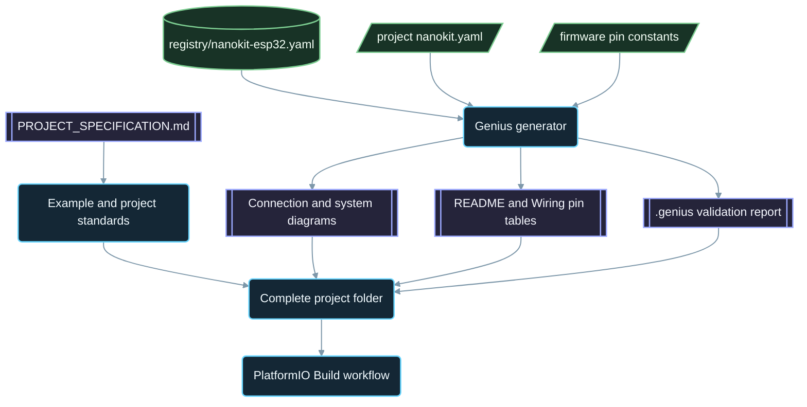

<div align="center">

# NanoKit-ESP32

**Oficjalny ekosystem PlatformIO dla płytki rozwojowej NanoKit Integrated ESP32**

<p>
<a href="../../README.md">English</a> ·
<a href="README.zh-CN.md">简体中文</a> ·
<a href="README.zh-TW.md">繁體中文</a> ·
<a href="README.ja.md">日本語</a> ·
<a href="README.ko.md">한국어</a> ·
<a href="README.tr.md">Türkçe</a> ·
<a href="README.ru.md">Русский</a> ·
<a href="README.vi.md">Tiếng Việt</a> ·
<a href="README.th.md">ไทย</a> ·
<a href="README.de.md">Deutsch</a> ·
<a href="README.es.md">Español</a> ·
<a href="README.fr.md">Français</a> ·
<a href="README.uk.md">Українська</a> ·
<strong>Polski</strong> ·
<a href="README.pt-BR.md">Português (Brasil)</a> ·
<a href="README.ar.md">العربية</a> ·
<a href="README.fa.md">فارسی</a> ·
<a href="README.id.md">Bahasa Indonesia</a> ·
<a href="README.it.md">Italiano</a> ·
<a href="README.el.md">Ελληνικά</a> ·
<a href="README.ml.md">മലയാളം</a> ·
<a href="README.ur-Latn.md">Roman Urdu</a> ·
<a href="README.ro.md">Română</a>
</p>

<p>
<a href="https://github.com/ProAmineOfficial/NanoKit-ESP32/stargazers"></a>
<a href="https://github.com/ProAmineOfficial/NanoKit-ESP32/commits/main"></a>
<a href="../../LICENSE"></a>
<a href="https://github.com/ProAmineOfficial/NanoKit-ESP32/actions/workflows/platformio-build.yml"></a>
<a href="https://github.com/ProAmineOfficial/NanoKit-ESP32/actions/workflows/repository-index.yml"></a>
</p>

<p>
<a href="https://proamine.tech"></a>
<a href="https://gitarchitecturediagram.com/ProAmineOfficial/NanoKit-ESP32"></a>

</p>

**Developed by Amine Saoud ibn al-Bashir.**

</div>

> **Uwaga dotycząca tłumaczenia:** ta strona jest tłumaczeniem [angielskiego pliku README](../../README.md). W razie rozbieżności rozstrzygająca jest angielska wersja README.

##  Karta katalogowa z rozkładem wyprowadzeń NanoKit Integrated ESP32


Płytka rozwojowa NanoKit Integrated ESP32 to platforma do tworzenia systemów wbudowanych z zakresu IoT, AI, robotyki, edukacji i profesjonalnego prototypowania. Repozytorium obejmuje przykłady PlatformIO, kompletne aplikacje, projekty open source, projekty dyplomowe, zasoby do symulacji, dokumentację, artykuły, samouczki i szablony wielokrotnego użytku.

Płytka NanoKit jest częścią szerszej wizji sprzętowej UMT, ale firmware w tym repozytorium korzysta ze standardowego Arduino C++ w PlatformIO i numerów GPIO układu ESP32, dzięki czemu każdy projekt kompiluje się i działa bezpośrednio w PlatformIO.

##  Misja repozytorium

To nie jest repozytorium demonstracyjne ani repozytorium szablonów. To oficjalne, długoterminowe repozytorium ekosystemu NanoKit-ESP32 do edukacyjnego i profesjonalnego tworzenia systemów wbudowanych: każdy projekt uczy kodu, połączeń, algorytmu, mapowania pinów NanoKit i sposobu rozwiązywania problemów.

Nadrzędne zasady repozytorium, model rozwoju, standardy przykładów, wymagania dotyczące dokumentacji oraz definicję ukończenia (Definition of Done) opisuje plik [PROJECT_SPECIFICATION.md](../../PROJECT_SPECIFICATION.md).

##  Szybki start

1. Zainstaluj [VS Code](https://code.visualstudio.com/) z rozszerzeniem [PlatformIO IDE](https://platformio.org/install/ide?install=vscode) albo PlatformIO Core CLI.
2. Sklonuj repozytorium i otwórz przykład. Na początek wypróbuj [`digital_input_output`](../../examples_on_platformio/digital_input_output/): przycisk, dioda LED i wbudowana dioda LED.
3. Podłącz NanoKit przez USB, a następnie zbuduj projekt, wgraj go na płytkę i otwórz Serial Monitor:

```bash
git clone https://github.com/ProAmineOfficial/NanoKit-ESP32.git
cd NanoKit-ESP32/examples_on_platformio/digital_input_output
pio run --target upload
pio device monitor -b 115200
```

Plik README każdego projektu wymienia potrzebne części, tabelę pinów NanoKit, kolejność podłączania i oczekiwane wyjście w Serial Monitor.

##  Struktura repozytorium

| Ścieżka | Przeznaczenie |
|---|---|
| [`examples_on_platformio/`](../../examples_on_platformio/README.md) | Ukierunkowane przykłady PlatformIO bez interfejsu użytkownika: jedna funkcja płytki, jeden czujnik lub moduł na przykład. |
| [`applications_on_platformio/`](../../applications_on_platformio/README.md) | Kompletne aplikacje z interfejsem użytkownika, np. aplikacje webowe serwowane przez NanoKit, z przyciskami, suwakami i pulpitami. |
| [`open_source_projects/`](../../open_source_projects/README.md) | Większe, oryginalne projekty NanoKit, takie jak NanoKit Drone 4X, a także sekcje dla społeczności, współtwórców, prezentacji projektów i hackathonów. |
| [`graduation_projects/`](../../graduation_projects/README.md) | Przestrzenie robocze dla projektów licencjackich, magisterskich, inżynierskich, instytutowych, końcowych (capstone) i prac dyplomowych. |
| `tutorials/` | Samouczki od poziomu początkującego do zaawansowanego, przewodniki po projektach i spisy linków do filmów. |
| `articles/` | Artykuły techniczne o systemach wbudowanych, IoT, AI, robotyce, PlatformIO, NanoKit i UMT. |
| `docs/` | Pierwsze kroki, instalacja, sprzęt, oprogramowanie, API, rozwiązywanie problemów, plan rozwoju, architektura i tłumaczenia. |
| `registry/` | Płytka NanoKit w postaci danych: każdy pin złącza, GPIO, adres VR i reguła elektryczna. |
| `tools/` | Automatyzacja repozytorium: generator Genius i generator indeksu. |
| `simulator/` | Symulator webowy, silnik symulacji, przykłady i zasoby symulatora. |
| `templates/` | Szablony wielokrotnego użytku dla przykładów, aplikacji, prac dyplomowych i dokumentacji. |
| `assets/` | Wspólne obrazy, ikony, logotypy, banery i filmy. |

##  Manifesty sprzętowe i generowana dokumentacja

Każdy przykład, aplikacja, projekt open source i projekt dyplomowy opisuje swój sprzęt jeden raz, w manifeście `nanokit.yaml`. Polecenie `python tools/genius/generate.py` sprawdza go względem rejestru płytki [`registry/nanokit-esp32.yaml`](../../registry/nanokit-esp32.yaml) oraz stałych pinów w firmware, a następnie ponownie generuje:

- `images/connection-diagram.md` i `images/system-diagram.md` z etykietami `Pin <NanoKit pin> / GPIO<n>` i stylami Confirmed / Proposed / Blocked,
- tabelę pinów NanoKit w pliku README każdego projektu oraz tabelę połączeń w każdym `docs/Wiring.md`,
- `.genius/VALIDATION_REPORT.md` ze sprawdzonymi regułami, wykrytymi problemami i dowodami z kodu.

Pin zajęty przez wewnętrzną pamięć flash, wyjście na pinie wyłącznie wejściowym, sygnał 5 V bez konwersji poziomów logicznych lub manifest niezgodny z kodem blokują commit i pull request. Projektem referencyjnym jest [`examples_on_platformio/ultrasonic_distance/`](../../examples_on_platformio/ultrasonic_distance/). Schemat manifestu i reguły: [`tools/genius/README.md`](../../tools/genius/README.md). Dokument projektowy: [`docs/software/genius-generator-spec.md`](../../docs/software/genius-generator-spec.md).

##  Generowane indeksy

- [Indeks repozytorium](../../REPOSITORY_INDEX.md) podsumowuje główne obszary repozytorium i zlicza rzeczywiste projekty (foldery z manifestem).
- [Drzewo repozytorium](../../REPOSITORY_TREE.md) przedstawia wygenerowane drzewo plików.
- [Backlog projektów](../../docs/roadmap/project-backlog.md) wymienia wszystkie planowane przykłady, aplikacje, samouczki i artykuły w pięciu falach; jego kolumna Status oraz [podsumowanie planu rozwoju](../../docs/roadmap/README.md) są odświeżane automatycznie.
- Każdy projekt PlatformIO jest kompilowany przez [workflow PlatformIO Build](../../.github/workflows/platformio-build.yml) przy każdym pushu i pull requeście.

Po dodaniu lub zmianie projektu uruchom `python tools/genius/generate.py`, a następnie `python tools/update_repository_index.py`. Włącz jednorazowo lokalny hook poleceniem `git config core.hooksPath .githooks`; workflow GitHub uruchamia te same dwa narzędzia przy każdym pushu do `main` i weryfikuje pull requesty.

##  Interaktywne drzewo repozytorium

Poniższe drzewo jest generowane na podstawie bieżącej zawartości repozytorium. Kliknij jego tytuł, aby je rozwinąć lub zwinąć. Lokalny hook pre-commit i workflow GitHub odświeżają je automatycznie, gdy projekty lub pliki są dodawane, przenoszone lub usuwane.

Pełne wygenerowane drzewo znajduje się w [REPOSITORY_TREE.md](../../REPOSITORY_TREE.md); angielski README przedstawia je jako rozwijaną listę.

##  Jak zbudowane jest repozytorium



##  Wyróżniony projekt open source

[NanoKit Drone 4X (kwadrokopter)](../../open_source_projects/nanokit_drone_4x_quadcopter/README.md) to referencyjny projekt sterowania lotem Quad-X w tym repozytorium, w którym bezpieczeństwo ma najwyższy priorytet. Kontroler lotu na NanoKit wykonuje pętlę sterowania 250 Hz z miksowaniem silników Quad-X i blokadami bezpieczeństwa, przeglądarkowy Flight Deck łączy się przez Wi-Fi i WebSocket, a druga płytka NanoKit obsługuje odizolowany ładunek użyteczny z kamerą i dźwiękiem, bez jakiejkolwiek kontroli nad silnikami. Projekt jest na etapie prac stanowiskowych: śmigła pozostają zdjęte, a sygnał wyjściowy silników jest utrzymywany na bezpiecznym minimum, dopóki protokół ESC nie zostanie zweryfikowany.

##  Kontrakt jakości

Oficjalne treści w tym repozytorium powinny być gotowe do zastosowań produkcyjnych, edukacyjne, kompletne i łatwe w utrzymaniu.

- Nie pozostawiaj pustych katalogów jako efektu końcowego.
- Nie dodawaj treści zastępczych, jeśli można dostarczyć prawdziwy materiał edukacyjny.
- Rozwijaj istniejącą pracę zamiast niepotrzebnie ją nadpisywać.
- Każdy przykład uczy kodu, połączeń, algorytmu, mapowania pinów i sposobu rozwiązywania problemów.
- Każdy przykład sprzętowy dokumentuje numery pinów NanoKit i numery GPIO układu ESP32, zapisane w pełnej formie: „Pin 36 / GPIO5”.

Podczas tworzenia lub przeglądania przykładów korzystaj z [docs/software/platformio-example-standard.md](../../docs/software/platformio-example-standard.md).

##  Konfiguracja bazowa PlatformIO

Projekty PlatformIO wykorzystują framework Arduino dla ESP32 jako pierwszą publiczną konfigurację bazową:

```ini
[env:nanokit_esp32]
platform = espressif32
board = esp32dev
framework = arduino
monitor_speed = 115200
upload_speed = 921600
```

W miarę rozwoju pakietu sprzętowego dedykowane definicje płytki NanoKit mogą zastąpić ogólny profil płytki `esp32dev`.

##  Zasada dotycząca firmware

Oficjalne przykłady w tym repozytorium muszą używać:

- PlatformIO
- frameworka Arduino dla ESP32
- C++
- dokumentacji w formacie Markdown
- zwykłych numerów GPIO układu ESP32 w kodzie źródłowym

Nie używaj kodu UMT SDK ani kodu Virtual Register API w przykładach PlatformIO.

##  Rozkład wyprowadzeń płytki

Traktuj [docs/hardware/nanokit-integrated-esp32-pinout.md](../../docs/hardware/nanokit-integrated-esp32-pinout.md) jako źródło prawdy o numerach pinów NanoKit, mapowaniu GPIO układu ESP32, uwagach elektrycznych i ostrzeżeniach.

Każdy przykład sprzętowy dokumentuje:

```text
NanoKit Pin -> GPIO -> Component Pin -> Description
```

Ważne ograniczenia:

- GPIO34, GPIO35, GPIO36 i GPIO39 działają wyłącznie jako wejścia.
- GPIO6, GPIO7, GPIO8, GPIO9, GPIO10 i GPIO11 to piny wewnętrznej pamięci flash SPI i nie wolno ich używać.
- GPIO0 to pin BOOT.
- GPIO1 i GPIO3 są współdzielone z USB Serial.
- EN to Reset / Enable i nie jest pinem GPIO.

##  Plan rozwoju

[Backlog projektów](../../docs/roadmap/project-backlog.md) dzieli bibliotekę na pięć fal: podstawy płytki, czujniki i moduły, aplikacje webowe, protokoły i chmura oraz moduły zewnętrzne. [Podsumowanie planu rozwoju](../../docs/roadmap/README.md) pokazuje, ile projektów z każdej fali jest już gotowych.

##  Współtworzenie

Zapraszamy do współtworzenia projektu. Najpierw przeczytaj [CONTRIBUTING.md](../../CONTRIBUTING.md): wyjaśnia on standardy projektów, manifest `nanokit.yaml`, hook pre-commit i licencję obejmującą wkład.

##  Tłumaczenia

Ten README jest dostępny w 23 językach za pomocą paska języków u góry strony. Tłumaczenia znajdują się w [`docs/i18n/`](../../docs/i18n/); gdy tłumaczenie różni się od angielskiego README, rozstrzygająca jest wersja angielska.

##  Wsparcie

-  Strona internetowa: [https://proamine.tech](https://proamine.tech)
-  Git Architecture Diagram: [https://gitarchitecturediagram.com](https://gitarchitecturediagram.com/ProAmineOfficial/NanoKit-ESP32)
-  E-mail: `technology@proamine.tech`
-  TikTok: [@pro_amine](https://www.tiktok.com/@pro_amine)
-  YouTube: [@pro_amine](https://www.youtube.com/@pro_amine)

##  Licencja

NanoKit-ESP32 jest udostępniany na licencji [GNU Affero General Public License v3.0 only](../../LICENSE) (`AGPL-3.0-only`) z dodatkowymi warunkami na mocy sekcji 7, wymienionymi w pliku [NOTICE](../../NOTICE):

- **Uznanie autorstwa:** każda kopia lub zmodyfikowana wersja zachowuje wiersz „Developed by Amine Saoud ibn al-Bashir.” i informuje, że jest oparta na NanoKit-ESP32 autorstwa Amine Saoud ibn al-Bashir (Pro_Amine LLC).
- **Zmodyfikowane wersje** są oznaczane jako różniące się od oryginału i nie są przedstawiane jako oficjalne repozytorium NanoKit-ESP32.
- **Nazwy:** nie udziela się żadnych praw do nazw NanoKit, Pro_Amine ani UMT ani do ich logotypów; redystrybuowana wersja używa własnej nazwy.
- **Użycie sieciowe:** jeśli uruchamiasz zmodyfikowaną wersję jako usługę sieciową, AGPL wymaga, abyś udostępnił jej użytkownikom jej kod źródłowy.

Na tych warunkach możesz swobodnie studiować, używać i modyfikować ten kod do nauki, nauczania, badań i własnych projektów. Wersje opublikowane przed przejściem na AGPL były rozpowszechniane na licencji Apache License 2.0. Ikony Fluent Emoji w `assets/icons/fluent/` są © Microsoft Corporation i objęte licencją MIT License.

<div align="center">

**Developed by Amine Saoud ibn al-Bashir · © 2026 Pro_Amine LLC**

</div>
