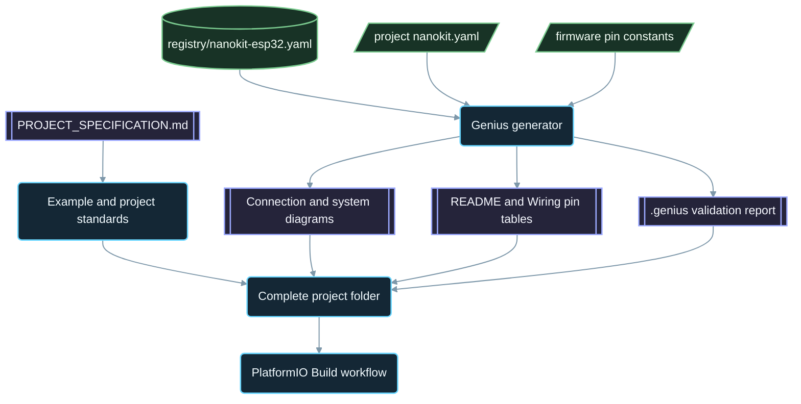

<div align="center">

# NanoKit-ESP32

**O ecossistema oficial do PlatformIO para a placa de desenvolvimento NanoKit Integrated ESP32**

<p>
<a href="../../README.md">English</a> ·
<a href="README.zh-CN.md">简体中文</a> ·
<a href="README.zh-TW.md">繁體中文</a> ·
<a href="README.ja.md">日本語</a> ·
<a href="README.ko.md">한국어</a> ·
<a href="README.tr.md">Türkçe</a> ·
<a href="README.ru.md">Русский</a> ·
<a href="README.vi.md">Tiếng Việt</a> ·
<a href="README.th.md">ไทย</a> ·
<a href="README.de.md">Deutsch</a> ·
<a href="README.es.md">Español</a> ·
<a href="README.fr.md">Français</a> ·
<a href="README.uk.md">Українська</a> ·
<a href="README.pl.md">Polski</a> ·
<strong>Português (Brasil)</strong> ·
<a href="README.ar.md">العربية</a> ·
<a href="README.fa.md">فارسی</a> ·
<a href="README.id.md">Bahasa Indonesia</a> ·
<a href="README.it.md">Italiano</a> ·
<a href="README.el.md">Ελληνικά</a> ·
<a href="README.ml.md">മലയാളം</a> ·
<a href="README.ur-Latn.md">Roman Urdu</a> ·
<a href="README.ro.md">Română</a>
</p>

<p>
<a href="https://github.com/ProAmineOfficial/NanoKit-ESP32/stargazers"></a>
<a href="https://github.com/ProAmineOfficial/NanoKit-ESP32/commits/main"></a>
<a href="../../LICENSE"></a>
<a href="https://github.com/ProAmineOfficial/NanoKit-ESP32/actions/workflows/platformio-build.yml"></a>
<a href="https://github.com/ProAmineOfficial/NanoKit-ESP32/actions/workflows/repository-index.yml"></a>
</p>

<p>
<a href="https://proamine.tech"></a>
<a href="https://gitarchitecturediagram.com/ProAmineOfficial/NanoKit-ESP32"></a>

</p>

**Developed by Amine Saoud ibn al-Bashir.**

</div>

> **Nota de tradução:** esta página é uma tradução do [README em inglês](../../README.md). Em caso de divergência, prevalece o README em inglês.

##  Datasheet da pinagem da NanoKit Integrated ESP32


A placa de desenvolvimento NanoKit Integrated ESP32 é uma plataforma de desenvolvimento embarcado para IoT, IA, robótica, educação e prototipagem profissional. Este repositório está organizado em exemplos para PlatformIO, aplicações completas, projetos de código aberto, projetos de conclusão de curso, recursos de simulação, documentação, artigos, tutoriais e modelos reutilizáveis.

A placa NanoKit faz parte da visão de hardware mais ampla da UMT, mas o firmware deste repositório usa C++ Arduino padrão no PlatformIO e os números de GPIO do ESP32, de modo que todo projeto compila e roda diretamente no PlatformIO.

##  Missão do repositório

Este não é um repositório de demonstração nem um repositório de modelos. É o repositório oficial e de longo prazo do ecossistema NanoKit-ESP32 para o desenvolvimento educacional e profissional de sistemas embarcados: cada projeto ensina o código, a fiação, o algoritmo, o mapeamento de pinos da NanoKit e o caminho para solucionar problemas.

Consulte o [PROJECT_SPECIFICATION.md](../../PROJECT_SPECIFICATION.md) para conhecer as regras principais do repositório, o modelo de crescimento, os padrões de exemplos, os requisitos de documentação e a Definition of Done.

##  Início rápido

1. Instale o [VS Code](https://code.visualstudio.com/) com a extensão [PlatformIO IDE](https://platformio.org/install/ide?install=vscode), ou a CLI do PlatformIO Core.
2. Clone o repositório e abra um exemplo. O [`digital_input_output`](../../examples_on_platformio/digital_input_output/) é o primeiro a experimentar: um botão, um LED e o LED da própria placa.
3. Conecte a NanoKit via USB e, em seguida, compile, faça o upload e abra o Serial Monitor:

```bash
git clone https://github.com/ProAmineOfficial/NanoKit-ESP32.git
cd NanoKit-ESP32/examples_on_platformio/digital_input_output
pio run --target upload
pio device monitor -b 115200
```

O README de cada projeto lista os componentes, a tabela de pinos da NanoKit, a ordem de ligação e a saída esperada no Serial Monitor.

##  Estrutura do repositório

| Caminho | Finalidade |
|---|---|
| [`examples_on_platformio/`](../../examples_on_platformio/README.md) | Exemplos para PlatformIO focados e sem interface de usuário: um recurso da placa, um sensor ou um módulo por exemplo. |
| [`applications_on_platformio/`](../../applications_on_platformio/README.md) | Aplicações completas com interface de usuário, como aplicativos web servidos pela NanoKit com botões, controles deslizantes e painéis. |
| [`open_source_projects/`](../../open_source_projects/README.md) | Projetos originais maiores da NanoKit, como o NanoKit Drone 4X, além de áreas para comunidade, colaboradores, vitrine de projetos e hackathons. |
| [`graduation_projects/`](../../graduation_projects/README.md) | Espaços de trabalho para projetos de bacharelado, mestrado, engenharia, instituto, capstone e tese. |
| `tutorials/` | Tutoriais do nível iniciante ao avançado, guias de projetos e índices de links de vídeos. |
| `articles/` | Artigos técnicos sobre sistemas embarcados, IoT, IA, robótica, PlatformIO, NanoKit e UMT. |
| `docs/` | Primeiros passos, instalação, hardware, software, API, solução de problemas, roadmap, arquitetura e traduções. |
| `registry/` | A placa NanoKit como dados: cada pino dos conectores, cada GPIO, cada endereço VR e cada regra elétrica. |
| `tools/` | Automação do repositório: o gerador Genius e o gerador de índice. |
| `simulator/` | Simulador web, motor de simulação, exemplos e recursos do simulador. |
| `templates/` | Modelos reutilizáveis para exemplos, aplicações, trabalhos de conclusão de curso e documentação. |
| `assets/` | Imagens, ícones, logotipos, banners e vídeos compartilhados. |

##  Manifestos de hardware e documentação gerada

Cada exemplo, aplicação, projeto de código aberto e projeto de conclusão de curso descreve seu hardware uma única vez, em um manifesto `nanokit.yaml`. O `python tools/genius/generate.py` o valida em relação ao registro da placa [`registry/nanokit-esp32.yaml`](../../registry/nanokit-esp32.yaml) e às constantes de pinos do firmware e, em seguida, regenera:

- `images/connection-diagram.md` e `images/system-diagram.md` com rótulos `Pin <NanoKit pin> / GPIO<n>` e estilos Confirmed / Proposed / Blocked,
- a tabela de pinos da NanoKit no README de cada projeto e a tabela de conexões em cada `docs/Wiring.md`,
- `.genius/VALIDATION_REPORT.md` com as regras verificadas, as constatações e as evidências no código.

Um pino na flash interna, uma saída em um pino somente de entrada, um sinal de 5 V sem conversão de nível ou um manifesto que diverge do código bloqueiam o commit e o pull request. O projeto de referência é [`examples_on_platformio/ultrasonic_distance/`](../../examples_on_platformio/ultrasonic_distance/). Esquema e regras: [`tools/genius/README.md`](../../tools/genius/README.md). Registro de design: [`docs/software/genius-generator-spec.md`](../../docs/software/genius-generator-spec.md).

##  Índices gerados

- O [Índice do repositório](../../REPOSITORY_INDEX.md) resume as principais áreas do repositório e conta os projetos reais (pastas com um manifesto).
- A [Árvore do repositório](../../REPOSITORY_TREE.md) mostra a árvore de arquivos gerada.
- O [Backlog de projetos](../../docs/roadmap/project-backlog.md) lista cada exemplo, aplicação, tutorial e artigo planejado em cinco ondas; sua coluna Status e o [resumo do roadmap](../../docs/roadmap/README.md) são atualizados automaticamente.
- Cada projeto PlatformIO é compilado pelo [workflow PlatformIO Build](../../.github/workflows/platformio-build.yml) a cada push e a cada pull request.

Execute `python tools/genius/generate.py` e depois `python tools/update_repository_index.py` após adicionar ou alterar um projeto. Ative o hook local uma única vez com `git config core.hooksPath .githooks`; o workflow do GitHub executa as mesmas duas ferramentas a cada push para `main` e valida os pull requests.

##  Árvore interativa do repositório

A árvore abaixo é gerada a partir do conteúdo atual do repositório. Selecione o título para expandi-la ou recolhê-la. O hook de pre-commit local e o workflow do GitHub a atualizam automaticamente quando projetos ou arquivos são adicionados, movidos ou removidos.

A árvore completa gerada está em [REPOSITORY_TREE.md](../../REPOSITORY_TREE.md); o README em inglês a exibe como uma lista expansível.

##  Como o repositório é construído



##  Projeto de código aberto em destaque

O [NanoKit Drone 4X (quadricóptero)](../../open_source_projects/nanokit_drone_4x_quadcopter/README.md) é a referência de controle de voo Quad-X do repositório, com a segurança em primeiro lugar. Uma controladora de voo NanoKit executa um laço de controle de 250 Hz com mixagem de motores Quad-X e travas de segurança, um Flight Deck no navegador se conecta via Wi-Fi e WebSocket, e uma segunda NanoKit executa uma carga útil isolada de câmera e áudio, sem nenhuma autoridade sobre os motores. O projeto está em desenvolvimento em bancada: as hélices permanecem removidas e a saída dos motores fica no mínimo seguro até que o protocolo do ESC seja verificado.

##  Contrato de qualidade

O conteúdo oficial deste repositório deve ser pronto para produção, didático, completo e de fácil manutenção.

- Não deixe diretórios vazios como trabalho final.
- Não adicione conteúdo provisório quando for possível fornecer material didático real.
- Construa sobre o trabalho existente em vez de sobrescrevê-lo sem necessidade.
- Cada exemplo ensina o código, a fiação, o algoritmo, o mapeamento de pinos e o caminho para solucionar problemas.
- Cada exemplo de hardware documenta os números de pino da NanoKit e os números de GPIO do ESP32, escritos por extenso como "Pin 36 / GPIO5".

Use o [docs/software/platformio-example-standard.md](../../docs/software/platformio-example-standard.md) ao criar ou revisar exemplos.

##  Configuração base do PlatformIO

Os projetos PlatformIO usam o framework Arduino para ESP32 como primeira base pública:

```ini
[env:nanokit_esp32]
platform = espressif32
board = esp32dev
framework = arduino
monitor_speed = 115200
upload_speed = 921600
```

Definições de placa dedicadas à NanoKit poderão substituir o perfil genérico de placa `esp32dev` à medida que o pacote de hardware evoluir.

##  Regra de firmware

Os exemplos oficiais deste repositório devem usar:

- PlatformIO
- Framework Arduino para ESP32
- C++
- Documentação em Markdown
- Números de GPIO normais do ESP32 no código-fonte

Não use código do SDK UMT nem código da Virtual Register API nos exemplos PlatformIO.

##  Pinagem do hardware

Use o [docs/hardware/nanokit-integrated-esp32-pinout.md](../../docs/hardware/nanokit-integrated-esp32-pinout.md) como fonte da verdade para os números de pino da NanoKit, os mapeamentos de GPIO do ESP32, as notas elétricas e os avisos.

Cada exemplo de hardware documenta:

```text
NanoKit Pin -> GPIO -> Component Pin -> Description
```

Restrições importantes:

- GPIO34, GPIO35, GPIO36 e GPIO39 são somente de entrada.
- GPIO6, GPIO7, GPIO8, GPIO9, GPIO10 e GPIO11 são pinos da flash SPI interna e não devem ser usados.
- GPIO0 é o pino BOOT.
- GPIO1 e GPIO3 são compartilhados com a serial USB.
- EN é Reset / Enable e não é um GPIO.

##  Roadmap

O [Backlog de projetos](../../docs/roadmap/project-backlog.md) planeja a biblioteca em cinco ondas: fundamentos da placa, sensores e módulos, aplicações web, protocolos e nuvem, e módulos externos. O [resumo do roadmap](../../docs/roadmap/README.md) mostra quantos projetos de cada onda estão concluídos.

##  Como contribuir

Contribuições são bem-vindas. Leia primeiro o [CONTRIBUTING.md](../../CONTRIBUTING.md): ele explica os padrões do projeto, o manifesto `nanokit.yaml`, o hook de pre-commit e a licença das contribuições.

##  Traduções

Este README está disponível em 23 idiomas pela barra de idiomas no topo. As traduções ficam em [`docs/i18n/`](../../docs/i18n/); quando uma tradução e o README em inglês divergem, prevalece o README em inglês.

##  Suporte

-  Site: [https://proamine.tech](https://proamine.tech)
-  Git Architecture Diagram: [https://gitarchitecturediagram.com](https://gitarchitecturediagram.com/ProAmineOfficial/NanoKit-ESP32)
-  E-mail: `technology@proamine.tech`
-  TikTok: [@pro_amine](https://www.tiktok.com/@pro_amine)
-  YouTube: [@pro_amine](https://www.youtube.com/@pro_amine)

##  Licença

O NanoKit-ESP32 é licenciado sob a [GNU Affero General Public License v3.0 only](../../LICENSE) (`AGPL-3.0-only`), com termos adicionais previstos na seção 7, listados em [NOTICE](../../NOTICE):

- **Atribuição:** toda cópia ou versão modificada mantém a linha "Developed by Amine Saoud ibn al-Bashir." e informa que é baseada no NanoKit-ESP32 de Amine Saoud ibn al-Bashir (Pro_Amine LLC).
- **Versões modificadas** são identificadas como diferentes do original e não são apresentadas como o repositório oficial NanoKit-ESP32.
- **Nomes:** nenhum direito é concedido sobre os nomes NanoKit, Pro_Amine ou UMT, nem sobre seus logotipos; uma versão redistribuída usa seu próprio nome.
- **Uso em rede:** se você executar uma versão modificada como serviço de rede, a AGPL exige que você ofereça o código-fonte dela aos seus usuários.

Você é livre para estudar, usar e modificar este código para aprender, ensinar, pesquisar e desenvolver seus próprios projetos, nestes termos. As versões publicadas antes da mudança para a AGPL foram distribuídas sob a Apache License 2.0. Os ícones Fluent Emoji em `assets/icons/fluent/` são © Microsoft Corporation e distribuídos sob a MIT License.

<div align="center">

**Developed by Amine Saoud ibn al-Bashir · © 2026 Pro_Amine LLC**

</div>
