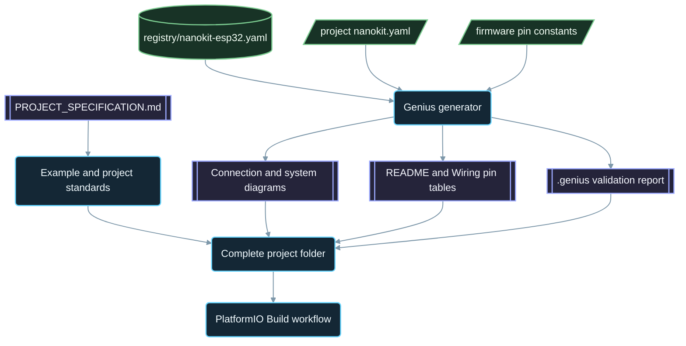

<div align="center">

# NanoKit-ESP32

**Ecosistemul PlatformIO oficial pentru placa de dezvoltare NanoKit Integrated ESP32**

<p>
<a href="../../README.md">English</a> ·
<a href="README.zh-CN.md">简体中文</a> ·
<a href="README.zh-TW.md">繁體中文</a> ·
<a href="README.ja.md">日本語</a> ·
<a href="README.ko.md">한국어</a> ·
<a href="README.tr.md">Türkçe</a> ·
<a href="README.ru.md">Русский</a> ·
<a href="README.vi.md">Tiếng Việt</a> ·
<a href="README.th.md">ไทย</a> ·
<a href="README.de.md">Deutsch</a> ·
<a href="README.es.md">Español</a> ·
<a href="README.fr.md">Français</a> ·
<a href="README.uk.md">Українська</a> ·
<a href="README.pl.md">Polski</a> ·
<a href="README.pt-BR.md">Português (Brasil)</a> ·
<a href="README.ar.md">العربية</a> ·
<a href="README.fa.md">فارسی</a> ·
<a href="README.id.md">Bahasa Indonesia</a> ·
<a href="README.it.md">Italiano</a> ·
<a href="README.el.md">Ελληνικά</a> ·
<a href="README.ml.md">മലയാളം</a> ·
<a href="README.ur-Latn.md">Roman Urdu</a> ·
<strong>Română</strong>
</p>

<p>
<a href="https://github.com/ProAmineOfficial/NanoKit-ESP32/stargazers"></a>
<a href="https://github.com/ProAmineOfficial/NanoKit-ESP32/commits/main"></a>
<a href="../../LICENSE"></a>
<a href="https://github.com/ProAmineOfficial/NanoKit-ESP32/actions/workflows/platformio-build.yml"></a>
<a href="https://github.com/ProAmineOfficial/NanoKit-ESP32/actions/workflows/repository-index.yml"></a>
</p>

<p>
<a href="https://proamine.tech"></a>
<a href="https://gitarchitecturediagram.com/ProAmineOfficial/NanoKit-ESP32"></a>

</p>

**Developed by Amine Saoud ibn al-Bashir.**

</div>

> **Notă privind traducerea:** această pagină este o traducere a [README-ului în limba engleză](../../README.md). Atunci când cele două diferă, README-ul în limba engleză are prioritate.

##  Fișa tehnică cu pinout-ul NanoKit Integrated ESP32


Placa de dezvoltare NanoKit Integrated ESP32 este o platformă de dezvoltare pentru sisteme embedded, destinată IoT, inteligenței artificiale, roboticii, educației și prototipării profesionale. Acest depozit este organizat pentru exemple PlatformIO, aplicații complete, proiecte open-source, proiecte de absolvire, resurse de simulare, documentație, articole, tutoriale și șabloane reutilizabile.

Placa NanoKit face parte din viziunea hardware mai largă UMT, însă firmware-ul din acest depozit folosește Arduino C++ standard pentru PlatformIO și numerele GPIO ale ESP32, astfel încât fiecare proiect se compilează și rulează direct în PlatformIO.

##  Misiunea depozitului

Acesta nu este un depozit demonstrativ și nici un depozit-șablon. Este depozitul oficial, pe termen lung, al ecosistemului NanoKit-ESP32 pentru dezvoltarea educațională și profesională de sisteme embedded: fiecare proiect explică codul, conexiunile, algoritmul, maparea pinilor NanoKit și modul de depanare.

Consultați [PROJECT_SPECIFICATION.md](../../PROJECT_SPECIFICATION.md) pentru regulile principale ale depozitului, modelul de creștere, standardele pentru exemple, cerințele de documentație și criteriile de finalizare (Definition of Done).

##  Pornire rapidă

1. Instalați [VS Code](https://code.visualstudio.com/) cu extensia [PlatformIO IDE](https://platformio.org/install/ide?install=vscode) sau PlatformIO Core CLI.
2. Clonați depozitul și deschideți un exemplu. [`digital_input_output`](../../examples_on_platformio/digital_input_output/) este primul pe care merită să-l încercați: un buton, un LED și LED-ul integrat pe placă.
3. Conectați NanoKit prin USB, apoi compilați, încărcați firmware-ul și deschideți Serial Monitor:

```bash
git clone https://github.com/ProAmineOfficial/NanoKit-ESP32.git
cd NanoKit-ESP32/examples_on_platformio/digital_input_output
pio run --target upload
pio device monitor -b 115200
```

README-ul fiecărui proiect enumeră componentele, tabelul pinilor NanoKit, ordinea conexiunilor și ieșirea așteptată în Serial Monitor.

##  Structura depozitului

| Cale | Scop |
|---|---|
| [`examples_on_platformio/`](../../examples_on_platformio/README.md) | Exemple PlatformIO concentrate, fără interfață cu utilizatorul: o singură funcție a plăcii, un senzor sau un modul per exemplu. |
| [`applications_on_platformio/`](../../applications_on_platformio/README.md) | Aplicații complete cu interfață cu utilizatorul, de exemplu aplicații web servite chiar de NanoKit, cu butoane, glisoare și panouri de control. |
| [`open_source_projects/`](../../open_source_projects/README.md) | Proiecte NanoKit originale mai ample, precum NanoKit Drone 4X, plus secțiuni pentru comunitate, contributori, prezentări și hackathoane. |
| [`graduation_projects/`](../../graduation_projects/README.md) | Spații de lucru pentru proiecte de licență, master, inginerie, institut, capstone și teză. |
| `tutorials/` | Tutoriale de la nivel începător la avansat, ghiduri de proiect și indexuri de linkuri video. |
| `articles/` | Articole tehnice despre sisteme embedded, IoT, inteligență artificială, robotică, PlatformIO, NanoKit și UMT. |
| `docs/` | Primii pași, instalare, hardware, software, API, depanare, foaie de parcurs, arhitectură și traduceri. |
| `registry/` | Placa NanoKit sub formă de date: fiecare pin de conector, GPIO, adresă VR și regulă electrică. |
| `tools/` | Automatizarea depozitului: generatorul Genius și generatorul de index. |
| `simulator/` | Simulator web, motor de simulare, exemple și resurse pentru simulator. |
| `templates/` | Șabloane reutilizabile pentru exemple, aplicații, lucrări de licență și documentație. |
| `assets/` | Imagini, pictograme, logouri, bannere și videoclipuri comune. |

##  Manifeste hardware și documentație generată

Fiecare exemplu, aplicație, proiect open-source și proiect de absolvire își descrie hardware-ul o singură dată, într-un manifest `nanokit.yaml`. `python tools/genius/generate.py` îl validează în raport cu registrul plăcii [`registry/nanokit-esp32.yaml`](../../registry/nanokit-esp32.yaml) și cu constantele de pini din firmware, apoi regenerează:

- `images/connection-diagram.md` și `images/system-diagram.md` cu etichete `Pin <NanoKit pin> / GPIO<n>` și stiluri Confirmed / Proposed / Blocked,
- tabelul pinilor NanoKit din README-ul fiecărui proiect și tabelul conexiunilor din fiecare `docs/Wiring.md`,
- `.genius/VALIDATION_REPORT.md` cu regulile verificate, constatările și dovezile din cod.

Un pin ocupat de memoria flash internă, o ieșire pe un pin doar de intrare, un semnal de 5 V fără conversie de nivel sau un manifest care nu concordă cu codul opresc commit-ul și pull request-ul. Proiectul de referință este [`examples_on_platformio/ultrasonic_distance/`](../../examples_on_platformio/ultrasonic_distance/). Schema și regulile: [`tools/genius/README.md`](../../tools/genius/README.md). Documentul de proiectare: [`docs/software/genius-generator-spec.md`](../../docs/software/genius-generator-spec.md).

##  Indexuri generate

- [Indexul depozitului](../../REPOSITORY_INDEX.md) rezumă principalele zone ale depozitului și numără proiectele reale (folderele care au un manifest).
- [Arborele depozitului](../../REPOSITORY_TREE.md) afișează arborele de fișiere generat.
- [Backlogul de proiecte](../../docs/roadmap/project-backlog.md) enumeră toate exemplele, aplicațiile, tutorialele și articolele planificate, în cinci valuri; coloana Status și [rezumatul foii de parcurs](../../docs/roadmap/README.md) sunt actualizate automat.
- Fiecare proiect PlatformIO este compilat de [fluxul de lucru PlatformIO Build](../../.github/workflows/platformio-build.yml) la fiecare push și pull request.

Rulați `python tools/genius/generate.py` și apoi `python tools/update_repository_index.py` după ce adăugați sau modificați un proiect. Activați o singură dată hook-ul local cu `git config core.hooksPath .githooks`; fluxul de lucru GitHub rulează aceleași două instrumente la fiecare push în `main` și validează pull request-urile.

##  Arborele interactiv al depozitului

Arborele de mai jos este generat din conținutul actual al depozitului. Selectați titlul acestuia pentru a-l extinde sau restrânge. Hook-ul pre-commit local și fluxul de lucru GitHub îl actualizează automat atunci când sunt adăugate, mutate sau eliminate proiecte ori fișiere.

Arborele complet generat se află în [REPOSITORY_TREE.md](../../REPOSITORY_TREE.md); README-ul în limba engleză îl afișează ca listă extensibilă.

##  Cum este construit depozitul



##  Proiect open-source recomandat

[NanoKit Drone 4X (dronă quadcopter)](../../open_source_projects/nanokit_drone_4x_quadcopter/README.md) este proiectul de referință al depozitului pentru controlul zborului Quad-X, cu siguranța pe primul loc. Un controler de zbor NanoKit rulează o buclă de control de 250 Hz cu mixarea motoarelor Quad-X și bariere de siguranță, un Flight Deck în browser se conectează prin Wi-Fi și WebSocket, iar un al doilea NanoKit rulează o sarcină utilă izolată, cu cameră și audio, fără nicio autoritate asupra motoarelor. Proiectul este în faza de dezvoltare pe banc: elicele rămân demontate, iar ieșirea către motoare rămâne la minimul sigur până când protocolul ESC este verificat.

##  Contractul de calitate

Conținutul oficial din acest depozit trebuie să fie gata de producție, educațional, complet și ușor de întreținut.

- Nu lăsați directoare goale ca rezultat final.
- Nu adăugați conținut provizoriu atunci când poate fi furnizat material educațional real.
- Construiți pe munca existentă în loc să o suprascrieți inutil.
- Fiecare exemplu explică codul, conexiunile, algoritmul, maparea pinilor și modul de depanare.
- Fiecare exemplu hardware documentează numerele pinilor NanoKit și numerele GPIO ale ESP32, scrise complet sub forma „Pin 36 / GPIO5”.

Folosiți [docs/software/platformio-example-standard.md](../../docs/software/platformio-example-standard.md) atunci când creați sau revizuiți exemple.

##  Configurația de bază PlatformIO

Proiectele PlatformIO folosesc framework-ul Arduino pentru ESP32 ca primă configurație de bază publică:

```ini
[env:nanokit_esp32]
; espressif32 8.0.0 = Arduino-ESP32 core 3.3.12, pinned so a platform update cannot break the build
platform = espressif32 @ 8.0.0
board = esp32dev
framework = arduino
monitor_speed = 115200
upload_speed = 921600
```

Pe măsură ce pachetul hardware evoluează, definiții dedicate ale plăcii NanoKit pot înlocui profilul generic de placă `esp32dev`.

##  Regula pentru firmware

Exemplele oficiale din acest depozit trebuie să folosească:

- PlatformIO
- Framework-ul Arduino pentru ESP32
- C++
- Documentație Markdown
- Numerele GPIO obișnuite ale ESP32 în codul sursă

Nu folosiți cod UMT SDK sau cod Virtual Register API în exemplele PlatformIO.

##  Pinout-ul hardware

Folosiți [docs/hardware/nanokit-integrated-esp32-pinout.md](../../docs/hardware/nanokit-integrated-esp32-pinout.md) ca sursă de referință pentru numerele pinilor NanoKit, corespondența cu GPIO-urile ESP32, notele electrice și avertismente.

Fiecare exemplu hardware documentează:

```text
NanoKit Pin -> GPIO -> Component Pin -> Description
```

Restricții importante:

- GPIO34, GPIO35, GPIO36 și GPIO39 sunt doar de intrare.
- GPIO6, GPIO7, GPIO8, GPIO9, GPIO10 și GPIO11 sunt pini ai memoriei flash SPI interne și nu trebuie folosiți.
- GPIO0 este pinul BOOT.
- GPIO1 și GPIO3 sunt partajați cu USB Serial.
- EN este Reset / Enable și nu este un GPIO.

##  Foaia de parcurs

[Backlogul de proiecte](../../docs/roadmap/project-backlog.md) planifică biblioteca în cinci valuri: elementele de bază ale plăcii, senzori și module, aplicații web, protocoale și cloud, module externe. [Rezumatul foii de parcurs](../../docs/roadmap/README.md) arată câte proiecte din fiecare val sunt finalizate.

##  Contribuții

Contribuțiile sunt binevenite. Citiți mai întâi [CONTRIBUTING.md](../../CONTRIBUTING.md): explică standardele proiectelor, manifestul `nanokit.yaml`, hook-ul pre-commit și licența contribuțiilor.

##  Traduceri

Acest README este disponibil în 23 de limbi prin bara de limbi din partea de sus a paginii. Traducerile se află în [`docs/i18n/`](../../docs/i18n/); atunci când o traducere diferă de README-ul în limba engleză, README-ul în limba engleză are prioritate.

##  Asistență

-  Site web: [https://proamine.tech](https://proamine.tech)
-  Git Architecture Diagram: [https://gitarchitecturediagram.com](https://gitarchitecturediagram.com/ProAmineOfficial/NanoKit-ESP32)
-  E-mail: `technology@proamine.tech`
-  TikTok: [@pro_amine](https://www.tiktok.com/@pro_amine)
-  YouTube: [@pro_amine](https://www.youtube.com/@pro_amine)

##  Licență

NanoKit-ESP32 este licențiat sub [GNU Affero General Public License v3.0 only](../../LICENSE) (`AGPL-3.0-only`), cu termeni suplimentari conform secțiunii 7, enumerați în [NOTICE](../../NOTICE):

- **Atribuire:** fiecare copie sau versiune modificată păstrează rândul „Developed by Amine Saoud ibn al-Bashir.” și menționează că se bazează pe NanoKit-ESP32 de Amine Saoud ibn al-Bashir (Pro_Amine LLC).
- **Versiunile modificate** sunt marcate ca diferite de original și nu sunt prezentate drept depozitul oficial NanoKit-ESP32.
- **Nume:** nu se acordă niciun drept asupra numelor NanoKit, Pro_Amine sau UMT ori asupra siglelor acestora; o versiune redistribuită își folosește propriul nume.
- **Utilizare în rețea:** dacă rulați o versiune modificată ca serviciu de rețea, AGPL vă obligă să oferiți codul sursă al acesteia utilizatorilor ei.

În aceste condiții, sunteți liberi să studiați, să folosiți și să modificați acest cod pentru învățare, predare, cercetare și propriile proiecte. Versiunile publicate înainte de trecerea la AGPL au fost distribuite sub Apache License 2.0. Pictogramele Fluent Emoji din `assets/icons/fluent/` sunt © Microsoft Corporation, sub licența MIT License.

<div align="center">

**Developed by Amine Saoud ibn al-Bashir · © 2026 Pro_Amine LLC**

</div>
