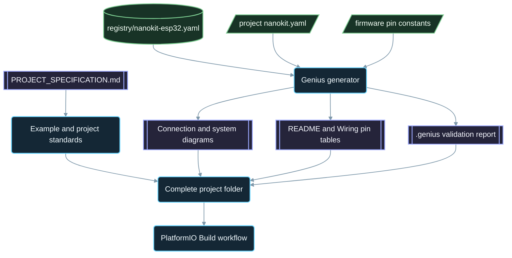

<div align="center">

# NanoKit-ESP32

**Официальная экосистема PlatformIO для отладочной платы NanoKit Integrated ESP32**

<p>
<a href="../../README.md">English</a> ·
<a href="README.zh-CN.md">简体中文</a> ·
<a href="README.zh-TW.md">繁體中文</a> ·
<a href="README.ja.md">日本語</a> ·
<a href="README.ko.md">한국어</a> ·
<a href="README.tr.md">Türkçe</a> ·
<strong>Русский</strong> ·
<a href="README.vi.md">Tiếng Việt</a> ·
<a href="README.th.md">ไทย</a> ·
<a href="README.de.md">Deutsch</a> ·
<a href="README.es.md">Español</a> ·
<a href="README.fr.md">Français</a> ·
<a href="README.uk.md">Українська</a> ·
<a href="README.pl.md">Polski</a> ·
<a href="README.pt-BR.md">Português (Brasil)</a> ·
<a href="README.ar.md">العربية</a> ·
<a href="README.fa.md">فارسی</a> ·
<a href="README.id.md">Bahasa Indonesia</a> ·
<a href="README.it.md">Italiano</a> ·
<a href="README.el.md">Ελληνικά</a> ·
<a href="README.ml.md">മലയാളം</a> ·
<a href="README.ur-Latn.md">Roman Urdu</a> ·
<a href="README.ro.md">Română</a>
</p>

<p>
<a href="https://github.com/ProAmineOfficial/NanoKit-ESP32/stargazers"></a>
<a href="https://github.com/ProAmineOfficial/NanoKit-ESP32/commits/main"></a>
<a href="../../LICENSE"></a>
<a href="https://github.com/ProAmineOfficial/NanoKit-ESP32/actions/workflows/platformio-build.yml"></a>
<a href="https://github.com/ProAmineOfficial/NanoKit-ESP32/actions/workflows/repository-index.yml"></a>
</p>

<p>
<a href="https://proamine.tech"></a>
<a href="https://gitarchitecturediagram.com/ProAmineOfficial/NanoKit-ESP32"></a>

</p>

**Developed by Amine Saoud ibn al-Bashir.**

</div>

> **Примечание о переводе:** эта страница является переводом [английского README](../../README.md). При расхождениях приоритет имеет английский README.

##  Распиновка NanoKit Integrated ESP32: техническое описание


Отладочная плата NanoKit Integrated ESP32 — это платформа для разработки встраиваемых систем в области IoT, ИИ, робототехники, образования и профессионального прототипирования. Репозиторий объединяет примеры для PlatformIO, законченные приложения, проекты с открытым исходным кодом, дипломные проекты, ресурсы для симуляции, документацию, статьи, учебные материалы и шаблоны для повторного использования.

Плата NanoKit является частью более широкой аппаратной концепции UMT, однако прошивки в этом репозитории написаны на стандартном Arduino C++ для PlatformIO и используют номера GPIO ESP32, поэтому каждый проект компилируется и запускается непосредственно в PlatformIO.

##  Миссия репозитория

Это не демонстрационный репозиторий и не репозиторий-шаблон. Это официальный долгосрочный репозиторий экосистемы NanoKit-ESP32 для учебной и профессиональной разработки встраиваемых систем: каждый проект объясняет код, схему подключения, алгоритм, соответствие выводов NanoKit и порядок поиска неисправностей.

Основные правила репозитория, модель его развития, стандарты примеров, требования к документации и критерии готовности (Definition of Done) описаны в [PROJECT_SPECIFICATION.md](../../PROJECT_SPECIFICATION.md).

##  Быстрый старт

1. Установите [VS Code](https://code.visualstudio.com/) с расширением [PlatformIO IDE](https://platformio.org/install/ide?install=vscode) или PlatformIO Core CLI.
2. Клонируйте репозиторий и откройте пример. Начните с [`digital_input_output`](../../examples_on_platformio/digital_input_output/): кнопка, LED и встроенный LED платы.
3. Подключите NanoKit по USB, затем соберите проект, загрузите прошивку и откройте Serial Monitor:

```bash
git clone https://github.com/ProAmineOfficial/NanoKit-ESP32.git
cd NanoKit-ESP32/examples_on_platformio/digital_input_output
pio run --target upload
pio device monitor -b 115200
```

В README каждого проекта перечислены компоненты, таблица выводов NanoKit, порядок подключения и ожидаемый вывод в Serial Monitor.

##  Структура репозитория

| Путь | Назначение |
|---|---|
| [`examples_on_platformio/`](../../examples_on_platformio/README.md) | Узконаправленные примеры для PlatformIO без пользовательского интерфейса: одна функция платы, один датчик или модуль на пример. |
| [`applications_on_platformio/`](../../applications_on_platformio/README.md) | Законченные приложения с пользовательским интерфейсом, например веб-приложения, которые раздаёт сама плата NanoKit, с кнопками, ползунками и панелями мониторинга. |
| [`open_source_projects/`](../../open_source_projects/README.md) | Более крупные оригинальные проекты NanoKit, такие как NanoKit Drone 4X, а также разделы для сообщества, участников, демонстраций и хакатонов. |
| [`graduation_projects/`](../../graduation_projects/README.md) | Рабочие пространства для бакалаврских, магистерских, инженерных, институтских, итоговых (capstone) и диссертационных проектов. |
| `tutorials/` | Учебные материалы от начального до продвинутого уровня, руководства по проектам и указатели ссылок на видео. |
| `articles/` | Технические статьи о встраиваемых системах, IoT, ИИ, робототехнике, PlatformIO, NanoKit и UMT. |
| `docs/` | Начало работы, установка, аппаратная часть, программное обеспечение, API, устранение неполадок, дорожная карта, архитектура и переводы. |
| `registry/` | Плата NanoKit в виде данных: каждый вывод разъёмов, GPIO, адрес VR и электрическое правило. |
| `tools/` | Автоматизация репозитория: генератор Genius и генератор индекса. |
| `simulator/` | Веб-симулятор, движок симуляции, примеры и ресурсы симулятора. |
| `templates/` | Шаблоны для повторного использования: примеры, приложения, дипломные работы и документация. |
| `assets/` | Общие изображения, иконки, логотипы, баннеры и видео. |

##  Аппаратные манифесты и генерируемая документация

Каждый пример, приложение, проект с открытым исходным кодом и дипломный проект описывает своё оборудование один раз — в манифесте `nanokit.yaml`. Команда `python tools/genius/generate.py` проверяет его по реестру платы [`registry/nanokit-esp32.yaml`](../../registry/nanokit-esp32.yaml) и по константам выводов в прошивке, а затем заново генерирует:

- `images/connection-diagram.md` и `images/system-diagram.md` с метками `Pin <NanoKit pin> / GPIO<n>` и стилями Confirmed / Proposed / Blocked,
- таблицу выводов NanoKit в README каждого проекта и таблицу подключений в каждом `docs/Wiring.md`,
- `.genius/VALIDATION_REPORT.md` с перечнем проверенных правил, найденных проблем и подтверждений из кода.

Вывод, занятый внутренней флеш-памятью, выход на выводе, работающем только на вход, сигнал 5 В без преобразования уровней или манифест, расходящийся с кодом, блокируют коммит и pull request. Эталонный проект — [`examples_on_platformio/ultrasonic_distance/`](../../examples_on_platformio/ultrasonic_distance/). Схема манифеста и правила: [`tools/genius/README.md`](../../tools/genius/README.md). Проектное описание: [`docs/software/genius-generator-spec.md`](../../docs/software/genius-generator-spec.md).

##  Генерируемые индексы

- [Индекс репозитория](../../REPOSITORY_INDEX.md) кратко описывает основные разделы репозитория и подсчитывает реальные проекты (папки с манифестом).
- [Дерево репозитория](../../REPOSITORY_TREE.md) показывает сгенерированное дерево файлов.
- [Бэклог проектов](../../docs/roadmap/project-backlog.md) перечисляет все запланированные примеры, приложения, учебные материалы и статьи, разбитые на пять волн; его столбец Status и [сводка дорожной карты](../../docs/roadmap/README.md) обновляются автоматически.
- Каждый проект PlatformIO компилируется [рабочим процессом PlatformIO Build](../../.github/workflows/platformio-build.yml) при каждом push и pull request.

После добавления или изменения проекта запустите `python tools/genius/generate.py`, а затем `python tools/update_repository_index.py`. Один раз включите локальный хук командой `git config core.hooksPath .githooks`; рабочий процесс GitHub запускает те же два инструмента при каждом push в `main` и проверяет каждый pull request.

##  Интерактивное дерево репозитория

Дерево ниже сгенерировано из текущего содержимого репозитория. Щёлкните по его заголовку, чтобы развернуть или свернуть его. Локальный pre-commit хук и рабочий процесс GitHub автоматически обновляют его, когда проекты или файлы добавляются, перемещаются или удаляются.

Полное сгенерированное дерево находится в [REPOSITORY_TREE.md](../../REPOSITORY_TREE.md); в английском README оно показано в виде раскрывающегося списка.

##  Как устроен репозиторий



##  Избранный проект с открытым исходным кодом

[NanoKit Drone 4X (квадрокоптер)](../../open_source_projects/nanokit_drone_4x_quadcopter/README.md) — эталонный проект системы управления полётом Quad-X в этом репозитории, где безопасность стоит на первом месте. Полётный контроллер на NanoKit выполняет контур управления с частотой 250 Гц, микширование моторов Quad-X и защитные блокировки, браузерный Flight Deck подключается по Wi-Fi и WebSocket, а вторая плата NanoKit управляет изолированной полезной нагрузкой — камерой и звуком — без какого-либо доступа к моторам. Проект находится на стадии стендовой разработки: пропеллеры сняты, а выход на моторы удерживается на безопасном минимуме, пока протокол ESC не будет проверен.

##  Контракт качества

Официальное содержимое этого репозитория должно быть готовым к промышленному использованию, учебным, полным и удобным в сопровождении.

- Не оставляйте пустые каталоги в качестве итогового результата.
- Не добавляйте материалы-заглушки, если можно предоставить настоящий учебный материал.
- Развивайте существующую работу, а не перезаписывайте её без необходимости.
- Каждый пример объясняет код, схему подключения, алгоритм, назначение выводов и порядок поиска неисправностей.
- Каждый аппаратный пример документирует номера выводов NanoKit и номера GPIO ESP32 в полной форме: «Pin 36 / GPIO5».

При создании или проверке примеров руководствуйтесь [docs/software/platformio-example-standard.md](../../docs/software/platformio-example-standard.md).

##  Базовая конфигурация PlatformIO

В качестве первой публичной базовой конфигурации проекты PlatformIO используют фреймворк Arduino для ESP32:

```ini
[env:nanokit_esp32]
platform = espressif32
board = esp32dev
framework = arduino
monitor_speed = 115200
upload_speed = 921600
```

По мере развития аппаратного пакета специальные определения платы NanoKit могут заменить универсальный профиль платы `esp32dev`.

##  Правило для прошивок

Официальные примеры в этом репозитории должны использовать:

- PlatformIO
- фреймворк Arduino для ESP32
- C++
- документацию в формате Markdown
- обычные номера GPIO ESP32 в исходном коде

Не используйте код UMT SDK или Virtual Register API в примерах PlatformIO.

##  Распиновка платы

Используйте [docs/hardware/nanokit-integrated-esp32-pinout.md](../../docs/hardware/nanokit-integrated-esp32-pinout.md) как первоисточник сведений о номерах выводов NanoKit, соответствии GPIO ESP32, электрических характеристиках и предупреждениях.

Каждый аппаратный пример документирует:

```text
NanoKit Pin -> GPIO -> Component Pin -> Description
```

Важные ограничения:

- GPIO34, GPIO35, GPIO36 и GPIO39 работают только на вход.
- GPIO6, GPIO7, GPIO8, GPIO9, GPIO10 и GPIO11 — выводы внутренней SPI флеш-памяти, их использовать нельзя.
- GPIO0 — вывод BOOT.
- GPIO1 и GPIO3 совместно используются с USB Serial.
- EN — это Reset / Enable, а не GPIO.

##  Дорожная карта

[Бэклог проектов](../../docs/roadmap/project-backlog.md) планирует библиотеку в пять волн: основы работы с платой, датчики и модули, веб-приложения, протоколы и облако, внешние модули. [Сводка дорожной карты](../../docs/roadmap/README.md) показывает, сколько проектов каждой волны уже готово.

##  Участие в разработке

Мы рады вашему вкладу. Сначала прочитайте [CONTRIBUTING.md](../../CONTRIBUTING.md): там описаны стандарты проектов, манифест `nanokit.yaml`, pre-commit хук и лицензирование вносимого вклада.

##  Переводы

Этот README доступен на 23 языках через языковую панель вверху страницы. Переводы находятся в [`docs/i18n/`](../../docs/i18n/); если перевод расходится с английским README, приоритет имеет английский README.

##  Поддержка

-  Веб-сайт: [https://proamine.tech](https://proamine.tech)
-  Git Architecture Diagram: [https://gitarchitecturediagram.com](https://gitarchitecturediagram.com/ProAmineOfficial/NanoKit-ESP32)
-  Эл. почта: `technology@proamine.tech`
-  TikTok: [@pro_amine](https://www.tiktok.com/@pro_amine)
-  YouTube: [@pro_amine](https://www.youtube.com/@pro_amine)

##  Лицензия

NanoKit-ESP32 распространяется по лицензии [GNU Affero General Public License v3.0 only](../../LICENSE) (`AGPL-3.0-only`) с дополнительными условиями по разделу 7, перечисленными в [NOTICE](../../NOTICE):

- **Указание авторства:** каждая копия или изменённая версия сохраняет строку «Developed by Amine Saoud ibn al-Bashir.» и указывает, что она основана на NanoKit-ESP32 от Amine Saoud ibn al-Bashir (Pro_Amine LLC).
- **Изменённые версии** помечаются как отличающиеся от оригинала и не выдаются за официальный репозиторий NanoKit-ESP32.
- **Названия:** никакие права на названия NanoKit, Pro_Amine или UMT и на их логотипы не предоставляются; распространяемая версия использует собственное название.
- **Использование по сети:** если вы запускаете изменённую версию как сетевой сервис, AGPL обязывает вас предоставить её пользователям исходный код этой версии.

На этих условиях вы можете свободно изучать, использовать и изменять этот код для обучения, преподавания, исследований и собственных проектов. Версии, опубликованные до перехода на AGPL, распространялись по лицензии Apache License 2.0. Значки Fluent Emoji в `assets/icons/fluent/` — © Microsoft Corporation, распространяются по лицензии MIT License.

<div align="center">

**Developed by Amine Saoud ibn al-Bashir · © 2026 Pro_Amine LLC**

</div>
