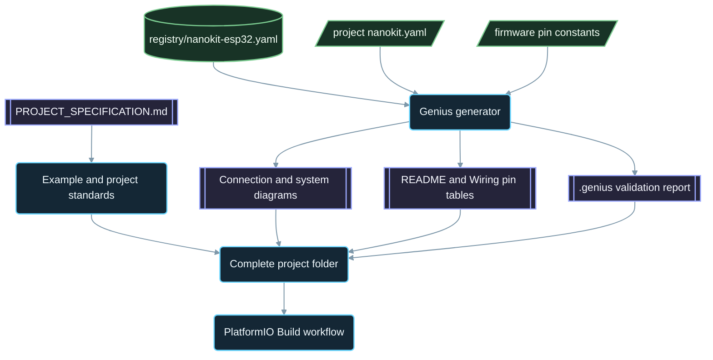

<div align="center">

# NanoKit-ESP32

**อีโคซิสเต็ม PlatformIO อย่างเป็นทางการสำหรับบอร์ดพัฒนา NanoKit Integrated ESP32**

<p>
<a href="../../README.md">English</a> ·
<a href="README.zh-CN.md">简体中文</a> ·
<a href="README.zh-TW.md">繁體中文</a> ·
<a href="README.ja.md">日本語</a> ·
<a href="README.ko.md">한국어</a> ·
<a href="README.tr.md">Türkçe</a> ·
<a href="README.ru.md">Русский</a> ·
<a href="README.vi.md">Tiếng Việt</a> ·
<strong>ไทย</strong> ·
<a href="README.de.md">Deutsch</a> ·
<a href="README.es.md">Español</a> ·
<a href="README.fr.md">Français</a> ·
<a href="README.uk.md">Українська</a> ·
<a href="README.pl.md">Polski</a> ·
<a href="README.pt-BR.md">Português (Brasil)</a> ·
<a href="README.ar.md">العربية</a> ·
<a href="README.fa.md">فارسی</a> ·
<a href="README.id.md">Bahasa Indonesia</a> ·
<a href="README.it.md">Italiano</a> ·
<a href="README.el.md">Ελληνικά</a> ·
<a href="README.ml.md">മലയാളം</a> ·
<a href="README.ur-Latn.md">Roman Urdu</a> ·
<a href="README.ro.md">Română</a>
</p>

<p>
<a href="https://github.com/ProAmineOfficial/NanoKit-ESP32/stargazers"></a>
<a href="https://github.com/ProAmineOfficial/NanoKit-ESP32/commits/main"></a>
<a href="../../LICENSE"></a>
<a href="https://github.com/ProAmineOfficial/NanoKit-ESP32/actions/workflows/platformio-build.yml"></a>
<a href="https://github.com/ProAmineOfficial/NanoKit-ESP32/actions/workflows/repository-index.yml"></a>
</p>

<p>
<a href="https://proamine.tech"></a>
<a href="https://gitarchitecturediagram.com/ProAmineOfficial/NanoKit-ESP32"></a>

</p>

**Developed by Amine Saoud ibn al-Bashir.**

</div>

> **หมายเหตุการแปล:** หน้านี้เป็นฉบับแปลของ [README ภาษาอังกฤษ](../../README.md) หากเนื้อหาทั้งสองฉบับไม่ตรงกัน ให้ถือ README ภาษาอังกฤษเป็นหลัก

##  ดาต้าชีตผังขา NanoKit Integrated ESP32


บอร์ดพัฒนา NanoKit Integrated ESP32 เป็นแพลตฟอร์มพัฒนาระบบสมองกลฝังตัวสำหรับงาน IoT, AI, หุ่นยนต์, การศึกษา และการสร้างต้นแบบระดับมืออาชีพ รีโพสิทอรีนี้จัดระเบียบไว้สำหรับตัวอย่าง PlatformIO แอปพลิเคชันที่สมบูรณ์ โปรเจกต์โอเพนซอร์ส โปรเจกต์จบการศึกษา ทรัพยากรสำหรับการจำลอง เอกสารประกอบ บทความ บทเรียน และเทมเพลตที่นำกลับมาใช้ซ้ำได้

บอร์ด NanoKit เป็นส่วนหนึ่งของวิสัยทัศน์ด้านฮาร์ดแวร์ UMT ที่กว้างกว่า แต่เฟิร์มแวร์ในรีโพสิทอรีนี้ใช้ PlatformIO Arduino C++ มาตรฐานและหมายเลข GPIO ของ ESP32 ทำให้ทุกโปรเจกต์คอมไพล์และรันได้โดยตรงใน PlatformIO

##  พันธกิจของรีโพสิทอรี

นี่ไม่ใช่รีโพสิทอรีสำหรับสาธิตและไม่ใช่รีโพสิทอรีเทมเพลต แต่เป็นรีโพสิทอรีอีโคซิสเต็มระยะยาวอย่างเป็นทางการของ NanoKit-ESP32 สำหรับการพัฒนาระบบสมองกลฝังตัวทั้งเพื่อการศึกษาและในระดับมืออาชีพ ทุกโปรเจกต์จะสอนทั้งโค้ด การต่อสาย อัลกอริทึม การแมปขาของ NanoKit และแนวทางการแก้ไขปัญหา

ดู [PROJECT_SPECIFICATION.md](../../PROJECT_SPECIFICATION.md) สำหรับกฎหลักของรีโพสิทอรี โมเดลการเติบโต มาตรฐานของตัวอย่าง ข้อกำหนดด้านเอกสาร และนิยามของงานที่เสร็จสมบูรณ์ (Definition of Done)

##  เริ่มต้นอย่างรวดเร็ว

1. ติดตั้ง [VS Code](https://code.visualstudio.com/) พร้อมส่วนขยาย [PlatformIO IDE](https://platformio.org/install/ide?install=vscode) หรือติดตั้ง PlatformIO Core CLI
2. โคลนรีโพสิทอรีแล้วเปิดตัวอย่าง ตัวอย่างแรกที่แนะนำให้ลองคือ [`digital_input_output`](../../examples_on_platformio/digital_input_output/) ซึ่งใช้ปุ่มกดหนึ่งปุ่ม LED หนึ่งดวง และ LED บนบอร์ด
3. เชื่อมต่อ NanoKit ผ่าน USB จากนั้นบิลด์ อัปโหลด และเปิด Serial Monitor:

```bash
git clone https://github.com/ProAmineOfficial/NanoKit-ESP32.git
cd NanoKit-ESP32/examples_on_platformio/digital_input_output
pio run --target upload
pio device monitor -b 115200
```

README ของทุกโปรเจกต์จะระบุรายการอุปกรณ์ ตารางขาของ NanoKit ลำดับการต่อสาย และผลลัพธ์ที่ควรเห็นใน Serial Monitor

##  โครงสร้างของรีโพสิทอรี

| พาธ | วัตถุประสงค์ |
|---|---|
| [`examples_on_platformio/`](../../examples_on_platformio/README.md) | ตัวอย่าง PlatformIO ที่เน้นเฉพาะเรื่องและไม่มีส่วนติดต่อผู้ใช้ โดยแต่ละตัวอย่างครอบคลุมฟีเจอร์ของบอร์ด เซนเซอร์ หรือโมดูลเพียงอย่างเดียว |
| [`applications_on_platformio/`](../../applications_on_platformio/README.md) | แอปพลิเคชันที่สมบูรณ์พร้อมส่วนติดต่อผู้ใช้ เช่น เว็บแอปที่ให้บริการจาก NanoKit พร้อมปุ่ม สไลเดอร์ และแดชบอร์ด |
| [`open_source_projects/`](../../open_source_projects/README.md) | โปรเจกต์ต้นฉบับขนาดใหญ่ของ NanoKit เช่น NanoKit Drone 4X รวมถึงพื้นที่สำหรับชุมชน ผู้ร่วมพัฒนา ผลงานเด่น และแฮกกาธอน |
| [`graduation_projects/`](../../graduation_projects/README.md) | พื้นที่ทำงานสำหรับโปรเจกต์ระดับปริญญาตรี ปริญญาโท วิศวกรรม สถาบัน โครงงานแคปสโตน และวิทยานิพนธ์ |
| `tutorials/` | บทเรียนตั้งแต่ระดับเริ่มต้นจนถึงขั้นสูง คู่มือโปรเจกต์ และดัชนีลิงก์วิดีโอ |
| `articles/` | บทความเชิงเทคนิคเกี่ยวกับระบบสมองกลฝังตัว IoT, AI, หุ่นยนต์, PlatformIO, NanoKit และ UMT |
| `docs/` | การเริ่มต้นใช้งาน การติดตั้ง ฮาร์ดแวร์ ซอฟต์แวร์ API การแก้ไขปัญหา แผนงาน สถาปัตยกรรม และงานแปล |
| `registry/` | บอร์ด NanoKit ในรูปแบบข้อมูล ได้แก่ ขาเฮดเดอร์ทุกขา GPIO แอดเดรส VR และกฎทางไฟฟ้า |
| `tools/` | ระบบอัตโนมัติของรีโพสิทอรี ได้แก่ ตัวสร้าง Genius และตัวสร้างดัชนี |
| `simulator/` | เว็บซิมูเลเตอร์ เอนจินจำลอง ตัวอย่าง และแอสเซ็ตของซิมูเลเตอร์ |
| `templates/` | เทมเพลตที่นำกลับมาใช้ซ้ำได้สำหรับตัวอย่าง แอปพลิเคชัน งานวิทยานิพนธ์ และเอกสารประกอบ |
| `assets/` | รูปภาพ ไอคอน โลโก้ แบนเนอร์ และวิดีโอที่ใช้ร่วมกัน |

##  แมนิเฟสต์ฮาร์ดแวร์และเอกสารที่สร้างขึ้นอัตโนมัติ

ทุกตัวอย่าง แอปพลิเคชัน โปรเจกต์โอเพนซอร์ส และโปรเจกต์จบการศึกษา จะอธิบายฮาร์ดแวร์ของตนเพียงครั้งเดียวในแมนิเฟสต์ `nanokit.yaml` คำสั่ง `python tools/genius/generate.py` จะตรวจสอบแมนิเฟสต์เทียบกับรีจิสทรีของบอร์ด [`registry/nanokit-esp32.yaml`](../../registry/nanokit-esp32.yaml) และค่าคงที่ของขาในเฟิร์มแวร์ จากนั้นจึงสร้างไฟล์ต่อไปนี้ขึ้นใหม่:

- `images/connection-diagram.md` และ `images/system-diagram.md` พร้อมป้ายกำกับ `Pin <NanoKit pin> / GPIO<n>` และสไตล์ Confirmed / Proposed / Blocked (ยืนยันแล้ว / เสนอ / ถูกบล็อก)
- ตารางขาของ NanoKit ใน README ของแต่ละโปรเจกต์ และตารางการเชื่อมต่อในไฟล์ `docs/Wiring.md` แต่ละไฟล์
- `.genius/VALIDATION_REPORT.md` ซึ่งระบุกฎที่ตรวจสอบ สิ่งที่ตรวจพบ และหลักฐานจากโค้ด

หากมีขาที่ไปใช้แฟลชภายใน มีการกำหนดเอาต์พุตบนขาที่เป็นอินพุตอย่างเดียว มีสัญญาณ 5 V ที่ไม่ผ่านการแปลงระดับแรงดัน หรือแมนิเฟสต์ไม่ตรงกับโค้ด คอมมิตและพูลรีเควสต์จะถูกหยุดไว้ โปรเจกต์อ้างอิงคือ [`examples_on_platformio/ultrasonic_distance/`](../../examples_on_platformio/ultrasonic_distance/) สคีมาและกฎ: [`tools/genius/README.md`](../../tools/genius/README.md) บันทึกการออกแบบ: [`docs/software/genius-generator-spec.md`](../../docs/software/genius-generator-spec.md)

##  ดัชนีที่สร้างขึ้นอัตโนมัติ

- [ดัชนีรีโพสิทอรี](../../REPOSITORY_INDEX.md) สรุปส่วนหลักของรีโพสิทอรีและนับจำนวนโปรเจกต์จริง (โฟลเดอร์ที่มีแมนิเฟสต์)
- [แผนผังรีโพสิทอรี](../../REPOSITORY_TREE.md) แสดงโครงสร้างไฟล์ที่สร้างขึ้นอัตโนมัติ
- [แบ็กล็อกโปรเจกต์](../../docs/roadmap/project-backlog.md) แสดงรายการตัวอย่าง แอปพลิเคชัน บทเรียน และบทความทั้งหมดที่วางแผนไว้ โดยแบ่งเป็นห้าระลอก คอลัมน์ Status ของแบ็กล็อกและ[สรุปแผนงาน](../../docs/roadmap/README.md)จะได้รับการอัปเดตโดยอัตโนมัติ
- ทุกโปรเจกต์ PlatformIO จะถูกคอมไพล์โดย[เวิร์กโฟลว์ PlatformIO Build](../../.github/workflows/platformio-build.yml) ทุกครั้งที่มีการพุชและพูลรีเควสต์

หลังจากเพิ่มหรือแก้ไขโปรเจกต์ ให้รัน `python tools/genius/generate.py` แล้วตามด้วย `python tools/update_repository_index.py` เปิดใช้งานฮุกในเครื่องเพียงครั้งเดียวด้วย `git config core.hooksPath .githooks` ส่วนเวิร์กโฟลว์ของ GitHub จะรันเครื่องมือทั้งสองนี้ทุกครั้งที่มีการพุชไปยัง `main` และตรวจสอบพูลรีเควสต์

##  แผนผังรีโพสิทอรีแบบอินเทอร์แอกทีฟ

แผนผังด้านล่างสร้างขึ้นจากเนื้อหาปัจจุบันของรีโพสิทอรี เลือกที่หัวข้อเพื่อขยายหรือยุบแผนผัง ฮุก pre-commit ในเครื่องและเวิร์กโฟลว์ของ GitHub จะอัปเดตแผนผังโดยอัตโนมัติเมื่อมีการเพิ่ม ย้าย หรือลบโปรเจกต์หรือไฟล์

แผนผังฉบับเต็มที่สร้างขึ้นอัตโนมัติอยู่ใน [REPOSITORY_TREE.md](../../REPOSITORY_TREE.md) ส่วน README ภาษาอังกฤษจะแสดงแผนผังนี้เป็นรายการที่ขยายได้

##  รีโพสิทอรีนี้สร้างขึ้นอย่างไร



##  โปรเจกต์โอเพนซอร์สเด่น

[NanoKit Drone 4X (ควอดคอปเตอร์)](../../open_source_projects/nanokit_drone_4x_quadcopter/README.md) คือโปรเจกต์อ้างอิงด้านการควบคุมการบินแบบ Quad-X ของรีโพสิทอรีนี้ ซึ่งยึดความปลอดภัยเป็นอันดับแรก NanoKit ที่ทำหน้าที่เป็นตัวควบคุมการบินจะรันลูปควบคุมที่ 250 Hz พร้อมการผสมสัญญาณมอเตอร์แบบ Quad-X และเกตความปลอดภัย Flight Deck บนเบราว์เซอร์เชื่อมต่อผ่าน Wi-Fi และ WebSocket และ NanoKit ตัวที่สองทำหน้าที่ควบคุมเพย์โหลดกล้องและเสียงที่แยกเป็นอิสระโดยไม่มีสิทธิ์ควบคุมมอเตอร์ใด ๆ ขณะนี้โปรเจกต์อยู่ในขั้นพัฒนาบนโต๊ะทดสอบ ใบพัดจะถูกถอดออกไว้ และเอาต์พุตมอเตอร์จะคงอยู่ที่ค่าต่ำสุดที่ปลอดภัยจนกว่าจะตรวจสอบโปรโตคอล ESC เรียบร้อยแล้ว

##  ข้อตกลงด้านคุณภาพ

เนื้อหาอย่างเป็นทางการในรีโพสิทอรีนี้ควรพร้อมใช้งานจริง มีคุณค่าทางการศึกษา สมบูรณ์ และดูแลรักษาได้ง่าย

- อย่าปล่อยไดเรกทอรีว่างไว้เป็นผลงานขั้นสุดท้าย
- อย่าใส่เนื้อหาตัวยึดตำแหน่ง (placeholder) หากสามารถจัดทำสื่อการเรียนรู้จริงได้
- ต่อยอดจากงานที่มีอยู่แทนการเขียนทับโดยไม่จำเป็น
- ทุกตัวอย่างต้องสอนโค้ด การต่อสาย อัลกอริทึม การแมปขา และแนวทางการแก้ไขปัญหา
- ทุกตัวอย่างฮาร์ดแวร์ต้องระบุหมายเลขขาของ NanoKit และหมายเลข GPIO ของ ESP32 โดยเขียนแบบเต็มเป็น "Pin 36 / GPIO5"

ใช้ [docs/software/platformio-example-standard.md](../../docs/software/platformio-example-standard.md) เมื่อสร้างหรือรีวิวตัวอย่าง

##  ค่าพื้นฐานของ PlatformIO

โปรเจกต์ PlatformIO ใช้เฟรมเวิร์ก Arduino สำหรับ ESP32 เป็นค่าพื้นฐานสาธารณะชุดแรก:

```ini
[env:nanokit_esp32]
; espressif32 8.0.0 = Arduino-ESP32 core 3.3.12, pinned so a platform update cannot break the build
platform = espressif32 @ 8.0.0
board = esp32dev
framework = arduino
monitor_speed = 115200
upload_speed = 921600
```

เมื่อแพ็กเกจฮาร์ดแวร์พัฒนาต่อไป นิยามบอร์ดเฉพาะของ NanoKit อาจเข้ามาแทนที่โปรไฟล์บอร์ด `esp32dev` แบบทั่วไปได้

##  กฎของเฟิร์มแวร์

ตัวอย่างอย่างเป็นทางการในรีโพสิทอรีนี้ต้องใช้:

- PlatformIO
- เฟรมเวิร์ก Arduino สำหรับ ESP32
- C++
- เอกสารประกอบในรูปแบบ Markdown
- หมายเลข GPIO ปกติของ ESP32 ในซอร์สโค้ด

ห้ามใช้โค้ด UMT SDK หรือโค้ด Virtual Register API ในตัวอย่าง PlatformIO

##  ผังขาของฮาร์ดแวร์

ใช้ [docs/hardware/nanokit-integrated-esp32-pinout.md](../../docs/hardware/nanokit-integrated-esp32-pinout.md) เป็นแหล่งข้อมูลหลักที่เชื่อถือได้สำหรับหมายเลขขาของ NanoKit การแมป GPIO ของ ESP32 หมายเหตุทางไฟฟ้า และคำเตือน

ทุกตัวอย่างฮาร์ดแวร์จะระบุ:

```text
NanoKit Pin -> GPIO -> Component Pin -> Description
```

ข้อจำกัดสำคัญ:

- GPIO34, GPIO35, GPIO36 และ GPIO39 เป็นขาอินพุตอย่างเดียว
- GPIO6, GPIO7, GPIO8, GPIO9, GPIO10 และ GPIO11 เป็นขาของแฟลช SPI ภายใน และห้ามนำไปใช้งาน
- GPIO0 คือขา BOOT
- GPIO1 และ GPIO3 ใช้ร่วมกับ Serial ผ่าน USB
- EN คือขา Reset / Enable (รีเซ็ต / เปิดใช้งาน) และไม่ใช่ GPIO

##  แผนงาน

[แบ็กล็อกโปรเจกต์](../../docs/roadmap/project-backlog.md) วางแผนคลังโปรเจกต์ไว้เป็นห้าระลอก ได้แก่ พื้นฐานของบอร์ด เซนเซอร์และโมดูล เว็บแอปพลิเคชัน โปรโตคอลและคลาวด์ และโมดูลภายนอก [สรุปแผนงาน](../../docs/roadmap/README.md) แสดงจำนวนโปรเจกต์ที่เสร็จแล้วในแต่ละระลอก

##  การมีส่วนร่วม

ยินดีต้อนรับทุกการมีส่วนร่วม โปรดอ่าน [CONTRIBUTING.md](../../CONTRIBUTING.md) ก่อน ซึ่งอธิบายมาตรฐานของโปรเจกต์ แมนิเฟสต์ `nanokit.yaml` ฮุก pre-commit และสัญญาอนุญาตของผลงานที่ร่วมสมทบ

##  งานแปล

README นี้มีให้อ่าน 23 ภาษาผ่านแถบภาษาที่ด้านบนของหน้า ฉบับแปลอยู่ใน [`docs/i18n/`](../../docs/i18n/) หากฉบับแปลกับ README ภาษาอังกฤษไม่ตรงกัน ให้ถือ README ภาษาอังกฤษเป็นหลัก

##  ช่องทางติดต่อ

-  เว็บไซต์: [https://proamine.tech](https://proamine.tech)
-  Git Architecture Diagram: [https://gitarchitecturediagram.com](https://gitarchitecturediagram.com/ProAmineOfficial/NanoKit-ESP32)
-  อีเมล: `technology@proamine.tech`
-  TikTok: [@pro_amine](https://www.tiktok.com/@pro_amine)
-  YouTube: [@pro_amine](https://www.youtube.com/@pro_amine)

##  สัญญาอนุญาต

NanoKit-ESP32 เผยแพร่ภายใต้ [GNU Affero General Public License v3.0 only](../../LICENSE) (`AGPL-3.0-only`) พร้อมข้อกำหนดเพิ่มเติมตามมาตรา 7 ซึ่งระบุไว้ใน [NOTICE](../../NOTICE):

- **การระบุที่มา:** ทุกสำเนาหรือฉบับดัดแปลงต้องคงบรรทัด "Developed by Amine Saoud ibn al-Bashir." ไว้ และระบุว่าพัฒนาต่อยอดจาก NanoKit-ESP32 โดย Amine Saoud ibn al-Bashir (Pro_Amine LLC)
- **ฉบับดัดแปลง** ต้องระบุว่าแตกต่างจากต้นฉบับ และต้องไม่นำเสนอว่าเป็นรีโพสิทอรี NanoKit-ESP32 อย่างเป็นทางการ
- **ชื่อ:** ไม่มีการให้สิทธิ์ใด ๆ ในชื่อ NanoKit, Pro_Amine หรือ UMT รวมถึงโลโก้ของชื่อเหล่านั้น ฉบับที่นำไปเผยแพร่ต่อต้องใช้ชื่อของตนเอง
- **การใช้งานผ่านเครือข่าย:** หากคุณรันฉบับดัดแปลงเป็นบริการบนเครือข่าย AGPL กำหนดให้คุณต้องเปิดให้ผู้ใช้บริการนั้นเข้าถึงซอร์สโค้ดของฉบับดังกล่าว

คุณมีอิสระในการศึกษา ใช้งาน และแก้ไขโค้ดนี้เพื่อการเรียนรู้ การสอน การวิจัย และโปรเจกต์ของคุณเองภายใต้ข้อกำหนดเหล่านี้ เวอร์ชันที่เผยแพร่ก่อนเปลี่ยนมาใช้ AGPL ได้รับการแจกจ่ายภายใต้ Apache License 2.0 ไอคอน Fluent Emoji ใน `assets/icons/fluent/` เป็นลิขสิทธิ์ © Microsoft Corporation ภายใต้ MIT License

<div align="center">

**Developed by Amine Saoud ibn al-Bashir · © 2026 Pro_Amine LLC**

</div>
