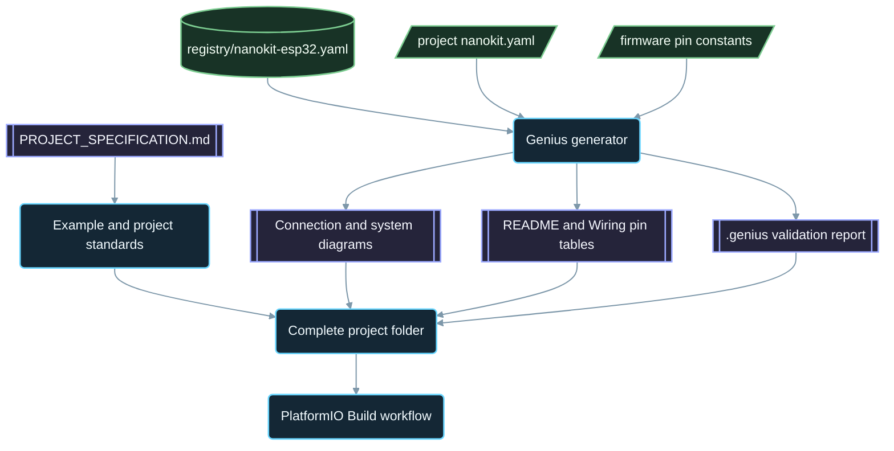

<div align="center">

# NanoKit-ESP32

**NanoKit Integrated ESP32 geliştirme kartı için resmî PlatformIO ekosistemi**

<p>
<a href="../../README.md">English</a> ·
<a href="README.zh-CN.md">简体中文</a> ·
<a href="README.zh-TW.md">繁體中文</a> ·
<a href="README.ja.md">日本語</a> ·
<a href="README.ko.md">한국어</a> ·
<strong>Türkçe</strong> ·
<a href="README.ru.md">Русский</a> ·
<a href="README.vi.md">Tiếng Việt</a> ·
<a href="README.th.md">ไทย</a> ·
<a href="README.de.md">Deutsch</a> ·
<a href="README.es.md">Español</a> ·
<a href="README.fr.md">Français</a> ·
<a href="README.uk.md">Українська</a> ·
<a href="README.pl.md">Polski</a> ·
<a href="README.pt-BR.md">Português (Brasil)</a> ·
<a href="README.ar.md">العربية</a> ·
<a href="README.fa.md">فارسی</a> ·
<a href="README.id.md">Bahasa Indonesia</a> ·
<a href="README.it.md">Italiano</a> ·
<a href="README.el.md">Ελληνικά</a> ·
<a href="README.ml.md">മലയാളം</a> ·
<a href="README.ur-Latn.md">Roman Urdu</a> ·
<a href="README.ro.md">Română</a>
</p>

<p>
<a href="https://github.com/ProAmineOfficial/NanoKit-ESP32/stargazers"></a>
<a href="https://github.com/ProAmineOfficial/NanoKit-ESP32/commits/main"></a>
<a href="../../LICENSE"></a>
<a href="https://github.com/ProAmineOfficial/NanoKit-ESP32/actions/workflows/platformio-build.yml"></a>
<a href="https://github.com/ProAmineOfficial/NanoKit-ESP32/actions/workflows/repository-index.yml"></a>
</p>

<p>
<a href="https://proamine.tech"></a>
<a href="https://gitarchitecturediagram.com/ProAmineOfficial/NanoKit-ESP32"></a>

</p>

**Developed by Amine Saoud ibn al-Bashir.**

</div>

> **Çeviri notu:** bu sayfa [İngilizce README](../../README.md) dosyasının bir çevirisidir. İkisi arasında fark olduğunda İngilizce README esas alınır.

##  NanoKit Integrated ESP32 Pin Diyagramı Veri Sayfası


NanoKit Integrated ESP32 geliştirme kartı; IoT, yapay zekâ, robotik, eğitim ve profesyonel prototipleme için tasarlanmış bir gömülü geliştirme platformudur. Bu depo; PlatformIO örnekleri, eksiksiz uygulamalar, açık kaynak projeler, bitirme projeleri, simülasyon kaynakları, dokümantasyon, makaleler, eğitimler ve yeniden kullanılabilir şablonlar için düzenlenmiştir.

NanoKit kartı daha geniş UMT donanım vizyonunun bir parçasıdır; ancak bu depodaki bellenim standart PlatformIO Arduino C++ ve ESP32 GPIO numaralarını kullanır, böylece her proje doğrudan PlatformIO'da derlenir ve çalışır.

##  Deponun Misyonu

Bu bir demo deposu ya da şablon deposu değildir. Eğitim amaçlı ve profesyonel gömülü sistem geliştirme için resmî ve uzun soluklu NanoKit-ESP32 ekosistem deposudur: her proje kodu, bağlantıları, algoritmayı, NanoKit pin eşlemesini ve sorun giderme yolunu öğretir.

Ana depo kuralları, büyüme modeli, örnek standartları, dokümantasyon gereksinimleri ve Definition of Done (tamamlanma tanımı) için [PROJECT_SPECIFICATION.md](../../PROJECT_SPECIFICATION.md) dosyasına bakın.

##  Hızlı Başlangıç

1. [VS Code](https://code.visualstudio.com/) ile birlikte [PlatformIO IDE](https://platformio.org/install/ide?install=vscode) eklentisini ya da PlatformIO Core CLI aracını kurun.
2. Depoyu klonlayın ve bir örnek açın. İlk denenecek örnek [`digital_input_output`](../../examples_on_platformio/digital_input_output/): bir düğme, bir LED ve kart üzerindeki LED.
3. NanoKit'i USB ile bağlayın, ardından projeyi derleyin, karta yükleyin ve Serial Monitor'ü açın:

```bash
git clone https://github.com/ProAmineOfficial/NanoKit-ESP32.git
cd NanoKit-ESP32/examples_on_platformio/digital_input_output
pio run --target upload
pio device monitor -b 115200
```

Her projenin README dosyası gerekli parçaları, NanoKit pin tablosunu, bağlantı sırasını ve beklenen Serial Monitor çıktısını listeler.

##  Depo Yapısı

| Yol | Amaç |
|---|---|
| [`examples_on_platformio/`](../../examples_on_platformio/README.md) | Kullanıcı arayüzü olmayan, tek konuya odaklanan PlatformIO örnekleri: her örnekte bir kart özelliği, sensör veya modül. |
| [`applications_on_platformio/`](../../applications_on_platformio/README.md) | Kullanıcı arayüzüne sahip eksiksiz uygulamalar; örneğin NanoKit'in kendisinin sunduğu, düğmeler, kaydırıcılar ve panolar içeren web uygulamaları. |
| [`open_source_projects/`](../../open_source_projects/README.md) | NanoKit Drone 4X gibi daha büyük özgün NanoKit projeleri ile topluluk, katkıda bulunanlar, vitrin ve hackathon alanları. |
| [`graduation_projects/`](../../graduation_projects/README.md) | Lisans, yüksek lisans, mühendislik, enstitü, bitirme (capstone) ve tez projeleri için çalışma alanları. |
| `tutorials/` | Başlangıçtan ileri seviyeye eğitimler, proje kılavuzları ve video bağlantı dizinleri. |
| `articles/` | Gömülü sistemler, IoT, yapay zekâ, robotik, PlatformIO, NanoKit ve UMT üzerine teknik makaleler. |
| `docs/` | Başlangıç, kurulum, donanım, yazılım, API, sorun giderme, yol haritası, mimari ve çeviriler. |
| `registry/` | Veri olarak NanoKit kartı: her konnektör pini, GPIO, VR adresi ve elektriksel kural. |
| `tools/` | Depo otomasyonu: Genius üreteci ve dizin üreteci. |
| `simulator/` | Web simülatörü, simülasyon motoru, örnekler ve simülatör varlıkları. |
| `templates/` | Örnekler, uygulamalar, tez çalışmaları ve dokümantasyon için yeniden kullanılabilir şablonlar. |
| `assets/` | Ortak görseller, simgeler, logolar, afişler ve videolar. |

##  Donanım Manifest Dosyaları ve Üretilen Dokümantasyon

Her örnek, uygulama, açık kaynak proje ve bitirme projesi donanımını yalnızca bir kez, bir `nanokit.yaml` manifest dosyasında tanımlar. `python tools/genius/generate.py` bu dosyayı [`registry/nanokit-esp32.yaml`](../../registry/nanokit-esp32.yaml) kart kayıt dosyasına ve bellenimdeki pin sabitlerine göre doğrular, ardından şunları yeniden üretir:

- `Pin <NanoKit pin> / GPIO<n>` etiketleri ve Confirmed / Proposed / Blocked biçimlendirmesiyle `images/connection-diagram.md` ve `images/system-diagram.md`,
- her proje README dosyasındaki NanoKit pin tablosu ve her `docs/Wiring.md` dosyasındaki bağlantı tablosu,
- kontrol edilen kuralları, bulguları ve koddan alınan kanıtları içeren `.genius/VALIDATION_REPORT.md`.

Dahili flash belleğe ayrılmış bir pin, yalnızca giriş olarak çalışabilen bir pine atanmış bir çıkış, seviye dönüştürme yapılmadan verilen 5 V sinyal veya kodla uyuşmayan bir manifest, commit'i ve pull request'i durdurur. Referans proje: [`examples_on_platformio/ultrasonic_distance/`](../../examples_on_platformio/ultrasonic_distance/). Şema ve kurallar: [`tools/genius/README.md`](../../tools/genius/README.md). Tasarım kaydı: [`docs/software/genius-generator-spec.md`](../../docs/software/genius-generator-spec.md).

##  Üretilen Dizinler

- [Depo Dizini](../../REPOSITORY_INDEX.md) ana depo alanlarını özetler ve gerçek projeleri (manifest dosyası bulunan klasörleri) sayar.
- [Depo Ağacı](../../REPOSITORY_TREE.md) üretilen dosya ağacını gösterir.
- [Proje İş Listesi](../../docs/roadmap/project-backlog.md) planlanan tüm örnekleri, uygulamaları, eğitimleri ve makaleleri beş dalga hâlinde listeler; Status sütunu ve [yol haritası özeti](../../docs/roadmap/README.md) otomatik olarak güncellenir.
- Her PlatformIO projesi, her push ve pull request'te [PlatformIO Build iş akışı](../../.github/workflows/platformio-build.yml) tarafından derlenir.

Bir proje ekledikten veya değiştirdikten sonra önce `python tools/genius/generate.py`, ardından `python tools/update_repository_index.py` komutunu çalıştırın. Yerel kancayı bir kez `git config core.hooksPath .githooks` komutuyla etkinleştirin; GitHub iş akışı aynı iki aracı `main` dalına yapılan her push'ta çalıştırır ve pull request'leri doğrular.

##  Etkileşimli Depo Ağacı

Aşağıdaki ağaç, deponun güncel içeriğinden üretilir. Genişletmek veya daraltmak için başlığına tıklayın. Yerel pre-commit kancası ve GitHub iş akışı, projeler ya da dosyalar eklendiğinde, taşındığında veya silindiğinde ağacı otomatik olarak günceller.

Üretilen ağacın tamamı [REPOSITORY_TREE.md](../../REPOSITORY_TREE.md) dosyasındadır; İngilizce README onu genişletilebilir bir liste olarak gösterir.

##  Depo Nasıl Oluşturulur



##  Öne Çıkan Açık Kaynak Proje

[NanoKit Drone 4X (Kuadkopter)](../../open_source_projects/nanokit_drone_4x_quadcopter/README.md), deponun güvenliği ön planda tutan Quad-X uçuş kontrolü referans projesidir. Bir NanoKit uçuş kontrolcüsü, Quad-X motor karıştırma ve güvenlik kilitleriyle 250 Hz'lik bir kontrol döngüsü çalıştırır; tarayıcı tabanlı Flight Deck, Wi-Fi ve WebSocket üzerinden bağlanır; ikinci bir NanoKit ise motorlar üzerinde hiçbir yetkisi olmayan, yalıtılmış bir kamera ve ses yükünü çalıştırır. Proje tezgâh geliştirme aşamasındadır: ESC protokolü doğrulanana kadar pervaneler sökülü kalır ve motor çıkışı güvenli minimum seviyede tutulur.

##  Kalite Sözleşmesi

Bu depodaki resmî içerik üretime hazır, öğretici, eksiksiz ve sürdürülebilir olmalıdır.

- Dizinleri nihai çalışma olarak boş bırakmayın.
- Gerçek eğitim materyali sağlanabiliyorsa yer tutucu içerik eklemeyin.
- Mevcut çalışmanın üzerine gereksiz yere yazmak yerine onu temel alarak geliştirin.
- Her örnek kodu, bağlantıları, algoritmayı, pin eşlemesini ve sorun giderme yolunu öğretir.
- Her donanım örneği NanoKit pin numaralarını ve ESP32 GPIO numaralarını "Pin 36 / GPIO5" biçiminde tam olarak yazarak belgeler.

Örnek oluştururken veya incelerken [docs/software/platformio-example-standard.md](../../docs/software/platformio-example-standard.md) belgesini kullanın.

##  PlatformIO Temel Yapılandırması

PlatformIO projeleri, ilk genel temel yapılandırma olarak ESP32 için Arduino framework'ünü kullanır:

```ini
[env:nanokit_esp32]
; espressif32 8.0.0 = Arduino-ESP32 core 3.3.12, pinned so a platform update cannot break the build
platform = espressif32 @ 8.0.0
board = esp32dev
framework = arduino
monitor_speed = 115200
upload_speed = 921600
```

Donanım paketi geliştikçe NanoKit'e özel kart tanımları, genel `esp32dev` kart profilinin yerini alabilir.

##  Bellenim Kuralı

Bu depodaki resmî örnekler şunları kullanmalıdır:

- PlatformIO
- ESP32 için Arduino framework'ü
- C++
- Markdown dokümantasyonu
- Kaynak kodda olağan ESP32 GPIO numaraları

PlatformIO örneklerinde UMT SDK kodu veya Virtual Register API kodu kullanmayın.

##  Donanım Pin Diyagramı

NanoKit pin numaraları, ESP32 GPIO eşlemeleri, elektriksel notlar ve uyarılar için tek doğru kaynak olarak [docs/hardware/nanokit-integrated-esp32-pinout.md](../../docs/hardware/nanokit-integrated-esp32-pinout.md) belgesini kullanın.

Her donanım örneği şunu belgeler:

```text
NanoKit Pin -> GPIO -> Component Pin -> Description
```

Önemli kısıtlamalar:

- GPIO34, GPIO35, GPIO36 ve GPIO39 yalnızca giriş olarak kullanılabilir.
- GPIO6, GPIO7, GPIO8, GPIO9, GPIO10 ve GPIO11 dahili SPI flash pinleridir ve kullanılmamalıdır.
- GPIO0, BOOT pinidir.
- GPIO1 ve GPIO3, USB Serial ile paylaşılır.
- EN, Reset / Enable pinidir ve bir GPIO değildir.

##  Yol Haritası

[Proje İş Listesi](../../docs/roadmap/project-backlog.md), kütüphaneyi beş dalgada planlar: kart temelleri, sensörler ve modüller, web uygulamaları, protokoller ve bulut, harici modüller. [Yol haritası özeti](../../docs/roadmap/README.md), her dalgadan kaç projenin tamamlandığını gösterir.

##  Katkıda Bulunma

Katkılarınızı memnuniyetle karşılıyoruz. Önce [CONTRIBUTING.md](../../CONTRIBUTING.md) dosyasını okuyun: proje standartlarını, `nanokit.yaml` manifest dosyasını, pre-commit kancasını ve katkıların lisansını açıklar.

##  Çeviriler

Bu README, sayfanın üst kısmındaki dil çubuğu aracılığıyla 23 dilde sunulmaktadır. Çeviriler [`docs/i18n/`](../../docs/i18n/) klasöründe bulunur; bir çeviri ile İngilizce README arasında fark olduğunda İngilizce README esas alınır.

##  Destek

-  Web sitesi: [https://proamine.tech](https://proamine.tech)
-  Git Architecture Diagram: [https://gitarchitecturediagram.com](https://gitarchitecturediagram.com/ProAmineOfficial/NanoKit-ESP32)
-  E-posta: `technology@proamine.tech`
-  TikTok: [@pro_amine](https://www.tiktok.com/@pro_amine)
-  YouTube: [@pro_amine](https://www.youtube.com/@pro_amine)

##  Lisans

NanoKit-ESP32, [GNU Affero General Public License v3.0 only](../../LICENSE) (`AGPL-3.0-only`) lisansı altında, [NOTICE](../../NOTICE) dosyasında listelenen 7. madde kapsamındaki ek koşullarla lisanslanmıştır:

- **Atıf:** her kopya veya değiştirilmiş sürüm "Developed by Amine Saoud ibn al-Bashir." satırını korur ve Amine Saoud ibn al-Bashir (Pro_Amine LLC) tarafından geliştirilen NanoKit-ESP32'ye dayandığını belirtir.
- **Değiştirilmiş sürümler** orijinalinden farklı olarak işaretlenir ve resmî NanoKit-ESP32 deposu olarak sunulmaz.
- **İsimler:** NanoKit, Pro_Amine veya UMT adları ya da bunların logoları üzerinde hiçbir hak tanınmaz; yeniden dağıtılan bir sürüm kendi adını kullanır.
- **Ağ üzerinden kullanım:** değiştirilmiş bir sürümü ağ hizmeti olarak çalıştırırsanız AGPL, bu sürümün kaynak kodunu kullanıcılarına sunmanızı gerektirir.

Bu koşullar çerçevesinde bu kodu öğrenme, öğretme, araştırma ve kendi projeleriniz için incelemekte, kullanmakta ve değiştirmekte özgürsünüz. AGPL'ye geçişten önce yayımlanan sürümler Apache License 2.0 kapsamında dağıtılmıştır. `assets/icons/fluent/` içindeki Fluent Emoji simgeleri © Microsoft Corporation olup MIT License kapsamındadır.

<div align="center">

**Developed by Amine Saoud ibn al-Bashir · © 2026 Pro_Amine LLC**

</div>
