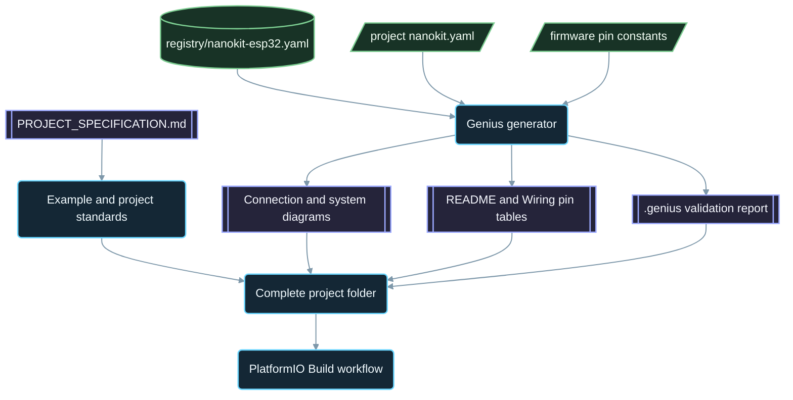

<div align="center">

# NanoKit-ESP32

**Офіційна екосистема PlatformIO для налагоджувальної плати NanoKit Integrated ESP32**

<p>
<a href="../../README.md">English</a> ·
<a href="README.zh-CN.md">简体中文</a> ·
<a href="README.zh-TW.md">繁體中文</a> ·
<a href="README.ja.md">日本語</a> ·
<a href="README.ko.md">한국어</a> ·
<a href="README.tr.md">Türkçe</a> ·
<a href="README.ru.md">Русский</a> ·
<a href="README.vi.md">Tiếng Việt</a> ·
<a href="README.th.md">ไทย</a> ·
<a href="README.de.md">Deutsch</a> ·
<a href="README.es.md">Español</a> ·
<a href="README.fr.md">Français</a> ·
<strong>Українська</strong> ·
<a href="README.pl.md">Polski</a> ·
<a href="README.pt-BR.md">Português (Brasil)</a> ·
<a href="README.ar.md">العربية</a> ·
<a href="README.fa.md">فارسی</a> ·
<a href="README.id.md">Bahasa Indonesia</a> ·
<a href="README.it.md">Italiano</a> ·
<a href="README.el.md">Ελληνικά</a> ·
<a href="README.ml.md">മലയാളം</a> ·
<a href="README.ur-Latn.md">Roman Urdu</a> ·
<a href="README.ro.md">Română</a>
</p>

<p>
<a href="https://github.com/ProAmineOfficial/NanoKit-ESP32/stargazers"></a>
<a href="https://github.com/ProAmineOfficial/NanoKit-ESP32/commits/main"></a>
<a href="../../LICENSE"></a>
<a href="https://github.com/ProAmineOfficial/NanoKit-ESP32/actions/workflows/platformio-build.yml"></a>
<a href="https://github.com/ProAmineOfficial/NanoKit-ESP32/actions/workflows/repository-index.yml"></a>
</p>

<p>
<a href="https://proamine.tech"></a>
<a href="https://gitarchitecturediagram.com/ProAmineOfficial/NanoKit-ESP32"></a>

</p>

**Developed by Amine Saoud ibn al-Bashir.**

</div>

> **Примітка щодо перекладу:** ця сторінка є перекладом [англійського README](../../README.md). У разі розбіжностей чинним є англійський README.

##  Розпіновка NanoKit Integrated ESP32: технічний опис


Налагоджувальна плата NanoKit Integrated ESP32 — це платформа для розробки вбудованих систем у галузі IoT, ШІ, робототехніки, освіти та професійного прототипування. Репозиторій об'єднує приклади для PlatformIO, завершені застосунки, проєкти з відкритим кодом, дипломні проєкти, ресурси для симуляції, документацію, статті, навчальні посібники та шаблони для повторного використання.

Плата NanoKit є частиною ширшої апаратної концепції UMT, проте прошивки в цьому репозиторії написані стандартною мовою Arduino C++ для PlatformIO і використовують номери GPIO ESP32, тож кожен проєкт компілюється та запускається безпосередньо в PlatformIO.

##  Місія репозиторію

Це не демонстраційний репозиторій і не репозиторій-шаблон. Це офіційний довгостроковий репозиторій екосистеми NanoKit-ESP32 для навчальної та професійної розробки вбудованих систем: кожен проєкт пояснює код, схему підключення, алгоритм, відповідність виводів NanoKit і порядок усунення несправностей.

Основні правила репозиторію, модель його розвитку, стандарти прикладів, вимоги до документації та критерії готовності (Definition of Done) описано в [PROJECT_SPECIFICATION.md](../../PROJECT_SPECIFICATION.md).

##  Швидкий старт

1. Установіть [VS Code](https://code.visualstudio.com/) з розширенням [PlatformIO IDE](https://platformio.org/install/ide?install=vscode) або PlatformIO Core CLI.
2. Клонуйте репозиторій і відкрийте приклад. Почніть із [`digital_input_output`](../../examples_on_platformio/digital_input_output/): кнопка, LED і вбудований LED плати.
3. Під'єднайте NanoKit через USB, потім зберіть проєкт, завантажте прошивку й відкрийте Serial Monitor:

```bash
git clone https://github.com/ProAmineOfficial/NanoKit-ESP32.git
cd NanoKit-ESP32/examples_on_platformio/digital_input_output
pio run --target upload
pio device monitor -b 115200
```

У README кожного проєкту наведено перелік компонентів, таблицю виводів NanoKit, порядок підключення та очікуваний вивід у Serial Monitor.

##  Структура репозиторію

| Шлях | Призначення |
|---|---|
| [`examples_on_platformio/`](../../examples_on_platformio/README.md) | Вузькоспрямовані приклади для PlatformIO без інтерфейсу користувача: одна функція плати, один датчик або модуль на приклад. |
| [`applications_on_platformio/`](../../applications_on_platformio/README.md) | Завершені застосунки з інтерфейсом користувача, наприклад вебзастосунки, які роздає сама плата NanoKit, із кнопками, повзунками та панелями моніторингу. |
| [`open_source_projects/`](../../open_source_projects/README.md) | Більші оригінальні проєкти NanoKit, як-от NanoKit Drone 4X, а також розділи для спільноти, учасників, демонстрацій і хакатонів. |
| [`graduation_projects/`](../../graduation_projects/README.md) | Робочі простори для бакалаврських, магістерських, інженерних, інститутських, підсумкових (capstone) і дисертаційних проєктів. |
| `tutorials/` | Навчальні посібники від початкового до просунутого рівня, посібники з проєктів і покажчики посилань на відео. |
| `articles/` | Технічні статті про вбудовані системи, IoT, ШІ, робототехніку, PlatformIO, NanoKit і UMT. |
| `docs/` | Початок роботи, встановлення, апаратна частина, програмне забезпечення, API, усунення несправностей, дорожня карта, архітектура та переклади. |
| `registry/` | Плата NanoKit у вигляді даних: кожен вивід роз'ємів, GPIO, адреса VR та електричне правило. |
| `tools/` | Автоматизація репозиторію: генератор Genius і генератор індексу. |
| `simulator/` | Вебсимулятор, рушій симуляції, приклади та ресурси симулятора. |
| `templates/` | Шаблони для повторного використання: приклади, застосунки, дипломні роботи та документація. |
| `assets/` | Спільні зображення, іконки, логотипи, банери та відео. |

##  Апаратні маніфести та згенерована документація

Кожен приклад, застосунок, проєкт з відкритим кодом і дипломний проєкт описує своє обладнання один раз — у маніфесті `nanokit.yaml`. Команда `python tools/genius/generate.py` перевіряє його за реєстром плати [`registry/nanokit-esp32.yaml`](../../registry/nanokit-esp32.yaml) і за константами виводів у прошивці, а потім заново генерує:

- `images/connection-diagram.md` і `images/system-diagram.md` з мітками `Pin <NanoKit pin> / GPIO<n>` та стилями Confirmed / Proposed / Blocked,
- таблицю виводів NanoKit у README кожного проєкту й таблицю підключень у кожному `docs/Wiring.md`,
- `.genius/VALIDATION_REPORT.md` з переліком перевірених правил, виявлених проблем і підтверджень з коду.

Вивід, зайнятий внутрішньою флеш-пам'яттю, вихід на виводі, що працює лише на вхід, сигнал 5 В без узгодження рівнів або маніфест, який розходиться з кодом, зупиняють коміт і pull request. Еталонний проєкт — [`examples_on_platformio/ultrasonic_distance/`](../../examples_on_platformio/ultrasonic_distance/). Схема маніфесту та правила: [`tools/genius/README.md`](../../tools/genius/README.md). Проєктний опис: [`docs/software/genius-generator-spec.md`](../../docs/software/genius-generator-spec.md).

##  Згенеровані індекси

- [Індекс репозиторію](../../REPOSITORY_INDEX.md) коротко описує основні розділи репозиторію та підраховує реальні проєкти (теки з маніфестом).
- [Дерево репозиторію](../../REPOSITORY_TREE.md) показує згенероване дерево файлів.
- [Беклог проєктів](../../docs/roadmap/project-backlog.md) містить усі заплановані приклади, застосунки, навчальні посібники та статті, розподілені на п'ять хвиль; його стовпець Status і [зведення дорожньої карти](../../docs/roadmap/README.md) оновлюються автоматично.
- Кожен проєкт PlatformIO компілюється [робочим процесом PlatformIO Build](../../.github/workflows/platformio-build.yml) під час кожного push і pull request.

Після додавання або зміни проєкту запустіть `python tools/genius/generate.py`, а потім `python tools/update_repository_index.py`. Один раз увімкніть локальний хук командою `git config core.hooksPath .githooks`; робочий процес GitHub запускає ті самі два інструменти під час кожного push у `main` і перевіряє кожен pull request.

##  Інтерактивне дерево репозиторію

Дерево нижче згенеровано з поточного вмісту репозиторію. Натисніть на його заголовок, щоб розгорнути або згорнути його. Локальний pre-commit хук і робочий процес GitHub автоматично оновлюють його, коли проєкти чи файли додаються, переміщуються або видаляються.

Повне згенероване дерево міститься в [REPOSITORY_TREE.md](../../REPOSITORY_TREE.md); в англійському README воно відображається як розгортуваний список.

##  Як побудовано репозиторій



##  Рекомендований проєкт з відкритим кодом

[NanoKit Drone 4X (квадрокоптер)](../../open_source_projects/nanokit_drone_4x_quadcopter/README.md) — еталонний проєкт системи керування польотом Quad-X у цьому репозиторії, де безпека стоїть на першому місці. Польотний контролер на NanoKit виконує контур керування з частотою 250 Гц, мікшування моторів Quad-X і захисні блокування, браузерний Flight Deck під'єднується через Wi-Fi та WebSocket, а друга плата NanoKit керує ізольованим корисним навантаженням — камерою та звуком — без жодного доступу до моторів. Проєкт перебуває на етапі стендової розробки: пропелери зняті, а вихід на мотори утримується на безпечному мінімумі, доки протокол ESC не буде перевірено.

##  Контракт якості

Офіційний вміст цього репозиторію має бути готовим до промислового використання, навчальним, повним і зручним у супроводі.

- Не залишайте порожні каталоги як підсумковий результат.
- Не додавайте вміст-заглушки, якщо можна надати справжній навчальний матеріал.
- Розвивайте наявну роботу, а не перезаписуйте її без потреби.
- Кожен приклад пояснює код, схему підключення, алгоритм, призначення виводів і порядок усунення несправностей.
- Кожен апаратний приклад документує номери виводів NanoKit і номери GPIO ESP32 у повній формі: «Pin 36 / GPIO5».

Під час створення або перевірки прикладів керуйтеся документом [docs/software/platformio-example-standard.md](../../docs/software/platformio-example-standard.md).

##  Базова конфігурація PlatformIO

Як першу публічну базову конфігурацію проєкти PlatformIO використовують фреймворк Arduino для ESP32:

```ini
[env:nanokit_esp32]
platform = espressif32
board = esp32dev
framework = arduino
monitor_speed = 115200
upload_speed = 921600
```

У міру розвитку апаратного пакета спеціалізовані визначення плати NanoKit можуть замінити універсальний профіль плати `esp32dev`.

##  Правило для прошивок

Офіційні приклади в цьому репозиторії мають використовувати:

- PlatformIO
- фреймворк Arduino для ESP32
- C++
- документацію у форматі Markdown
- звичайні номери GPIO ESP32 у вихідному коді

Не використовуйте код UMT SDK або Virtual Register API у прикладах PlatformIO.

##  Розпіновка плати

Використовуйте [docs/hardware/nanokit-integrated-esp32-pinout.md](../../docs/hardware/nanokit-integrated-esp32-pinout.md) як першоджерело відомостей про номери виводів NanoKit, відповідність GPIO ESP32, електричні характеристики та попередження.

Кожен апаратний приклад документує:

```text
NanoKit Pin -> GPIO -> Component Pin -> Description
```

Важливі обмеження:

- GPIO34, GPIO35, GPIO36 і GPIO39 працюють лише на вхід.
- GPIO6, GPIO7, GPIO8, GPIO9, GPIO10 і GPIO11 — виводи внутрішньої SPI флеш-пам'яті, їх не можна використовувати.
- GPIO0 — це вивід BOOT.
- GPIO1 і GPIO3 спільно використовуються з USB Serial.
- EN — це Reset / Enable, а не GPIO.

##  Дорожня карта

[Беклог проєктів](../../docs/roadmap/project-backlog.md) планує бібліотеку в п'ять хвиль: основи роботи з платою, датчики та модулі, вебзастосунки, протоколи та хмара, зовнішні модулі. [Зведення дорожньої карти](../../docs/roadmap/README.md) показує, скільки проєктів кожної хвилі вже завершено.

##  Участь у розробці

Ми раді вашому внеску. Спершу прочитайте [CONTRIBUTING.md](../../CONTRIBUTING.md): там пояснено стандарти проєктів, маніфест `nanokit.yaml`, pre-commit хук і ліцензування внесків.

##  Переклади

Цей README доступний 23 мовами через мовну панель угорі сторінки. Переклади розміщено в [`docs/i18n/`](../../docs/i18n/); якщо переклад розходиться з англійським README, чинним є англійський README.

##  Підтримка

-  Вебсайт: [https://proamine.tech](https://proamine.tech)
-  Git Architecture Diagram: [https://gitarchitecturediagram.com](https://gitarchitecturediagram.com/ProAmineOfficial/NanoKit-ESP32)
-  Електронна пошта: `technology@proamine.tech`
-  TikTok: [@pro_amine](https://www.tiktok.com/@pro_amine)
-  YouTube: [@pro_amine](https://www.youtube.com/@pro_amine)

##  Ліцензія

NanoKit-ESP32 поширюється за ліцензією [GNU Affero General Public License v3.0 only](../../LICENSE) (`AGPL-3.0-only`) з додатковими умовами відповідно до розділу 7, переліченими в [NOTICE](../../NOTICE):

- **Зазначення авторства:** кожна копія або змінена версія зберігає рядок «Developed by Amine Saoud ibn al-Bashir.» і зазначає, що вона базується на NanoKit-ESP32 від Amine Saoud ibn al-Bashir (Pro_Amine LLC).
- **Змінені версії** позначаються як відмінні від оригіналу й не видаються за офіційний репозиторій NanoKit-ESP32.
- **Назви:** жодних прав на назви NanoKit, Pro_Amine чи UMT або на їхні логотипи не надається; розповсюджувана версія використовує власну назву.
- **Використання в мережі:** якщо ви запускаєте змінену версію як мережевий сервіс, AGPL зобов'язує вас надати її користувачам вихідний код цієї версії.

На цих умовах ви можете вільно вивчати, використовувати та змінювати цей код для навчання, викладання, досліджень і власних проєктів. Версії, опубліковані до переходу на AGPL, поширювалися за ліцензією Apache License 2.0. Значки Fluent Emoji в `assets/icons/fluent/` — © Microsoft Corporation, поширюються за ліцензією MIT License.

<div align="center">

**Developed by Amine Saoud ibn al-Bashir · © 2026 Pro_Amine LLC**

</div>
