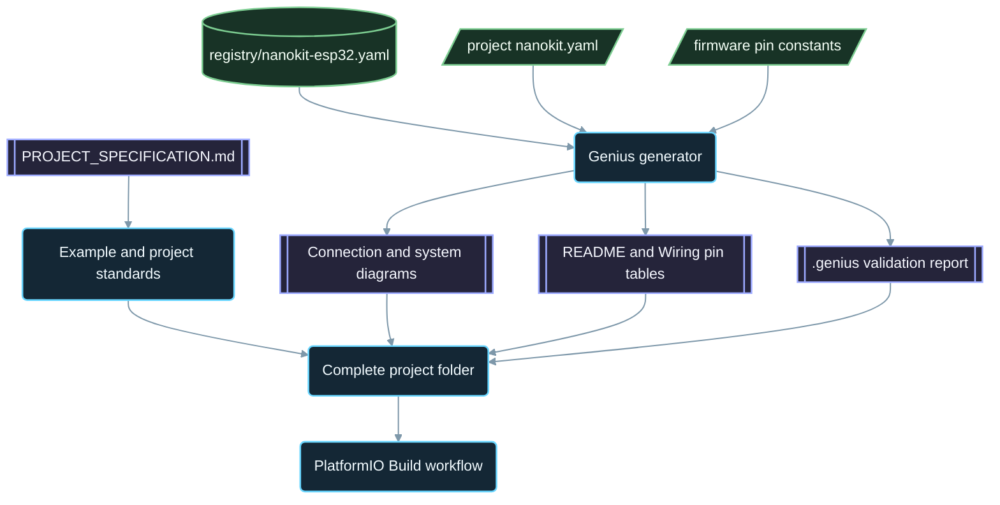

<div align="center">

# NanoKit-ESP32

**NanoKit Integrated ESP32 Dev Board ke liye PlatformIO ka official ecosystem**

<p>
<a href="../../README.md">English</a> ·
<a href="README.zh-CN.md">简体中文</a> ·
<a href="README.zh-TW.md">繁體中文</a> ·
<a href="README.ja.md">日本語</a> ·
<a href="README.ko.md">한국어</a> ·
<a href="README.tr.md">Türkçe</a> ·
<a href="README.ru.md">Русский</a> ·
<a href="README.vi.md">Tiếng Việt</a> ·
<a href="README.th.md">ไทย</a> ·
<a href="README.de.md">Deutsch</a> ·
<a href="README.es.md">Español</a> ·
<a href="README.fr.md">Français</a> ·
<a href="README.uk.md">Українська</a> ·
<a href="README.pl.md">Polski</a> ·
<a href="README.pt-BR.md">Português (Brasil)</a> ·
<a href="README.ar.md">العربية</a> ·
<a href="README.fa.md">فارسی</a> ·
<a href="README.id.md">Bahasa Indonesia</a> ·
<a href="README.it.md">Italiano</a> ·
<a href="README.el.md">Ελληνικά</a> ·
<a href="README.ml.md">മലയാളം</a> ·
<strong>Roman Urdu</strong> ·
<a href="README.ro.md">Română</a>
</p>

<p>
<a href="https://github.com/ProAmineOfficial/NanoKit-ESP32/stargazers"></a>
<a href="https://github.com/ProAmineOfficial/NanoKit-ESP32/commits/main"></a>
<a href="../../LICENSE"></a>
<a href="https://github.com/ProAmineOfficial/NanoKit-ESP32/actions/workflows/platformio-build.yml"></a>
<a href="https://github.com/ProAmineOfficial/NanoKit-ESP32/actions/workflows/repository-index.yml"></a>
</p>

<p>
<a href="https://proamine.tech"></a>
<a href="https://gitarchitecturediagram.com/ProAmineOfficial/NanoKit-ESP32"></a>

</p>

**Developed by Amine Saoud ibn al-Bashir.**

</div>

> **Tarjume ke baare mein note:** yeh safha [English README ka tarjuma](../../README.md) hai. Agar dono mein koi farq ho to English README hi mustanad maana jaye ga.

##  NanoKit Integrated ESP32 ki Pinout Datasheet


NanoKit Integrated ESP32 Dev Board ek embedded development platform hai jo IoT, AI, robotics, taleem aur professional prototyping ke liye banaya gaya hai. Yeh repository PlatformIO examples, mukammal applications, open-source projects, graduation projects, simulation resources, documentation, articles, tutorials aur dobara istemal hone wale templates ke liye tarteeb di gayi hai.

NanoKit board UMT ke wasee hardware vision ka hissa hai, lekin is repository ka firmware standard PlatformIO Arduino C++ aur ESP32 ke aam GPIO numbers istemal karta hai, taake har project seedha PlatformIO mein compile ho kar chal sake.

##  Repository ka Maqsad

Yeh na to koi demo repository hai aur na hi template repository. Yeh taleemi aur professional embedded systems development ke liye NanoKit-ESP32 ecosystem ki official aur taweel mudti repository hai: har project code, wiring, algorithm, NanoKit pin mapping aur masail hal karne (troubleshooting) ka tareeqa sikhata hai.

Repository ke bunyadi qawaid, taraqqi ke model, examples ke mayaar, documentation ki zaruriyat aur Definition of Done (kaam mukammal hone ki tareef) ke liye [PROJECT_SPECIFICATION.md](../../PROJECT_SPECIFICATION.md) dekhein.

##  Jaldi Shuru Karein

1. [VS Code](https://code.visualstudio.com/) ke saath [PlatformIO IDE](https://platformio.org/install/ide?install=vscode) extension install karein, ya phir PlatformIO Core CLI install kar lein.
2. Repository clone karein aur koi example kholein. Sab se pehle [`digital_input_output`](../../examples_on_platformio/digital_input_output/) azmaayein: is mein ek button, ek LED aur board par laga hua onboard LED istemal hota hai.
3. NanoKit ko USB se connect karein, phir build aur upload karein aur Serial Monitor kholein:

```bash
git clone https://github.com/ProAmineOfficial/NanoKit-ESP32.git
cd NanoKit-ESP32/examples_on_platformio/digital_input_output
pio run --target upload
pio device monitor -b 115200
```

Har project ki README mein parts ki fehrist, NanoKit pin table, wiring ki tarteeb aur Serial Monitor ka mutawaqqa output diya gaya hai.

##  Repository ka Dhaancha

| Path | Maqsad |
|---|---|
| [`examples_on_platformio/`](../../examples_on_platformio/README.md) | User interface ke baghair markooz PlatformIO examples: har example mein board ka ek feature, ek sensor ya ek module. |
| [`applications_on_platformio/`](../../applications_on_platformio/README.md) | User interface wali mukammal applications, maslan aisi web apps jo khud NanoKit serve karta hai aur jin mein buttons, sliders aur dashboards hote hain. |
| [`open_source_projects/`](../../open_source_projects/README.md) | NanoKit Drone 4X jaise baray aur original NanoKit projects, saath hi community, contributors, showcase aur hackathon ke hisse. |
| [`graduation_projects/`](../../graduation_projects/README.md) | Bachelor, master, engineering, institute, capstone aur thesis projects ke liye workspaces. |
| `tutorials/` | Beginner se advanced level tak tutorials, project guides aur video links ki fehristen. |
| `articles/` | Embedded systems, IoT, AI, robotics, PlatformIO, NanoKit aur UMT par technical articles. |
| `docs/` | Shuruaat, installation, hardware, software, API, troubleshooting, roadmap, architecture aur tarjume. |
| `registry/` | NanoKit board data ki shakal mein: har header pin, har GPIO, har VR address aur har electrical qaida. |
| `tools/` | Repository ki automation: Genius generator aur index generator. |
| `simulator/` | Web simulator, simulation engine, examples aur simulator ke assets. |
| `templates/` | Examples, applications, thesis ke kaam aur documentation ke liye dobara istemal hone wale templates. |
| `assets/` | Mushtarka images, icons, logos, banners aur videos. |

##  Hardware Manifests aur Khud-kaar Tayyar Hone Wali Documentation

Har example, application, open-source project aur graduation project apna hardware sirf ek baar, ek `nanokit.yaml` manifest mein bayan karta hai. `python tools/genius/generate.py` is manifest ko board registry [`registry/nanokit-esp32.yaml`](../../registry/nanokit-esp32.yaml) aur firmware ke pin constants se mila kar validate karta hai, phir yeh cheezein dobara generate karta hai:

- `images/connection-diagram.md` aur `images/system-diagram.md`, jin mein `Pin <NanoKit pin> / GPIO<n>` labels aur Confirmed / Proposed / Blocked (tasdeeq-shuda / tajweez-kardah / mamnoo) ki styling hoti hai,
- har project ki README mein NanoKit pin table aur har `docs/Wiring.md` mein connection table,
- `.genius/VALIDATION_REPORT.md`, jis mein check kiye gaye qawaid, nataij aur code se liye gaye saboot shamil hote hain.

Internal flash wala pin, sirf input wale pin par output, level shifting ke baghair 5 V signal, ya aisa manifest jo code se mel na khata ho: in mein se koi bhi cheez commit aur pull request dono ko rok deti hai. Reference project [`examples_on_platformio/ultrasonic_distance/`](../../examples_on_platformio/ultrasonic_distance/) hai. Schema aur qawaid: [`tools/genius/README.md`](../../tools/genius/README.md). Design ka record: [`docs/software/genius-generator-spec.md`](../../docs/software/genius-generator-spec.md).

##  Khud-kaar Tayyar Hone Wale Indexes

- [Repository ka Index](../../REPOSITORY_INDEX.md) repository ke ahem hisson ka khulasa deta hai aur asal projects (yaani manifest wale folders) ginta hai.
- [Repository ka Tree](../../REPOSITORY_TREE.md) generate kiya gaya file tree dikhata hai.
- [Projects ka Backlog](../../docs/roadmap/project-backlog.md) har mansooba-bandi shuda example, application, tutorial aur article ko paanch marhalon (waves) mein list karta hai; is ka Status column aur [roadmap ka khulasa](../../docs/roadmap/README.md) khud-ba-khud update hote hain.
- Har push aur har pull request par [PlatformIO Build ka workflow](../../.github/workflows/platformio-build.yml) har PlatformIO project ko compile karta hai.

Koi project add ya tabdeel karne ke baad `python tools/genius/generate.py` aur phir `python tools/update_repository_index.py` chalayein. Local hook ko `git config core.hooksPath .githooks` se ek baar enable kar lein; GitHub ka workflow `main` par har push ke waqt yahi do tools chalata hai aur pull requests ko validate karta hai.

##  Repository ka Interactive Tree

Neeche diya gaya tree repository ke maujooda content se generate hota hai. Isay kholne ya band karne ke liye is ke unwan par click karein. Jab projects ya files add, move ya remove hoti hain to local pre-commit hook aur GitHub ka workflow isay khud-ba-khud refresh kar dete hain.

Mukammal generate shuda tree [REPOSITORY_TREE.md](../../REPOSITORY_TREE.md) mein mojood hai; English README isay khulne aur band hone wali list ki shakal mein dikhata hai.

##  Repository Kaise Banti Hai



##  Numayan Open-Source Project

[NanoKit Drone 4X (Quadcopter)](../../open_source_projects/nanokit_drone_4x_quadcopter/README.md) is repository mein Quad-X flight control ka reference project hai, jis mein hifazat ko sab se pehle rakha gaya hai. Ek NanoKit flight controller 250 Hz ka control loop chalata hai jis mein Quad-X motor mixing aur safety gates shamil hain, browser mein chalne wala Flight Deck Wi-Fi aur WebSocket ke zariye connect hota hai, aur doosra NanoKit ek alag-thalag camera aur audio payload chalata hai jis ka motors par koi ikhtiyar nahi hota. Project abhi bench development ke marhale mein hai: jab tak ESC protocol ki tasdeeq nahi ho jati, propellers utaray hue rehte hain aur motor output mehfooz kam-az-kam satah par rehta hai.

##  Mayaar ka Muahida

Is repository ka official content production ke liye tayyar, taleemi, mukammal aur maintain karne ke qabil hona chahiye.

- Directories ko khali chhor kar unhein aakhri kaam na samjhein.
- Jab asal taleemi mawad diya ja sakta ho to placeholder content shamil na karein.
- Maujooda kaam ko bila wajah overwrite karne ke bajaye usi ko aage barhayein.
- Har example code, wiring, algorithm, pin mapping aur troubleshooting ka tareeqa sikhata hai.
- Har hardware example NanoKit pin numbers aur ESP32 GPIO numbers ko poori tarah "Pin 36 / GPIO5" ki shakal mein likh kar document karta hai.

Examples banate ya un ka jaiza lete waqt [docs/software/platformio-example-standard.md](../../docs/software/platformio-example-standard.md) se rehnumai lein.

##  PlatformIO ki Bunyadi Settings

PlatformIO projects pehli public bunyad ke taur par ESP32 ka Arduino framework istemal karte hain:

```ini
[env:nanokit_esp32]
platform = espressif32
board = esp32dev
framework = arduino
monitor_speed = 115200
upload_speed = 921600
```

Jaise jaise hardware package aage barhega, NanoKit ke liye makhsoos board definitions generic `esp32dev` board profile ki jagah le sakti hain.

##  Firmware ka Qaida

Is repository ki official examples mein in cheezon ka istemal lazmi hai:

- PlatformIO
- ESP32 ke liye Arduino framework
- C++
- Markdown mein documentation
- Source code mein ESP32 ke aam GPIO numbers

PlatformIO examples mein UMT SDK ka code ya Virtual Register API ka code istemal na karein.

##  Hardware ka Pinout

NanoKit pin numbers, ESP32 GPIO mappings, electrical notes aur warnings ke liye [docs/hardware/nanokit-integrated-esp32-pinout.md](../../docs/hardware/nanokit-integrated-esp32-pinout.md) ko mustanad zariya maanein.

Har hardware example yeh cheezein document karta hai:

```text
NanoKit Pin -> GPIO -> Component Pin -> Description
```

Ahem pabandiyan:

- GPIO34, GPIO35, GPIO36 aur GPIO39 sirf input ke liye hain.
- GPIO6, GPIO7, GPIO8, GPIO9, GPIO10 aur GPIO11 internal SPI flash ke pins hain, inhein bilkul istemal na karein.
- GPIO0 BOOT pin hai.
- GPIO1 aur GPIO3 USB Serial ke saath mushtarka hain.
- EN Reset / Enable pin hai aur yeh GPIO nahi hai.

##  Aainda ka Roadmap

[Projects ka Backlog](../../docs/roadmap/project-backlog.md) library ko paanch marhalon mein plan karta hai: board ki bunyadi baatein, sensors aur modules, web applications, protocols aur cloud, aur external modules. [Roadmap ka khulasa](../../docs/roadmap/README.md) dikhata hai ke har marhale ke kitne projects mukammal ho chuke hain.

##  Hissa Kaise Dalein

Aap ke contributions ka khair-maqdam hai. Pehle [CONTRIBUTING.md](../../CONTRIBUTING.md) parhein: is mein project ke mayaar, `nanokit.yaml` manifest, pre-commit hook aur contributions ke license ki wazahat ki gayi hai.

##  Tarjume

Yeh README oopar diye gaye language bar ke zariye 23 zabanon mein dastiyab hai. Tarjume [`docs/i18n/`](../../docs/i18n/) mein mojood hain; agar kisi tarjume aur English README mein farq ho to English README hi mustanad hai.

##  Raabta aur Madad

-  Website ka pata: [https://proamine.tech](https://proamine.tech)
-  Git Architecture Diagram: [https://gitarchitecturediagram.com](https://gitarchitecturediagram.com/ProAmineOfficial/NanoKit-ESP32)
-  Email ka pata: `technology@proamine.tech`
-  TikTok: [@pro_amine](https://www.tiktok.com/@pro_amine)
-  YouTube: [@pro_amine](https://www.youtube.com/@pro_amine)

##  License (ijazat-nama)

NanoKit-ESP32 [GNU Affero General Public License v3.0 only](../../LICENSE) (`AGPL-3.0-only`) ke tehat licensed hai, aur section 7 ke tehat izafi sharait [NOTICE](../../NOTICE) mein darj hain:

- **Nisbat:** har copy ya tabdeel shuda version "Developed by Amine Saoud ibn al-Bashir." wali line barqarar rakhta hai aur yeh bayan karta hai ke woh Amine Saoud ibn al-Bashir (Pro_Amine LLC) ke NanoKit-ESP32 par mabni hai.
- **Tabdeel shuda versions** par wazeh nishan lagaya jata hai ke woh original se mukhtalif hain, aur unhein official NanoKit-ESP32 repository ke taur par pesh nahi kiya jata.
- **Naam:** NanoKit, Pro_Amine ya UMT ke naamon ya un ke logos par koi huqooq nahi diye jate; dobara taqseem kiya gaya version apna alag naam istemal karta hai.
- **Network par istemal:** agar aap koi tabdeel shuda version network service ke taur par chalate hain to AGPL ke mutabiq aap ko us ka source code us ke users ko faraham karna hoga.

In sharait ke tehat aap seekhne, parhane, tehqeeq aur apne projects ke liye is code ka mutala karne, isay istemal karne aur is mein tabdeeli karne mein azad hain. AGPL par muntaqil hone se pehle shaya kiye gaye versions Apache License 2.0 ke tehat taqseem kiye gaye thay. `assets/icons/fluent/` mein mojood Fluent Emoji icons © Microsoft Corporation ki milkiyat hain aur MIT License ke tehat dastiyab hain.

<div align="center">

**Developed by Amine Saoud ibn al-Bashir · © 2026 Pro_Amine LLC**

</div>
