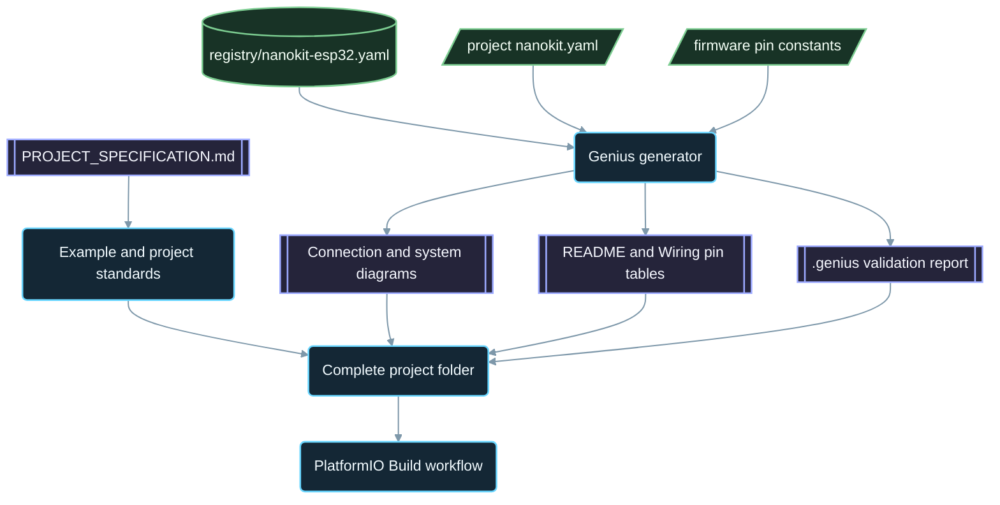

<div align="center">

# NanoKit-ESP32

**Hệ sinh thái PlatformIO chính thức dành cho bo mạch phát triển NanoKit Integrated ESP32**

<p>
<a href="../../README.md">English</a> ·
<a href="README.zh-CN.md">简体中文</a> ·
<a href="README.zh-TW.md">繁體中文</a> ·
<a href="README.ja.md">日本語</a> ·
<a href="README.ko.md">한국어</a> ·
<a href="README.tr.md">Türkçe</a> ·
<a href="README.ru.md">Русский</a> ·
<strong>Tiếng Việt</strong> ·
<a href="README.th.md">ไทย</a> ·
<a href="README.de.md">Deutsch</a> ·
<a href="README.es.md">Español</a> ·
<a href="README.fr.md">Français</a> ·
<a href="README.uk.md">Українська</a> ·
<a href="README.pl.md">Polski</a> ·
<a href="README.pt-BR.md">Português (Brasil)</a> ·
<a href="README.ar.md">العربية</a> ·
<a href="README.fa.md">فارسی</a> ·
<a href="README.id.md">Bahasa Indonesia</a> ·
<a href="README.it.md">Italiano</a> ·
<a href="README.el.md">Ελληνικά</a> ·
<a href="README.ml.md">മലയാളം</a> ·
<a href="README.ur-Latn.md">Roman Urdu</a> ·
<a href="README.ro.md">Română</a>
</p>

<p>
<a href="https://github.com/ProAmineOfficial/NanoKit-ESP32/stargazers"></a>
<a href="https://github.com/ProAmineOfficial/NanoKit-ESP32/commits/main"></a>
<a href="../../LICENSE"></a>
<a href="https://github.com/ProAmineOfficial/NanoKit-ESP32/actions/workflows/platformio-build.yml"></a>
<a href="https://github.com/ProAmineOfficial/NanoKit-ESP32/actions/workflows/repository-index.yml"></a>
</p>

<p>
<a href="https://proamine.tech"></a>
<a href="https://gitarchitecturediagram.com/ProAmineOfficial/NanoKit-ESP32"></a>

</p>

**Developed by Amine Saoud ibn al-Bashir.**

</div>

> **Ghi chú về bản dịch:** trang này là bản dịch của [README tiếng Anh](../../README.md). Khi hai bản có nội dung khác nhau, README tiếng Anh là bản có giá trị chính thức.

##  Bảng dữ liệu sơ đồ chân NanoKit Integrated ESP32


Bo mạch phát triển NanoKit Integrated ESP32 là một nền tảng phát triển nhúng dành cho IoT, AI, robot, giáo dục và tạo mẫu thử chuyên nghiệp. Kho mã này được tổ chức để chứa các ví dụ PlatformIO, ứng dụng hoàn chỉnh, dự án mã nguồn mở, đồ án tốt nghiệp, tài nguyên mô phỏng, tài liệu, bài viết, hướng dẫn và mẫu có thể tái sử dụng.

Bo mạch NanoKit là một phần trong tầm nhìn phần cứng UMT rộng lớn hơn, nhưng firmware trong kho mã này sử dụng PlatformIO Arduino C++ tiêu chuẩn và số hiệu GPIO của ESP32, nhờ đó mọi dự án đều có thể biên dịch và chạy trực tiếp trong PlatformIO.

##  Sứ mệnh của kho mã

Đây không phải là kho mã trình diễn, cũng không phải kho mã mẫu. Đây là kho mã hệ sinh thái chính thức và lâu dài của NanoKit-ESP32, phục vụ phát triển hệ thống nhúng trong giáo dục lẫn chuyên nghiệp: mỗi dự án đều giảng giải mã nguồn, cách đấu dây, thuật toán, ánh xạ chân NanoKit và hướng khắc phục sự cố.

Xem [PROJECT_SPECIFICATION.md](../../PROJECT_SPECIFICATION.md) để biết các quy tắc tổng thể của kho mã, mô hình phát triển, tiêu chuẩn cho ví dụ, yêu cầu về tài liệu và Định nghĩa Hoàn thành (Definition of Done).

##  Bắt đầu nhanh

1. Cài đặt [VS Code](https://code.visualstudio.com/) cùng tiện ích mở rộng [PlatformIO IDE](https://platformio.org/install/ide?install=vscode), hoặc cài PlatformIO Core CLI.
2. Clone kho mã và mở một ví dụ. [`digital_input_output`](../../examples_on_platformio/digital_input_output/) là ví dụ nên thử đầu tiên: một nút nhấn, một LED và LED tích hợp trên bo mạch.
3. Kết nối NanoKit qua USB, sau đó build, nạp chương trình và mở Serial Monitor:

```bash
git clone https://github.com/ProAmineOfficial/NanoKit-ESP32.git
cd NanoKit-ESP32/examples_on_platformio/digital_input_output
pio run --target upload
pio device monitor -b 115200
```

README của mỗi dự án đều liệt kê linh kiện, bảng chân NanoKit, thứ tự đấu dây và kết quả mong đợi trên Serial Monitor.

##  Cấu trúc kho mã

| Đường dẫn | Mục đích |
|---|---|
| [`examples_on_platformio/`](../../examples_on_platformio/README.md) | Các ví dụ PlatformIO tập trung, không có giao diện người dùng: mỗi ví dụ minh họa một tính năng của bo mạch, một cảm biến hoặc một mô-đun. |
| [`applications_on_platformio/`](../../applications_on_platformio/README.md) | Ứng dụng hoàn chỉnh có giao diện người dùng, chẳng hạn ứng dụng web do NanoKit phục vụ với nút bấm, thanh trượt và bảng điều khiển. |
| [`open_source_projects/`](../../open_source_projects/README.md) | Các dự án NanoKit nguyên bản quy mô lớn hơn như NanoKit Drone 4X, cùng các khu vực dành cho cộng đồng, người đóng góp, trưng bày và hackathon. |
| [`graduation_projects/`](../../graduation_projects/README.md) | Không gian làm việc cho đồ án cử nhân, thạc sĩ, kỹ sư, cao đẳng, đồ án capstone và luận văn. |
| `tutorials/` | Hướng dẫn từ cơ bản đến nâng cao, tài liệu hướng dẫn dự án và mục lục liên kết video. |
| `articles/` | Bài viết kỹ thuật về hệ thống nhúng, IoT, AI, robot, PlatformIO, NanoKit và UMT. |
| `docs/` | Bắt đầu sử dụng, cài đặt, phần cứng, phần mềm, API, khắc phục sự cố, lộ trình, kiến trúc và bản dịch. |
| `registry/` | Bo mạch NanoKit dưới dạng dữ liệu: mọi chân header, GPIO, địa chỉ VR và quy tắc về điện. |
| `tools/` | Tự động hóa kho mã: trình tạo Genius và trình tạo chỉ mục. |
| `simulator/` | Trình mô phỏng web, bộ máy mô phỏng, ví dụ và tài nguyên cho trình mô phỏng. |
| `templates/` | Mẫu tái sử dụng cho ví dụ, ứng dụng, luận văn và tài liệu. |
| `assets/` | Hình ảnh, biểu tượng, logo, banner và video dùng chung. |

##  Tệp manifest phần cứng và tài liệu được tạo tự động

Mỗi ví dụ, ứng dụng, dự án mã nguồn mở và đồ án tốt nghiệp chỉ mô tả phần cứng của mình một lần, trong tệp manifest `nanokit.yaml`. Lệnh `python tools/genius/generate.py` kiểm tra tệp này đối chiếu với registry của bo mạch [`registry/nanokit-esp32.yaml`](../../registry/nanokit-esp32.yaml) và với các hằng số chân trong firmware, sau đó tạo lại:

- `images/connection-diagram.md` và `images/system-diagram.md` với nhãn `Pin <NanoKit pin> / GPIO<n>` và kiểu hiển thị Confirmed / Proposed / Blocked (đã xác nhận / đề xuất / bị chặn),
- bảng chân NanoKit trong README của từng dự án và bảng kết nối trong từng tệp `docs/Wiring.md`,
- `.genius/VALIDATION_REPORT.md` với các quy tắc đã kiểm tra, các phát hiện và bằng chứng từ mã nguồn.

Một chân nằm trên flash nội, một đầu ra trên chân chỉ dành cho đầu vào, một tín hiệu 5 V không qua chuyển đổi mức logic, hoặc một tệp manifest không khớp với mã nguồn đều sẽ chặn commit và pull request. Dự án tham chiếu là [`examples_on_platformio/ultrasonic_distance/`](../../examples_on_platformio/ultrasonic_distance/). Lược đồ (schema) và quy tắc: [`tools/genius/README.md`](../../tools/genius/README.md). Hồ sơ thiết kế: [`docs/software/genius-generator-spec.md`](../../docs/software/genius-generator-spec.md).

##  Các chỉ mục được tạo tự động

- [Chỉ mục kho mã](../../REPOSITORY_INDEX.md) tóm tắt các khu vực chính của kho mã và đếm số dự án thực sự (các thư mục có tệp manifest).
- [Cây kho mã](../../REPOSITORY_TREE.md) hiển thị cây tệp được tạo tự động.
- [Danh sách công việc dự án](../../docs/roadmap/project-backlog.md) liệt kê mọi ví dụ, ứng dụng, hướng dẫn và bài viết đã lên kế hoạch theo năm đợt; cột Status của danh sách và [bản tóm tắt lộ trình](../../docs/roadmap/README.md) được cập nhật tự động.
- Mọi dự án PlatformIO đều được biên dịch bởi [workflow PlatformIO Build](../../.github/workflows/platformio-build.yml) mỗi khi có push hoặc pull request.

Chạy `python tools/genius/generate.py` rồi đến `python tools/update_repository_index.py` sau khi thêm hoặc thay đổi một dự án. Chỉ cần bật hook cục bộ một lần bằng `git config core.hooksPath .githooks`; workflow GitHub sẽ chạy hai công cụ này mỗi lần push lên `main` và kiểm tra các pull request.

##  Cây kho mã tương tác

Cây bên dưới được tạo từ nội dung hiện tại của kho mã. Chọn tiêu đề để mở rộng hoặc thu gọn cây. Hook pre-commit cục bộ và workflow GitHub tự động làm mới cây khi có dự án hoặc tệp được thêm, di chuyển hoặc xóa.

Toàn bộ cây được tạo tự động nằm trong [REPOSITORY_TREE.md](../../REPOSITORY_TREE.md); README tiếng Anh hiển thị cây này dưới dạng danh sách có thể mở rộng.

##  Cách kho mã được xây dựng



##  Dự án mã nguồn mở tiêu biểu

[NanoKit Drone 4X (máy bay bốn cánh quạt)](../../open_source_projects/nanokit_drone_4x_quadcopter/README.md) là dự án tham chiếu về điều khiển bay Quad-X của kho mã, đặt an toàn lên hàng đầu. Một NanoKit đóng vai trò bộ điều khiển bay, chạy vòng điều khiển 250 Hz với bộ trộn động cơ Quad-X và các cổng an toàn; giao diện Flight Deck trên trình duyệt kết nối qua Wi-Fi và WebSocket; còn một NanoKit thứ hai vận hành khối tải camera và âm thanh độc lập, không có bất kỳ quyền điều khiển động cơ nào. Dự án đang ở giai đoạn phát triển trên bàn thử: cánh quạt luôn được tháo ra và đầu ra động cơ luôn giữ ở mức tối thiểu an toàn cho đến khi giao thức ESC được xác minh.

##  Cam kết chất lượng

Nội dung chính thức trong kho mã này phải sẵn sàng cho sử dụng thực tế, mang tính giáo dục, hoàn chỉnh và dễ bảo trì.

- Không để lại thư mục trống như sản phẩm cuối cùng.
- Không thêm nội dung giữ chỗ khi có thể cung cấp tài liệu giáo dục thực sự.
- Phát triển dựa trên thành quả hiện có thay vì ghi đè lên chúng một cách không cần thiết.
- Mỗi ví dụ đều giảng giải mã nguồn, cách đấu dây, thuật toán, ánh xạ chân và hướng khắc phục sự cố.
- Mỗi ví dụ phần cứng đều ghi rõ số chân NanoKit và số GPIO của ESP32, viết đầy đủ dạng "Pin 36 / GPIO5".

Hãy dùng [docs/software/platformio-example-standard.md](../../docs/software/platformio-example-standard.md) khi tạo hoặc rà soát ví dụ.

##  Cấu hình cơ sở PlatformIO

Các dự án PlatformIO sử dụng framework Arduino cho ESP32 làm cấu hình cơ sở công khai đầu tiên:

```ini
[env:nanokit_esp32]
; espressif32 8.0.0 = Arduino-ESP32 core 3.3.12, pinned so a platform update cannot break the build
platform = espressif32 @ 8.0.0
board = esp32dev
framework = arduino
monitor_speed = 115200
upload_speed = 921600
```

Khi gói phần cứng phát triển, các định nghĩa bo mạch NanoKit chuyên biệt có thể thay thế cấu hình bo mạch chung `esp32dev`.

##  Quy tắc firmware

Các ví dụ chính thức trong kho mã này phải sử dụng:

- PlatformIO
- Framework Arduino cho ESP32
- C++
- Tài liệu Markdown
- Số hiệu GPIO thông thường của ESP32 trong mã nguồn

Không sử dụng mã UMT SDK hoặc mã Virtual Register API trong các ví dụ PlatformIO.

##  Sơ đồ chân phần cứng

Hãy dùng [docs/hardware/nanokit-integrated-esp32-pinout.md](../../docs/hardware/nanokit-integrated-esp32-pinout.md) làm nguồn tham chiếu chuẩn duy nhất cho số chân NanoKit, ánh xạ GPIO của ESP32, ghi chú về điện và các cảnh báo.

Mỗi ví dụ phần cứng đều ghi rõ:

```text
NanoKit Pin -> GPIO -> Component Pin -> Description
```

Các hạn chế quan trọng:

- GPIO34, GPIO35, GPIO36 và GPIO39 chỉ dùng làm đầu vào.
- GPIO6, GPIO7, GPIO8, GPIO9, GPIO10 và GPIO11 là các chân flash SPI nội và không được sử dụng.
- GPIO0 là chân BOOT.
- GPIO1 và GPIO3 dùng chung với cổng Serial qua USB.
- EN là chân Reset / Enable (khởi động lại / cho phép hoạt động) và không phải là GPIO.

##  Lộ trình

[Danh sách công việc dự án](../../docs/roadmap/project-backlog.md) lên kế hoạch cho thư viện dự án theo năm đợt: nền tảng về bo mạch, cảm biến và mô-đun, ứng dụng web, giao thức và đám mây, và mô-đun ngoài. [Bản tóm tắt lộ trình](../../docs/roadmap/README.md) cho biết số dự án đã hoàn thành trong mỗi đợt.

##  Đóng góp

Chúng tôi luôn hoan nghênh mọi đóng góp. Hãy đọc [CONTRIBUTING.md](../../CONTRIBUTING.md) trước: tài liệu này giải thích các tiêu chuẩn dự án, tệp manifest `nanokit.yaml`, hook pre-commit và giấy phép áp dụng cho các đóng góp.

##  Bản dịch

README này có sẵn bằng 23 ngôn ngữ thông qua thanh ngôn ngữ ở đầu trang. Các bản dịch nằm trong [`docs/i18n/`](../../docs/i18n/); khi bản dịch và README tiếng Anh có nội dung khác nhau, README tiếng Anh là bản có giá trị chính thức.

##  Hỗ trợ

-  Trang web: [https://proamine.tech](https://proamine.tech)
-  Git Architecture Diagram: [https://gitarchitecturediagram.com](https://gitarchitecturediagram.com/ProAmineOfficial/NanoKit-ESP32)
-  Email: `technology@proamine.tech`
-  TikTok: [@pro_amine](https://www.tiktok.com/@pro_amine)
-  YouTube: [@pro_amine](https://www.youtube.com/@pro_amine)

##  Giấy phép

NanoKit-ESP32 được cấp phép theo [GNU Affero General Public License v3.0 only](../../LICENSE) (`AGPL-3.0-only`), kèm các điều khoản bổ sung theo mục 7 được liệt kê trong [NOTICE](../../NOTICE):

- **Ghi công:** mọi bản sao hoặc phiên bản sửa đổi đều phải giữ nguyên dòng "Developed by Amine Saoud ibn al-Bashir." và nêu rõ rằng nó dựa trên NanoKit-ESP32 của Amine Saoud ibn al-Bashir (Pro_Amine LLC).
- **Phiên bản sửa đổi** phải được đánh dấu là khác với bản gốc và không được trình bày như kho mã NanoKit-ESP32 chính thức.
- **Tên gọi:** không có quyền nào được cấp đối với các tên NanoKit, Pro_Amine hoặc UMT, hay đối với logo của chúng; phiên bản phân phối lại phải dùng tên riêng của mình.
- **Sử dụng qua mạng:** nếu bạn vận hành một phiên bản sửa đổi như một dịch vụ mạng, AGPL yêu cầu bạn cung cấp mã nguồn của phiên bản đó cho người dùng của dịch vụ.

Bạn được tự do nghiên cứu, sử dụng và sửa đổi mã này cho mục đích học tập, giảng dạy, nghiên cứu và các dự án của riêng bạn theo các điều khoản này. Các phiên bản phát hành trước khi chuyển sang AGPL được phân phối theo Apache License 2.0. Các biểu tượng Fluent Emoji trong `assets/icons/fluent/` thuộc bản quyền © Microsoft Corporation và được cấp phép theo MIT License.

<div align="center">

**Developed by Amine Saoud ibn al-Bashir · © 2026 Pro_Amine LLC**

</div>
