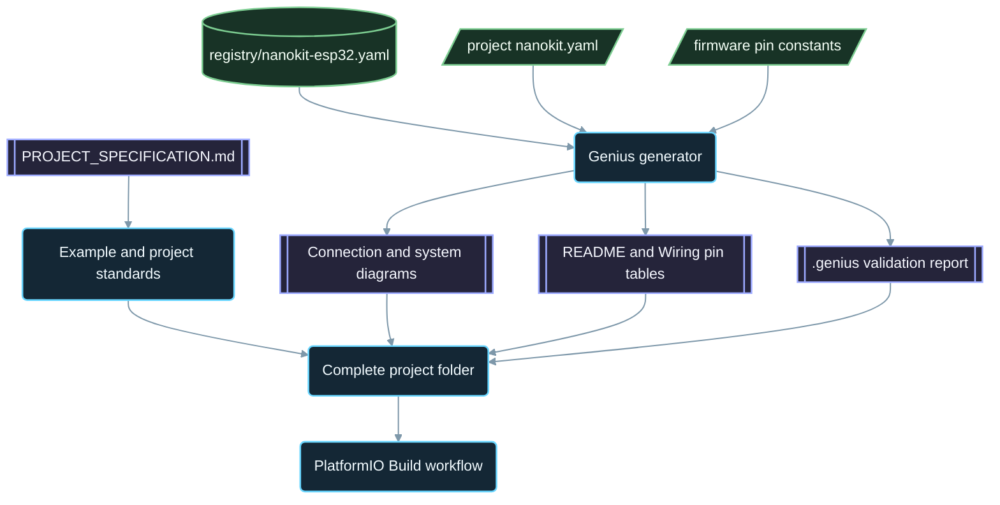

<div align="center">

# NanoKit-ESP32

**NanoKit Integrated ESP32 开发板的官方 PlatformIO 生态系统**

<p>
<a href="../../README.md">English</a> ·
<strong>简体中文</strong> ·
<a href="README.zh-TW.md">繁體中文</a> ·
<a href="README.ja.md">日本語</a> ·
<a href="README.ko.md">한국어</a> ·
<a href="README.tr.md">Türkçe</a> ·
<a href="README.ru.md">Русский</a> ·
<a href="README.vi.md">Tiếng Việt</a> ·
<a href="README.th.md">ไทย</a> ·
<a href="README.de.md">Deutsch</a> ·
<a href="README.es.md">Español</a> ·
<a href="README.fr.md">Français</a> ·
<a href="README.uk.md">Українська</a> ·
<a href="README.pl.md">Polski</a> ·
<a href="README.pt-BR.md">Português (Brasil)</a> ·
<a href="README.ar.md">العربية</a> ·
<a href="README.fa.md">فارسی</a> ·
<a href="README.id.md">Bahasa Indonesia</a> ·
<a href="README.it.md">Italiano</a> ·
<a href="README.el.md">Ελληνικά</a> ·
<a href="README.ml.md">മലയാളം</a> ·
<a href="README.ur-Latn.md">Roman Urdu</a> ·
<a href="README.ro.md">Română</a>
</p>

<p>
<a href="https://github.com/ProAmineOfficial/NanoKit-ESP32/stargazers"></a>
<a href="https://github.com/ProAmineOfficial/NanoKit-ESP32/commits/main"></a>
<a href="../../LICENSE"></a>
<a href="https://github.com/ProAmineOfficial/NanoKit-ESP32/actions/workflows/platformio-build.yml"></a>
<a href="https://github.com/ProAmineOfficial/NanoKit-ESP32/actions/workflows/repository-index.yml"></a>
</p>

<p>
<a href="https://proamine.tech"></a>
<a href="https://gitarchitecturediagram.com/ProAmineOfficial/NanoKit-ESP32"></a>

</p>

**Developed by Amine Saoud ibn al-Bashir.**

</div>

> **翻译说明：** 本页是[英文 README](../../README.md) 的译文。两者内容不一致时，以英文 README 为准。

##  NanoKit Integrated ESP32 引脚图数据手册


NanoKit Integrated ESP32 开发板是一个面向物联网、AI、机器人、教育和专业原型开发的嵌入式开发平台。本仓库用于收录 PlatformIO 示例、完整应用、开源项目、毕业设计、仿真资源、文档、技术文章、教程以及可复用的模板。

NanoKit 开发板是更宏大的 UMT 硬件愿景的一部分，但本仓库的固件采用标准的 PlatformIO Arduino C++ 和 ESP32 GPIO 编号，因此每个项目都可以直接在 PlatformIO 中编译和运行。

##  仓库使命

这不是一个演示仓库，也不是一个模板仓库。它是 NanoKit-ESP32 官方的长期生态系统仓库，服务于教育和专业领域的嵌入式系统开发：每个项目都会讲解代码、接线、算法、NanoKit 引脚映射以及故障排查思路。

关于仓库的总体规则、发展模式、示例标准、文档要求以及完成定义（Definition of Done），请参阅 [PROJECT_SPECIFICATION.md](../../PROJECT_SPECIFICATION.md)。

##  快速入门

1. 安装 [VS Code](https://code.visualstudio.com/) 及 [PlatformIO IDE](https://platformio.org/install/ide?install=vscode) 扩展，或者安装 PlatformIO Core CLI。
2. 克隆本仓库并打开一个示例。建议首先尝试 [`digital_input_output`](../../examples_on_platformio/digital_input_output/)：它使用一个按键、一个 LED 以及板载 LED。
3. 通过 USB 连接 NanoKit，然后编译、上传并打开 Serial Monitor：

```bash
git clone https://github.com/ProAmineOfficial/NanoKit-ESP32.git
cd NanoKit-ESP32/examples_on_platformio/digital_input_output
pio run --target upload
pio device monitor -b 115200
```

每个项目的 README 都会列出所需元件、NanoKit 引脚表、接线顺序以及预期的 Serial Monitor 输出。

##  仓库结构

| 路径 | 用途 |
|---|---|
| [`examples_on_platformio/`](../../examples_on_platformio/README.md) | 聚焦单一主题、不含用户界面的 PlatformIO 示例：每个示例对应一项开发板功能、一个传感器或一个模块。 |
| [`applications_on_platformio/`](../../applications_on_platformio/README.md) | 带用户界面的完整应用，例如由 NanoKit 托管、包含按钮、滑块和仪表盘的 Web 应用。 |
| [`open_source_projects/`](../../open_source_projects/README.md) | 规模更大的 NanoKit 原创项目（如 NanoKit Drone 4X），以及社区、贡献者、作品展示和黑客松专区。 |
| [`graduation_projects/`](../../graduation_projects/README.md) | 本科、硕士、工程类、专科院校、综合实践（capstone）以及学位论文项目的工作区。 |
| `tutorials/` | 从入门到进阶的教程、项目指南以及视频链接索引。 |
| `articles/` | 关于嵌入式系统、物联网、AI、机器人、PlatformIO、NanoKit 和 UMT 的技术文章。 |
| `docs/` | 入门指南、安装、硬件、软件、API、故障排查、路线图、架构以及翻译。 |
| `registry/` | 以数据形式描述的 NanoKit 开发板：每个排针引脚、GPIO、VR 地址和电气规则。 |
| `tools/` | 仓库自动化工具：Genius 生成器和索引生成器。 |
| `simulator/` | Web 仿真器、仿真引擎、示例以及仿真器资源。 |
| `templates/` | 适用于示例、应用、学位论文和文档的可复用模板。 |
| `assets/` | 共享的图片、图标、徽标、横幅和视频。 |

##  硬件清单与自动生成的文档

每个示例、应用、开源项目和毕业设计都只在一个 `nanokit.yaml` 清单文件中描述一次自己的硬件。`python tools/genius/generate.py` 会对照开发板注册表 [`registry/nanokit-esp32.yaml`](../../registry/nanokit-esp32.yaml) 以及固件中的引脚常量对清单进行校验，然后重新生成：

- 带有 `Pin <NanoKit pin> / GPIO<n>` 标签以及 Confirmed / Proposed / Blocked（已确认 / 拟议 / 已阻止）样式的 `images/connection-diagram.md` 和 `images/system-diagram.md`；
- 每个项目 README 中的 NanoKit 引脚表，以及每个 `docs/Wiring.md` 中的连接表；
- `.genius/VALIDATION_REPORT.md`，其中包含已检查的规则、发现的问题以及代码证据。

只要出现以下任一情况，提交（commit）和拉取请求（pull request）都会被阻止：引脚位于内部闪存上、在仅输入引脚上配置输出、5 V 信号未经电平转换，或清单与代码不一致。参考项目是 [`examples_on_platformio/ultrasonic_distance/`](../../examples_on_platformio/ultrasonic_distance/)。清单结构（schema）与规则：[`tools/genius/README.md`](../../tools/genius/README.md)。设计记录：[`docs/software/genius-generator-spec.md`](../../docs/software/genius-generator-spec.md)。

##  自动生成的索引

- [仓库索引](../../REPOSITORY_INDEX.md)汇总仓库的主要区域，并统计真实项目的数量（即包含清单文件的文件夹）。
- [仓库目录树](../../REPOSITORY_TREE.md)展示自动生成的文件树。
- [项目待办列表](../../docs/roadmap/project-backlog.md)分五个阶段列出所有计划中的示例、应用、教程和文章；其中的状态（Status）列和[路线图摘要](../../docs/roadmap/README.md)会自动刷新。
- 每次推送和拉取请求时，[PlatformIO Build 工作流](../../.github/workflows/platformio-build.yml)都会编译所有 PlatformIO 项目。

添加或修改项目后，请先运行 `python tools/genius/generate.py`，再运行 `python tools/update_repository_index.py`。只需执行一次 `git config core.hooksPath .githooks` 即可启用本地钩子；GitHub 工作流会在每次推送到 `main` 时运行这两个工具，并校验拉取请求。

##  交互式仓库目录树

下方的目录树根据仓库当前的内容自动生成。点击其标题即可展开或折叠。当项目或文件被添加、移动或删除时，本地 pre-commit 钩子和 GitHub 工作流会自动刷新它。

完整的自动生成目录树见 [REPOSITORY_TREE.md](../../REPOSITORY_TREE.md)；英文 README 以可展开列表的形式展示它。

##  仓库的构建方式



##  精选开源项目

[NanoKit Drone 4X（四旋翼飞行器）](../../open_source_projects/nanokit_drone_4x_quadcopter/README.md)是本仓库以安全为先的 Quad-X 飞控参考项目。一块 NanoKit 作为飞控，运行 250 Hz 的控制回路，具备 Quad-X 电机混控和安全门控；基于浏览器的 Flight Deck 通过 Wi-Fi 和 WebSocket 连接；另一块 NanoKit 运行相互隔离的摄像头与音频载荷，不具备任何电机控制权限。该项目目前处于台架开发阶段：在 ESC 协议验证完成之前，螺旋桨始终保持拆除状态，电机输出始终保持在安全最小值。

##  质量约定

本仓库中的官方内容应当达到可用于生产、具有教学价值、内容完整且易于维护的标准。

- 不要把空目录作为最终成果留下。
- 能够提供真实的教学材料时，不要添加占位内容。
- 在现有成果的基础上继续构建，而不是不必要地覆盖它们。
- 每个示例都要讲解代码、接线、算法、引脚映射和故障排查思路。
- 每个硬件示例都要注明 NanoKit 引脚编号和 ESP32 GPIO 编号，并完整写成 "Pin 36 / GPIO5" 的形式。

创建或审阅示例时，请遵循 [docs/software/platformio-example-standard.md](../../docs/software/platformio-example-standard.md)。

##  PlatformIO 基线配置

PlatformIO 项目以 ESP32 Arduino 框架作为首个公开基线：

```ini
[env:nanokit_esp32]
; espressif32 8.0.0 = Arduino-ESP32 core 3.3.12, pinned so a platform update cannot break the build
platform = espressif32 @ 8.0.0
board = esp32dev
framework = arduino
monitor_speed = 115200
upload_speed = 921600
```

随着硬件包的演进，专用的 NanoKit 开发板定义可以取代通用的 `esp32dev` 开发板配置。

##  固件规则

本仓库中的官方示例必须使用：

- PlatformIO
- 适用于 ESP32 的 Arduino 框架
- C++
- Markdown 文档
- 源代码中使用常规的 ESP32 GPIO 编号

请勿在 PlatformIO 示例中使用 UMT SDK 代码或 Virtual Register API 代码。

##  硬件引脚定义

请以 [docs/hardware/nanokit-integrated-esp32-pinout.md](../../docs/hardware/nanokit-integrated-esp32-pinout.md) 作为 NanoKit 引脚编号、ESP32 GPIO 映射、电气说明和警告事项的唯一权威来源。

每个硬件示例都会注明：

```text
NanoKit Pin -> GPIO -> Component Pin -> Description
```

重要限制：

- GPIO34、GPIO35、GPIO36 和 GPIO39 仅可用作输入。
- GPIO6、GPIO7、GPIO8、GPIO9、GPIO10 和 GPIO11 是内部 SPI 闪存引脚，不得使用。
- GPIO0 是 BOOT 引脚。
- GPIO1 和 GPIO3 与 USB 串口共用。
- EN 是复位 / 使能（Reset / Enable）引脚，不是 GPIO。

##  路线图

[项目待办列表](../../docs/roadmap/project-backlog.md)将整个项目库规划为五个阶段：开发板基础、传感器与模块、Web 应用、通信协议与云、外部模块。[路线图摘要](../../docs/roadmap/README.md)显示每个阶段已完成的项目数量。

##  参与贡献

欢迎参与贡献。请先阅读 [CONTRIBUTING.md](../../CONTRIBUTING.md)：其中说明了项目标准、`nanokit.yaml` 清单文件、pre-commit 钩子以及贡献内容的许可方式。

##  翻译

通过页面顶部的语言栏，可以阅读本 README 的 23 种语言版本。译文存放在 [`docs/i18n/`](../../docs/i18n/) 中；当译文与英文 README 不一致时，以英文 README 为准。

##  支持

-  网站：[https://proamine.tech](https://proamine.tech)
-  Git Architecture Diagram：[https://gitarchitecturediagram.com](https://gitarchitecturediagram.com/ProAmineOfficial/NanoKit-ESP32)
-  电子邮件：`technology@proamine.tech`
-  TikTok：[@pro_amine](https://www.tiktok.com/@pro_amine)
-  YouTube：[@pro_amine](https://www.youtube.com/@pro_amine)

##  许可证

NanoKit-ESP32 采用 [GNU Affero General Public License v3.0 only](../../LICENSE)（`AGPL-3.0-only`）许可，并附有依据第 7 条订立的附加条款，详见 [NOTICE](../../NOTICE)：

- **署名：** 每份副本或修改版本都必须保留 "Developed by Amine Saoud ibn al-Bashir." 这一行，并注明其基于 Amine Saoud ibn al-Bashir（Pro_Amine LLC）的 NanoKit-ESP32。
- **修改版本**必须标明与原版不同，且不得以官方 NanoKit-ESP32 仓库的名义呈现。
- **名称：** 不授予对 NanoKit、Pro_Amine 或 UMT 这些名称及其徽标的任何权利；再分发的版本须使用自己的名称。
- **网络使用：** 如果您将修改版本作为网络服务运行，AGPL 要求您向其用户提供该版本的源代码。

在遵守上述条款的前提下，您可以自由地研究、使用和修改本代码，用于学习、教学、研究以及您自己的项目。在改用 AGPL 之前发布的版本以 Apache License 2.0 分发。`assets/icons/fluent/` 中的 Fluent Emoji 图标版权归 © Microsoft Corporation 所有，采用 MIT License 授权。

<div align="center">

**Developed by Amine Saoud ibn al-Bashir · © 2026 Pro_Amine LLC**

</div>
