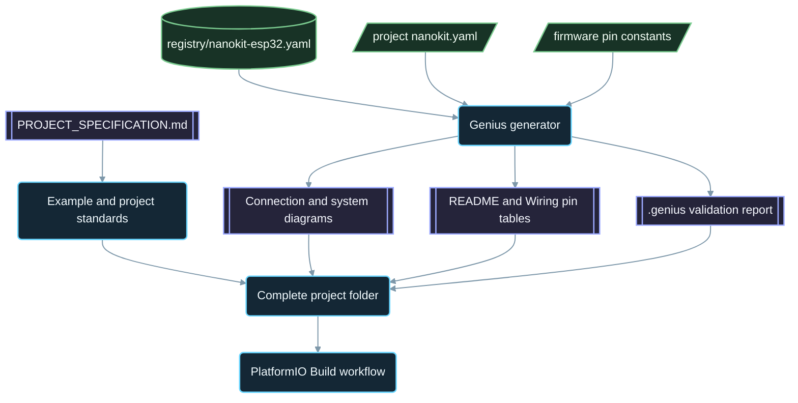

<div align="center">

# NanoKit-ESP32

**NanoKit Integrated ESP32 開發板的官方 PlatformIO 生態系**

<p>
<a href="../../README.md">English</a> ·
<a href="README.zh-CN.md">简体中文</a> ·
<strong>繁體中文</strong> ·
<a href="README.ja.md">日本語</a> ·
<a href="README.ko.md">한국어</a> ·
<a href="README.tr.md">Türkçe</a> ·
<a href="README.ru.md">Русский</a> ·
<a href="README.vi.md">Tiếng Việt</a> ·
<a href="README.th.md">ไทย</a> ·
<a href="README.de.md">Deutsch</a> ·
<a href="README.es.md">Español</a> ·
<a href="README.fr.md">Français</a> ·
<a href="README.uk.md">Українська</a> ·
<a href="README.pl.md">Polski</a> ·
<a href="README.pt-BR.md">Português (Brasil)</a> ·
<a href="README.ar.md">العربية</a> ·
<a href="README.fa.md">فارسی</a> ·
<a href="README.id.md">Bahasa Indonesia</a> ·
<a href="README.it.md">Italiano</a> ·
<a href="README.el.md">Ελληνικά</a> ·
<a href="README.ml.md">മലയാളം</a> ·
<a href="README.ur-Latn.md">Roman Urdu</a> ·
<a href="README.ro.md">Română</a>
</p>

<p>
<a href="https://github.com/ProAmineOfficial/NanoKit-ESP32/stargazers"></a>
<a href="https://github.com/ProAmineOfficial/NanoKit-ESP32/commits/main"></a>
<a href="../../LICENSE"></a>
<a href="https://github.com/ProAmineOfficial/NanoKit-ESP32/actions/workflows/platformio-build.yml"></a>
<a href="https://github.com/ProAmineOfficial/NanoKit-ESP32/actions/workflows/repository-index.yml"></a>
</p>

<p>
<a href="https://proamine.tech"></a>
<a href="https://gitarchitecturediagram.com/ProAmineOfficial/NanoKit-ESP32"></a>

</p>

**Developed by Amine Saoud ibn al-Bashir.**

</div>

> **翻譯說明：** 本頁是[英文 README](../../README.md) 的譯文。兩者內容不一致時，以英文 README 為準。

##  NanoKit Integrated ESP32 腳位圖規格書


NanoKit Integrated ESP32 開發板是一個專為物聯網、AI、機器人、教育及專業原型開發打造的嵌入式開發平台。本儲存庫收錄 PlatformIO 範例、完整應用程式、開源專案、畢業專題、模擬資源、文件、技術文章、教學以及可重複使用的範本。

NanoKit 開發板是更宏觀的 UMT 硬體願景的一部分，但本儲存庫的韌體採用標準的 PlatformIO Arduino C++ 與 ESP32 GPIO 編號，因此每個專案都能直接在 PlatformIO 中編譯並執行。

##  儲存庫使命

這不是展示用的儲存庫，也不是範本儲存庫。它是 NanoKit-ESP32 官方的長期生態系儲存庫，服務於教育與專業領域的嵌入式系統開發：每個專案都會講解程式碼、接線、演算法、NanoKit 腳位對應，以及疑難排解的思路。

關於儲存庫的總體規則、成長模式、範例標準、文件要求與完成定義（Definition of Done），請參閱 [PROJECT_SPECIFICATION.md](../../PROJECT_SPECIFICATION.md)。

##  快速入門

1. 安裝 [VS Code](https://code.visualstudio.com/) 並加裝 [PlatformIO IDE](https://platformio.org/install/ide?install=vscode) 擴充功能，或安裝 PlatformIO Core CLI。
2. 複製（clone）本儲存庫並開啟一個範例。建議先從 [`digital_input_output`](../../examples_on_platformio/digital_input_output/) 開始：它使用一個按鈕、一顆 LED，以及板上內建的 LED。
3. 透過 USB 連接 NanoKit，接著建置、上傳並開啟 Serial Monitor：

```bash
git clone https://github.com/ProAmineOfficial/NanoKit-ESP32.git
cd NanoKit-ESP32/examples_on_platformio/digital_input_output
pio run --target upload
pio device monitor -b 115200
```

每個專案的 README 都會列出所需零件、NanoKit 腳位表、接線順序，以及預期的 Serial Monitor 輸出。

##  儲存庫結構

| 路徑 | 用途 |
|---|---|
| [`examples_on_platformio/`](../../examples_on_platformio/README.md) | 聚焦單一主題、不含使用者介面的 PlatformIO 範例：每個範例對應一項開發板功能、一個感測器或一個模組。 |
| [`applications_on_platformio/`](../../applications_on_platformio/README.md) | 具備使用者介面的完整應用程式，例如由 NanoKit 提供、含有按鈕、滑桿與儀表板的網頁應用程式。 |
| [`open_source_projects/`](../../open_source_projects/README.md) | 規模較大的 NanoKit 原創專案（例如 NanoKit Drone 4X），以及社群、貢獻者、作品展示與黑客松專區。 |
| [`graduation_projects/`](../../graduation_projects/README.md) | 學士、碩士、工程、技術學院、總整專題（capstone）與學位論文專案的工作區。 |
| `tutorials/` | 從入門到進階的教學、專案指南與影片連結索引。 |
| `articles/` | 關於嵌入式系統、物聯網、AI、機器人、PlatformIO、NanoKit 與 UMT 的技術文章。 |
| `docs/` | 入門指南、安裝、硬體、軟體、API、疑難排解、路線圖、架構與翻譯。 |
| `registry/` | 以資料形式描述的 NanoKit 開發板：每個排針腳位、GPIO、VR 位址與電氣規則。 |
| `tools/` | 儲存庫自動化工具：Genius 產生器與索引產生器。 |
| `simulator/` | 網頁模擬器、模擬引擎、範例與模擬器素材。 |
| `templates/` | 適用於範例、應用程式、學位論文與文件的可重複使用範本。 |
| `assets/` | 共用的圖片、圖示、標誌、橫幅與影片。 |

##  硬體清單檔與自動產生的文件

每個範例、應用程式、開源專案與畢業專題都只在一個 `nanokit.yaml` 清單檔中描述一次自己的硬體。`python tools/genius/generate.py` 會依據開發板登錄檔 [`registry/nanokit-esp32.yaml`](../../registry/nanokit-esp32.yaml) 以及韌體中的腳位常數驗證清單檔，然後重新產生：

- 帶有 `Pin <NanoKit pin> / GPIO<n>` 標籤及 Confirmed / Proposed / Blocked（已確認／提議中／已封鎖）樣式的 `images/connection-diagram.md` 與 `images/system-diagram.md`；
- 每個專案 README 中的 NanoKit 腳位表，以及每份 `docs/Wiring.md` 中的連接表；
- `.genius/VALIDATION_REPORT.md`，內含已檢查的規則、發現的問題與程式碼證據。

只要出現以下任一情況，提交（commit）與拉取請求（pull request）都會被擋下：腳位位於內部快閃記憶體上、在僅限輸入的腳位上設定輸出、5 V 訊號未經電壓準位轉換，或清單檔與程式碼不一致。參考專案為 [`examples_on_platformio/ultrasonic_distance/`](../../examples_on_platformio/ultrasonic_distance/)。結構定義（schema）與規則：[`tools/genius/README.md`](../../tools/genius/README.md)。設計紀錄：[`docs/software/genius-generator-spec.md`](../../docs/software/genius-generator-spec.md)。

##  自動產生的索引

- [儲存庫索引](../../REPOSITORY_INDEX.md)彙整儲存庫的主要區域，並統計實際專案的數量（即含有清單檔的資料夾）。
- [儲存庫樹狀結構](../../REPOSITORY_TREE.md)呈現自動產生的檔案樹。
- [專案待辦清單](../../docs/roadmap/project-backlog.md)分五個階段列出所有規劃中的範例、應用程式、教學與文章；其中的狀態（Status）欄與[路線圖摘要](../../docs/roadmap/README.md)會自動更新。
- 每次推送（push）與拉取請求時，[PlatformIO Build 工作流程](../../.github/workflows/platformio-build.yml)都會編譯所有 PlatformIO 專案。

新增或修改專案後，請先執行 `python tools/genius/generate.py`，再執行 `python tools/update_repository_index.py`。只需執行一次 `git config core.hooksPath .githooks` 即可啟用本機 hook；GitHub 工作流程會在每次推送到 `main` 時執行這兩個工具，並驗證拉取請求。

##  互動式儲存庫樹狀結構

下方的樹狀結構是根據儲存庫目前的內容自動產生的。點選標題即可展開或收合。當專案或檔案被新增、移動或刪除時，本機的 pre-commit hook 與 GitHub 工作流程會自動更新它。

完整的自動產生樹狀結構請見 [REPOSITORY_TREE.md](../../REPOSITORY_TREE.md)；英文 README 以可展開清單的形式呈現。

##  儲存庫的建構方式



##  精選開源專案

[NanoKit Drone 4X（四軸飛行器）](../../open_source_projects/nanokit_drone_4x_quadcopter/README.md)是本儲存庫以安全為優先的 Quad-X 飛行控制參考專案。一片 NanoKit 擔任飛行控制器，執行 250 Hz 的控制迴路，具備 Quad-X 馬達混控與安全閘門；瀏覽器端的 Flight Deck 透過 Wi-Fi 與 WebSocket 連線；另一片 NanoKit 執行彼此隔離的攝影機與音訊酬載，不具任何馬達控制權限。本專案目前處於實驗台開發階段：在 ESC 通訊協定驗證完成之前，螺旋槳一律保持拆除，馬達輸出一律維持在安全最小值。

##  品質約定

本儲存庫的官方內容應達到可正式上線使用、具教學價值、內容完整且易於維護的水準。

- 不要將空目錄當作最終成果留下。
- 能提供真正的教學內容時，不要加入佔位內容。
- 在既有成果的基礎上延伸，而不是不必要地覆寫。
- 每個範例都要講解程式碼、接線、演算法、腳位對應與疑難排解思路。
- 每個硬體範例都要標明 NanoKit 腳位編號與 ESP32 GPIO 編號，並完整寫成 "Pin 36 / GPIO5" 的形式。

建立或審查範例時，請依循 [docs/software/platformio-example-standard.md](../../docs/software/platformio-example-standard.md)。

##  PlatformIO 基準設定

PlatformIO 專案以 ESP32 Arduino 框架作為第一個公開基準：

```ini
[env:nanokit_esp32]
; espressif32 8.0.0 = Arduino-ESP32 core 3.3.12, pinned so a platform update cannot break the build
platform = espressif32 @ 8.0.0
board = esp32dev
framework = arduino
monitor_speed = 115200
upload_speed = 921600
```

隨著硬體套件的演進，專屬的 NanoKit 開發板定義可取代通用的 `esp32dev` 開發板設定檔。

##  韌體規則

本儲存庫的官方範例必須使用：

- PlatformIO
- ESP32 適用的 Arduino 框架
- C++
- Markdown 文件
- 原始碼中使用一般的 ESP32 GPIO 編號

請勿在 PlatformIO 範例中使用 UMT SDK 程式碼或 Virtual Register API 程式碼。

##  硬體腳位配置

請以 [docs/hardware/nanokit-integrated-esp32-pinout.md](../../docs/hardware/nanokit-integrated-esp32-pinout.md) 作為 NanoKit 腳位編號、ESP32 GPIO 對應、電氣說明與警告事項的唯一依據。

每個硬體範例都會標明：

```text
NanoKit Pin -> GPIO -> Component Pin -> Description
```

重要限制：

- GPIO34、GPIO35、GPIO36 與 GPIO39 僅能作為輸入。
- GPIO6、GPIO7、GPIO8、GPIO9、GPIO10 與 GPIO11 為內部 SPI 快閃記憶體腳位，不得使用。
- GPIO0 為 BOOT 腳位。
- GPIO1 與 GPIO3 和 USB 序列埠共用。
- EN 為重置／致能（Reset / Enable）腳位，並非 GPIO。

##  路線圖

[專案待辦清單](../../docs/roadmap/project-backlog.md)將整個專案庫規劃為五個階段：開發板基礎、感測器與模組、網頁應用程式、通訊協定與雲端，以及外部模組。[路線圖摘要](../../docs/roadmap/README.md)顯示各階段已完成的專案數量。

##  參與貢獻

歡迎參與貢獻。請先閱讀 [CONTRIBUTING.md](../../CONTRIBUTING.md)：其中說明了專案標準、`nanokit.yaml` 清單檔、pre-commit hook，以及貢獻內容的授權方式。

##  翻譯

透過頁面頂端的語言列，即可閱讀本 README 的 23 種語言版本。譯文存放於 [`docs/i18n/`](../../docs/i18n/)；當譯文與英文 README 不一致時，以英文 README 為準。

##  支援

-  網站：[https://proamine.tech](https://proamine.tech)
-  Git Architecture Diagram：[https://gitarchitecturediagram.com](https://gitarchitecturediagram.com/ProAmineOfficial/NanoKit-ESP32)
-  電子郵件：`technology@proamine.tech`
-  TikTok：[@pro_amine](https://www.tiktok.com/@pro_amine)
-  YouTube：[@pro_amine](https://www.youtube.com/@pro_amine)

##  授權條款

NanoKit-ESP32 採用 [GNU Affero General Public License v3.0 only](../../LICENSE)（`AGPL-3.0-only`）授權，並附有依第 7 條訂定的額外條款，詳見 [NOTICE](../../NOTICE)：

- **姓名標示：** 每份副本或修改版本都必須保留 "Developed by Amine Saoud ibn al-Bashir." 這一行，並註明其以 Amine Saoud ibn al-Bashir（Pro_Amine LLC）的 NanoKit-ESP32 為基礎。
- **修改版本**必須標示與原版不同，且不得以官方 NanoKit-ESP32 儲存庫的名義呈現。
- **名稱：** 不授予 NanoKit、Pro_Amine 或 UMT 等名稱及其標誌的任何權利；重新散布的版本須使用自己的名稱。
- **網路使用：** 若您將修改版本作為網路服務執行，AGPL 要求您向其使用者提供該版本的原始碼。

在遵守上述條款的前提下，您可以自由研讀、使用及修改本程式碼，用於學習、教學、研究與個人專案。改用 AGPL 之前發布的版本係以 Apache License 2.0 散布。`assets/icons/fluent/` 中的 Fluent Emoji 圖示版權屬於 © Microsoft Corporation，依 MIT License 授權。

<div align="center">

**Developed by Amine Saoud ibn al-Bashir · © 2026 Pro_Amine LLC**

</div>
