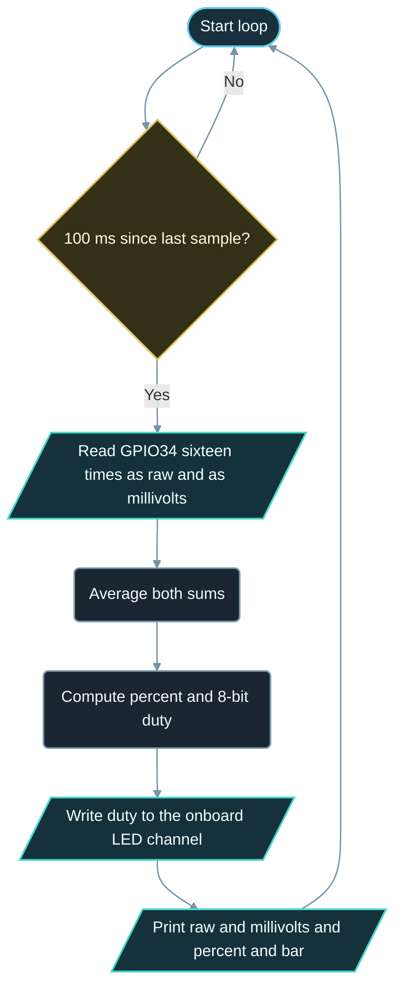

# Implementation Guide - Analog Input Potentiometer

**Developed by Amine Saoud ibn al-Bashir.**

## Algorithm

1. Set 11 dB attenuation on GPIO34 with `analogSetPinAttenuation` so the ADC covers 0 V to about 3.3 V.
2. Configure LEDC channel 0 at 5 kHz / 8 bits, attach GPIO2 to it, and write duty 0.
3. Every 100 ms, read GPIO34 sixteen times with `analogRead` and sixteen times with `analogReadMilliVolts`, summing each.
4. Divide both sums by 16 to get the averaged raw count and the averaged millivolts.
5. Compute percent = raw * 100 / 4095 and duty = raw >> 4 (12-bit count to 8-bit duty).
6. Write the duty to the LEDC channel so the onboard LED brightness follows the knob.
7. Print raw, millivolts, percent, a 20-character bar, and the duty on one line.

## Flowchart



## Pseudocode

```text
set 11 dB attenuation on the potentiometer pin
configure LEDC channel 0 at 5000 Hz, 8 bits; attach the onboard LED pin; duty 0
repeat forever:
  every 100 ms:
    rawSum = 0, mvSum = 0
    repeat 16 times:
      rawSum = rawSum + analogRead(pin)
      mvSum  = mvSum  + analogReadMilliVolts(pin)
    raw = rawSum / 16
    mv  = mvSum / 16
    percent = raw * 100 / 4095
    duty = raw / 16            (12-bit to 8-bit)
    write duty to the LED channel
    print raw, mv, percent, bar of 20 characters, duty
```

## Components List

| Component | Purpose |
|---|---|
| NanoKit Integrated ESP32 | Converts the wiper voltage to a number, drives the onboard LED, prints to Serial |
| 10 kOhm potentiometer | Voltage divider that produces 0 V to 3.3 V on its wiper |
| Jumper wires | Connect 3V3, GND, and the wiper to the NanoKit header |

## Testing

1. Upload and open the Serial Monitor at 115200 baud; the ready message appears, then one line every 100 ms.
2. Turn the knob fully towards the GND leg: raw is 0 or very close to it, the bar is empty, and the onboard LED is off.
3. Turn the knob fully towards the 3V3 leg: raw is 4095, the bar is full, and the onboard LED is at full brightness. The millivolt value will stop a little short of 3300 because the ADC saturates early.
4. Leave the knob at mid-travel and watch ten consecutive lines: the raw value should move by only a few counts. Change `SAMPLE_COUNT` to 1 and the jitter becomes clearly larger.
5. Put a multimeter between the wiper and GND and compare it with the millivolt column in the middle of the range; they should agree within a few tens of millivolts.

## Troubleshooting

- Reading is stuck at 0 or 4095 whatever the knob does: the wiper and an outer leg are swapped, or the wiper jumper is on the wrong NanoKit pin.
- Reading jumps between random values: the wiper wire is loose, or the potentiometer is not plugged into the breadboard rows you think it is.
- Reading reaches 4095 while the multimeter still shows only about 1.1 V on the wiper: the attenuation was changed to `ADC_0db` somewhere; set it back to `ADC_11db` for the full range.
- The millivolt column does not match raw * 3300 / 4095: expected, the millivolt reading is calibrated and the raw count is not.
- Nothing in Serial Monitor: confirm 115200 baud and the correct COM port.

## Learning Notes

The ESP32 has two ADC units. ADC1 serves GPIO32 to GPIO39, ADC2 serves pins such as GPIO4, GPIO13, GPIO25, and GPIO26. The Wi-Fi radio uses ADC2 internally, so once `WiFi.begin()` has run, `analogRead` on an ADC2 pin returns garbage or fails. This example does not use Wi-Fi, but it deliberately uses GPIO34 on ADC1 so that adding a web dashboard later does not break the measurement. The `nanokit.yaml` manifest carries the same note, and the Genius generator warns whenever `type: adc` lands on an ADC2 pin.

GPIO34, GPIO35, GPIO36, and GPIO39 are input-only: they have no output driver and no internal pull resistors. They are ideal for analog signals because nothing on the pin can disturb the voltage being measured, but they cannot drive an LED and cannot use `INPUT_PULLUP`.

The ESP32 ADC is not perfectly linear. With 11 dB attenuation, inputs below roughly 100 mV all read as 0, and the count reaches 4095 before the input reaches 3.3 V. Espressif's documented accurate span for this setting is about 150 mV to 2450 mV. `analogReadMilliVolts` corrects most of the mid-range error with per-chip values stored in eFuse at the factory, which is why it is the number to trust when you need a voltage rather than a position.

Attenuation is the ADC's range switch. At 0 dB the converter spans only about 0 V to 1.1 V, so each of the 4096 counts is a finer step; at 11 dB the span stretches to about 3.3 V at the cost of coarser steps and a little more error. The Arduino core defaults every pin to 11 dB, and `analogSetPinAttenuation` sets it per pin, so a precise small-signal sensor and a full-range potentiometer can share the same ADC with different settings.

ADC noise is random: each conversion differs from the previous one by a few counts even with a perfectly steady input. Averaging N samples shrinks that random part by about the square root of N, so 16 samples give roughly a four-times steadier reading at the cost of a few extra microseconds per update.

## Exercises

1. Convert the millivolt reading into a knob angle, assuming a 270 degree potentiometer, and print it.
2. Replace the simple average with an exponential moving average (`filtered = filtered + (raw - filtered) / 8`) and compare the responsiveness.
3. Add a second potentiometer on NanoKit Pin 6 / GPIO35 (ADC1_CH7) and print both readings on the same line.

## PDF Ready Notes

This Markdown file is structured with headings, tables, and diagrams so it can be exported to PDF by GitHub, VS Code extensions, or Pandoc.
