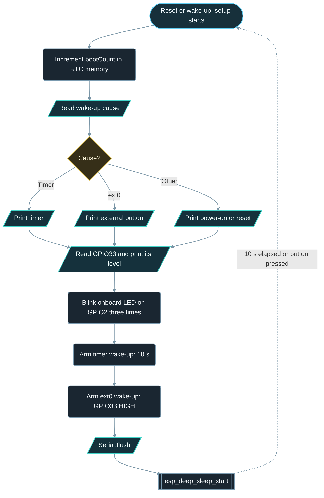

# Implementation Guide - Deep Sleep Wakeup

**Developed by Amine Saoud ibn al-Bashir.**

## Algorithm

1. On every start of `setup()`, increment `bootCount`, which is stored in RTC memory with `RTC_DATA_ATTR`.
2. Read the wake-up cause with `esp_sleep_get_wakeup_cause()` and print it as "timer", "external button (ext0)", or "power-on / reset".
3. Read GPIO33 once and print whether it rests LOW, which confirms that the pull-down resistor is wired.
4. Blink the onboard LED on GPIO2 three times.
5. Arm the timer wake-up for 10 s and the ext0 wake-up on GPIO33 for level HIGH.
6. Call `Serial.flush()` so no text is lost, then `esp_deep_sleep_start()`.
7. The chip powers down. Ten seconds later, or as soon as the button is pressed, it resets and starts again at step 1. `loop()` is never reached.

## Flowchart



## Pseudocode

```text
RTC memory: bootCount = 0 (kept across deep sleep)

setup:
  bootCount = bootCount + 1
  cause = wake-up cause from the chip
  print bootCount and cause (timer / button / power-on)
  print the resting level of GPIO33
  blink onboard LED 3 times
  arm timer wake-up in 10 s
  arm ext0 wake-up when GPIO33 is HIGH
  flush Serial
  enter deep sleep           (the chip restarts at "setup" when it wakes)

loop:
  (never reached)
```

## Components List

| Component | Purpose |
|---|---|
| NanoKit Integrated ESP32 | Sleeps, wakes, counts boots, drives the onboard LED, prints to Serial |
| Push button | External wake-up source on an RTC GPIO, active HIGH |
| 10 kOhm resistor | Pull-down that defines the wake pin level while the button is open |
| Jumper wires | Connect the button and the resistor to the NanoKit header |

## Testing

1. Upload and open the Serial Monitor at 115200 baud: boot number 1 and the cause "power-on / reset" appear, the LED blinks three times, and the chip announces deep sleep.
2. Do nothing for 10 s: the boot ROM prints `rst:0x5 (DEEPSLEEP_RESET)`, then boot number 2 appears with the cause "timer".
3. Press the button while the chip sleeps: it wakes at once with the cause "external button on GPIO33 (ext0)" and the next boot number.
4. Power-cycle the board (unplug and replug USB) or pull the EN / reset line on NanoKit Pin 35 low for a moment: the boot number returns to 1, which proves that RTC memory survives sleep but not a reset.
5. Hold the wake button down and wait for the chip to sleep: it wakes again immediately, because ext0 looks at the level, not at an edge.

## Troubleshooting

- The chip wakes every time, even without a press: GPIO33 is floating or HIGH. Check that the 10 kOhm resistor goes from NanoKit Pin 20 / GPIO33 to GND and that the boot line reports "reads LOW".
- The button never wakes the chip: the button leg must go to 3.3 V (NanoKit Pin 13 or 14) and the other leg to NanoKit Pin 20 / GPIO33. Confirm with the boot line while holding the button: it must read HIGH.
- The last lines before sleep are missing: `Serial.flush()` was removed or moved after `esp_deep_sleep_start()`.
- Upload fails or times out: the upload tool resets the chip through the USB-serial bridge, which also works while the chip sleeps. If it still fails, unplug and replug USB and start the upload during the first 10 s, while the chip is awake.
- `Boot number` always shows 1: `RTC_DATA_ATTR` was removed from the declaration, so the variable lives in normal RAM and is lost at every wake-up.

## Learning Notes

Deep sleep is not a pause. The ESP32 switches off the two CPU cores, the main RAM, and the normal peripherals; only the small RTC domain stays powered, with its slow memory, its timer, and the RTC GPIOs. Waking up is a reset: the boot ROM runs, the firmware starts from the beginning, and `setup()` is executed again. Any value that must survive has to be declared with `RTC_DATA_ATTR` so the linker places it in RTC slow memory.

Because only the RTC domain is awake, only pins that belong to it can wake the chip: GPIO0, 2, 4, 12 to 15, 25 to 27, and 32 to 39. On NanoKit that includes Pin 20 / GPIO33 used here. Pins such as GPIO26 on NanoKit Pin 37 are also RTC pins, while GPIO16 to GPIO23 are not: `esp_sleep_enable_ext0_wakeup()` rejects them with an error code, and because this example does not check the return value, the chip would simply never wake on the button.

The ESP32 chip itself draws on the order of 10 uA in deep sleep with the RTC timer and RTC memory running. The number you can measure at the USB connector is much larger, because the board's USB-serial bridge and voltage regulator keep drawing current whatever the chip does; the measured board current therefore depends on the board. For a real battery product the measurement must be made on the specific board, after the USB cable is removed.

`Serial.print()` returns as soon as the characters are placed in the UART transmit buffer; the hardware sends them later, at 115200 baud, about 87 us per character. `esp_deep_sleep_start()` cuts the power to the UART immediately, so a line queued just before it would be cut off. `Serial.flush()` blocks until the last byte has actually been shifted out.

## Exercises

1. Change `SLEEP_SECONDS` to 30 and verify the new timer period with a stopwatch.
2. Replace the external resistor with the chip's RTC pull-down: include `driver/rtc_io.h` and call `rtc_gpio_pulldown_en(GPIO_NUM_33)` before sleeping. Explain why the normal `INPUT_PULLDOWN` mode is not enough in deep sleep.
3. Store the last wake-up cause in a second `RTC_DATA_ATTR` variable and print "previous wake-up was ..." at each boot.
4. Make the LED blink once for a timer wake-up and three times for a button wake-up.

## PDF Ready Notes

This Markdown file is structured with headings, tables, and diagrams so it can be exported to PDF by GitHub, VS Code extensions, or Pandoc.
