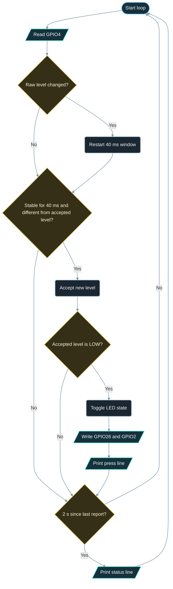

# Implementation Guide - Digital Input Output

**Developed by Amine Saoud ibn al-Bashir.**

## Algorithm

1. Configure GPIO4 as `INPUT_PULLUP`, GPIO26 and GPIO2 as `OUTPUT`, and switch both LEDs off.
2. Every loop, read the raw level of GPIO4.
3. If the raw level differs from the previous raw level, record the time: the debounce window restarts.
4. If the raw level has been unchanged for at least 40 ms and differs from the accepted level, accept it.
5. If the newly accepted level is `LOW` (press edge), toggle the LED state, write both LEDs, and print a line.
6. Every 2 s, print a status line so the user can see the loop is alive.

## Flowchart



## Pseudocode

```text
configure button as input with pull-up
configure external LED and onboard LED as outputs, both off
repeat forever:
  raw = read button
  if raw changed since last read:
    remember time of change
  if raw unchanged for 40 ms and raw differs from accepted level:
    accepted = raw
    if accepted is LOW (pressed):
      ledOn = not ledOn
      write both LEDs
      print "Press detected"
  every 2 s:
    print status
```

## Components List

| Component | Purpose |
|---|---|
| NanoKit Integrated ESP32 | Reads the button, drives the LEDs, prints to Serial |
| Push button | Digital input, active LOW thanks to the internal pull-up |
| LED + 220 ohm resistor | Digital output with a safe current limit |
| Jumper wires | Connect button and LED to the NanoKit header |

## Testing

1. Upload and open the Serial Monitor at 115200 baud; the ready message and a status line appear.
2. Press and release the button once: exactly one `Press detected` line, LED ON.
3. Press again: one line, LED OFF. The press counter increases by exactly one per press.
4. Hold the button for several seconds: the LED does not toggle again until the button is released and pressed anew.
5. Remove the LED wiring: the onboard LED on NanoKit Pin 17 still toggles, which proves the firmware is independent of the external LED.

## Troubleshooting

- LED never lights: check LED polarity (long leg to the resistor side) and that the resistor goes to NanoKit Pin 37 / GPIO26.
- Several presses counted per press: increase `DEBOUNCE_MS` to 60 or 80 for a very noisy switch.
- Button reads pressed all the time: a leg is shorted to GND, or the two legs used are the pair that is always connected (rotate the button 90 degrees on the breadboard).
- Nothing in Serial Monitor: confirm 115200 baud and the correct COM port.

## Learning Notes

A pull-up resistor defines the pin level when nothing drives it. Without it, an open button leaves the pin "floating" and `digitalRead` returns random values. The ESP32 offers that resistor inside the chip, which is why `INPUT_PULLUP` exists and why "pressed" reads `LOW`.

Contact bounce is mechanical: the metal contacts touch and separate several times within a few milliseconds. A program that counts every edge sees 3 to 10 presses. Waiting for a stable level, as done here, removes them without a single `delay()`.

## Exercises

1. Make the LED blink while the button is held, and stay off when released.
2. Count presses and print "10 presses reached" once, then reset the counter.
3. Add a second button on NanoKit Pin 19 / GPIO27 that turns the LED off directly.

## PDF Ready Notes

This Markdown file is structured with headings, tables, and diagrams so it can be exported to PDF by GitHub, VS Code extensions, or Pandoc.
