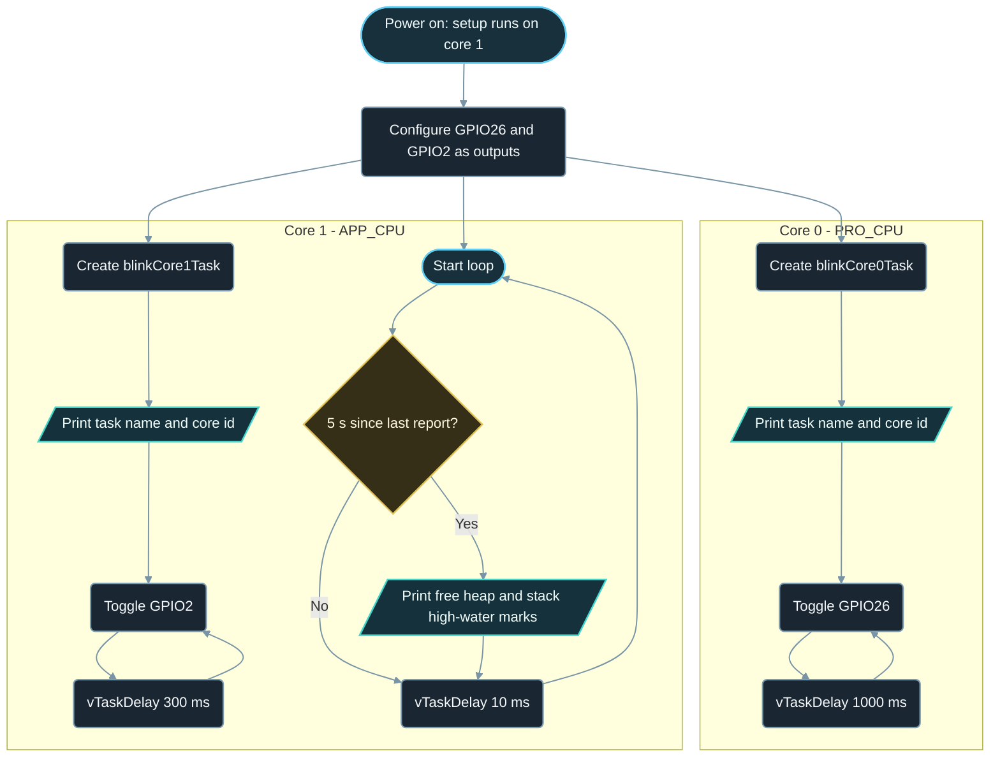

# Implementation Guide - Dual Core Tasks

**Developed by Amine Saoud ibn al-Bashir.**

## Algorithm

1. In `setup()` (running on core 1), configure GPIO26 and GPIO2 as outputs and print the id of the current core.
2. Create `blinkCore0Task` with `xTaskCreatePinnedToCore`, 2048-byte stack, priority 1, pinned to core 0, and keep its handle.
3. Create `blinkCore1Task` the same way, pinned to core 1, and keep its handle.
4. Each task prints its name and `xPortGetCoreID()` once, then forever: toggle its LED and sleep with `vTaskDelay(pdMS_TO_TICKS(period))` (1000 ms on core 0, 300 ms on core 1).
5. `loop()` checks `millis()`; every 5 s it prints `ESP.getFreeHeap()` and the stack high-water mark of both task handles, then yields for 10 ms so the other tasks on core 1 can run.

## Flowchart



## Pseudocode

```text
setup (core 1):
  configure LED pins as outputs
  print "setup runs on core" + current core id
  create task blinkCore0Task on core 0, stack 2048 bytes, priority 1
  create task blinkCore1Task on core 1, stack 2048 bytes, priority 1

blinkCore0Task:
  print name and current core id
  repeat forever:
    toggle external LED
    sleep 1000 ms (vTaskDelay)

blinkCore1Task:
  print name and current core id
  repeat forever:
    toggle onboard LED
    sleep 300 ms (vTaskDelay)

loop (core 1):
  every 5 s:
    print free heap
    print stack high-water mark of both tasks
  sleep 10 ms (vTaskDelay)
```

## Components List

| Component | Purpose |
|---|---|
| NanoKit Integrated ESP32 | Dual-core ESP32 running FreeRTOS; one task pinned to each core |
| LED + 220 ohm resistor | Visible heartbeat of the core 0 task |
| Onboard LED | Visible heartbeat of the core 1 task |
| Jumper wires | Connect the external LED to the NanoKit header |

## Testing

1. Upload and open the Serial Monitor at 115200 baud: the ready message says `setup() and loop() run on core 1`.
2. The two task lines follow: `blinkCore0Task started on core 0` and `blinkCore1Task started on core 1`. The core ids are read from the hardware at run time, so they prove the pinning.
3. The external LED blinks slowly (1 s on, 1 s off) and the onboard LED blinks fast (300 ms). Watch them for a minute: the rhythms are independent and never pause each other.
4. Every 5 s a `Report` line appears. The free heap and both stack figures must stay the same from one report to the next; a value that keeps shrinking would mean a leak.
5. Change `TASK_STACK_BYTES` to 1024, upload again, and compare the high-water marks: they drop by about 1024 while the tasks still work, showing how much margin the default leaves.

## Troubleshooting

- A task reports the wrong core: check the last argument of `xTaskCreatePinnedToCore`; `tskNO_AFFINITY` lets the scheduler choose either core.
- The board resets every few seconds with a `Task watchdog got triggered` message: a task on core 0 never blocks. Make sure every task loop contains `vTaskDelay` or another blocking call.
- The board resets with a `Stack canary watchpoint triggered` or `Guru Meditation` message: a task stack is too small. Increase `TASK_STACK_BYTES` (4096 is a safe default for tasks that print a lot).
- The two start lines are mixed together, for example `blinkCore0Task sblinkCore1Task started on core 1`: this is the shared `Serial` port written from two cores at once. It is cosmetic here; the Exercises show how to guard prints with a mutex.
- External LED never lights: check the LED polarity (long leg to the resistor side) and that the resistor goes to NanoKit Pin 37 / GPIO26.
- Nothing in the Serial Monitor: confirm 115200 baud and the correct COM port.

## Learning Notes

The ESP32 has two identical cores, named PRO_CPU (core 0) and APP_CPU (core 1). The Arduino core starts the Wi-Fi, Bluetooth, and most system services on core 0 and runs `setup()` and `loop()` on core 1. That is why time-critical user work usually goes to core 1: it is not interrupted by the radio stack. A task pinned to core 0 still runs fine, as the slow LED shows, but its timing can jitter by a few milliseconds whenever Wi-Fi is busy.

A FreeRTOS task is a function that never returns, with its own stack. `xTaskCreatePinnedToCore` allocates that stack from the heap (in bytes on ESP32, unlike vanilla FreeRTOS where the size is in words) and hands the function to the scheduler. The handle it returns is how the rest of the program refers to the task later.

`uxTaskGetStackHighWaterMark` reports the minimum number of stack bytes that have ever been free since the task started. A value of 1500 out of 2048 means the task never needed more than about 550 bytes; a value near 0 means the next deeper function call will corrupt memory. Check it once with the real workload, then size the stack with a comfortable margin.

Inside a task, `vTaskDelay(pdMS_TO_TICKS(ms))` tells the scheduler "wake me in ms milliseconds" and gives the core to other tasks in the meantime, including the idle task that feeds the task watchdog. `delay()` on the Arduino ESP32 core does call `vTaskDelay` internally, but writing the FreeRTOS call makes the intent explicit, and `pdMS_TO_TICKS` keeps the code correct if the tick rate ever changes.

`Serial` is one UART shared by the whole chip. Two tasks on two cores can call `Serial.print` at the same moment, and their characters then interleave. Keeping each print short makes this rare; a mutex (`xSemaphoreCreateMutex`, `xSemaphoreTake`, `xSemaphoreGive`) around each complete line removes it entirely.

## Exercises

1. Create a mutex in `setup()` and take it before, and give it after, each `Serial` line in both tasks and in `printMemoryReport()`. The start lines can no longer interleave.
2. Give the core 1 task a 2 ms `vTaskDelay` instead of 300 ms and watch the high-water marks and the free heap: a task that runs often does not use more memory.
3. Pin both tasks to core 1 and compare the blink rhythms with the original: on one core the scheduler switches between them so quickly that the LEDs look identical.
4. Replace the fixed core ids with `tskNO_AFFINITY` and print `xPortGetCoreID()` inside the loop of each task every few seconds: the scheduler may move an unpinned task between cores.

## PDF Ready Notes

This Markdown file is structured with headings, tables, and diagrams so it can be exported to PDF by GitHub, VS Code extensions, or Pandoc.
