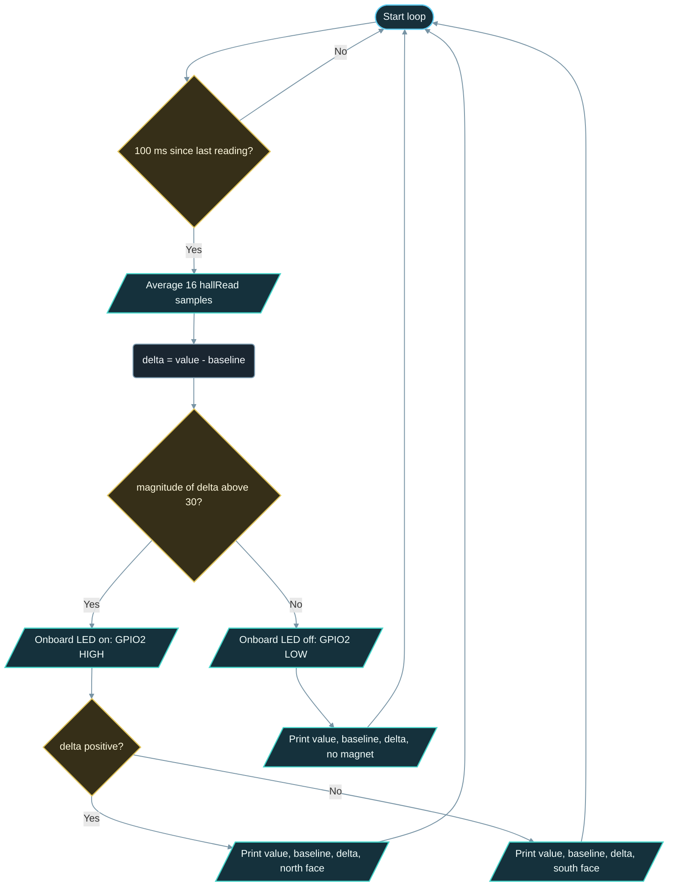

# Implementation Guide - Hall Sensor

**Developed by Amine Saoud ibn al-Bashir.**

## Algorithm

1. Configure GPIO2 as `OUTPUT` and switch the onboard LED off.
2. Average 64 `hallRead()` samples with no magnet nearby: this is the baseline.
3. Every 100 ms, average 16 `hallRead()` samples to get the current value.
4. Compute `delta = value - baseline` and its magnitude.
5. If the magnitude is above 30, switch the LED on, otherwise off.
6. Print value, baseline, delta, and a polarity word: "north face" for a positive delta above the threshold, "south face" for a negative one, "no magnet" otherwise.

## Flowchart



## Pseudocode

```text
configure onboard LED as output, off
baseline = average of 64 hall readings (no magnet nearby)
repeat forever:
  every 100 ms:
    value = average of 16 hall readings
    delta = value - baseline
    detected = |delta| > 30
    write LED = detected
    if delta > 30:        word = "north face"
    else if delta < -30:  word = "south face"
    else:                 word = "no magnet"
    print value, baseline, delta, word
```

## Components List

| Component | Purpose |
|---|---|
| NanoKit Integrated ESP32 | Hosts the Hall sensor, averages the readings, drives the onboard LED, prints to Serial |
| Built-in Hall-effect sensor | Converts the magnetic field through the chip into a signed reading |
| Onboard LED | Detection indicator on NanoKit Pin 17 / GPIO2 |
| Permanent magnet | The field source held by the user |

## Testing

1. Upload and open the Serial Monitor at 115200 baud with no magnet nearby. The baseline appears and the delta stays within a few counts of zero.
2. Bring a magnet towards the module shield: the delta grows past 30, the LED lights, and a polarity word is printed.
3. Flip the magnet: the delta changes sign and the other polarity word appears, while the LED stays on.
4. Move the magnet away: the delta returns near zero and the LED goes off.
5. Touch NanoKit Pin 5 / GPIO36 with a finger: the value jumps even without a magnet, which shows why the two ADC pins must stay free.

## Troubleshooting

- The delta never exceeds 30: the magnet is weak or too far. Use a neodymium magnet and hold it right against the shield, or lower `DETECT_THRESHOLD` to 15.
- The LED flickers with no magnet: the noise is larger than the threshold. Raise `SAMPLES_PER_READING` to 32 or `DETECT_THRESHOLD` to 50, and keep Wi-Fi off.
- The baseline is far from zero or drifts between runs: this is normal chip-to-chip offset, which is exactly why the baseline is measured at every start-up.
- The sketch does not compile and complains that `hallRead` is undeclared: the project is building with Arduino-ESP32 core 3.x, where the function was removed. Use the `espressif32` PlatformIO platform, which ships core 2.x.
- Wild readings while something is plugged into NanoKit Pin 4 or Pin 5: remove it; those pins carry the sensor signal.

## Learning Notes

A Hall-effect sensor is a thin strip of semiconductor with a current flowing along it. A magnetic field through the strip pushes the moving charges sideways, which creates a small voltage across the strip. The voltage grows with the field strength and flips sign when the field direction flips, so one pole raises the reading and the other lowers it. Which pole gives which sign depends on how the sensor is oriented inside the module and how the module sits on the board, which is why the polarity words in this example must be checked once with a known magnet.

The built-in sensor is tiny and its voltage is small, so `hallRead()` returns a value that moves by tens of counts from one sample to the next. Averaging 16 samples divides that noise by about four and makes a magnet detection reliable; the 64-sample baseline is even steadier. The reading also contains a fixed offset that differs from chip to chip, which is why the example works with the change from the baseline, not with the absolute value.

`hallRead()` is provided by Arduino-ESP32 core 2.x, the core that PlatformIO's `espressif32` platform installs for `board = esp32dev`. The function was removed in core 3.x together with the underlying ESP-IDF 5 driver, so this example is tied to core 2.x; projects on a 3.x core must read the sensor through the ESP-IDF ADC API directly.

The sensor is read through the chip's ADC, which is shared with every other analogue function and is sensitive to the radio. ESP-IDF reserves ADC2 for the Wi-Fi driver, and the bursts of current drawn while Wi-Fi transmits add noise to analogue readings in general. This example keeps Wi-Fi off; if you add it later, expect a noisier delta and raise the sample count.

## Exercises

1. Print "magnet approaching" and "magnet leaving" by comparing each delta with the previous one.
2. Replace the fixed threshold with one computed at start-up as three times the measured noise (the largest difference between the 64 baseline samples and their average).
3. Count how many times a magnet passes the module, like a bicycle speed sensor, by detecting the rising edge of `detected`.
4. Attach a small magnet to a door and use the example as a door-open detector that prints the time the door stayed open.

## PDF Ready Notes

This Markdown file is structured with headings, tables, and diagrams so it can be exported to PDF by GitHub, VS Code extensions, or Pandoc.
