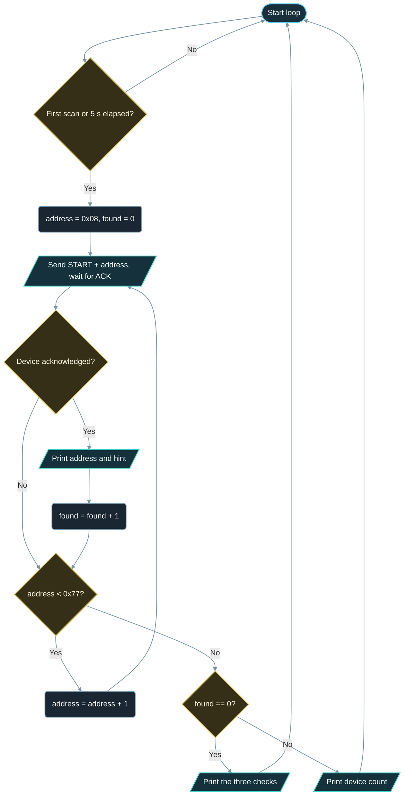

# Implementation Guide - I2C Scanner

**Developed by Amine Saoud ibn al-Bashir.**

## Algorithm

1. Start the I2C0 peripheral on GPIO21 (SDA) and GPIO22 (SCL) with `Wire.begin`, and set the clock to 100 kHz.
2. On the first loop, and then every 5 s, start a new scan and print its number.
3. For every address from 0x08 to 0x77, send a START condition and the address byte with `Wire.beginTransmission` / `Wire.endTransmission`.
4. If `endTransmission` returns 0, a device acknowledged: print the address in hexadecimal with a hint from the built-in address table and increase the device counter.
5. If it returns the timeout code, increase a timeout counter; a NACK (code 2) is simply skipped.
6. After the last address, print the device count, or, if none answered, the three-point checklist (power, swapped SDA/SCL, pull-ups) plus a note when timeouts occurred.

## Flowchart



## Pseudocode

```text
start I2C on SDA = GPIO21, SCL = GPIO22 at 100 kHz
repeat forever:
  if first scan or 5 s since the last scan:
    found = 0, timeouts = 0
    for address from 0x08 to 0x77:
      send START + address
      if a device answered ACK:
        print address in hex and the hint for it
        found = found + 1
      else if the transfer timed out:
        timeouts = timeouts + 1
    if found == 0:
      print the power / wiring / pull-up checklist
      if timeouts > 0: print "a line is held low"
    else:
      print found
```

## Components List

| Component | Purpose |
|---|---|
| NanoKit Integrated ESP32 | I2C master: generates the clock, sends addresses, reads the ACK bit |
| Any 3.3 V I2C module | I2C slave under test; answers when its address is sent |
| 4.7 kOhm resistors (optional) | Pull SDA and SCL up to 3.3 V when the module has no pull-ups |
| Jumper wires | VCC, GND, SDA, SCL between the module and the NanoKit header |

## Testing

1. Upload with nothing connected and open the Serial Monitor at 115200 baud: the ready message appears, then `Scan 1:` and the three-point checklist. The scan finishes in well under a second.
2. Unplug USB, wire one module as described in `Wiring.md`, plug USB back in: the module's address appears, for example `0x3C` for an OLED, followed by `1 device found.`
3. Add a second module with a different address while the firmware runs: the next scan lists both and reports `2 devices found.`
4. Swap the SDA and SCL wires: the module disappears and the checklist is printed again. Swap them back: the module returns on the next scan.
5. If the module has an address jumper (ADDR, SDO, or A0), move it: the address changes by one (0x76 to 0x77, 0x68 to 0x69, 0x3C to 0x3D).

## Troubleshooting

- Nothing found although the module is wired: check that VCC is on 3V3 (NanoKit Pin 13 or 14) and GND on NanoKit Pin 12 or 31, then that SDA is on NanoKit Pin 23 / GPIO21 and SCL on NanoKit Pin 18 / GPIO22. Swapped SDA/SCL is the most common mistake.
- The scan takes many seconds and reports timeouts: a line is held low. Look for a short between SDA or SCL and GND, a module that is not powered (an unpowered chip can clamp the lines), or a 5 V module whose level shifter is not powered.
- Addresses appear and disappear between scans: a loose jumper wire, or a wire that is too long. Shorten the wires and press the module firmly into the breadboard.
- Every address from 0x08 to 0x77 answers: SDA is shorted to GND or SDA and SCL are shorted together, so every address "acknowledges". Check the wiring.
- A device answers at an address the hint table does not know: that is normal; the table is a cheat sheet, not a database. The module datasheet is the authority.
- Nothing in the Serial Monitor: confirm 115200 baud and the correct COM port.

## Learning Notes

An I2C transaction starts with the master sending one byte: 7 bits of address followed by one read/write bit. That is why addresses run from 0x00 to 0x7F (128 values) and why datasheets sometimes quote the "8-bit address" (the 7-bit address shifted left, for example 0x78 for an OLED that the scanner reports as 0x3C). Arduino and this scanner always use the 7-bit form. Chips with an address pin (BME280 SDO, MPU-6050 AD0, DS3231 none) let you choose between two values so that two identical chips can share a bus.

The specification reserves 0x00-0x07 (general call, START byte, CBUS, the 10-bit addressing prefix) and 0x78-0x7F (10-bit addressing and future use). A device never occupies them, so the scanner skips them and only probes the 112 addresses from 0x08 to 0x77.

SDA and SCL are open-drain lines: a chip can pull a line to GND through a transistor but has no transistor to push it to 3.3 V. The pull-up resistor does that job passively. This is what lets many chips share two wires without ever fighting each other, and it is also why a bus with no pull-ups at all does not work: the lines simply stay low (or float) and no clock can be produced. It is also why the ACK works: after the address byte the master releases SDA, and a device that recognised its address pulls SDA low for one clock pulse.

The scanner uses the 100 kHz standard mode because it is the one speed every I2C device supports, from 1980s EEPROMs to modern sensors. Fast mode (400 kHz) is fine once you know what is on the bus and that the pull-ups are strong enough for it; for discovery, slow and tolerant wins. Scanning 112 addresses still takes less than a second.

`Wire.endTransmission()` returns 0 for an ACK and 2 for a NACK; on the ESP32 core it returns 5 when the transfer times out because a line never came back high. The scanner uses that difference to tell "nobody is there" from "the bus is stuck".

## Exercises

1. Change `SCAN_INTERVAL_MS` to 1000 and watch a module appear within a second of plugging it in.
2. Add a row to `HINTS` for a module you own that the table does not recognise.
3. Add `Wire.setClock(400000)` after the first scan and compare: does your module still answer at 400 kHz? If not, the wires or pull-ups are the limit.
4. Print how long each scan takes using `millis()` before and after `scanBus()`, and compare the empty bus with a stuck bus.

## PDF Ready Notes

This Markdown file is structured with headings, tables, and diagrams so it can be exported to PDF by GitHub, VS Code extensions, or Pandoc.
