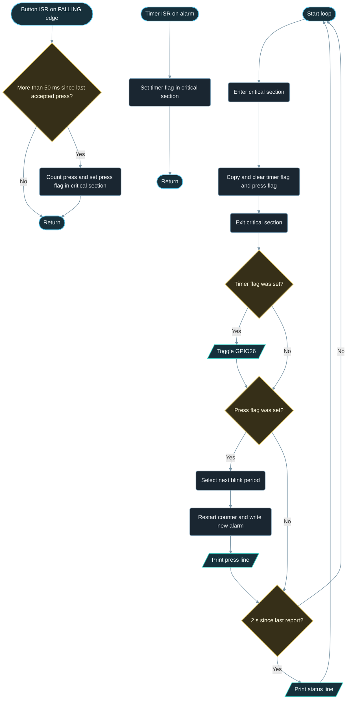

# Implementation Guide - Interrupts and Timers

**Developed by Amine Saoud ibn al-Bashir.**

## Algorithm

1. Configure GPIO4 as `INPUT_PULLUP` and GPIO26 as `OUTPUT` (LED off).
2. Attach `onButtonIsr` to the `FALLING` edge of GPIO4.
3. Claim hardware timer 0 with prescaler 80 (1 us ticks), attach `onTimerIsr`, write a 1 000 000 us auto-reload alarm, and enable it.
4. Button ISR: read `micros()`; if less than 50 ms since the last accepted press, return; otherwise record the time, increment the press counter, and set the press flag, all inside a critical section.
5. Timer ISR: set the timer flag inside a critical section.
6. Every loop, copy both flags and the press counter inside a critical section and clear the flags.
7. If the timer flag was set, toggle the LED and count the toggle.
8. If the press flag was set, advance to the next period in the list (1000, 500, 250, 125 ms), restart the counter with `timerWrite`, write the new alarm with `timerAlarmWrite`, and print a line.
9. Every 2 s, print a status line.

## Flowchart



## Pseudocode

```text
configure button as input with pull-up, LED as output and off
attach button ISR to the FALLING edge of the button pin
timer = begin hardware timer 0 with prescaler 80 (1 us ticks), counting up
attach timer ISR to timer; alarm every 1 000 000 us with auto-reload; enable alarm

button ISR:
  now = micros()
  if now - lastAccepted < 50 000: return        (bounce)
  lastAccepted = now
  lock; pressCount += 1; pressPending = true; unlock

timer ISR:
  lock; timerFired = true; unlock

repeat forever:
  lock; copy timerFired, pressPending, pressCount; clear both flags; unlock
  if timer flag was set:
    toggle LED, toggles += 1
  if press flag was set:
    periodIndex = (periodIndex + 1) mod 4
    restart timer counter; write alarm = period[periodIndex] * 1000 us
    print "Press detected"
  every 2 s:
    print status
```

## Components List

| Component | Purpose |
|---|---|
| NanoKit Integrated ESP32 | Runs the GPIO interrupt, hardware timer 0, and the main loop |
| Push button | Edge source for the GPIO interrupt, active LOW thanks to the internal pull-up |
| LED + 220 ohm resistor | Shows the timer period; toggled from `loop()` |
| Jumper wires | Connect button and LED to the NanoKit header |

## Testing

1. Upload and open the Serial Monitor at 115200 baud; the ready message appears and the LED blinks once per second without any input.
2. Watch two status lines: the toggle counter grows by about 2 between them at the 1000 ms period.
3. Press the button once: exactly one `Press detected` line, the period becomes 500 ms, and the LED visibly blinks twice as fast.
4. Press three more times: 250 ms, 125 ms, then back to 1000 ms. The press counter increases by exactly one per press, which proves the ISR debounce works.
5. Hold the button down for several seconds: nothing else happens, because the interrupt fires on the edge, not the level.
6. Optional: set `DEBOUNCE_US` to 0 and press a few times. The press counter now jumps by several per press, which shows the bounce the ISR normally hides.

## Troubleshooting

- LED never blinks: check LED polarity (long leg to the resistor side) and that the resistor goes to NanoKit Pin 37 / GPIO26. If the Serial status line shows the toggle counter growing, the timer is fine and the problem is wiring.
- Several presses counted per press: increase `DEBOUNCE_US` to 80000 for a very noisy switch.
- Presses are never counted: confirm the button goes to GND, not 3V3, and that the ISR is attached to `FALLING`.
- The board resets with a `Guru Meditation` or `Cache disabled` message: an ISR is calling something that is not safe, such as `Serial.print` or `delay`, or the `IRAM_ATTR` attribute was removed.
- Nothing in Serial Monitor: confirm 115200 baud and the correct COM port.

## Learning Notes

An interrupt service routine runs the instant the hardware event happens, in the middle of whatever `loop()` was doing. That is its strength and its danger. Inside an ISR you may read a pin, read `micros()`, update a few variables, and return. You may not call `Serial`, `delay()`, `millis()`-based waiting, memory allocation, or anything that could block, because the rest of the system is frozen while the ISR runs and other interrupts (including the Wi-Fi and the watchdog) are waiting. `IRAM_ATTR` places the function in internal RAM so it can run even when the flash cache is temporarily disabled; without it the ESP32 can crash with a "Cache disabled but cached memory region accessed" error.

The flag pattern follows from those rules: the ISR records that something happened, and `loop()` decides what to do about it at its own pace. The ISR stays a few microseconds long, and all the slow or risky work (printing, reconfiguring the timer, driving outputs) happens in normal code.

Variables shared between an ISR and `loop()` need two protections. `volatile` tells the compiler to reload the variable from memory every time, instead of keeping a copy in a register that the ISR cannot see. The `portMUX_TYPE` spinlock, used through `portENTER_CRITICAL_ISR` / `portEXIT_CRITICAL_ISR` in the ISR and `portENTER_CRITICAL` / `portEXIT_CRITICAL` in `loop()`, disables interrupts for the few instructions inside so that `loop()` can never read a counter and a flag that belong to two different events. Critical sections must be as short as the ISRs themselves.

The ESP32 has four general-purpose 64-bit hardware timers, grouped as two timers in each of two timer groups; the Arduino core numbers them 0 to 3. Each one counts a clock that is the 80 MHz APB clock divided by a 16-bit prescaler. `timerBegin(0, 80, true)` picks timer 0, divides 80 MHz by 80, and counts up, so the counter advances exactly once per microsecond. An alarm value is then simply a time in microseconds, and auto-reload makes the counter restart from 0 after every alarm so the period stays exact regardless of how busy `loop()` is. Because the timer runs in hardware, the LED period stays correct even if `loop()` were stuck in a long calculation.

## Exercises

1. Make the LED stay off while the button is held, using a `RISING` interrupt on a second pin or `CHANGE` with a level check.
2. Use timer 1 to measure how long each press lasts, and print it in milliseconds from `loop()`.
3. Replace the `digitalWrite` toggle with an LEDC duty change so the timer steps through four brightness levels instead of blinking.

## PDF Ready Notes

This Markdown file is structured with headings, tables, and diagrams so it can be exported to PDF by GitHub, VS Code extensions, or Pandoc.
