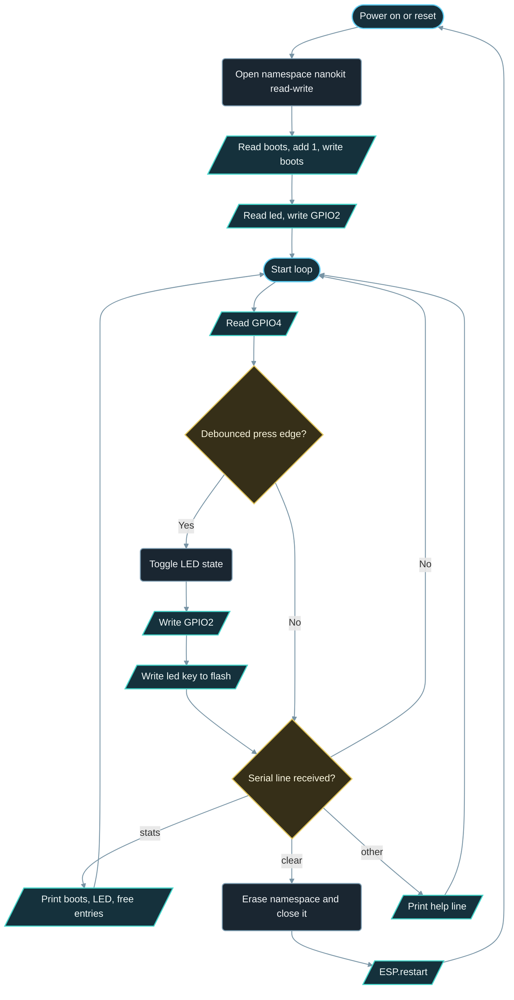

# Implementation Guide - Preferences Flash Storage

**Developed by Amine Saoud ibn al-Bashir.**

## Algorithm

1. Configure GPIO4 as `INPUT_PULLUP` and GPIO2 as `OUTPUT`.
2. Open the `nanokit` namespace in read-write mode with `prefs.begin("nanokit", false)`.
3. Read `boots` (default 0), add 1, write it back, and keep it in RAM for the `stats` command.
4. Read `led` (default `false`), store it in `ledOn`, and drive GPIO2 with it.
5. Every loop, debounce GPIO4 with a 40 ms window. On a press edge, toggle `ledOn`, write GPIO2, and write `led` to flash once.
6. Every loop, collect Serial characters until a newline. `stats` prints boots, LED state, and free entries; `clear` erases the namespace, closes it, and restarts the chip; anything else prints a help line.

## Flowchart



## Pseudocode

```text
configure button as input with pull-up, onboard LED as output
open namespace "nanokit" for reading and writing
boots = read "boots" (default 0) + 1
write "boots" = boots
ledOn = read "led" (default false)
write LED
print stats
repeat forever:
  raw = read button
  if raw changed since last read:
    remember time of change
  if raw unchanged for 40 ms and raw differs from accepted level:
    accepted = raw
    if accepted is LOW (pressed):
      ledOn = not ledOn
      write LED
      write "led" = ledOn        (the only write caused by the user)
  for each character available on Serial:
    if newline: run the collected command, then empty the buffer
      "stats": print boots, ledOn, free entries
      "clear": erase namespace, close it, restart
      other:   print help
    else: append the character (ignore extras beyond 15)
```

## Components List

| Component | Purpose |
|---|---|
| NanoKit Integrated ESP32 | Runs the firmware; its flash chip holds the NVS partition |
| Push button | Digital input, active LOW thanks to the internal pull-up; each press causes one flash write |
| Onboard LED | Shows the state restored from flash |
| Jumper wires | Connect the button to the NanoKit header |

## Testing

1. Upload and open the Serial Monitor at 115200 baud: the ready message and `Stats | boots: 1 | LED: OFF | ...` appear.
2. Press the button once: `Saved | LED: ON` and the onboard LED lights.
3. Press the EN (reset) button on the board: the firmware restarts, prints `boots: 2 | LED: ON`, and the LED is already lit before you touch anything.
4. Unplug USB, wait a few seconds, plug it back in: `boots: 3`, LED state preserved. This proves the data is in flash, not in RAM.
5. Type `stats` and press Enter: the same figures are printed on demand.
6. Type `clear` and press Enter: the board reboots with `boots: 1` and the LED off.
7. Type `hello` and press Enter: `Unknown command. Type 'stats' or 'clear'.` appears, which shows the command parser is working.

## Troubleshooting

- Typing a command does nothing: the Serial Monitor must send a newline when you press Enter. `pio device monitor` does this by default; in other terminals select "Newline" or "Both NL & CR" as the line ending.
- Commands are not visible as you type: that is the normal behaviour of `pio device monitor`; add `--echo` to the command, or just type blind and press Enter.
- `boots` stays at 1 after every reset: the write in `setup()` failed, which usually means the NVS partition is full or corrupt. Type `clear`, or erase the whole flash with `pio run --target erase` and upload again.
- The LED state is not restored: make sure `saveLedState()` is called after each press (watch for the `Saved` line) and that the key name is spelled identically in `getBool` and `putBool`.
- Several `Saved` lines per press: increase `DEBOUNCE_MS` to 60 or 80 for a very noisy switch. Each extra line is also an extra flash write.
- Nothing in the Serial Monitor: confirm 115200 baud and the correct COM port.

## Learning Notes

NVS (Non-Volatile Storage) is a small key/value database that ESP-IDF keeps in a dedicated partition of the flash chip. `Preferences` is the Arduino wrapper around it. Data is organised in namespaces, and each namespace holds keys; both names are limited to 15 characters, and a longer name is silently truncated or rejected, so keep them short and consistent. Namespaces let different parts of a firmware, or different examples flashed on the same board, keep their settings apart: this example's `nanokit` namespace does not disturb a Wi-Fi library's own namespace.

Every key has a type fixed by the first `put...()` call: `putBool`, `putUChar`, `putInt`, `putUInt`, `putFloat`, `putString`, `putBytes`, and so on. Reading with the matching `get...()` returns the stored value, and the default you pass is returned when the key does not exist yet. That default is what makes the first boot work without any special-case code.

`prefs.begin(name, readOnly)` opens a namespace. With `readOnly = true` the firmware can only read, which is a good safety net for code that must never modify settings; with `false` it can also write and erase. Opening a namespace that does not exist in read-only mode fails, so the first boot of a fresh chip must use read-write mode.

The older `EEPROM` library on the ESP32 is an emulation: there is no EEPROM chip, so it keeps a RAM copy of a flash sector and rewrites the whole sector on `commit()`. `Preferences` is better on every count: values have names and types instead of byte offsets, the ESP-IDF NVS layer spreads writes across the partition (wear levelling) and checks each entry with a checksum, and a reset in the middle of a write cannot corrupt the previously stored value.

Flash memory tolerates a limited number of erase cycles per sector, typically specified in the tens of thousands. NVS appends new entries and erases a sector only when it is full, so a value written on each button press lasts for the lifetime of the board. A value written on every loop pass, thousands of times per second, is a different story: it can exhaust the partition's erase budget in days. The rule is simple: write when something changed, and write the smallest value that describes the change.

## Exercises

1. Store a blink period in milliseconds under a third key and make the LED blink at that rate; let the Serial command `period 250` change and save it.
2. Add a `last` key that records `millis()` at the moment of the last press, and print how long the board had been running when it was last touched.
3. Open the namespace read-only after the boot counter has been written (`prefs.end()` then `prefs.begin("nanokit", true)`) and observe that `putBool` now fails and returns 0.
4. Replace the boot counter write with `putUInt` inside `loop()` on purpose, watch `freeEntries()` drop, then remove it again: you have seen why writes belong on events only.

## PDF Ready Notes

This Markdown file is structured with headings, tables, and diagrams so it can be exported to PDF by GitHub, VS Code extensions, or Pandoc.
