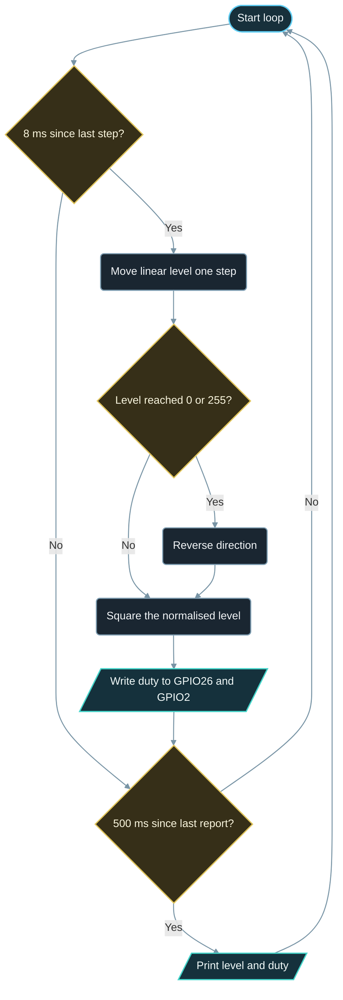

# Implementation Guide - PWM LED Fade

**Developed by Amine Saoud ibn al-Bashir.**

## Algorithm

1. Attach GPIO26 and GPIO2 to LEDC with `ledcAttach` at 5000 Hz and 8-bit resolution; the core gives each pin its own free channel.
2. Write duty 0 to both pins so both LEDs start dark.
3. Every 8 ms, add the direction (+1 or -1) to a linear level that runs from 0 to 255.
4. When the level reaches 255, set the direction to -1; when it reaches 0, set it to +1.
5. Convert the level to a duty: normalise to 0.0-1.0, square, scale back to 0-255, round.
6. Write that duty to both pins with `ledcWrite`.
7. Every 500 ms, print the linear level, the corrected duty, and the direction.

## Flowchart



## Pseudocode

```text
attach external LED pin and onboard LED pin to LEDC: 5000 Hz, 8 bits
write duty 0 to both pins
level = 0, direction = +1
repeat forever:
  every 8 ms:
    level = level + direction
    if level >= 255: level = 255, direction = -1
    if level <= 0:   level = 0,   direction = +1
    duty = round((level / 255)^2 * 255)
    write duty to both pins
  every 500 ms:
    print level, duty, direction
```

## Components List

| Component | Purpose |
|---|---|
| NanoKit Integrated ESP32 | Generates the PWM waveform in hardware and prints to Serial |
| LED + 220 ohm resistor | Visible output; the resistor limits the peak current of each PWM pulse |
| Jumper wires | Connect the LED to the NanoKit header |

## Testing

1. Upload and open the Serial Monitor at 115200 baud; the ready message appears, then one line every 500 ms.
2. Both LEDs ramp from dark to full in about 2 s, then back to dark in about 2 s, with no visible flicker and no visible steps.
3. Compare the two numbers in each line: at level 125 the written duty is only about 61. The LED still looks about half as bright as full, which is the point of the correction.
4. Remove the LED wiring: the onboard LED on NanoKit Pin 17 keeps fading, which proves the firmware does not depend on the external LED.
5. Optional: change `PWM_FREQUENCY_HZ` to 50. The LED now flickers visibly, which shows why the frequency must be well above what the eye can follow.

## Troubleshooting

- LED never lights: check LED polarity (long leg to the resistor side) and that the resistor goes to NanoKit Pin 37 / GPIO26.
- LED is either fully on or fully off: `ledcAttach` was not called for that pin, or it returned false (check the "LEDC setup failed" line in the Serial Monitor).
- Build error `'ledcSetup' was not declared in this scope`: that is the old Arduino-ESP32 2.x API. This example targets core 3.x (`platform = espressif32 @ 8.0.0`), where `ledcSetup` + `ledcAttachPin` became `ledcAttach`.
- The fade is very fast or very slow: `FADE_STEP_MS` sets the speed; 255 steps at 8 ms each give about 2 s per direction.
- The duty in the Serial Monitor never reaches 255: the maximum duty is `(1 << PWM_RESOLUTION_BITS) - 1`; with 8 bits that is 255, with 10 bits it would be 1023.
- Nothing in Serial Monitor: confirm 115200 baud and the correct COM port.

## Learning Notes

A duty cycle is the fraction of each PWM period during which the output is HIGH. At 5 kHz one period lasts 200 us; a duty of 64 out of 255 keeps the pin HIGH for about 50 us and LOW for about 150 us. The LED really blinks at 5 kHz, but the eye averages anything faster than roughly 100 Hz, so it sees a quarter of the brightness instead of a blink.

The LEDC timer counts a fixed clock, and the duty resolution is simply how many counts fit into one period. On the ESP32 the LEDC timers run from the 80 MHz APB clock, so at 5 kHz one period holds 80 000 000 / 5 000 = 16 000 counts: enough for 13 bits, so 8 bits (256 counts) is comfortable. Asking for 16 bits means 65 536 counts per period, which only fits if the frequency drops to about 1.2 kHz. Higher resolution therefore always costs frequency; pick the lowest resolution that gives you smooth steps, then raise the frequency as far as it allows.

A linear duty ramp looks wrong because human brightness perception is roughly logarithmic: a small absolute change near dark is very visible, the same change near full is nearly invisible. Linear duty makes the LED appear to reach full brightness after a third of the ramp and then stay there. Squaring the normalised level compresses the low end, so the perceived brightness climbs at a steady rate. Lighting libraries do the same with a gamma curve (often an exponent of 2.2 to 2.8) or a lookup table.

The resistor is still needed with PWM because dimming reduces the average current, not the peak. During every HIGH slice the LED sees the full 3.3 V, and without the resistor that slice would draw far more than the GPIO can source.

## Exercises

1. Replace the square correction with a 256-entry lookup table that you compute once in `setup()` with `pow(x, 2.2)`.
2. Change the resolution to 10 bits and the frequency to 1 kHz, and adapt `DUTY_MAX` so the fade still works. Confirm that 10 bits at 100 kHz is rejected by looking at the return value of `ledcAttach`.
3. Fade the external LED and the onboard LED in opposite directions by writing `DUTY_MAX - duty` to the onboard LED pin.

## PDF Ready Notes

This Markdown file is structured with headings, tables, and diagrams so it can be exported to PDF by GitHub, VS Code extensions, or Pandoc.
