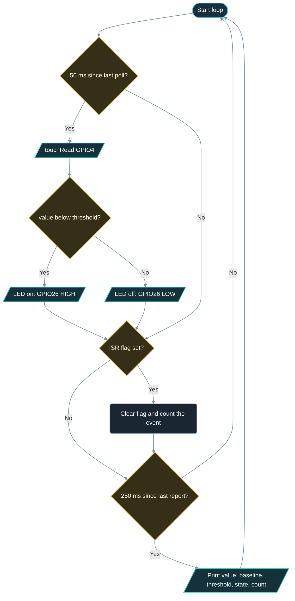

# Implementation Guide - Touch Sensor

**Developed by Amine Saoud ibn al-Bashir.**

## Algorithm

1. Configure GPIO26 as `OUTPUT` and switch the LED off.
2. Read T0 once to configure the touch peripheral, then average 32 readings taken 30 ms apart while the pad is untouched: this is the baseline.
3. Compute the threshold: 70 % of the baseline, or `baseline - 10` if that is lower, so a touch always needs a clear drop.
4. Register `onTouchIsr` with `touchAttachInterrupt()` using the same threshold; the ISR only sets a flag.
5. Every 50 ms, read T0 again; if the value is below the threshold the pad is touched, so drive GPIO26 HIGH, otherwise LOW.
6. Whenever the flag is set, clear it and increment the interrupt counter.
7. Every 250 ms, print value, baseline, threshold, state, and the interrupt counter.

## Flowchart



## Pseudocode

```text
configure LED as output, off
read touch pad once and discard the value
baseline = average of 32 touch readings taken 30 ms apart
threshold = min(baseline * 0.7, baseline - 10)
attach touch interrupt with threshold -> ISR sets flag
repeat forever:
  every 50 ms:
    value = read touch pad
    touched = value < threshold
    write LED = touched
  if flag is set:
    clear flag
    isrEvents = isrEvents + 1
  every 250 ms:
    print value, baseline, threshold, touched, isrEvents
```

## Components List

| Component | Purpose |
|---|---|
| NanoKit Integrated ESP32 | Measures the pad capacitance, drives the LED, prints to Serial |
| Jumper wire (plus optional foil) | The touch pad: its capacitance changes when a finger comes near |
| LED + 220 ohm resistor | Visible touch indicator with a safe current limit |
| Jumper wires | Connect the LED to the NanoKit header |

## Testing

1. Upload and open the Serial Monitor at 115200 baud without touching the wire. The "Baseline:" line shows a steady value and a threshold below it.
2. Watch a few status lines: the value stays within one or two counts of the baseline and the state is "released".
3. Touch the free end of the wire: the LED lights, the value drops well below the threshold, the state reads TOUCHED, and the interrupt counter starts climbing.
4. Release: the LED goes off, the value returns to the baseline, and the counter stops.
5. Reset the board while holding the wire, then release it: the baseline is now too low and the pad never triggers. This shows why the first second must be hands-off.

## Troubleshooting

- The state is TOUCHED all the time: the baseline was measured while the wire was touched, or the wire runs along another conductor. Reset the board with the wire free and in the air.
- The pad never triggers: the drop is too small for the threshold. Add foil to make the pad larger, touch with the whole fingertip, or raise `TOUCH_RATIO` to 0.8.
- Random triggers with nobody near the wire: the threshold is too close to the baseline. Lower `TOUCH_RATIO` to 0.6 or raise `MIN_DROP_COUNTS` to 20, and keep the wire short.
- The interrupt counter never changes while the polled state works: `touchAttachInterrupt()` was called before the threshold was computed, so it received a threshold of 0.
- Nothing in the Serial Monitor: confirm 115200 baud and the correct COM port.

## Learning Notes

A capacitive touch pin does not measure a voltage. The touch block charges the pad to a reference voltage and lets it discharge, over and over, and counts how many of those cycles fit into a fixed measuring window. A finger near the pad adds capacitance, each charge cycle takes longer, fewer cycles fit into the window, and the count falls. That is why on the classic ESP32 a touch makes the `touchRead()` value *drop*.

The untouched count depends on everything connected to the pin: wire length, foil size, breadboard rows, even the humidity of the room. A threshold copied from another project therefore rarely works. Measuring the baseline on the real hardware at every start-up adapts the example to any wire, which is the same technique commercial touch buttons use.

The ESP32 has ten touch channels, T0 to T9. On NanoKit they sit on these pins: T0 on Pin 10 / GPIO4, T2 on Pin 17 / GPIO2 (the onboard LED pin), T3 on Pin 9 / GPIO15, T4 on Pin 8 / GPIO13, T5 on Pin 33 / GPIO12, T6 on Pin 15 / GPIO14, T7 on Pin 19 / GPIO27, T8 on Pin 20 / GPIO33, and T9 on Pin 7 / GPIO32. T1 is GPIO0 on Pin 34, the BOOT strapping pin, which should not be used for a touch pad. GPIO12 and GPIO15 are strapping pins too, so prefer the others when you have the choice.

The touch block runs on its own timer, which is why `touchAttachInterrupt()` can fire without any `touchRead()` in `loop()`. The interrupt is raised after every measurement cycle in which the value is below the threshold, not just once per touch, so the counter in this example climbs while the finger stays. The same hardware can also wake the chip from deep sleep: see the exercises.

## Exercises

1. Turn the climbing interrupt counter into one count per touch by remembering whether the previous poll was already touched.
2. Add a second pad on NanoKit Pin 19 / GPIO27 (T7) and make the two pads switch the LED on and off respectively.
3. Replace the fixed baseline with a slow-moving average that follows temperature and humidity drift while the pad is released.
4. Wake the ESP32 from deep sleep with the pad: call `touchSleepWakeUpEnable(TOUCH_PIN, threshold)` and `esp_sleep_enable_touchpad_wakeup()` before `esp_deep_sleep_start()`, then check `esp_sleep_get_wakeup_cause()` for `ESP_SLEEP_WAKEUP_TOUCHPAD` at the next boot. The deep sleep example in this repository shows the rest of the pattern.

## PDF Ready Notes

This Markdown file is structured with headings, tables, and diagrams so it can be exported to PDF by GitHub, VS Code extensions, or Pandoc.
