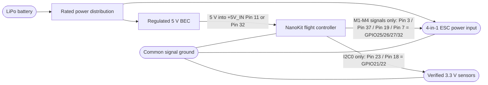

# Wiring - NanoKit Drone 4X

**Developed by Amine Saoud ibn al-Bashir.**

## Signal Map (Confirmed, Proposed, Blocked)

<!-- GENIUS:CONNECTION_TABLE:START -->
| NanoKit Pin | GPIO | VR Address | Component | Component Pin | Direction | Status | Description |
|---:|---|---|---|---|---|---|---|
| 23 | GPIO21 | 0x30 | [flight] I2C bus i2c0 | SDA | Bidirectional | Confirmed | Confirmed I2C0 SDA, module pull-ups |
| 18 | GPIO22 | 0x31 | [flight] I2C bus i2c0 | SCL | Bidirectional | Confirmed | Confirmed I2C0 SCL |
| 39 | GPIO17 | 0x05 | [flight] UART bus uart2 | TX | Output | Proposed | Recommended UART2 TX keeps USB Serial free; not bench-verified |
| 40 | GPIO16 | 0x04 | [flight] UART bus uart2 | RX | Input | Proposed | Recommended UART2 RX; GNSS TX is 3.3 V on most M9N modules, verify |
| 24 | GPIO23 | 0x14 | [flight] SPI bus vspi | MOSI | Output | Proposed | Recommended VSPI MOSI |
| 16 | GPIO19 | 0x15 | [flight] SPI bus vspi | MISO | Input | Proposed | Recommended VSPI MISO |
| 38 | GPIO18 | 0x16 | [flight] SPI bus vspi | SCLK | Output | Proposed | Recommended VSPI clock |
| 3 | GPIO25 | 0x71 | [flight] 4-in-1 ESC (signal inputs) | M1 | Output | Confirmed | M1 front-left CCW, LEDC channel 0 |
| 37 | GPIO26 | 0x8A | [flight] 4-in-1 ESC (signal inputs) | M2 | Output | Confirmed | M2 front-right CW, LEDC channel 1 |
| 19 | GPIO27 | 0x82 | [flight] 4-in-1 ESC (signal inputs) | M3 | Output | Confirmed | M3 rear-right CCW, LEDC channel 2 |
| 7 | GPIO32 | 0x54 | [flight] 4-in-1 ESC (signal inputs) | M4 | Output | Confirmed | M4 rear-left CW, LEDC channel 3 |
| 12 or 31 | GND | 0xD0 | [flight] 4-in-1 ESC (signal inputs) | GND | Power | Confirmed | Common signal ground with the ESC |
| 12 or 31 | GND | 0xD0 | [flight] Regulated 5 V BEC | GND | Power | Proposed | Common ground |
| 11 or 32 | 5V | - | [flight] Regulated 5 V BEC | 5V out | Power | Proposed | Into NanoKit +5V_IN/OUT |
| TODO | TODO | - | PMW3901 optical flow | CS | Output | Blocked | Chip select not assigned yet; Pin 36 / GPIO5 is the recommended VSPI CS |
| TODO | TODO | - | HC-SR04 bench ranger | TRIG | Output | Blocked | Trigger pin not assigned yet |
| TODO | TODO | - | HC-SR04 bench ranger | ECHO | Input | Blocked | Echo pin not assigned; must be an input-only ADC1 pin behind level shifting |
| TODO | TODO | - | Status LED | LED | Output | Blocked | Pin not assigned yet |
| TODO | TODO | - | Buzzer | Signal | Output | Blocked | Pin not assigned yet |
<!-- GENIUS:CONNECTION_TABLE:END -->

Generated from [`../nanokit.yaml`](../nanokit.yaml) and `registry/nanokit-esp32.yaml` by `python tools/genius/generate.py`. `Proposed` rows are the pinout reference's recommended bus pins and are not bench-verified; `TODO` rows are intentionally unassigned.

The exact ICM-20948 module wiring is still TODO. Do not infer its supply, address strap, interrupt, or auxiliary pins from the confirmed I2C bus alone.

## Power Boundary

Motor current never passes through NanoKit. Select the BEC, wire gauge, connectors, capacitor, ESC, battery, motors, and propellers as one measured power system.

## Unassigned Interfaces

ICM-20948, GNSS, PMW3901, HC-SR04, status LED, buzzer, camera, microphone, speaker, microSD, servo, BME280, DPS310, INA226, AT24C256, TCA9548A, and VL53L1CX pins are intentionally absent. They remain TODO until verified.

## Electrical Notes

- Confirm that the exact 4-in-1 ESC accepts 1000-2000 us analogue PWM before changing the firmware gate.
- Level-shift HC-SR04 ECHO when the module outputs 5 V.
- Verify BME280 and DPS310 addresses or isolate them through TCA9548A.
- Put each of six VL53L1CX sensors on its own TCA9548A channel.
- Power servos and high-current payloads from a suitable regulated rail, never from an ESP32 GPIO.
- Keep a common ground between all signal systems.
