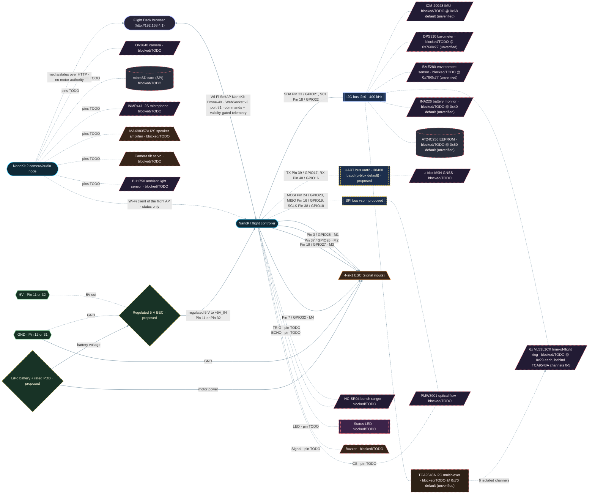

# Connection Diagram - NanoKit Drone 4X

**Developed by Amine Saoud ibn al-Bashir.**

<!-- Generated by NanoKit Genius Generator 1.0.0 from open_source_projects/nanokit_drone_4x_quadcopter/nanokit.yaml and registry/nanokit-esp32.yaml. Edit the manifest, not this file. -->

Solid lines and plain labels are **Confirmed**; dashed yellow nodes are **Proposed**; dashed red nodes are **Blocked/TODO**. Labels read `Pin <NanoKit pin> / GPIO<n>` so the physical NanoKit header pin and the ESP32 GPIO are always shown together. Render to PNG/SVG with `python tools/genius/generate.py --render`.
