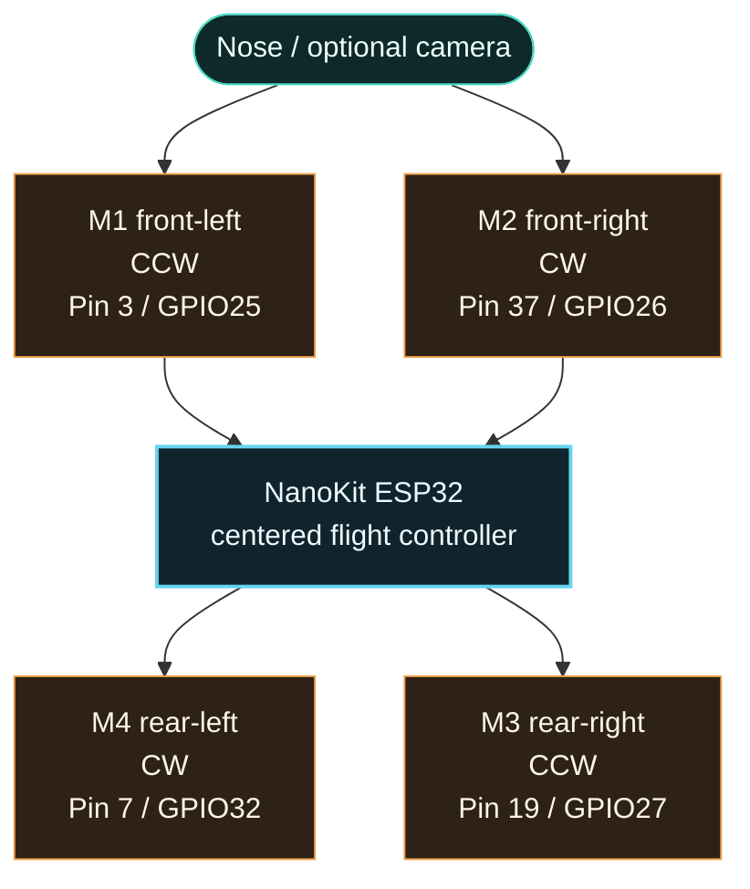

# Motor Layout - NanoKit Drone 4X

**Developed by Amine Saoud ibn al-Bashir.**

View from above. The nose and optional camera point toward the top.

| Motor | Position | Rotation | NanoKit Pin | Signal GPIO | LEDC channel |
|---|---|---|---:|---|---:|
| M1 | Front left | CCW | 3 | GPIO25 | 0 |
| M2 | Front right | CW | 37 | GPIO26 | 1 |
| M3 | Rear right | CCW | 19 | GPIO27 | 2 |
| M4 | Rear left | CW | 7 | GPIO32 | 3 |

The motor pins are confirmed, but the exact ESC analogue PWM protocol is not. Keep propellers removed and the compile-time confirmation gate at `0` until bench verification is documented.
